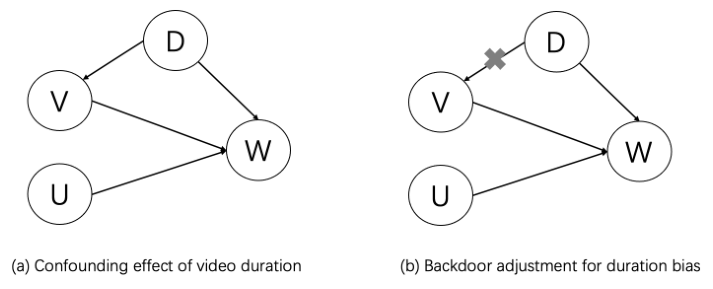
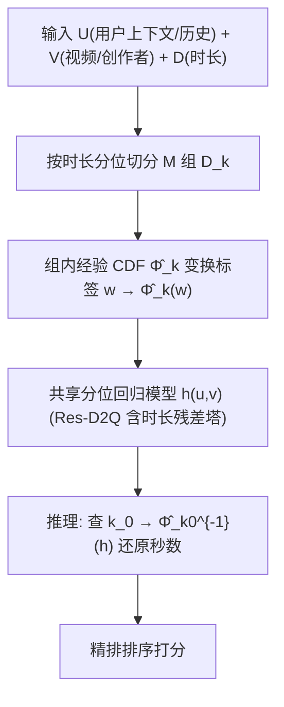
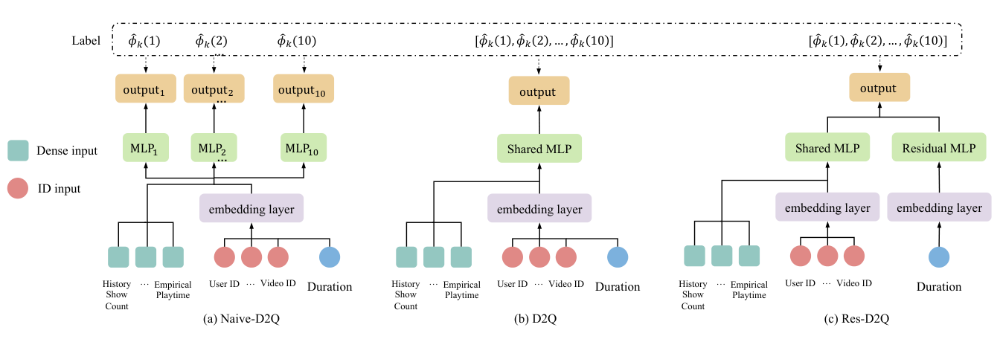

# Deconfounding Duration Bias in Watch-time Prediction for Video Recommendation (视频推荐观看时长预测中的时长偏差去混杂)

- **会议/期刊**: KDD 2022 (Research Track, 10 pages)
- **作者与机构**: Ruohan Zhan (HKUST，工作完成于快手)、Changhua Pei、Qiang Su、Jianfeng Wen、Xueliang Wang、Guanyu Mu、Dong Zheng、Peng Jiang（快手科技）
- **推荐链路定位**: 精排（排序阶段的核心时长预估模型）
- **研究方向**: 去偏公平、可信隐私与工业架构 / CTR 预估与特征交叉
- **论文原文**: [https://arxiv.org/abs/2206.06003v1](https://arxiv.org/abs/2206.06003v1)
- **开源代码**: [https://github.com/MorganSQ/Ks-D2Q](https://github.com/MorganSQ/Ks-D2Q)

## TL;DR (1分钟核心速览)

短视频沉浸式推荐以「观看时长」为主目标，但时长本身既**因果地**影响用户实际观看时长（应保留），又**偏差地**影响视频被曝光的概率（应消除），二者纠缠导致模型放量推荐长视频。本文用因果图把时长建模为混杂因子，依后门调整把训练数据按**时长分位切分为 M 组**，让单一共享模型预测「组内观看时长分位」而非绝对值，实现去偏与参数共享的统一。快手 13.4 亿样本离线实验 XGAUC 由 WLR 的 0.6436 提升至 0.6693（+3.99%），MAE 由 65.65 降至 26.51；线上 A/B（2100 万+用户桶）WatchTime +0.746%。

## Background & Motivation (背景与核心矛盾)

- **主流范式**: 观看时长预估事实标准是 YouTube 的 Weighted Logistic Regression (WLR)：把回归转成二分类，正样本按实际观看时长加权，用学到的 odds 近似期望观看时长。
- **前人局限**: 其一，WLR 的样本权重与观看时长正相关，而观看时长又与视频时长强正相关（快手 200 亿样本显示 60 分位观看时长随时长单调上升），长视频天然获得更大梯度，偏差被反馈回路进一步放大；其二，短视频全屏流中「没有未点击样本」，WLR 的加权口径需要重定义，且不同时长组的样本量天然不均，短时长组欠拟合。
- **核心洞察 (Key Insight)**: 图 2 的强相关是「真效应」与「伪相关」的纠缠——用户对长视频确实看得更久（内在属性），但平台为最大化时长而逐步把曝光倾斜到长视频（图 3 的 11 个月曝光增量随时长递增），后者是被优化的目标反向污染了训练分布。
- **本文切入点**: 把时长当作混杂因子做后门调整，切断 $D\to V$边但保留$D\to W$ 边，并用量化标签把「分组去偏」压缩进**一个**模型以保证工业可扩展。

<figure class="paper-figure" markdown="span">
  <figcaption>图4：观看时长预测的因果图：𝑈–用户，𝑉–视频，𝐷–时长，𝑊–观看时长。图(a)建模视频时长对视频曝光和观看时长预测的混杂效应。图(b)使用后门调整消除时长的混杂，并去除其对视频的影响。</figcaption>
</figure>

## Method (核心方法设计)

### 1. 整体框架 (Overall Architecture)

输入为用户表征 $U$（人口属性、即时上下文、历史交互）、视频表征$V$（主题、创作者、历史统计）与视频时长$D$，输出预测观看时长用于精排打分。核心闭环是：训练前先按时长经验分位把样本切成$M$个等量组$\{\mathcal{D}_k\}$；每组在**组内**计算观看时长的经验累积分布$\hat{\Phi}_k$，并把原始时长标签$w_i$变换为分位标签$\hat{\Phi}_{k_i}(w_i)$；随后一个跨所有组共享的模型$h(u,v)$拟合该分位标签；推理时先查候选视频所属时长组$k_0$，再用$\hat{\Phi}_{k_0}^{-1}(h(u_0,v_0))$ 把分位映射回秒数。

### 2. 关键设计拆解 (Key Designs)

1. **后门调整的期望分解（为什么切分是对的）**: 标准模型直接拟合 $E[W|U,V]$，混入了$D\to V$的曝光偏差。依 do-calculus 切断$D\to V$后，$D\perp\{U,V\}$，故有
$$E[W|do(U,V)]=\sum_{d}P(D=d)\,E[W|U,V,D=d]\approx\sum_{k=1}^{M}\mathbb{I}(d\in\mathcal{D}_k)\,f_k(U,V)$$
   直觉上，加权求和按 $P(D)$ 对不同时长组「等权投票」，长视频组不再因样本权重或样本量优势主导梯度，从而抵消曝光倾斜带来的伪相关，同时保留组内的时长-观看真效应。

2. **分位标签共享（为什么能只训一个模型）**: 若每组独立建模（Naive-D2Q，图 5(a)）则模型体积随 $M$ 线性爆炸；若共享参数却仍拟合原始秒数标签，则等价于不切分、去偏收益归零。本文的破局是让标签变为**时长相关**：
$$\hat{w}_i=\hat{\Phi}_{k_i}(w_i),\qquad h=\arg\min_{h'}\sum_{i}\left(h'(u_i,v_i)-\hat{\Phi}_{k_i}(w_i)\right)^2$$
   因为不同组的同一分位对应不同秒数，标签天然携带组信息，一个模型即可学到「跨组可比的相对位置」。Res-D2Q 进一步在输出层加一条以时长嵌入为输入的残差 MLP（图 5(c)），显式补偿组间尺度差异。

3. **训练目标与推理开销**: 总损失即上式 MSE（无负采样，纯稠密回归），WLR/D2Q 输出经 sigmoid 缩放到 $[0,1]$。推理需额外一次「查组 + 逆 CDF 查表」，为$O(1)$ 分段线性插值，几乎不增加时延，这是能上生产的决定性因素。

<figure class="paper-figure" markdown="span">
  <figcaption>图5：用于估计各时长组观看时长的不同模型架构，即bΦ𝑘(ℎ(𝑢, 𝑣))。图(a)为每个时长组分别拟合模型以估计观看时长。“稠密输入”指视频的历史统计数值（如历史曝光次数、经验观看时长）。“ID输入”指ID特征（如用户ID、视频ID）和类别特征（如视频类别、用户性别）。图(b)在所有时长组上拟合单一模型，标签为观看时长分位数，由对应时长组内的观看时长经验分布计算得到。</figcaption>
</figure>

## Experimental Setup & Evaluation Protocol (实验设置与评估协议)

- **数据集与预处理**: 快手线上生产日志，全屏流场景下每条样本均有曝光与观看时长（无未点击样本），全算法共享同一特征输入。

| 数据集 | #Users | #Items(Photos) | #Interactions | 特征/场景说明 |
| :--- | :---: | :---: | :---: | :--- |
| Kuaishou | 47,298,353 | 15,187,170 | 1,346,539,657 (train 1,211,885,691 / test 134,653,965) | 5,942 个视频类目；用户上下文+ID 特征+历史统计；约 90/10 比例划分 |

- **数据划分与防穿越 (Splitting Strategy)**: `比例划分`（约 90%/10% 训练/测试），原文未显式声明按全局时间戳切分，亦非 Leave-One-Out。
- **排名评测协议 (Ranking Protocol)**: 采用**采样成对排序**而非全库排序——从测试集均匀采样样本对，若预测序与真实观看时长序一致记 1，得到 XAUC；再按用户加权平均得 XGAUC。另有 MAE 衡量绝对值误差。
- **对比基线与超参设置**: 基线为 VR（MSE 直接回归秒数）与 WLR（以 $q_{60}$分位为二分类阈值、正样本按时长加权，适配全屏流改造版）。所有方法共享同一 MLP 骨干，D2Q/Res-D2Q 在$M\in\{1,10,20,30,50,100\}$上扫描，$M=30$ 最优。

## Key Experimental Results (实验关键数据)

### 1. 主实验对比 (Main Results)

| #Groups | Method | XAUC | XGAUC | MAE |
| :--- | :--- | :---: | :---: | :---: |
| 1 | VR | 0.6843 | 0.6380 | 28.2413 |
| 1 | WLR [Covington'16] | 0.6940 | 0.6436 | 65.6535 |
| 1 | D2Q (无切分) | 0.7084 | 0.6562 | 36.4871 |
| 10 | D2Q | 0.7092 | 0.6579 | 26.8684 |
| 10 | Res-D2Q | 0.7108 | 0.6604 | 26.6686 |
| 20 | Res-D2Q | 0.7150 | 0.6679 | 26.5530 |
| **30** | **D2Q** | **0.7148** | 0.6660 | 26.5227 |
| **30** | **Res-D2Q** | 0.7145 | **0.6693** | **26.5073** |
| 50 | Res-D2Q | 0.7141 | 0.6643 | 27.1260 |
| 100 | Res-D2Q | 0.7125 | 0.6637 | 26.7297 |
| — | **Improv. vs WLR (best)** | **+3.02%** | **+3.99%** | **−59.6%** |

**线上 A/B（24 小时，每桶 5% 用户 ≈ 1500 万+，95% CI）**：以 VR 为基准，WLR WatchTime **+0.184%**（显著）；Res-D2Q（$M=30$）WatchTime **+0.746%**（显著），点赞/关注/转发/评论等约束指标均在置信区间内无显著退化。

### 2. 消融实验 (Ablation Study)

| 配置 | XAUC | XGAUC | MAE | 说明 |
| :--- | :---: | :---: | :---: | :--- |
| $M=1$（等价不切分） | 0.7084 | 0.6562 | 36.4871 | 仅有分位标签收益 |
| $M=10$ | 0.7092 | 0.6579 | 26.8684 | 去偏开始生效 |
| $M=30$ | 0.7148 | 0.6660 | 26.5227 | 最佳平衡点 |
| $M=100$ | 0.7119 | 0.6608 | 26.8277 | 组内样本稀疏，估计误差反噬 |
| Res-D2Q $M=30$ | 0.7145 | 0.6693 | 26.5073 | 残差时长塔带来稳定增益 |

### 3. 关键实验发现 (Key Findings)

1. **去偏主导增益，分位只是「可扩展的载体」**：$M=1$时 D2Q 与 WLR/VR 差距有限（XGAUC 0.6562 vs 0.6436），一旦切分到$M=30$，XGAUC 跳到 0.6693，说明收益几乎全部来自切断$D\to V$的分组机制；而 D2Q 的$M=1$ 已用分位标签把 MAE 从 WLR 的 65.65 压到 36.49，证明分位化同时修好了 WLR 的权重失配病。
2. **分组数呈典型「先升后降」倒 U 形**：$M$从 1 增至 30 时 XGAUC 单调上升（0.6562→0.6693），超过 30 后因组内样本量收缩、经验 CDF 偏离真实分布而回落（$M=100$ 降至 0.6608），定量验证了「去偏收益 vs 估计方差」的权衡，并给出可复用的工程取值经验。
3. **排序指标与线上收益一致，且非以互动指标换时长**：离线 XAUC/XGAUC 的最优配置（$M=30$）正是线上最优配置，WatchTime +0.746% 约为生产算法常规提升幅度（≈0.1%）的 7 倍，而点赞/关注/转发/评论变化均落在 CI 内，排除了「靠诱导长视频刷时长」的退化解释。

## Highlights & Limitations (亮点、对比与审稿批判)

- **与代表作对比 (vs. Prior Work)**: 相比 WLR（Covington et al., RecSys'16）只把时长当普通特征并按时长加权，本文显式拆出并剥离了时长的曝光混杂通道；相比流行度去偏的 IPW 类方法（如 inverse propensity 加权），本文不做重要性权重估计、不做倾向建模，而是用**硬切分 + 分位对齐**这一更工程友好的后门调整实现；相比 DCN 等特征交叉网络，本文的增量在因果结构而非网络容量本身。
- **可迁移亮点**: ①「分位数标签 + 组内逆 CDF 还原」是解决多值/异构分组下参数共享的通用技巧，可直接迁移到多场景、多业务线联合建模；②「$M$ 组数即去偏强度旋钮」的倒 U 曲线，为任何分桶去偏方法提供了轻量的超参调优范式。
- **审稿级局限批判**: ① 时长分位切分假设 $P(D)$ 稳定，若平台分发策略突变（如强制扶持短视频）或新时长分布出现，经验 CDF 与组边界需重估，存在分布漂移脆弱性；② 离线评估仅有 VR/WLR 两个基线且为采样成对 XAUC，未与近年因果去偏方法（如 DCN+IPW、流行度去偏）做全库排序对比，外部效度有限；③ 分组去偏只针对时长这一单一混杂因子，用户侧选择偏差（用户只看自己偏好的视频）未被建模。

## Rating (四维评分)

- **方法创新性 (Novelty)**: ⭐⭐⭐⭐ （首次把时长偏差形式化为混杂因子，后门调整 + 分位标签共享的组合在工业约束下颇具巧思，但因果分解本身是标准工具迁移）
- **评估协议与实验扎实度 (Protocol & Experiments)**: ⭐⭐⭐⭐ （13.4 亿样本离线 + 2100 万用户级线上 A/B 且含置信区间与约束指标，说服力强；扣分在基线偏少、仅采样成对排序、未与近期因果去偏方法横评）
- **写作与数学规范度 (Clarity & Rigor)**: ⭐⭐⭐⭐ （因果图→do-calculus 三步推导→算法 1/2 链条清晰，$M$ 组权衡有理论说明与实证呼应；经验 CDF 估计误差缺乏定量界）
- **工业落地与复现价值 (Industrial & Practical Value)**: ⭐⭐⭐⭐⭐ （已全量上线快手，推理仅多一次查表、参数不随 $M$ 增长，代码开源 Ks-D2Q，是少见的「可直接抄作业」的去偏落地范式）

