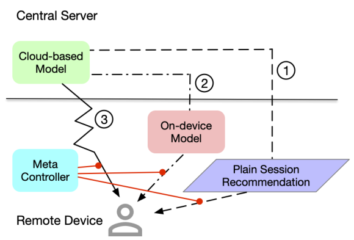
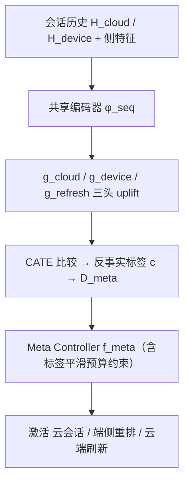
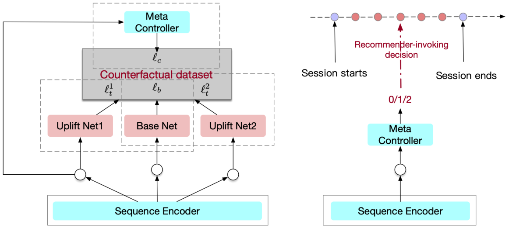

# Device-Cloud Collaborative Recommendation via Meta Controller (基于元控制器的端云协同推荐)

- **会议/期刊**: KDD 2022 (arXiv:2207.03066v1)
- **作者与机构**: Jiangchao Yao, Bo Han, Feng Wang, Jingren Zhou, Hongxia Yang 等（上海交大 CMIC、阿里巴巴达摩院、蚂蚁集团、香港浸会大学）
- **推荐链路定位**: 会话内重排 / 机制调度（端云协同）
- **研究方向**: 去偏公平、可信隐私与工业架构 / 强化学习与动态探索推荐
- **论文原文**: [https://arxiv.org/abs/2207.03066v1](https://arxiv.org/abs/2207.03066v1)
- **开源代码**: 暂未开源

## TL;DR (1分钟核心速览)

工业界现有端云协同（EdgeRec/DCCL）是**串行**的：端侧模型只能在云端下发的有限 item cache 内重排，用户兴趣剧烈变化时既换不出新物品、又等不到云端刷新。本文提出 Meta Controller，在「云会话推荐 $f_{\text{cloud}}$／端侧推荐$f_{\text{device}}$／云端刷新$f_{\text{re-fresh}}$」三种机制间逐会话做三分类调度；为破解控制器缺乏在线样本的困境，用**双 uplift 网络**从因果视角离线构造反事实样本$\mathcal{D}_{\text{meta}}$，并用标签平滑实现刷新调用比例$\epsilon$ 的硬预算约束。在 Movielens/Amazon/Alipay 上，MCRec 相对云端会话推荐在 Alipay 上 AUC 提升 2.03%（72.39→73.86）、HitRate@1 提升 2.30%（17.85→18.26）。

## Background & Motivation (背景与核心矛盾)

- **主流范式**: 云端大模型负责从十亿级物品池召回/排序（会话推荐一次刷新 $K$ 个候选），端侧轻量模型（压缩或 split-deployment）用实时特征在本地 cache 内重排。
- **前人局限**: ①串行机制被端侧存储卡死——cache 内的物品无法回应用户兴趣突变；②云端刷新（session 长度为 1 的极端情形）虽感知反馈更快，但面向亿级用户的计算成本不可扩展。
- **核心洞察 (Key Insight)**: 三种机制的优劣是**按用户兴趣变化幅度分工**的：兴趣稳定→纯会话推荐即可；兴趣小变→端侧重排足够；兴趣剧变→必须走云端大池刷新。因此最优策略不是固定串行，而是**按会话动态选路**。
- **本文切入点**: 把「选哪条链路」建模为一个可学习的元控制器，其训练样本缺失问题用反事实推断（uplift）离线合成。

<figure class="paper-figure" markdown="span">
  <figcaption>图1：①传统会话推荐，其中云端推荐器无法感知会话中的实时用户交互。②以往设计利用端侧模型基于会话内行为对云端模型的推荐结果进行优化。③来自云端模型的实时但昂贵的会话内推荐刷新。我们的工作是构建一个 Meta Controller，动态管理三种推荐机制之间的协作。</figcaption>
</figure>

## Method (核心方法设计)

### 1. 整体框架 (Overall Architecture)

输入为会话内历史点击 $H$（云端仅有$H_{\text{cloud}}$，端侧含实时新增$H_{\text{device}}=H_{\text{cloud}}\cup H_{\text{add}}$）与侧特征。训练分两阶段：**Phase I** 训练三个替身模型（共享序列编码器$\phi_{\text{seq}}$+ 基线输出网 + 两个 uplift 输出网），对每条样本估计三种机制的 CATE，取 argmax 生成反事实标签，得到$\mathcal{D}_{\text{meta}}$；**Phase II** 在$\mathcal{D}_{\text{meta}}$上训练端侧部署的$f_{\text{meta}}$，并用标签平滑把云端刷新调用率压到预算$\epsilon$以下。线上服务时，$f_{\text{meta}}$ 读实时行为，输出 one-hot 决策，仅激活对应机制。

### 2. 关键设计拆解 (Key Designs)

1. **三机制统一决策目标（把串行改成路由）**：云刷新与云会话**共享同一模型** $f_{\text{cloud}}(\cdot)$，只是刷新时喂入$H_{\text{device}}$，故增益来自「特征实时性」而非新模型。控制器目标为

$$\min_{f_{\text{meta}}}\ \mathbb{E}_{(X,Y)\sim P_{\text{meta}}}\Big[\ell\Big(Y,\sum_{t=0}^{2}f_{\text{meta}}(X)_t\, f_t(X)\Big)\Big]$$

   与 MoE 的关键区别是：$f_t$全部**预训练冻结**，只学路由$f_{\text{meta}}$，从而避免端侧再背一个大模型。

2. **双 Uplift 反事实样本构造（解数据集缺失）**：$P_{\text{meta}}$下的样本在冷启时不存在，随机策略上线又高风险。故以云会话为对照组，共享$\phi_{\text{seq}}$训练$g_{\text{cloud}},g_{\text{device}},g_{\text{re-fresh}}$三个替身（T-learner），计算$\tau_{\text{device}}(h)=g_{\text{device}}(h)-g_{\text{cloud}}(h)$、$\tau_{\text{re-fresh}}(h)=g_{\text{re-fresh}}(h)-g_{\text{cloud}}(h)$，再令$c=\text{IND}(\tau_{\text{cloud}},\tau_{\text{device}},\tau_{\text{re-fresh}})$（$\tau_{\text{cloud}}\equiv 0$）。刷新头**不复用**$g_{\text{cloud}}$，因为它与云会话特征同形而调用频率不同、分布 non-IID。

3. **预算约束的标签平滑与训练目标**：刷新受算力硬约束，直接用 $\mathcal{L}=\text{CE}(c,f_{\text{meta}}(h))$会突破预算。故当 batch 内预测为刷新类的比例超$\epsilon$ 时软化标签：

$$\hat{c}=(1-\lambda)c+\lambda c^{-},\quad c=[0,0,1]^{\top}\ \text{且超预算}$$

   $c^{-}$ 为第二大预测类别的 one-hot。物理直觉：把「必须刷新」的监督部分改判给次优机制，模型学到的边际收益排序被拉平，调用率自然回落；未超预算时退化为原始 CE。**无负采样设计**（三分类全监督），推理仅为一次小型前向，端侧开销可忽略。

<figure class="paper-figure" markdown="span">
  <figcaption>图2：dual-uplift 建模方法（左图）比较推荐机制的因果效应，以进行高效的离线样本构建，然后可在生成的反事实数据集上训练 Meta Controller。会话服务时，Meta Controller 决定调用相应的推荐器（右图）。</figcaption>
</figure>

## Experimental Setup & Evaluation Protocol (实验设置与评估协议)

- **数据集与预处理**: 每个数据集构造 5 份训练集（2 份训练云端/端侧基模型，3 份学控制器），测试集一份测 CATE、一份测 CTR：

| 数据集 | #Users | #Items | #Samples | 说明 |
| :--- | :---: | :---: | :---: | :--- |
| Movielens | 6,040 | 3,706 | 4.82M (CATE 三份同量) / CTR 0.79M+27.0M | 无会话信息，**人工模拟 session** |
| Amazon | 49,814 | 36,997 | 2.59M×3 / CTR 17.4M+285.8M | 同上，类目跨域 |
| Alipay | 0.6M(CATE)/10.5M(CTR) | 10K | 1M/0.2M/0.3M + CTR 31M/14M | 真实工业「背景词」推荐，含会话与实时特征 |

- **数据划分与防穿越**: 按会话做**样本级划分**（非 Leave-One-Out），构造阶段与 CTR 阶段使用独立测试集，避免同一会话同时出现在 uplift 拟合与效果评估中。
- **排名评测协议**: 二阶段混合协议——构造阶段用 `AUUC / QINI` 评估 uplift 排序质量（全量样本按预测分数排序，无采样）；推荐阶段用 `HitRate@1 / NDCG@5 / AUC`，AUC 在每用户正负样本集上逐用户计算后平均（用户内全候选，非全局负采样）。
- **对比基线与超参**: 骨干统一为 DIN，对比 CRec（云会话）、ORec（端侧）、CRRec（云刷新）、RMixRec（随机混合三机制）；控制器维度与训练 schedule 见附录，未报显著性检验（工业数据仅给点估计）。

## Key Experimental Results (实验关键数据)

### 1. 主实验对比 (Main Results)

| Methods | Movielens HR@1 | NDCG@5 | AUC | Amazon HR@1 | NDCG@5 | AUC | Alipay HR@1 | NDCG@5 | AUC |
| :--- | :---: | :---: | :---: | :---: | :---: | :---: | :---: | :---: | :---: |
| CRec (云会话) | 32.22 | 50.13 | 92.46 | 16.27 | 27.36 | 77.04 | 17.85 | 34.96 | 72.39 |
| ORec (端侧) | 36.98 | 55.31 | 93.70 | 17.31 | 28.94 | 77.95 | 17.88 | 35.02 | 72.80 |
| CRRec (云刷新) | 37.28 | 55.85 | 93.88 | 17.56 | 29.24 | 78.98 | 18.09 | 35.41 | 73.35 |
| RMixRec (随机混合) | 35.52 | 53.76 | 93.34 | 17.06 | 28.51 | 77.99 | 17.90 | 35.06 | 72.83 |
| **MCRec (w/o 约束)** | **37.84** | **56.20** | **93.90** | **17.70** | **29.48** | **79.05** | **18.26** | **35.77** | **73.86** |
| MCRec ($\epsilon$=0.5) | 37.87 | 56.19 | 93.88 | 17.68 | 29.48 | 79.03 | 18.14 | 35.62 | 73.45 |
| MCRec ($\epsilon$=0.3) | 37.62 | 55.88 | 93.80 | 17.61 | 29.38 | 78.79 | 17.98 | 35.33 | 73.32 |
| MCRec ($\epsilon$=0.1) | 37.16 | 55.45 | 93.67 | 17.50 | 29.21 | 78.38 | 17.91 | 35.17 | 73.03 |
| **Improv. vs CRec** | +17.4% | +12.1% | +1.56% | +8.79% | +7.75% | +2.61% | +2.30% | +2.32% | **+2.03%** |

### 2. 消融实验 (Ablation Study)

| 配置 | Movielens HR@1 | AUC | Amazon HR@1 | AUC | Alipay HR@1 | AUC |
| :--- | :---: | :---: | :---: | :---: | :---: | :---: |
| ①云会话 + ②端侧 | 36.72 | 93.60 | 17.31 | 77.95 | 17.82 | 72.78 |
| ①云会话 + ③云刷新 | 37.27 | 93.88 | 17.56 | 78.98 | 17.95 | 73.21 |
| ②端侧 + ③云刷新 | **37.88** | **93.90** | **17.70** | **79.05** | **17.98** | 73.34 |
| 三机制全用 (MCRec) | 37.84 | 93.90 | 17.70 | 79.05 | **18.26** | **73.86** |
| — AUUC/QINI (vs CRec) | ORec 0.0337/0.0322 | CRRec 0.0338/0.0322 | ORec 0.0025/0.0043 | CRRec 0.0065/0.0111 | ORec 0.024/0.010 | CRRec 0.037/0.033 |

### 3. 关键实验发现 (Key Findings)

1. **机制互补性可被控制器兑现，但随机混合无效**：RMixRec 在 Alipay 上仅 17.90（甚至略胜 ORec 的 17.88 后又逊于 CRRec 的 18.09），说明三机制收益高度**样本相关**；MCRec 相对 CRec 在 Movielens 上 HR@1 提升 5.62 个绝对点（+17.4%），远超任一单机制相对 CRec 的提升。
2. **实时特征是主增益，云会话负责「慢变兴趣」兜底**：两两组合中 ②+③（端侧+刷新）最优（三数据集均为 HR@1 最高），但 Alipay 上三路全开仍比 ②+③ 再高 0.28（17.98→18.26），印证云会话在兴趣平稳段提供不可替代的基线；Amazon 上 CRRec 的 QINI=0.0111 是 ORec（0.0043）的 2.6 倍，说明**大物品池场景刷新收益更显著**。
3. **预算 $\epsilon$的边际收益呈单调递减、且低预算仍优于纯会话**：Alipay 上$\epsilon$从 1.0→0.1，HR@1 由 18.26 降至 17.91（-1.9%），AUC 73.86→73.03，但仍高于 CRec 的 17.85/72.39。图 6 显示标签平滑后实际调用率紧贴约束虚线，$\epsilon\ge0.8$时$\lambda$ 不动（原调用率已达标），验证约束机制可精确调控。

## Highlights & Limitations (亮点、对比与审稿批判)

- **与代表作对比 (vs. Prior Work)**: EdgeRec 用 split-deployment 在**固定候选集**内重排，DCCL 用端侧学习做个性化，二者都是「云端→端侧」单向串行；AdaRequest 同时期提出两模式互补但未解决控制器样本问题。本文首次把三机制做成**可学习路由**，并用 uplift 提供离线监督信号。
- **可迁移亮点**: ①「共享编码器 + 基线头 + 多 uplift 头」的样本构造范式可迁移到任意「多策略择优」场景（召回通道选择、粗排级联深度选择）；②标签平滑做**决策类比例约束**比后置阈值/拉格朗日乘子更易在 batch 级实现。
- **审稿级局限批判**: ①需同时维护 3 个替身模型与 5 份训练集，offline-online 一致性依赖 T-learner 近似 CATE 的准确性，误差会直接污染路由标签；②Movielens/Amazon 的会话为人工模拟，缺乏线上 A/B 与端侧推理延迟/能耗实测，$\epsilon$与$\lambda$ 靠网格搜索，泛化性论证偏弱。

## Rating (四维评分)

- **方法创新性 (Novelty)**: ⭐⭐⭐⭐ （把端云协同从串行重排重构为三机制路由，并用 uplift 反事实样本解冷启，思路清晰但因果建模本身为已有 T-learner 的直接套用）
- **评估协议与实验扎实度 (Protocol & Experiments)**: ⭐⭐⭐ （三数据集含真实工业 Alipay，AUUC/QINI+CTR 双阶段评测完整，但缺显著性检验与线上验证，两个公开集为模拟会话）
- **写作与数学规范度 (Clarity & Rigor)**: ⭐⭐⭐⭐ （$f(\cdot)$与$g(\cdot)$的线上/替身区分讲得干净，公式紧凑；$\lambda$与$\epsilon$ 的自适应关系仅给经验曲线未给算法）
- **工业落地与复现价值 (Industrial & Practical Value)**: ⭐⭐⭐⭐ （端侧仅跑一次小前向、预算可控，落地路径明确；但未开源且复现需三套 DIN 训练数据，工程复现成本高）

