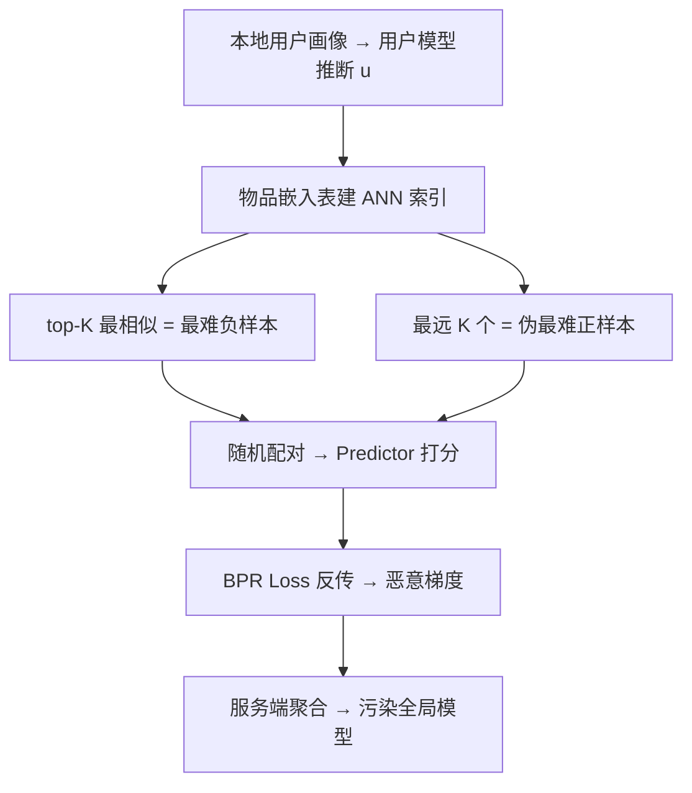
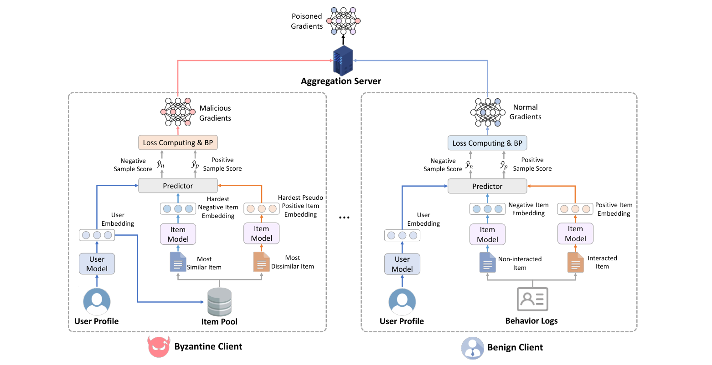
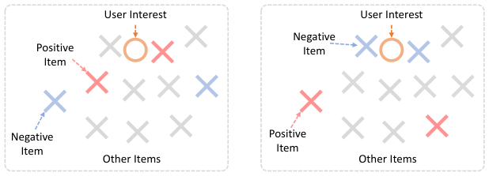

# FedAttack: Effective and Covert Poisoning Attack on Federated Recommendation via Hard Sampling (基于硬采样的联邦推荐高效隐蔽投毒攻击)

- **会议/期刊**: KDD 2022
- **作者与机构**: Chuhan Wu, Tao Qi, Yongfeng Huang (清华大学电子工程系); Fangzhao Wu, Xing Xie (微软亚洲研究院)
- **推荐链路定位**: 端到端联邦训练（客户端本地训练 + 服务端聚合环节）
- **研究方向**: 去偏公平、可信隐私与工业架构 / 协同过滤与双塔召回
- **论文原文**: [https://arxiv.org/abs/2202.04975v1](https://arxiv.org/abs/2202.04975v1)
- **开源代码**: [https://github.com/wuch15/FedAttack](https://github.com/wuch15/FedAttack)

## TL;DR (1分钟核心速览)

联邦推荐中恶意客户端能以极小比例（1%）实施**无目标（untargeted）投毒**使全站推荐变差。此前通用 FL 投毒（高斯噪声、标签翻转、LIE/STAT-OPT 梯度扰动）在隐式反馈噪声与稀疏本地更新双重"掩体"下要么效果微弱，要么被异常检测捕获。本文提出 FedAttack：Byzantine 客户端用当前用户模型推断 $\boldsymbol{u}$，取内积 top-$K$物品作**全局最难负样本**、最远$K$ 个作**伪最难正样本**，仅改样本标签、不改梯度，经 BPR 反传得到同向累积的恶意梯度。ML-1M/Beauty 全库排序下，5% 恶意客户端使 NCF 的 HR@5 相对无攻击下降 19.3%/21.6%，且能绕过 Median/Krum/Norm-bounding 与监督式梯度检测。

## Background & Motivation (背景与核心矛盾)

- **主流范式**: 联邦推荐（FedRec）让客户端本地保存用户嵌入与交互、仅上传模型更新；隐私得以保护，但客户端不可信，服务端无法审计数据。
- **前人局限一**: 推荐投毒研究几乎全为**定向**（提升目标物品曝光，如 PipAttack），无目标降质攻击几乎空白；而通用 FL 投毒方法要求 20% 以上 Byzantine 比例，并假设已知良性更新分布与聚合规则，代价与假设都不现实。
- **前人局限二**: 简单手段在推荐场景天然失效——加噪/标签翻转的扰动是**相互抵消**的随机噪声，模型对隐式反馈噪声本就鲁棒；而扰动全部物品梯度会破坏稀疏性，立刻触发异常检测。
- **核心洞察 (Key Insight)**: 硬样本（hard sample）对收敛的影响是**同向累积**而非抵消；而"全局最难负样本"多为未曝光的假阴性，把它们当成负标签会系统性歪曲用户-物品内积几何。更关键的是：恶意客户端的正样本分布与"兴趣分散/冷启动"良性用户高度重叠，服务端从梯度上**天然无法区分**。
- **本文切入点**: 不做梯度扰动，只做**数据/标签替换**——用最难样本训练，把"硬采样"从提效技术反向用作攻击算子。

## Method (核心方法设计)

### 1. 整体框架 (Overall Architecture)

每轮联邦训练中，良性客户端按正常流程从交互历史构造 BPR 正负样本对；Byzantine 客户端则先用本地画像经用户模型推断 $\boldsymbol{u}$，基于当前物品嵌入表建 ANN 索引，检索与$\boldsymbol{u}$最相似（最难负）与最不相似（最难伪正）的各$K$ 个候选物品，随机配对后前向打分、计算 BPR loss 并反传，得到"看起来正常"的恶意梯度上传。服务端按原聚合规则（攻击者不必知晓其细节）聚合分发，污染随全局模型扩散回良性客户端。攻击只需改本地输入，无需数据投毒注入、无需推理期改动。

<figure class="paper-figure" markdown="span">
  <figcaption>图2：我们的 FedAttack 方法框架。</figcaption>
</figure>

### 2. 关键设计拆解 (Key Designs)

1. **全局最难负样本检索（把假阴性当负标签）**: 良性随机负采样梯度几乎不携带信息，加噪投毒又方向互斥。此处直接取 $\mathcal{N}(\boldsymbol{u})=\mathrm{topK}_{i\in\mathcal{C}}\,\boldsymbol{u}^{\top}\mathbf{e}_i$，$\mathcal{C}$ 为攻击者爬取的大候选池（越接近全库越好）。物理直觉：这些物品与用户兴趣高度相关却未交互（多为未曝光），强行推远等价于在嵌入空间挖去用户真实偏好邻域，且各样本梯度**同向叠加**，1% 客户端也能撬动全局收敛。

2. **伪最难正样本替换（破坏内积几何）**: 仅推远负样本仍留有正确正锚点。作者再取 $\mathcal{P}(\boldsymbol{u})=\mathrm{topK}_{i}\,(-\boldsymbol{u}^{\top}\mathbf{e}_i)$ 作为"正样本"，与负样本随机配对，用标准 BPR 目标

$$\mathcal{L}=-\log\sigma(\hat{y}_p-\hat{y}_n)$$

强迫模型给最不相关物品打高分。直觉：正负两端同时越界，使 Predictor 学到的相似度函数与真实兴趣方向解耦，损害远大于单侧扰动。

<figure class="paper-figure" markdown="span">
  <figcaption>图3：良性客户端与 Byzantine 客户端上负样本和正样本的示意比较。</figcaption>
</figure>

3. **训练目标、隐蔽性与开销**: 恶意客户端复用与良性端完全相同的 BPR 损失与优化器，仅样本不同，因此梯度范数/方差无异常；由于只涉及 $2K$个物品，物品嵌入更新**依旧稀疏**，不触发稀疏性检测。攻击成本为每轮一次 ANN top-$K$ 检索；推理阶段零额外开销。防御侧代价则相反——见实验。

## Experimental Setup & Evaluation Protocol (实验设置与评估协议)

- **数据集与预处理**: 两个公开基准，无 5-core 过滤（保留原始长尾）：

| 数据集 | #Users | #Items | #Interactions | 平均序列长 / 密度 | 场景 |
| :--- | :---: | :---: | :---: | :---: | :--- |
| MovieLens-1M | 6,040 | 3,416 | 1.0M | 163.5 / 4.79% | 电影评分 |
| Amazon Beauty | 40,226 | 54,542 | 0.35M | 8.8 / 0.02% | 电商评论（极稀疏） |

- **数据划分与防穿越**: `Leave-One-Out` —— 每用户最后 1 次交互作测试、倒数第 2 次作验证，其余构造训练样本。
- **排名评测协议**: 明确采用无偏 `Full-Ranking`（对全物品集排序，而非流行度采样），指标为 HR@5 与 nDCG@5，**仅在良性客户端上计算**；良性客户端负样本从全库随机抽取。
- **对比基线与超参**: 攻击基线 5 个——LabelFlip、Gaussian、LIE、STAT-OPT、DYN-OPT（后三者为梯度投毒）；受害模型 NCF（协同过滤）与 BERT4Rec（序列）；$d=64$，Adam，lr=$10^{-3}$，每批 16 客户端，50 epoch，Byzantine 比例$M\in\{1\%,2\%,5\%\}$，5 次重复取均值，$t$-检验$p<0.01$。

## Key Experimental Results (实验关键数据)

### 1. 主实验对比 (Main Results)

HR@5（**越低越好**，越低说明攻击越成功；加粗为最优攻击）：

| 攻击方法 | ML-1M·NCF 1% | ML-1M·NCF 5% | Beauty·NCF 1% | Beauty·NCF 5% | ML-1M·BERT4Rec 5% | Beauty·BERT4Rec 5% |
| :--- | :---: | :---: | :---: | :---: | :---: | :---: |
| No Attack | 0.0135 | 0.0135 | 0.0125 | 0.0125 | 0.0550 | 0.0159 |
| LabelFlip | 0.0137 | 0.0130 | 0.0127 | 0.0119 | 0.0533 | 0.0149 |
| Gaussian | 0.0138 | 0.0129 | 0.0125 | 0.0118 | 0.0532 | 0.0144 |
| LIE | 0.0133 | 0.0123 | 0.0120 | 0.0114 | 0.0513 | 0.0140 |
| STAT-OPT | 0.0132 | 0.0120 | 0.0122 | 0.0113 | 0.0510 | 0.0141 |
| DYN-OPT | 0.0131 | 0.0122 | 0.0118 | 0.0110 | 0.0501 | 0.0139 |
| **FedAttack** | **0.0124** | **0.0109** | **0.0112** | **0.0098** | **0.0459** | **0.0122** |
| Improv.（vs 最优基线） | −5.3% | −9.2% | −5.1% | −10.9% | −8.4% | −12.2% |
| 相对无攻击降幅 | −8.1% | −19.3% | −10.4% | −21.6% | −16.5% | −23.3% |

nDCG@5 呈同向趋势（如 ML-1M·NCF 5%：0.0091 → 0.0079；Beauty·NCF 5%：0.0072 → 0.0058）。

### 2. 消融与敏感性分析 (Ablation & Sensitivity)

原文未做逐组件（w/o 最难负 / w/o 伪正）消融，代之以攻击预算、候选池、防御三类敏感性实验：

| 配置维度 | 设置 | 攻击效果（ML-1M·NCF, HR@5） | 观察 |
| :--- | :--- | :--- | :--- |
| Byzantine 比例 | 1% / 2% / 5% | 0.0124 / 0.0116 / 0.0109 | 单调增强，1% 已显著有效 |
| 候选池规模 | 20% / 60% / 100% | 明显衰减 / 接近饱和 / 0.0109 | 池过小则"最难"不具代表性 |
| 鲁棒聚合 | Median / Trimmed-mean / Krum / Multi-Krum / Norm-bound | FedAttack 均未被防住 | Norm-bound 可完全防住全部基线 |
| 监督式梯度检测 | MLP 二分类过滤恶意梯度 | FedAttack 仍最优、最难被检出 | STAT-OPT 最易检出，LabelFlip/Gaussian 反而隐蔽 |

### 3. 关键实验发现 (Key Findings)

1. **攻击预算极小化是核心收益**：1% Byzantine 下 FedAttack 已带来 8.1% 相对降幅，而最强基线 DYN-OPT 仅 3.0%；在 ML-1M·NCF 上 5% 时两者差距扩大到 19.3% vs 9.6%，验证"最难样本梯度同向累积、随机噪声相互抵消"的机理。
2. **污染具备跨客户端传播性**：序列模型 BERT4Rec 在 Beauty 上 HR@5 由 0.0159 跌至 0.0122（−23.3%），降幅甚至大于 NCF，说明物品嵌入被系统性歪曲后，通过全局聚合可污染完全未参与攻击的良性客户端。
3. **隐蔽性来自分布重叠而非噪声幅度**：图 7 显示 Byzantine 客户端的正样本-用户相似度随交互数增加而下降，其分布与"兴趣分散/低活跃"良性用户大幅重叠；图 8 的 PCA 可视化中恶意与良性梯度完全混杂，且良性客户端本身产生更多离群梯度——这解释了为何 Median/Krum 类防御会误杀良性更新、精度损失甚至超过被攻击损失。

## Highlights & Limitations (亮点、对比与审稿批判)

- **与代表作对比 (vs. Prior Work)**: 与 PipAttack（定向提升目标物品、需距离约束正则）不同，本文攻击的是**整体性能**且无需任何约束项；与 LIE/STAT-OPT/DYN-OPT 等梯度投毒相比，本文不动梯度、只动样本，故不改变梯度范数/方差统计量，天然规避基于范数与聚类的检测；与 LabelFlip 相比，翻转标签是随机方向，而硬采样是**定向且语义一致**的污染。
- **可迁移亮点**: (1) 把"最难负采样"从训练提效工具反转为鲁棒性压力测试算子，可用于联邦/去中心化推荐的对抗评测基准；(2) "攻击者只改输入、复用官方损失与优化器"这一隐蔽性设计范式，可迁移到任何客户端不可信的分布式训练场景审计。
- **审稿级局限批判**: (1) 防御与检测实验仅在 MovieLens-1M 上报告（Beauty 被省略），且检测器用**同分布恶意梯度**训练，现实中攻击者策略变化后检测准确率未知，结论稳健性打折；(2) 缺少模块级消融（单独移除最难负样本或伪正样本的贡献未量化），也未讨论攻击对长尾/冷启动用户与头部用户的不均衡伤害，且需假设攻击者可爬取接近全库的候选池与访问本地嵌入，工程门槛被低估。

## Rating (四维评分)

- **方法创新性 (Novelty)**: ⭐⭐⭐⭐ （将硬负采样反用为投毒算子，视角新颖、机理清晰，但技术组件本身均为已有积木的组合）
- **评估协议与实验扎实度 (Protocol & Experiments)**: ⭐⭐⭐ （Full-Ranking 无偏评测与 5 个强基线、$p<0.01$ 显著性到位，但防御/检测实验仅单数据集、缺组件级消融）
- **写作与数学规范度 (Clarity & Rigor)**: ⭐⭐⭐⭐ （问题定义、攻击者假设与能力边界交代清楚，公式极简；代价是对隐蔽性的理论刻画仅靠经验可视化）
- **工业落地与复现价值 (Industrial & Practical Value)**: ⭐⭐⭐⭐ （开源代码齐全、攻击仅需一次 ANN 检索且推理零开销，对联邦推荐安全审计与鲁棒聚合选型有直接参考价值）

