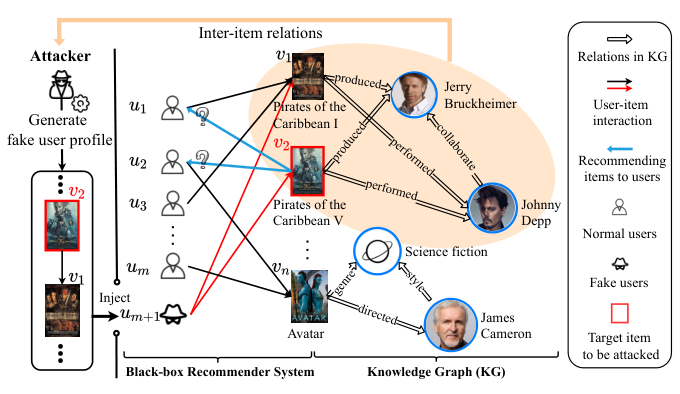
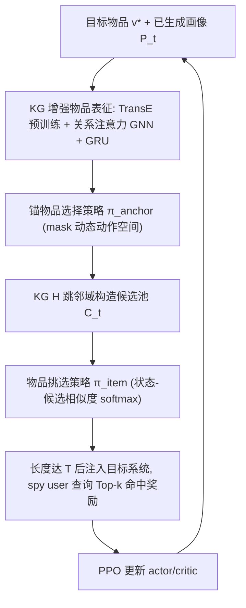
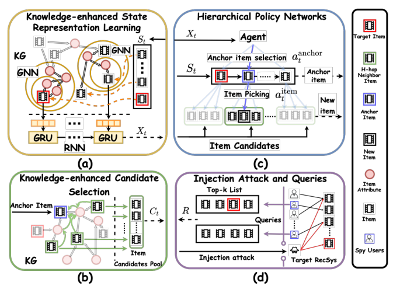

# Knowledge-enhanced Black-box Attacks for Recommendations (知识图谱增强的推荐系统黑盒攻击)

- **会议/期刊**: KDD 2022 (28th ACM SIGKDD)
- **作者与机构**: Jingfan Chen, Guanghui Zhu, Chunfeng Yuan, Yihua Huang (南京大学计算机软件新技术国家重点实验室)；Wenqi Fan, Qing Li (香港理工大学)；Xiangyu Zhao (香港城市大学)
- **推荐链路定位**: 数据侧投毒/注入攻击（作用于训练数据与召回排序全链路），非模型侧推理优化
- **研究方向**: 去偏公平、可信隐私与工业架构（推荐系统对抗安全） / 强化学习与动态探索推荐
- **论文原文**: [https://arxiv.org/abs/2207.10307v1](https://arxiv.org/abs/2207.10307v1)
- **开源代码**: 暂未开源

## TL;DR (1分钟核心速览)

推荐系统黑盒攻击的难点在于：攻击者只能通过查询反馈获得稀疏奖励，而物品空间（动作空间）巨大且无法访问目标模型参数与训练数据。本文提出 KGAttack，利用**公开可得的物品知识图谱**做两件事：一是用 TransE + 关系注意力 GNN 初始化并聚合物品表征，让虚假画像的"语义相关性"显式进入状态表示；二是用 KG 的 $H$跳邻域把动作空间从全库裁剪为候选池，并用「锚物品选择 + 物品挑选」的分层策略网络缓解大离散动作空间下的探索难题，最终用 PPO 以 spy user 的 Top-$k$ 命中率为奖励训练。在 Pinsage/NeuMF/KGCN 三类目标模型、ML-1M/Book-Crossing/Last.FM 上，ML-1M 的 HR@20 由 PoisonRec 的 0.610 提升到 0.672（+10.2%），NDCG@20 由 0.163 提升到 0.183（+12.3%）。

## Background & Motivation (背景与核心矛盾)

- **主流范式**: 攻击者构造虚假用户画像（一组交互物品）注入目标系统，实现对目标物品的 promote/demote；按可获知信息分为白盒、灰盒与黑盒攻击。
- **前人局限**: ① 白盒/灰盒方法（基于梯度优化、GAN 生成）依赖目标模型参数与训练集，现实中因隐私安全不可得；② 黑盒方法中，PoisonRec 纯靠查询从海量物品中试错，样本效率极低、画像质量差；CopyAttack 依赖跨域真实画像复制，通用推荐场景缺乏跨域知识而失效。
- **核心洞察 (Key Insight)**: 物品属性（导演、演员、流派等）构成的知识图谱是**公开可得**的富信息源，KG 中物品间的连通性恰好刻画了替代品/互补品这类底层关联。攻击目标物品在 KG 上的邻居，天然是"最能带出目标物品"的高价值交互项。
- **本文切入点**: 把 KG 同时注入强化学习的**状态表征**与**动作空间**，用分层策略把一次大动作分解为两步小动作，从而在黑盒低资源下生成高质量画像。

<figure class="paper-figure" markdown="span">
  <figcaption>图1：推荐系统中知识图谱增强的黑盒攻击示意图。攻击者的目标是通过基于知识图谱中的潜在关系（例如替代品和互补品）注入虚假用户画像（即用户 𝑢𝑚+1 = {..., 𝑣2, 𝑣1, ...}），来提升目标物品 𝑣2。</figcaption>
</figure>

## Method (核心方法设计)

### 1. 整体框架 (Overall Architecture)

攻击建模为 MDP：状态 $s_t$为长度$t$的虚假画像，动作$a_t=(a^{\text{anchor}}_t,a^{\text{item}}_t)$先选锚物品再选新物品，轨迹长度达到$T$后一次性注入目标系统，通过 spy user 的 Top-$k$命中情况获得奖励并回传 PPO。四模块闭环：(a) KG 增强状态表征；(b) KG 约束候选池构造；(c) 分层策略网络（锚选择策略$\pi^{\text{anchor}}_\theta$+ 物品挑选策略$\pi^{\text{item}}_\phi$）；(d) 注入攻击与查询奖励。训练采用 A2C/PPO 架构，actor 更新用 clip 代理目标，critic 用 TD 误差估计优势值以缓解稀疏奖励。

<figure class="paper-figure" markdown="span">
  <figcaption>图3：(a) 知识增强的状态表示学习、(b) 知识增强的候选选择、(c) 分层策略网络和 (d) 注入攻击与查询的详细示意图。</figcaption>
</figure>

### 2. 关键设计拆解 (Key Designs)

1. **KG 增强状态表征（把语义相关性写进状态）**：痛点在于画像中的物品若只学 ID 嵌入，则"哪些物品能共同带出目标物品"这一信号完全缺失。做法是先用 TransE 的 margin 损失预训练实体/关系嵌入：$\mathcal{L}_{\text{pre-train}}=\sum_{(p,r,q)\in\mathcal{B}^+}\sum_{(p',r,q')\in\mathcal{B}^-}[d(\mathbf{p}+\mathbf{r},\mathbf{q})+\xi-d(\mathbf{p}'+\mathbf{r},\mathbf{q}')]_+$，再用关系注意力 GNN 聚合邻居$\mathbf{e}^l_i=\mathbf{W}^l_1\mathbf{e}^{l-1}_i+\mathbf{W}^l_2\sum_{v_j\in\mathcal{N}(v_i)}\alpha^l_{i,j}\mathbf{e}^{l-1}_j$，其中$\alpha^l_{i,j}=\text{softmax}\big((\mathbf{W}_{\text{in}}\mathbf{e}^{l-1}_i)^\top(\mathbf{W}_{\text{out}}\mathbf{e}^{l-1}_j)/\sqrt{d}\big)$，最后由 GRU 编码序列得到$s_t$。直觉：KG 上的多跳聚合让"同导演/同系列/同流派"的物品在表征空间靠近，使策略网络在语义空间中做决策而非在孤立 ID 上盲试。
2. **KG 约束的分层策略（把 $|\mathcal{V}|$级动作降为两步）**：全库动作空间导致探索困难与样本低效。第一层从当前画像中采样锚物品（用$T$长度 mask 向量$\mathbf{m}_t$屏蔽无效位置）：$\pi^{\text{anchor}}_\theta=\text{Softmax}(\mathbf{W}_{A,2}\text{ReLU}(\mathbf{W}_{A,1}\mathbf{x}_t)+\mathbf{m}_t)$；第二层在锚物品的$H$跳 KG 邻域$\mathcal{C}_t=\{v\mid v\in\bigcup_{h=1}^{H}\mathcal{E}^h_t, v\in\mathcal{V}\}$内按状态-候选相似度挑选：$\pi^{\text{item}}_\phi=\frac{\exp(\mathbf{W}_{I,2}[\hat{\mathbf{x}}_t;\mathbf{e}_t])}{\sum_{v_j\in\mathcal{C}_t}\exp(\mathbf{W}_{I,2}[\hat{\mathbf{x}}_t;\mathbf{e}_j])}$。同时引入锚比例$\epsilon$：以$\epsilon$概率由策略网络选锚（探索），以$1-\epsilon$ 概率强制用目标物品作锚（利用），构成显式 E&E 权衡。
3. **奖励设计与训练/推理开销**：仅在轨迹末端给稀疏奖励 $r_{T-1}=\frac{1}{|\hat{U}|}\sum_{i=1}^{|\hat{U}|}\text{HR}(\hat{u}_i,v^*,k)$，其余步为 0；actor 用 PPO 裁剪目标$\min\big(\rho_t A_\omega(s_t),\text{clip}(\rho_t,1-\psi,1+\psi)A_\omega(s_t)\big)$，$\rho_t=\pi_\theta/\pi_{\theta_{\text{old}}}$，critic 最小化$\sum_t(\sum_{j}\gamma^j r_{t+j}-V_\omega(s_t))^2$。**免负采样**（RL 无 BPR 式负例），每轮批量生成$N$条画像共享同一奖励，代价主要是$N$ 次注入+查询的线上开销，属于"高查询成本、低梯度成本"型攻击。

## Experimental Setup & Evaluation Protocol (实验设置与评估协议)

- **数据集与预处理**（KG 由 Microsoft Satori 抽取，沿用 KGCN 公开版本）：

| 数据集 | #Users | #Items | #Interactions | 稀疏度/密度 | 特征/场景说明 |
| :--- | :---: | :---: | :---: | :---: | :--- |
| MovieLens-1M | 6,040 | 3,706 | 1,000,209 | 4.47% | 电影推荐，KG 实体极多、关联最丰富 |
| Book-Crossing | 2,788 | 27,179 | 104,282 | 0.14% | 图书推荐，极稀疏 |
| Last.FM | 1,872 | 3,846 | 42,346 | 0.59% | 音乐收听，KG 连通性较弱 |

- **数据划分与防穿越 (Splitting Strategy)**: 沿用各数据集标准划分（训练/测试交互分离，测试期目标模型参数冻结或重训，见下），攻击注入仅发生在训练/测试阶段的数据层。
- **排名评测协议 (Ranking Protocol)**: 采用 **Full-Ranking（对 spy user $\hat{U}$在目标系统全库打分排序取 Top-$k$）**，指标为 HR@{10,20} 与 NDCG@{10,20}；无采样负例。
- **攻击场景与基线**: **Evasion（测试期，Pinsage 冻结参数）** 与 **Poison（训练期重训，NeuMF 与 KGCN）** 两类；基线 7 个：RandomAttack、TargetAttack、TargetAttack-KG、PoisonRec、PoisonRec-KG，以及自身变体 KGAttack-Target / KGAttack-Seq。超参：候选池跳数 $H\in\{1,2,3,4\}$、锚比例$\epsilon\in\{0.1,\dots,0.9\}$、画像长度$T$、预算$\Delta$。

## Key Experimental Results (实验关键数据)

### 1. 主实验对比 (Main Results)

Pinsage 目标系统（Evasion，全库排序）：

| 方法 | ML-1M H@20 | ML-1M N@20 | Book-Crossing H@20 | Book-Crossing N@20 | Last.FM H@20 | Last.FM N@20 |
| :--- | :---: | :---: | :---: | :---: | :---: | :---: |
| Without Attack | 0.000 | 0.000 | 0.191 | 0.065 | 0.193 | 0.073 |
| RandomAttack | 0.000 | 0.000 | 0.202 | 0.069 | 0.152 | 0.054 |
| TargetAttack | 0.464 | 0.118 | 0.706 | 0.226 | 0.242 | 0.064 |
| TargetAttack-KG | 0.398 | 0.099 | 0.862 | 0.342 | 0.282 | 0.085 |
| PoisonRec | 0.610 | 0.162 | 0.930 | 0.428 | 0.442 | 0.125 |
| PoisonRec-KG | 0.628 | 0.163 | 0.930 | 0.427 | 0.438 | 0.123 |
| KGAttack-Target | 0.554 | 0.144 | 0.940 | 0.437 | 0.442 | 0.125 |
| KGAttack-Seq | 0.504 | 0.132 | 0.932 | 0.425 | 0.436 | 0.123 |
| **KGAttack** | **0.672** | **0.183** | 0.934 | **0.459** | **0.452** | **0.130** |
| Improv. vs best baseline | **+10.2%** | **+12.3%** | +0.4% | **+7.2%** | +2.3% | +4.0% |

### 2. 消融实验 (Ablation Study)

Pinsage 上的组件移除（H@20 / N@20）：

| 变体 | ML-1M | Book-Crossing | Last.FM |
| :--- | :---: | :---: | :---: |
| KGAttack (-KGE，去掉 TransE 预训练) | 0.598 / 0.163 | 0.928 / 0.442 | 0.422 / 0.119 |
| KGAttack (-GNN，仅 GRU 序列编码) | 0.630 / 0.161 | 0.926 / 0.442 | 0.446 / 0.124 |
| KGAttack (-Relevant，动作空间恢复全库) | 0.628 / 0.163 | 0.930 / 0.427 | 0.438 / 0.123 |
| KGAttack (-HPN，去掉锚选择分层) | 0.532 / 0.140 | 0.926 / 0.421 | 0.430 / 0.121 |
| **KGAttack (full)** | **0.672 / 0.183** | **0.934 / 0.459** | **0.460 / 0.130** |

### 3. 关键实验发现 (Key Findings)

1. **分层策略是最大贡献项，KG 表征是第二大项**：ML-1M 上去掉分层策略（-HPN）H@20 从 0.672 掉到 0.532（−20.8%），跌幅甚至大于去掉 GNN 与 KGE 的总和，说明"先选锚、再在 $H$ 跳池内挑选"这一动作分解对缓解大离散空间探索困境的作用超过表征增益本身。
2. **KG 的价值强依赖 KG 密度，存在噪声反噬**：ML-1M 上 TargetAttack-KG (0.398) 反而**低于** TargetAttack (0.464)，因其实体过多引入噪声；同数据集 $H=2$最优（0.672），而 Book-Crossing/Last.FM 需$H=3$（0.940/0.460），即 KG 越稠密、跳数越要收紧。
3. **E&E 权衡与预算单调性**：锚比例 $\epsilon=0.9$时 ML-1M 达 0.660、Last.FM 在$\epsilon=0.7$达 0.460，说明过度强制目标物品作锚（$\epsilon\to0$，即 KGAttack-Target 的贪心策略）会削弱探索；预算$\Delta>30$ 后 KGAttack 在 Last.FM 的 NDCG@20 稳定领先，且对 KGCN/NeuMF 两类目标模型同样有效，验证了跨模型可迁移性。

## Highlights & Limitations (亮点、对比与审稿批判)

- **与代表作对比 (vs. Prior Work)**: 相比 PoisonRec 仅用纯查询在原始物品空间试错，本文把公开 KG 同时用于状态与动作空间，等价于给 RL 注入先验，样本效率显著提升（ML-1M HR@20 +10.2%）；相比 CopyAttack 依赖跨域真实画像复制，本文不要求任何跨域数据，适用面更广；相比 TargetAttack-KG 这类"随机在 KG 邻域采样"的启发式，本文用可学习的分层策略自适应选锚，避免了 ML-1M 上的性能倒挂。
- **可迁移亮点**: ① "KG $H$跳邻域裁剪动作空间 + 分层策略"可作为任何大候选空间序贯决策任务的通用降复杂度范式（如会话推荐的动作裁剪、对话推荐的候选收敛）；② 用 spy user 的 Top-$k$ 命中率作为黑盒反馈信号，是把不可微排序指标转为可训练奖励的轻量技巧。
- **审稿级局限批判**: ① 奖励极度稀疏（仅轨迹末端 0/1 级 HR），且需要多次真实注入+查询，工业环境中的查询频次与账号存活成本未做量化分析，实际可行性存疑；② 只做 promotion 攻击、未给出 demotion 与防御侧（检测/鲁棒训练）评估，且 ML-1M 上 KG 变体反而劣于无 KG 版本这一反常现象缺乏更细的噪声归因实验；③ 与 Table 1 相比 Table 2 中 Last.FM 的 KGAttack H@20（0.452 vs 0.460）数值不一致，复现细节（$T$、$N$、$\Delta$ 默认值）散落附录，可复现性打折。

## Rating (四维评分)

- **方法创新性 (Novelty)**: ⭐⭐⭐⭐ （首次把公开 KG 同时注入黑盒攻击的状态表征与动作空间，分层锚-物品策略是对大离散动作空间问题的有效拆解）
- **评估协议与实验扎实度 (Protocol & Experiments)**: ⭐⭐⭐⭐ （三类目标模型 × 三数据集 × Evasion/Poison 双场景 + 全库排序 + 7 基线 + 完整消融与超参分析，唯缺防御侧评估与统计显著性检验）
- **写作与数学规范度 (Clarity & Rigor)**: ⭐⭐⭐⭐ （MDP 五元组、分层策略与 PPO 目标定义清晰，但 Table 1/2 数值不一致、关键超参与数据集统计下放附录）
- **工业落地与复现价值 (Industrial & Practical Value)**: ⭐⭐⭐ （思路对推荐系统安全评测与鲁棒性加固有直接警示价值，但未开源、依赖大量线上注入查询，攻击侧落地成本高）

