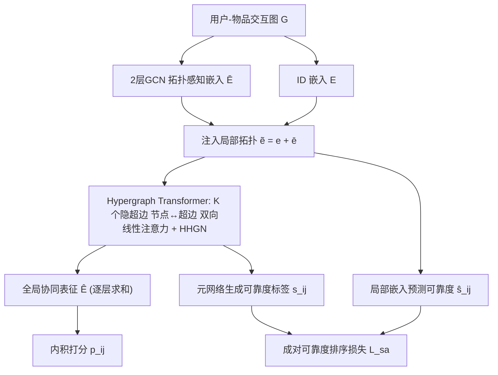
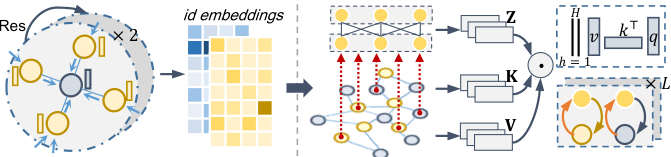
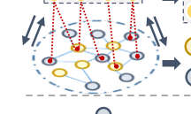

# Self-Supervised Hypergraph Transformer for Recommender Systems (面向推荐系统的自监督超图 Transformer)

- **会议/期刊**: KDD 2022 (Research Track, Full Paper)
- **作者与机构**: Lianghao Xia, Chao Huang (通讯), Chuxu Zhang — 香港大学 / Brandeis University
- **推荐链路定位**: 召回 (User-Item 表征学习与 Top-N 排序)
- **研究方向**: 图神经网络与知识图谱推荐 / 自监督对比学习与交互去噪
- **论文原文**: [https://arxiv.org/abs/2207.14338v1](https://arxiv.org/abs/2207.14338v1)
- **开源代码**: [https://github.com/akaxlh/SHT](https://github.com/akaxlh/SHT)

## TL;DR (1分钟核心速览)

针对 GNN 协同过滤中**交互噪声沿多跳传播被放大**与**稀疏/长尾节点表征偏置**两大痛点，SHT 放弃"手工构造超边"，改用 K 个**可学习隐超边**做节点↔超边双向线性注意力，把超图结构学习本身参数化；再用元网络从全局超边嵌入生成边"可靠度"标签，以成对排序损失蒸馏回局部拓扑嵌入（跨视角自增广）。在 Yelp/Gowalla/Tmall 三数据集、7:2:1 划分、**全库 Full-Ranking** 协议下，Recall@20 较最优基线 SGL 分别提升 23.8% / 19.6% / 44.4%。

## Background & Motivation (背景与核心矛盾)

- **主流范式**: LightGCN/GCCF 类图卷积在 user-item 二部图上递归聚合邻居，用多跳传播刻画协同信号；SGL、MHCN 等再叠加随机边/节点 Dropout 的对比学习做增广。
- **前人局限**: ① 交互图天然含"误点击"噪声，多跳传播会**放大**而非抑制噪声；② 随机 mask/dropout 增广是无差别扰动，既可能保留噪声边，又可能丢掉关键监督信号，且构造的视图与真实兴趣结构无关。
- **核心洞察 (Key Insight)**: 全局"高阶协同簇"比局部边更抗噪——若把同一用户在多个语义超边上的归属度学出来，则噪声边在全局视角下天然获得低归属分；该分数可作为**软标签**去重标定局部嵌入。
- **本文切入点**: 用隐超边 + Transformer 注意力同时完成"全局关系学习"与"边可靠度标注"，端到端联合训练，无需预构造高阶关系矩阵。

## Method (核心方法设计)

### 1. 整体框架 (Overall Architecture)

输入为二部图 $\mathcal{G}$与 ID 嵌入$\mathbf{E}$；先用两层轻量 GCN 得到拓扑感知嵌入$\bar{\mathbf{E}}$，与 ID 嵌入逐元素相加得$\tilde{\mathbf{e}}_i=\mathbf{e}_i+\bar{\mathbf{e}}_i$，使 Transformer 保有图局部位置信息。随后 K 个**可学习隐超边**作为全局枢纽，与用户/物品做双向线性注意力传播，并经 HHGN 挖掘超边间非线性关系；多层堆叠后逐层求和得最终嵌入$\hat{\mathbf{E}}$，内积打分。训练侧，超图分支输出的超边上下文经元网络生成边可靠度标签$s_{ij}$，监督局部拓扑嵌入的成对排序预测$\hat{s}_{ij}$，形成"全局→局部"知识蒸馏闭环。

<figure class="paper-figure" markdown="span">
  <figcaption>图 1：所提出 SHT 模型的整体框架。</figcaption>
</figure>

### 2. 关键设计拆解 (Key Designs)

1. **拓扑感知嵌入 + 线性注意力超边传播**：纯 ID 嵌入让 Transformer 丢失图局部性，纯 GCN 又只能看局部邻域。SHT 先把 $\bar{\mathbf{E}}^{(u)}=\bar{\mathbf{A}}\bar{\mathbf{A}}^{\top}\mathbf{E}^{(u)}+\bar{\mathbf{A}}\mathbf{E}^{(v)}$注入注意力输入，再以 K 个隐超边做 node→hyperedge 汇聚：$\bar{\mathbf{z}}_{k,h}=\sum_{i=1}^{I}\mathbf{v}_{i,h}\mathbf{k}_{i,h}^{\top}\mathbf{q}_{k,h}$。妙处在于先算$\sum_i\mathbf{v}_{i,h}\mathbf{k}_{i,h}^{\top}$再乘$\mathbf{q}_{k,h}$，把显式构造 node-hyperedge 关联的$O(K(I+J)d)$降为$O((I+J+K)d^2)$——**超边结构无需预先定义，由注意力自适应学出**，这是相对 HyRec/DHCF"以用户或物品为超边"的本质差异。

2. **HHGN 与迭代超边传播**：单层超边语义过浅，且超边之间缺少交互。HHGN 引入可学习超边间关系矩阵 $\mathbf{H}\in\mathbb{R}^{K\times K}$：$\mathbf{HHGN}(\mathbf{X})=\sigma(\mathbf{H}\mathbf{X}+\mathbf{X})$叠两层，再做 hyperedge→node 反向传播（复用同一组参数，仅交换 query/key：$\mathbf{q}'_{i,h}=\mathbf{k}_{i,h},\ \mathbf{k}'_{k,h}=\mathbf{q}_{k,h}$），最后$\hat{\mathbf{E}}=\sum_{l=1}^{L}\tilde{\mathbf{E}}_l$ 聚合多层长程依赖。

3. **元网络可靠度标注的跨视角自增广 + 训练目标**：随机增广会丢信号，故改为"全局教局部"。取注意力 key 向量拼接得 $\Gamma_i,\Gamma_j$，用**以超边均值为条件生成的元网络**做域适配：$\mathbf{W}=\mathbf{V}_1\bar{\mathbf{z}}+\mathbf{W}_0$，再输出可靠度标签$s_{i,j}=\mathrm{sigm}(\mathbf{d}^{\top}\sigma(\mathbf{T}[\Gamma_i;\Gamma_j]+\Gamma_i+\Gamma_j+\mathbf{c}))$。局部嵌入预测$\hat{s}_{i,j}=\mathbf{e}_i^{\top}\mathbf{e}_j$通过带幅值的成对排序损失对齐：$\mathcal{L}_{sa}=\sum_r\max(0,1-(\hat{s}_{r,1}-\hat{s}_{r,2})(s_{r,1}-s_{r,2}))$——标签差越大梯度越强，标签接近时自动衰减，构成自适应软去噪。总目标$\mathcal{L}=\sum_{r}\max(0,1-(p^{+}-p^{-}))+\lambda_1\mathcal{L}_{sa}+\lambda_2\|\Theta\|_F^2$，负样本为**均匀随机负采样**（正负 1:1 成对），推理仅需一次前向，复杂度与 GCN 同阶。

<figure class="paper-figure" markdown="span">
  <figcaption>图 2：自增强学习的工作流程。超边嵌入的均值池化（即 ¯z = Í𝐾</figcaption>
</figure>

## Experimental Setup & Evaluation Protocol (实验设置与评估协议)

- **数据集与预处理**:

| 数据集 | #Users | #Items | #Interactions | 稀疏度/密度 | 特征/场景说明 |
| :--- | :---: | :---: | :---: | :---: | :--- |
| Yelp | 29,601 | 24,734 | 1,517,326 | $2.1\times10^{-3}$ | 商户点评，评分视为隐式交互 |
| Gowalla | 50,821 | 24,734 | 1,069,128 | $4.0\times10^{-4}$ | 2016–2019 LBS 签到 |
| Tmall | 47,939 | 41,390 | 2,357,450 | $1.2\times10^{-3}$ | 电商 2017-12 页面浏览 |

- **数据划分与防穿越 (Splitting Strategy)**: 采用 **7:2:1 随机比例划分**（训练/验证/测试），**非**全局时间戳切分；测试集仅保留每个用户在测试集中的正例参与排序。
- **排名评测协议 (Ranking Protocol)**: 无偏 **Full-Ranking（全库未交互物品一并排序）**，指标 Recall@{20,40} 与 NDCG@{20,40}；对 SHT 与最优基线 SGL 各重训 10 次做 t-test（$p<10^{-6}$）。
- **对比基线与超参设置**: 15 个基线，涵盖 MF (BiasMF)、神经 (NCF/AutoR)、GNN (GCMC/PinSage/NGCF/STGCN/LightGCN/GCCF)、解耦 (DGCF)、超图 (HyRec/DHCF)、自监督 (MHCN/SLRec/SGL)。嵌入维度 $d=32$，隐超边数$K=128$，GCN 层数$\{1,2,3\}$，Adam 学习率$1e^{-3}$，batch$\{32,\dots,512\}$。

## Key Experimental Results (实验关键数据)

### 1. 主实验对比 (Main Results)

| 模型 | Yelp R@20 | Yelp N@20 | Gowalla R@20 | Gowalla N@20 | Tmall R@20 | Tmall N@20 |
| :--- | :---: | :---: | :---: | :---: | :---: | :---: |
| NGCF | 0.0294 | 0.0243 | 0.0552 | 0.0298 | 0.0180 | 0.0123 |
| LightGCN | 0.0482 | 0.0409 | 0.0985 | 0.0593 | 0.0225 | 0.0154 |
| DGCF | 0.0466 | 0.0395 | 0.0944 | 0.0522 | 0.0235 | 0.0163 |
| HyRec | 0.0472 | 0.0395 | 0.0901 | 0.0498 | 0.0233 | 0.0160 |
| DHCF | 0.0449 | 0.0381 | 0.0931 | 0.0505 | 0.0156 | 0.0108 |
| MHCN | 0.0503 | 0.0424 | 0.0955 | 0.0574 | 0.0203 | 0.0139 |
| SGL | 0.0526 | 0.0444 | 0.1030 | 0.0623 | 0.0268 | 0.0183 |
| **SHT** | **0.0651** | **0.0546** | **0.1232** | **0.0731** | **0.0387** | **0.0262** |
| **Improv.%** | +23.8% | +23.0% | +19.6% | +17.3% | +44.4% | +43.2% |

### 2. 消融实验 (Ablation Study)

| 变体 | Yelp R@20 | Yelp N@20 | Gowalla R@20 | Tmall R@20 |
| :--- | :---: | :---: | :---: | :---: |
| w/o 拓扑感知嵌入 (-Pos) | 0.0423 | 0.0352 | 0.0816 | 0.0218 |
| w/o 注意力超图 (-Trans, 独立关联矩阵) | 0.0603 | 0.0504 | 0.0999 | 0.0321 |
| w/o 深层超边特征 (-DeepH) | 0.0645 | 0.0540 | 0.1089 | 0.0347 |
| w/o 高阶超图迭代 (-HighH) | 0.0598 | 0.0497 | 0.1091 | 0.0336 |
| w/o 超图整体 (-Hyper) | 0.0401 | 0.0346 | 0.0879 | 0.0209 |
| w/o 元网络 (-Meta) | 0.0615 | 0.0526 | 0.1108 | 0.0375 |
| w/o 自增广 (-SAL) | 0.0602 | 0.0519 | 0.1099 | 0.0363 |
| **SHT** | **0.0651** | **0.0546** | **0.1232** | **0.0387** |

### 3. 关键实验发现 (Key Findings)

1. **超图分支是性能主引擎，局部拓扑是底座**：移除整个超图 (-Hyper) 使 Yelp Recall@20 从 0.0651 崩至 0.0401（−38%），而仅去掉拓扑位置注入 (-Pos) 也掉至 0.0423（−35%），说明"全局隐超边 + 局部拓扑位置"是互补而非替代关系。
2. **注意力式超边结构学习优于显式关联矩阵**：把线性注意力换成独立 node-hyperedge 参数矩阵 (-Trans) 掉 7.4%（Yelp 0.0603），参数量更大反而更差，验证 $O((I+J+K)d^2)$ 的 key-value 先乘技巧既省参数又正则化了超边语义。
3. **噪声与稀疏双重鲁棒性**：随机替换 5%→25% 真实边为伪边时，SHT 相对 Recall 衰减明显小于 LightGCN/MHCN（Gowalla 最稀疏故衰减最剧）；在 item 交互数 0–8 的最稀疏桶，SHT 相对 LightGCN 的增益最大，Tmall 上 Recall@20 的 +44.4% 亦主要来自该长尾区间——即隐超边把稠密节点知识迁移至稀疏节点。

## Highlights & Limitations (亮点、对比与审稿批判)

- **与代表作对比 (vs. Prior Work)**: 相对 LightGCN，把"多跳局部聚合"升维为"K 个可学习全局枢纽"；相对 MHCN/DHCF，无需预构造高阶关系矩阵（后者以用户/物品当超边），避免 $O(K\times(I+J)\times d)$ 的显式关联计算；相对 SGL/SLRec 的随机 mask 增广，SHT 用**确定性全局→局部蒸馏**替代对比视图，规避"丢真信号、留噪声"。
- **可迁移亮点**: ① "用注意力 key + 元网络生成边可靠度软标签"可作为通用去噪插件，挂载到任意 GNN 推荐骨干；② key-value 先乘的线性注意力写法，可把任意 node-cluster 双层传播降到近线性复杂度。
- **审稿级局限批判**: ① 隐超边数 $K=128$与层数、$\lambda_1$均靠网格搜索，论文未讨论$K$ 随图规模（百万级节点）应如何伸缩，全局语义覆盖度缺乏理论保证；② 评估仅用随机 7:2:1 划分而非时间切分，存在未来信息泄漏风险，且未报告推理时延、显存与线上 A/B，工业可用性论证偏弱；③ 表 1 中 Gowalla 物品数与 Yelp 完全相同（24,734），疑似统计笔误，削弱数据集描述可信度。

## Rating (四维评分)

- **方法创新性 (Novelty)**: ⭐⭐⭐⭐ （隐超边 + 线性注意力超图结构学习，配合元网络跨视角可靠度蒸馏，机制新颖且复杂度可控）
- **评估协议与实验扎实度 (Protocol & Experiments)**: ⭐⭐⭐⭐ （15 基线 + Full-Ranking + t-test + 噪声/稀疏分桶 + 案例研究齐全，但缺时间切分与线上验证）
- **写作与数学规范度 (Clarity & Rigor)**: ⭐⭐⭐⭐ （双向传播共享参数、key/value 互换与复杂度推导清晰，个别符号与表 1 统计有瑕疵）
- **工业落地与复现价值 (Industrial & Practical Value)**: ⭐⭐⭐⭐ （TF 代码开源、推理复杂度与 GCN 同阶、插件式可挂载，适合作为召回阶段去噪增强模块）

