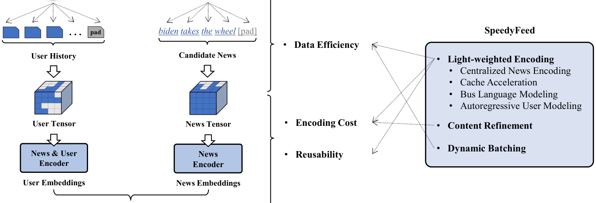
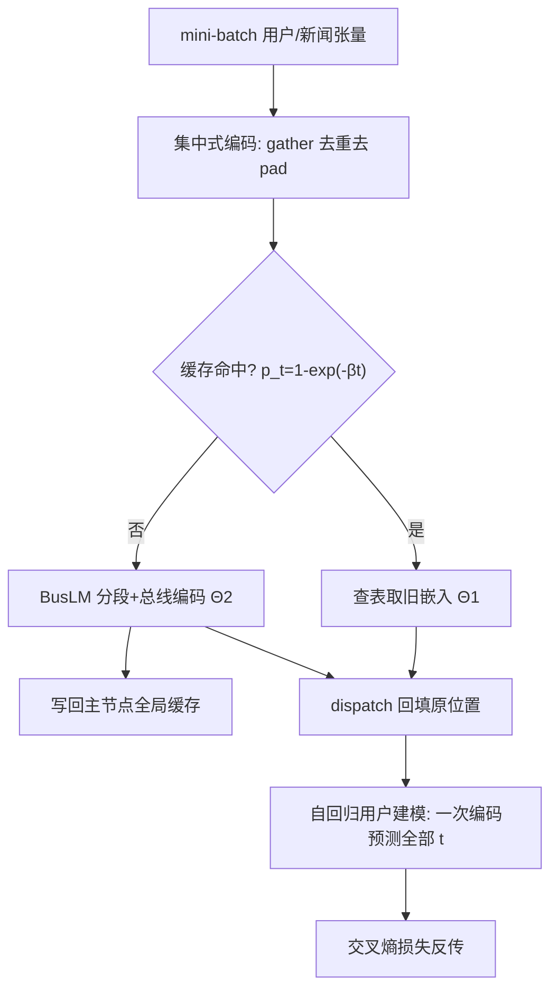

# Training Large-Scale News Recommenders with Pretrained Language Models in the Loop (让预训练语言模型留在训练回路中的大规模新闻推荐)

- **会议/期刊**: KDD 2022
- **作者与机构**: Shitao Xiao, Zheng Liu, Yingxia Shao, Tao Di, Xing Xie（北京邮电大学 / 微软亚洲研究院 / 微软）
- **推荐链路定位**: 召回（用户/新闻双塔语义表征与 ANN 检索）
- **研究方向**: 大语言模型推荐 / 序列推荐
- **论文原文**: [https://arxiv.org/abs/2102.09268v2](https://arxiv.org/abs/2102.09268v2)
- **开源代码**: [https://github.com/Microsoft/SpeedyRec](https://github.com/Microsoft/SpeedyRec)

## TL;DR (1分钟核心速览)

新闻推荐要用 BERT/UniLM 级编码器才能吃透语义，但每一条点击样本都要重编码整段用户历史，端到端训练代价高到不可行（单次训练估计 2497.5 小时）。SpeedyFeed 不改模型结构，只重构训练流水线：集中式新闻编码去 pad 去重、全局缓存复用新闻嵌入、BusLM 线性化长文编码、自回归用户建模一次编码预测全部时刻。在微软新闻 4.72M 用户真实数据上训练加速 **128.7×**（19.4 小时），并在 Impression 排序与全库 ANN 召回上大幅超过 NRMS 等 SOTA（AUC 73.74 vs 68.62，Recall@50 8.32% vs 3.10%）。

## Background & Motivation (背景与核心矛盾)

- **主流范式**: NPA/NAML/LSTUR/NRMS 等以 CNN/自注意力等小规模文本编码器生成新闻向量，再注意力聚合用户历史；PLM 仅被当作离线特征或小模型蒸馏源。
- **前人局限**: 其一，PLM 编码复杂度 $O(N^2)$，而新闻平均长度 659.64 词，远超 512 上限；其二，传统流水线中每条样本的中间结果"用一次即丢"，而热门新闻（Top-1% 占 59.53% 点击）会在几乎每个 batch 里被反复重编码。
- **核心洞察 (Key Insight)**: 训练学习率仅 $1e^{-5}$ 量级，相邻 step 的新闻嵌入变化极小，因此**旧嵌入可近似替代新嵌入**；同时用户历史前缀在不同时间戳样本间完全重复，天然可复用。
- **本文切入点**: 不改模型、不改损失，只把"编码"从逐样本操作改写为 batch 级 gather–encode–dispatch 的共享流水线，并量化数据效率损失。

<figure class="paper-figure" markdown="span">
  <figcaption>图 1. 左：新闻推荐的典型训练工作流。中：典型工作流中的潜在问题。右：SpeedyFeed 的构成及其对训练工作流的贡献。</figcaption>
</figure>

## Method (核心方法设计)

### 1. 整体框架 (Overall Architecture)

每个 mini-batch 先做**集中式新闻编码**：把用户张量与候选张量中的所有新闻 gather 成合并集合 $\mathcal{M}$，剔除 padding 与重复项；随后按缓存调度器给出的命中概率$p_t$划分出查找集$\mathcal{M}_L$，其嵌入$\Theta_1$直接读缓存，剩余$\mathcal{M}\setminus\mathcal{M}_L$由 BusLM 编码得$\Theta_2$ 并写回主节点全局缓存；嵌入 dispatch 回原位置（padding 位填 dummy 向量，零编码开销）；最后用自回归用户建模一次性算出全部时间戳的用户嵌入与预测损失并反传。

### 2. 关键设计拆解 (Key Designs)

1. **集中式新闻编码 + 动态批处理（提数据效率）**：痛点是把 padding 一起编码，实测数据效率 $\text{DE}=\frac{|\text{valid}|}{|\text{valid}|+|\text{padded}|}$ 常低于 50%。本文以合并集合编码彻底消除用户历史中的 pad，并按样本内最长新闻分桶、按 token 数（39800）动态组 batch，使 DE 从 30.84% 升至 76.96%。
2. **缓存加速 + 自回归用户建模（提复用率）**：缓存用指数调度 $p_t=1-\exp(-\beta t)$控制读取概率（$\beta=2e^{-3}$，训练初期为 0 避免参数剧变期失配），条目$\gamma=20$步后过期；自回归建模则把$\langle \text{click}=t,\text{clicks}_{\le t-1}\rangle$的$L$条样本压成一条，前缀编码只做一次，损失为$\mathcal{L}_{auto}=-\sum_{t<L}\log\frac{\exp(\langle\boldsymbol{\theta}_{t+1},\boldsymbol{\mu}_t\rangle)}{\exp(\langle\boldsymbol{\theta}_{t+1},\boldsymbol{\mu}_t\rangle)+\sum_{\boldsymbol{\theta}'}\exp(\langle\boldsymbol{\theta}'_{t+1},\boldsymbol{\mu}_t\rangle)}$，其中$\boldsymbol{\mu}_t$仅依赖$\{\boldsymbol{\theta}_l\}_{l\le t}$，故因果性不被破坏。
3. **BusLM + 内容精炼（降编码复杂度）**：把新闻按标题/摘要/正文切成 $K$段，独立编码可把$O(N^2)$降为$O(N^2/K)$，但段间失去互见会掉点。BusLM 在每层取各段首 token 组成总线$\text{Bus}_i=\{\mathbf{H}^i_j[0]\}_{j=1}^{K}$，再令$\mathbf{H}^{i+1}_j=\text{Transformer}_i([\mathbf{H}^i_j,\text{Bus}_i])$，仅在 K/V 侧拼接、Q 保持原长，从而以极小的额外开销实现跨段信息交换。内容精炼则把原文转为有序词袋，按 BM25 保留 top-$k$ 词并附加词频嵌入，替代粗暴截断。训练负采样比为 1，推理时新闻嵌入可离线缓存、用户侧仅需内积 + HNSW 检索。

## Experimental Setup & Evaluation Protocol (实验设置与评估协议)

- **数据集与预处理**: 微软新闻 2020-05-01 至 2020-08-31 真实日志；新闻取标题、摘要、正文首段各 ≤32 词，总长截断至 96；用户历史截断至 100。

| 数据集 | #Users | #Items | #Interactions | 稀疏度/密度 | 特征/场景说明 |
| :--- | :---: | :---: | :---: | :---: | :--- |
| Microsoft News | 4,720,192 | 1,202,576 | 41,481,252 impressions / 72,093,567 clicks | 每用户均 15.27 次点击，长尾 | 标题+摘要+正文；纯文本新闻流 |

- **数据划分与防穿越 (Splitting Strategy)**: **全局时间戳切分**——前 3 个月训练，最后 1 个月（2020-08）测试，严格避免未来信息泄漏。
- **排名评测协议 (Ranking Protocol)**: 排序侧在**单次 Impression 内**对曝光新闻重排（非全库），用 AUC/MRR/NDCG 衡量；召回侧以用户嵌入在**全量生产索引**上做 MIPS 检索（HNSW 索引），属无偏 Full-Ranking 语义，报告 Recall@50/100/200。
- **对比基线与超参设置**: NPA、NAML、LSTUR、NRMS 四个小编码器 SOTA，外加无加速的 UniLM 与三种简化 PLM（MiniLM、UniLM-Half、UniLM-Last）；新闻编码器为 12 层 768 维 UniLMv2-base，用户编码器为 Attentive YouTube-DNN；Adam，PLM 学习率 $8e^{-6}$、其余$1e^{-4}$；4×V100-32G。

## Key Experimental Results (实验关键数据)

### 1. 主实验对比 (Main Results)

| 模型 | AUC | MRR | NDCG@5 | NDCG@10 | R@50 | R@100 | 训练时长(h) |
| :--- | :---: | :---: | :---: | :---: | :---: | :---: | :---: |
| NPA | 65.01 | 24.66 | 26.06 | 30.90 | 2.24 | 4.04 | 23.6 |
| NAML | 67.57 | 26.90 | 28.73 | 33.75 | 2.29 | 5.22 | 26.6 |
| LSTUR | 64.37 | 24.35 | 25.58 | 30.63 | 2.28 | 3.96 | 30.4 |
| NRMS | 68.62 | 27.30 | 29.09 | 34.15 | 3.10 | 5.81 | 27.8 |
| UniLM (无 SpeedyFeed) | – | – | – | – | – | – | 2497.5 |
| Speed-Mini | 72.06 | 30.16 | 32.63 | 37.74 | 6.93 | 10.75 | 3.1 |
| Speed-Last | 70.98 | 28.92 | 31.09 | 36.26 | 4.69 | 8.07 | 6.5 |
| **Speed-UniLM (本文)** | **73.74** | **31.70** | **34.40** | **39.53** | **8.32** | **13.17** | 19.4 |
| Improv. vs NRMS | +7.5% | +16.1% | +18.3% | +15.8% | +168.4% | +126.7% | 128.7× 加速 |

### 2. 消融实验 (Ablation Study)

| 配置 | AUC | R@50 | R@100 | 说明 |
| :--- | :---: | :---: | :---: | :--- |
| w.o. Bus | 73.20 | 6.72 | 10.81 | 分段独立编码，掉点最重 |
| w.o. Cache ($\gamma=0$) | 73.70 | 8.11 | 12.73 | 训练时长升至 38.5h |
| w.o. Refine | 73.70 | 7.88 | 12.45 | 改为首部硬截断 |
| **Default** | **73.74** | **8.32** | **13.17** | 19.4h |

| 缓存过期步 $\gamma$ | 0 | 10 | 20 | 30 |
| :--- | :---: | :---: | :---: | :---: |
| AUC / R@50 / 时长(h) | 73.70 / 8.11 / 38.5 | 73.94 / 8.40 / 26.2 | 73.74 / 8.32 / 19.4 | 73.69 / 7.99 / 15.4 |

### 3. 关键实验发现 (Key Findings)

1. **加速贡献排序清晰**：自回归用户建模贡献 17.0×、集中式编码+动态批处理 3.0×、缓存 1.98×、BusLM 1.27×，乘积效应带来 2497.5h → 19.4h 的 128.7× 加速，且总耗时已低于 NRMS 的 27.8h。
2. **缓存不只是快，还更准**：$\gamma=10$ 时 AUC 达 73.94，反而高于关闭缓存的 73.70，作者归因为缓存让热门新闻少占用训练机会，长尾新闻获得更多梯度更新，等价于一种隐式重采样去偏。
3. **PLM 必须端到端全参训练**：仅微调末层的 Speed-Last（70.98）与蒸馏的 Speed-Mini（72.06）均明显落后全参 Speed-UniLM（73.74），说明"提速"不能以牺牲编码器表达力为代价；BusLM 分段数超过 5 后加速饱和（总线段数增多导致总线交互开销上升），默认取 3。

## Highlights & Limitations (亮点、对比与审稿批判)

- **与代表作对比 (vs. Prior Work)**: 相较 NRMS/NAML 这类"换更强文本编码器"的思路，本文证明瓶颈在**训练系统**而非模型；相较 MiniLM 蒸馏路线，本文保留全参 PLM 仍更快；相较通用高效 Transformer（如分段/稀疏注意力），BusLM 以"总线 token"这一极轻结构在速度与语义完整性间取得更好折中。
- **可迁移亮点**: ①"低学习率 ⇒ 嵌入可跨 step 复用"的缓存调度策略，可直接搬到商品/广告的文本塔训练；②自回归前缀复用思想适用于任何"滑窗式构造样本"的序列推荐训练。
- **审稿级局限批判**: ①缓存正确性依赖学习率足够小，若改用大学习率或 Adapter 微调，$\gamma=20$ 的近似误差缺少理论界；②评测仅限微软新闻单一域与离线日志，Recall 依赖 HNSW 近似索引，缺少线上 A/B 的留存/时长指标，且未报告方差与显著性检验。

## Rating (四维评分)

- **方法创新性 (Novelty)**: ⭐⭐⭐⭐ （不发明新模型，而是把"编码复用"系统化为缓存调度 + 自回归前缀 + 总线分段三件套，工程洞察扎实）
- **评估协议与实验扎实度 (Protocol & Experiments)**: ⭐⭐⭐⭐ （4.72M 用户工业级数据、时间切分、排序+全库召回双视角，但缺线上 A/B 与显著性检验）
- **写作与数学规范度 (Clarity & Rigor)**: ⭐⭐⭐⭐ （数据效率、缓存调度、BusLM 公式定义清晰，缓存近似的误差分析偏经验化）
- **工业落地与复现价值 (Industrial & Practical Value)**: ⭐⭐⭐⭐⭐ （框架 model-agnostic 且已开源，128.7× 加速直接决定大模型能否进训练回路，落地价值极高）

