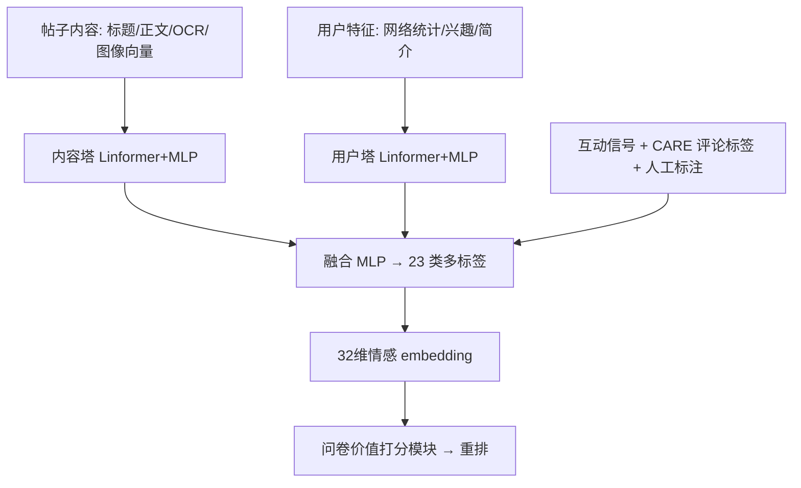

# Affective Signals in a Social Media Recommender System (社交媒体推荐系统中的情感信号)

- **会议/期刊**: KDD 2022 (Applied Data Science Track)
- **作者与机构**: Jane Dwivedi-Yu, Yi-Chia Wang, Lijing Qin, Cristian Canton-Ferrer, Alon Y. Halevy (Meta AI)
- **推荐链路定位**: 精排（打分模块特征注入）
- **研究方向**: 多任务学习与列表级重排 / 去偏公平与工业架构
- **论文原文**: [https://arxiv.org/abs/2206.12374v1](https://arxiv.org/abs/2206.12374v1)
- **开源代码**: 暂未开源

## TL;DR (1分钟核心速览)

工业界排序器只用「互动行为」与「主题标签」刻画用户价值，但点赞/生气等单一行为在语境下语义歧义（"sad" 反应既可能是共情也可能是厌恶），主题标签更无法区分"小丑帖"是逗乐还是惊吓。本文提出 14 类**受众情感响应 (affective response)** 分类体系，用互动信号 + CARE 评论弱标注 + 82 万帖人工标注（730 万条）联合训练双塔多标签模型，导出 32 维情感 embedding 注入 Facebook 打分模块：离线归一化 AUC-ROC 损失下降 >8%，20M+ 用户 14 天在线 A/B 中违规内容曝光显著下降 >0.6%、点赞数提升约 0.4%。

## Background & Motivation (背景与核心矛盾)

- **主流范式**: 工业排序器把帖子价值建模为 $c_{p,u,T}$ 的加权线性和，预测项主要是互动行为（赞/转/点出）与问卷式价值预测；内容理解则依赖**主题分类**。
- **前人局限**: ① 主题粒度不足——同一主题下情感响应可从愉悦到恐惧，主题无法刻画"这条内容让**观看者**产生什么体验"；② 互动信号语义歧义——单个 reaction 在不同语境下指向相反意图，且互动在帖子刚发布时**尚不存在**，无法作为推理期特征。
- **核心洞察 (Key Insight)**: 应建模**观看者情感响应**而非发帖人情感 (publisher affect)。实证显示两者相关性普遍偏弱（excited 0.12、grateful 0.11，仅 sad↔saddened 0.5），证明"作者情绪"不能替代"读者反应"。
- **本文切入点**: 把情感预测做成一个**可插拔的多标签表征模块**，只输出 embedding 供任意打分模块复用，而非直接当作独立排序目标（因为单一情感本身不指示排序高低）。

## Method (核心方法设计)

### 1. 整体框架 (Overall Architecture)

候选池先过完整性过滤，粗筛至 ~500 条后进入主排序；主排序中新增一条旁路：双塔模型（左塔编码内容文本/OCR/视频转写与图像稠密向量，右塔编码用户网络统计、兴趣与简介）分别经 Linformer-Transformer + MLP，融合后再经一层 MLP 输出 23 维多标签二值预测；取其**倒数第二层 32 维向量**作为情感 embedding，作为特征喂给下游问卷价值预测打分模块，最终进入多样性重排。训练标签三源合一：平台互动（近 90 天反应/隐藏/举报/分享/点出）、CARE 评论弱标签、人工标注（经"点赞即认同"启发式个性化）。

### 2. 关键设计拆解 (Key Designs)

1. **可实操的情感分类体系 (Taxonomy)**：痛点是大体系标注一致性崩塌（前人 28 类仅 0.28 人际相关）。本文按"可判别性 × 类目数最小化"折中，关键创新是把 angered 拆成 **constructively-angered**（愤怒但有益/推动公共议题）与 **destructively-angered**（愤怒且有害/擦边违规），并把 excited 与 relaxed 从笼统 joy 中解耦；最终 14 类，标注者人际相关提升到 **0.52**。这种"同情绪、异价值"的拆分正是排序器可用的判别边界。
2. **CARE 评论弱标注 (Common Affective Response Expression)**：痛点是人工标注贵、互动标签歧义。做法是在**评论**（而非帖子正文）上做高精度模式匹配：以少量种子 pattern + 关键词-情感映射起步，迭代挖掘高频 n-gram 扩充 pattern 集与词典（收敛于 23 个 pattern、163 词），再按帖子聚合评论级标签，产出 **400 万** 弱标签。因模式作用于评论而非帖子，模型不会背下这些表达，避免标签泄漏。与人工标注一致性：3 人共识时 Any-CARE 命中率 80%。
3. **个性化启发式与训练目标**：人工标注是"大多数人会怎么感觉"的非个性化标签，无法直接用于个性化模型。作者用启发式：若用户点赞/爱心了被标注为正向情感 $A$的帖子$p$，则生成样本$(p,A,u)$；负向情感（angered/saddened/scared）不适用此规则故被剔除，最终保留 23 个预测类。训练为多标签二元交叉熵$\mathcal{L}=-\sum_{k=1}^{23}\left[y_k\log \hat{y}_k+(1-y_k)\log(1-\hat{y}_k)\right]$，每类采 100 万样本（正负各半）共 2300 万，80/10/10 划分，3 epoch、lr=7e-4；推理时仅需内容塔即可在发布瞬间打分，无冷启动互动依赖。

## Experimental Setup & Evaluation Protocol (实验设置与评估协议)

- **数据集与预处理**: 无公开 benchmark，全部为 Facebook 内部去标识化数据。

| 数据集 | 规模 | 标签来源 | 用途 |
| :--- | :---: | :--- | :--- |
| 人工标注集 | 820k 帖 / 7.3M 标注（5 人/帖，348 名标注员） | 众包，非个性化视角，最多选 3 项 | 训练 + 一致性分析 |
| CARE 弱标注 | 4M 条 | 评论模式/词典自举 | 训练 |
| 互动标签 | 23 类 × 1M（正负各半） | 近 90 天行为日志 | 训练 |
| 离线打分评估集 | ~1.5M 问卷响应 | 用户问卷 | 离线 AUC 评估 |
| 在线实验 | 20M+ 用户，14 天 | A/B | 线上指标 |

- **数据划分与防穿越 (Splitting Strategy)**: 训练集按 `80/10/10` 比例随机划分；在线实验为同期随机分流 A/B（对照组为生产模型），非时间切分，但 CARE 模式仅作用于评论、内容塔仅看帖子，避免标签泄漏。
- **排名评测协议 (Ranking Protocol)**: 非传统 Top-N 检索评测。离线用 **AUC-ROC 的归一化损失下降** $(\text{AUC}_{new}-\text{AUC}_{base})/(1-\text{AUC}_{base})\times 100$，衡量情感 embedding 对问卷价值预测的增益；线上用违规内容曝光率、点赞数等业务指标。
- **对比基线与超参设置**: 基线为**不含情感 embedding 的生产打分模块**；对照配置为内容塔 / 用户塔 / 双塔拼接三种 embedding。模型超参：Linformer 编码 + MLP，embedding 维度 32，3 epoch，lr=0.0007。

## Key Experimental Results (实验关键数据)

### 1. 主实验对比 (Main Results)

| 打分模块配置 | AUC-ROC 相对表现 | 归一化损失下降 |
| :--- | :---: | :---: |
| 基线（无情感 embedding） | $S_{base}$ | — |
| **+ 内容塔 32 维 embedding** | $S_{new}$ | **>8%** |
| + 用户塔 embedding | 略高于内容塔 | 未报告精确值 |
| + 双塔拼接 embedding | 仅边际更高 | 未报告精确值 |

> 说明：本文为工业系统论文，未在公开数据集上与 CF/序列模型类基线对比，主表以"生产基线 vs. 注入情感特征"的消融形式呈现；作者明确选用**内容塔**单塔 embedding 是出于内部基础设施效率考虑。

### 2. 消融与一致性实验 (Ablation & Label Quality)

| 配置 / 设置 | 结果 |
| :--- | :---: |
| 去情感 embedding（基线） | 参照组 |
| 内容塔 vs. 用户塔 vs. 拼接 | 内容塔已获主要收益，拼接增益边际 |
| 编码层数等结构消融 | 用于筛选最优 embedding 版本 |
| CARE 标签 vs. 人工（3 人共识） | 一致率 80%（Any-CARE） |
| 本文体系人际相关 vs. Demszky et al. | **0.52 vs. 0.28** |

### 3. 关键实验发现 (Key Findings)

1. **情感 embedding 是打分模块的第一重要特征**：离线归一化 AUC-ROC 损失下降 >8%，且特征重要性排名第 1，说明"用户会有什么感受"比单纯互动预测更贴近问卷式价值判断。
2. **在线收益是"降害 + 增效"双正**：20M+ 用户 14 天实验中，错误信息与 engagement bait 等违规内容曝光下降 **>0.6%**（统计显著），点赞反应提升约 **0.4%**，且其他关键指标无损——证明情感信号可同时服务完整性与参与度。
3. **情感响应 ≠ 发帖人情感 ≠ 互动信号**：publisher affect 与 affective response 相关性多为弱相关（excited 0.12、grateful 0.11）；互动侧 haha↔entertained 仅 0.41、sorry↔saddened 0.36，故三源标签互补而非冗余，必须联合使用。

## Highlights & Limitations (亮点、对比与审稿批判)

- **与代表作对比 (vs. Prior Work)**: 相比 Orellana-Rodriguez 等基于 80 名标注者 + Plutchik 八情绪的 YouTube 情感推荐、以及 Mizgajski 等仅用单一反馈源的大规模新闻推荐，本文首次在十亿级社交平台上把**多源弱监督 + 双塔多标签**做成可上线模块；相比 Sintsova 等的纯词典/规则伪标注，本文只用词典产生**训练标签**、预测由内容模型完成，不受词典规模约束。
- **可迁移亮点**: ① "评论模式 → 帖子级标签"的弱监督自举管线可直接迁移到电商评论/短视频弹幕的情感或意图标注；② 把大模型倒数第二层 embedding 作为**特征**而非**目标**注入下游稀疏任务，是解决小样本打分模块数据饥饿的通用套路。
- **审稿级局限批判**: ① 完全依赖内部数据与生产系统，无公开数据集、无开源代码，离线增益（>8%）无法被第三方复现或与学术基线公平对比，且关键消融仅有定性描述；② 负向情感（angered/saddened/scared）因个性化启发式失效而被排除在建模之外，恰恰是"减少有害内容"最相关的类别，逻辑上存在缺口；③ 情感标签为"多数人视角"，个性化仅靠"点赞即同感"近似，对反讽、猎奇等高歧义内容易失真。

## Rating (四维评分)

- **方法创新性 (Novelty)**: ⭐⭐⭐ （无新网络结构，创新集中在"建设性/破坏性愤怒"这类价值导向的 taxonomy 拆分与 CARE 自举标注范式，属问题定义与数据工程层面的贡献）
- **评估协议与实验扎实度 (Protocol & Experiments)**: ⭐⭐⭐ （有 20M 用户 14 天在线 A/B 这一稀缺证据，但离线无公开 benchmark、无显著性检验细节，主表以消融替代基线对比）
- **写作与数学规范度 (Clarity & Rigor)**: ⭐⭐⭐⭐ （管线叙述清晰、标注一致性分析（人际相关、类间相关、publisher vs. response 相关）层层递进，但形式化建模极简，仅给出打分加权与归一化增益两式）
- **工业落地与复现价值 (Industrial & Practical Value)**: ⭐⭐⭐⭐⭐ （完整呈现从 taxonomy 设计、弱标注、双塔训练到特征注入与在线验证的全链路，是工业推荐系统引入内容理解信号的优秀范本，唯缺开源代码）

