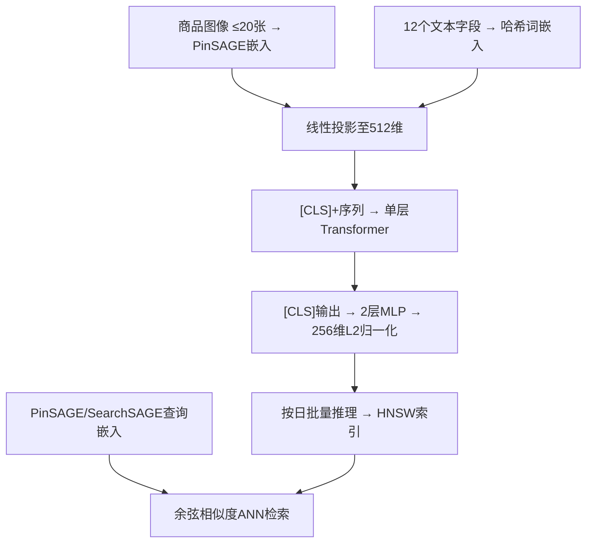

# ItemSage: Learning Product Embeddings for Shopping Recommendations at Pinterest (Pinterest购物推荐商品嵌入学习)

- **会议/期刊**: KDD 2022
- **作者与机构**: Paul Baltescu, Haoyu Chen, Nikil Pancha, Andrew Zhai, Jure Leskovec, Charles Rosenberg (Pinterest / Stanford)
- **推荐链路定位**: 召回（候选生成）
- **研究方向**: 多模态推荐 / 多任务学习
- **论文原文**: [论文原文链接](https://arxiv.org/abs/2205.11728v1)
- **开源代码**: 暂未开源

## TL;DR (1分钟核心速览)

针对 Pinterest 购物商品嵌入需同时兼容图像与文本查询、且要优化多个转化目标的核心痛点，ItemSage 用单层 Transformer 聚合 20 张 PinSAGE 图像嵌入与 12 种哈希文本特征，采用 logQ 校正 softmax 并将 in-batch 与随机负采样损失分离计算，以多任务学习联合优化点击/收藏/加购/结账。离线在 100 万干扰池 Recall@10 评估中 8 项任务全面超越单模态基线；在线 A/B 在 Closeup 界面带来 +6.85% GMV 与 +9.97% 点击。

## Background & Motivation (背景与核心矛盾)

- **主流范式**: 电商商品嵌入通常从单一模态（文本或图像）构建，并面向单一业务场景（如商品搜索或图像推荐）单独训练。
- **前人局限**: ① 单模态无法兼顾"视觉氛围偏好"（Pinterest 用户偏好 lifestyle 场景图）与"文本语义消歧"（商品图中常含其他商品，需文本区分）；② Home/Closeup/Search 三个界面查询模态各异，分别训练导致 3 倍基础设施与版本升级维护成本。
- **核心洞察 (Key Insight)**: PinSAGE 与 SearchSAGE 已能产出高质量查询嵌入，只需让商品嵌入与之兼容即可复用同一 ANN 索引；多任务联合训练中密集的点击/收藏标签可为稀疏的购物标签提供正则。
- **本文切入点**: 冻结查询编码器，用 Transformer 统一聚合图文特征，在多任务框架下学习单一兼容商品嵌入。

## Method (核心方法设计)

### 1. 整体框架 (Overall Architecture)

商品最多 20 张图片经冻结 PinSAGE 编码为图像嵌入，12 个文本字段（标题、描述、品牌、颜色等）经 word unigram、bigram 与 char trigram 切分后映射至哈希嵌入表。所有特征经各自线性层投影到 512 维，与 [CLS] token 拼接成 32 长度序列送入单层 8 头 Transformer 编码器；[CLS] 输出经两层 MLP 降至 256 维并 L2 归一化。训练目标同时包含来自 Closeup（图像查询）与 Search（文本查询）的点击/收藏/加购/结账正例，负例混合 in-batch 正例与随机采样商品。推理时商品嵌入按日批量更新并构建 HNSW 索引，三个界面共享同一索引，Search 在线编码查询串。

### 2. 关键设计拆解 (Key Designs)

1. **哈希文本嵌入（Hash Embedder）**：全量词表（200K unigram + 1M bigram + 64K trigram ≈ 1.26M）的 embedding 表内存爆炸。用两个哈希函数 $h_1, h_2$将 token$i$映射到$100000\times 256$表的两个槽，输出为可学习重要性权重下的插值$e_i = W_{i1}E_{h_1(i)} + W_{i2}E_{h_2(i)}$，其中$W\in\mathbb{R}^{|\mathcal{V}|\times 2}$。表大小降至 1/12，且权重缓解哈希冲突、对 OOV 天然鲁棒。

2. **logQ 校正分离式混合负采样**：全 softmax 归一化需遍历商品库；仅用 in-batch 正例做负例会系统性惩罚热门商品；仅用随机负例则模型退化（少数商品垄断 top-10）。核心算子为分别计算的带 logQ 校正 in-batch 损失与随机负例损失之和：

$$L_{S_{pos}} = -\frac{1}{|B|}\sum_{i=1}^{|B|}\log\frac{e^{\langle q_{x_i},p_{y_i}\rangle-\log Q_p(y_i|x_i)}}{\sum_{y\in B}e^{\langle q_{x_i},p_y\rangle-\log Q_p(y|x_i)}}$$

$$L_{S_{neg}} = -\frac{1}{|N|}\sum_{i=1}^{|N|}\log\frac{e^{\langle q_{x_i},p_{y_i}\rangle-\log Q_n(y_i)}}{\sum_{y\in N}e^{\langle q_{x_i},p_y\rangle-\log Q_n(y)}}$$

直觉：logQ 把采样偏差从 softmax 中解耦，分离两项损失让 in-batch 与随机负例各自贡献梯度，避免热门商品被过度惩罚——相比 [31] 的混合归一化 $L_{S_{mixed}}$ 在全部 8 项任务上稳定领先。

3. **多任务混合批次**：加购/结账标签比点击/收藏稀疏约 30 倍，单任务模型收敛差。一个批次内按 $T_k = |B|/K$分配各任务正例，共享同一组负例与同一 softmax。直觉：点击/收藏与购物行为强相关（先点击后购买），密集标签为稀疏标签提供正则，且统一嵌入避免每个界面单独训练。总损失$\mathcal{L} = L_{S_{pos}} + L_{S_{neg}}$，无额外负采样器；商品嵌入按日批量推理，在线查询仅需$O(\log n)$ ANN 检索。

## Experimental Setup & Evaluation Protocol (实验设置与评估协议)

- **数据集与预处理**: 训练数据来自 Closeup 与 Search 互动日志（表 1）：

| 界面 | 互动类型 | 正例数 |
| :--- | :--- | :---: |
| Closeup | 点击+收藏 | 93.3M |
| Closeup | 加购+结账 | 3.7M |
| Search | 点击+收藏 | 99.4M |
| Search | 加购+结账 | 3.5M |

- **数据划分与防穿越 (Splitting Strategy)**: 从互动日志采样训练对并去重，训练集外另取 8×80K 查询-商品对作离线基准；不涉及用户级划分或时间切分（工业部署为每日批量推理）。
- **排名评测协议 (Ranking Protocol)**: **Sampled Ranking（采样排序）**——对每个查询，在 100 万随机干扰商品 + 1 个真实正例上计算 engagement-weighted Recall@10；非全库 Full-Ranking。
- **对比基线与超参设置**: Sum（图像 PinSAGE 求和）、Sum-MLP（SearchSAGE MLP+求和）、MLP-Concat-MLP（双模态 3 层 MLP 拼接）；嵌入维度 $d=256$，Transformer 单层 8 头。

## Key Experimental Results (实验关键数据)

### 1. 主实验对比 (Main Results)

| 模型 | 参数量 | Closeup 点击 | Closeup 收藏 | Closeup 加购 | Closeup 结账 | Search 点击 | Search 收藏 | Search 加购 | Search 结账 |
| :--- | :---: | :---: | :---: | :---: | :---: | :---: | :---: | :---: | :---: |
| Sum | - | 0.663 | 0.647 | 0.669 | 0.699 | - | - | - | - |
| Sum-MLP | - | - | - | - | - | 0.577 | 0.533 | 0.561 | 0.629 |
| MLP-Concat-MLP | 30.8M | 0.805 | 0.794 | 0.896 | 0.916 | 0.723 | 0.736 | 0.834 | 0.861 |
| **ItemSage** | 33.1M | **0.816** | **0.812** | **0.897** | **0.916** | **0.749** | **0.762** | **0.842** | **0.869** |
| Improv. vs MLP | - | +1.4% | +2.3% | +0.1% | 0% | +3.6% | +3.5% | +1.0% | +0.9% |
| 4-Layer Transformer | 42.6M | 0.816 | 0.813 | 0.897 | 0.915 | 0.750 | 0.764 | 0.840 | 0.869 |

在线 A/B（表 4，相对基线）：

| 界面 | 点击 | 购买 | GMV |
| :--- | :---: | :---: | :---: |
| Home | +11.34% | +2.61% | +2.94% |
| Closeup | +9.97% | +5.13% | +6.85% |
| Search | +2.3% | +1.5% | +3.7% |

### 2. 消融实验 (Ablation Study)

| 变体 | Closeup 点击 | Closeup 收藏 | Closeup 加购 | Closeup 结账 | Search 点击 | Search 收藏 | Search 加购 | Search 结账 |
| :--- | :---: | :---: | :---: | :---: | :---: | :---: | :---: | :---: |
| ItemSage | 0.816 | 0.812 | 0.897 | 0.916 | 0.749 | 0.762 | 0.842 | 0.869 |
| 仅图像 | -2.6% | -3.1% | -1.7% | -0.9% | -10.5% | -8.4% | -5.2% | -4.5% |
| 仅文本 | -16.3% | -19.0% | -7.2% | -6.2% | -10.7% | -12.7% | -6.2% | -5.6% |
| +图结构 | -0.2% | 0.0% | -0.4% | -1.2% | -0.8% | +0.7% | 0.0% | -1.0% |
| 仅 $L_{S_{pos}}$ | -26.8% | -25.9% | -20.1% | -15.7% | -26.2% | -28.6% | -21.4% | -16.7% |
| 仅 $L_{S_{neg}}$ | -5.1% | -5.2% | -3.2% | -2.1% | -12.6% | -12.1% | -4.5% | -3.3% |
| $L_{S_{mixed}}$[31] | -4.3% | -4.7% | -4.1% | -3.5% | -8.3% | -7.3% | -3.9% | -3.6% |
| 仅点击+收藏 | +0.4% | 0.0% | -3.1% | -2.4% | +0.8% | +0.8% | -18.2% | -12.0% |
| 仅加购+结账 | -38.4% | -38.1% | -5.2% | -3.7% | -49.0% | -48.6% | -8.8% | -8.7% |

### 3. 关键实验发现 (Key Findings)

1. **多模态互补不可替代，且对跨模态查询增益最大**：仅图像模型在 Search 点击上掉 10.5%、仅文本模型在 Closeup 收藏上掉 19.0%；融合模型同时拿到两类查询的最优结果——单模态模型仅在同模态查询上有局部优势（图像→Closeup、文本→Search），跨界面统一嵌入必须依赖图文互补。
2. **分离式 logQ 混合负采样是性能基石**：去掉 in-batch 负例（仅 $L_{S_{neg}}$）Search 掉 12.6%，仅用 in-batch（$L_{S_{pos}}$）则全面掉 20%+ 且模型退化为热门商品垄断；相比 [31] 的$L_{S_{mixed}}$ 混合归一化再稳定提升 3.5%+。
3. **密集标签为稀疏目标提供有效正则**：仅用购物标签（加购+结账）训练时，Closeup 点击 Recall 从 0.816 暴跌至 0.503（-38.4%）、Search 点击从 0.749 跌至 0.382（-49.0%）；加入点击/收藏标签后，加购任务反而提升 3.7%–8.7%，验证"先点击后购买"的任务相关性红利。

## Highlights & Limitations (亮点、对比与审稿批判)

- **与代表作对比 (vs. Prior Work)**: PinSAGE/Sum 仅用图像、单界面，需为每个界面单独训练；MLP-Concat-MLP 虽做图文融合但无自注意力、无 logQ、无多任务；ItemSage 首次在工业级推荐系统中用 Transformer 统一聚合图文并输出单一兼容嵌入，同时兼容图像查询与文本查询。
- **可迁移亮点**: ①"冻结查询编码器、只学习目标端嵌入"的单边训练范式，可直接迁移到任何已有高质量查询/物品编码器的系统，避免端到端重训；② logQ 校正 + 分离式混合负采样可作为通用召回损失模块即插即用。
- **审稿级局限批判**: ① 离线评估仅用 100 万干扰池（采样排序），未做全库排序，且正例来源与训练分布同源，可能高估真实召回能力；② 文本编码仍为词袋 + 哈希，未用预训练语言模型（作者亦列为 future work），长描述/语义匹配场景可能弱于 BERT 类编码器；③ 在线 A/B 在 Search 界面增益仅 +2.3% 点击/+3.7% GMV，显著低于 Home/Closeup，或与文本查询分布长尾严重有关。

## Rating (四维评分)

- **方法创新性 (Novelty)**: ⭐⭐⭐⭐ （多模态 Transformer + logQ 混合负采样 + 单嵌入多任务，组合新颖但各组件非全新）
- **评估协议与实验扎实度 (Protocol & Experiments)**: ⭐⭐⭐⭐ （8 任务基准 + 离线消融 + 在线三界面 A/B，但离线仅采样排序、正例分布与训练同源）
- **写作与数学规范度 (Clarity & Rigor)**: ⭐⭐⭐⭐ （损失推导清晰、logQ 动机明确；哈希嵌入与 count-min sketch 细节稍简）
- **工业落地与复现价值 (Industrial & Practical Value)**: ⭐⭐⭐⭐⭐ （Pinterest 全量部署，3× 基础设施成本下降，A/B 显著正收益）

