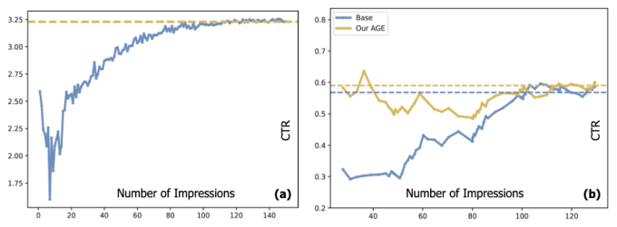
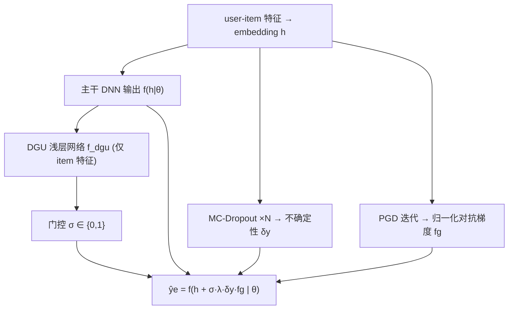
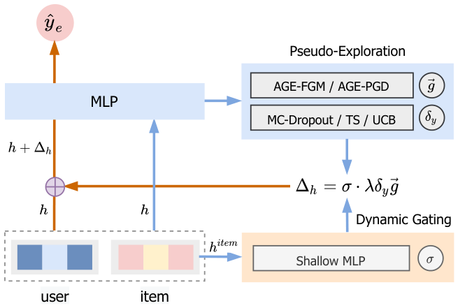

# Adversarial Gradient Driven Exploration for Deep Click-Through Rate Prediction (面向深度 CTR 预估的对抗梯度驱动探索)

- **会议/期刊**: KDD 2022 (August 14–18, Washington D.C.)
- **作者与机构**: Kailun Wu, Zhangming Chan, Weijie Bian, Lejian Ren, Shiming Xiang, Shuguang Han, Hongbo Deng, Bo Zheng（阿里巴巴集团；中科院自动化所）
- **推荐链路定位**: 精排（Ranking Stage，CTR 预估打分）
- **研究方向**: 强化学习与动态探索推荐（主）/ CTR 预估与特征交叉（次）
- **论文原文**: [https://arxiv.org/abs/2112.11136v2](https://arxiv.org/abs/2112.11136v2)
- **开源代码**: 暂未开源

## TL;DR (1分钟核心速览)

本文针对反馈回路导致新物品与长尾物品难以获得曝光、CTR 迟迟不收敛的痛点，指出传统 E&E 只看“模型不确定性”是片面的，忽略了探索对后续训练数据与模型更新的影响。作者提出 AGE：用 Pseudo-Exploration 模拟“探索一次 + 收到反馈”后的参数更新，证明该过程等价于对输入 embedding 注入对抗扰动，从而用 $f_g\cdot\delta_y$ 直接改写打分。在 Yahoo! R6B 的 replay 累计点击数上，AGE-TS 相比无探索 DNN 提升 28.00%、比最强基线 UR-gradient-TS 高 5.41%；阿里展示广告线上 A/B 中 CTR +6.4%、AFR +5.5%。

## Background & Motivation (背景与核心矛盾)

- **主流范式**: 工业系统用 Contextual Bandit 框架做 E&E，排序分写作 $pctr'_i = k(\mu_i, \delta_i)$，$\mu_i$为预估 CTR、$\delta_i$ 为不确定性，UCB 取置信上界、Thompson Sampling 从后验采样。
- **前人局限一**: 不确定性估计成为绝对核心（MC-Dropout、BNN、Gaussian Process、gradient-norm），但它只是当前模型的“知识空白”，并不能反映“补上这块空白后模型会变成什么样”。
- **前人局限二**: 直接用“打分 + 不确定性”相加做排序，会造成分数分布剧烈漂移，且对低质高不确定物品过度自信；DGU 缺失时 AGE-UCB 掉 19.9% 就是明证。
- **核心洞察 (Key Insight)**: 在线学习视角下，探索的真正收益来自它采集到的反馈如何改变后续模型。由图 1 可知新物品平均需约 10,000 次曝光才使 CTR 收敛，因此探索的价值应以“加速收敛”而非“不确定性大小”来度量。
- **本文切入点**: 用一步梯度更新模拟探索后的参数变化，再把该变化反解为对输入的对抗扰动，使“探索”变成一次前向传播内即可完成的确定性算子。

<figure class="paper-figure" markdown="span">
  <figcaption>图 1：各物品的点击率随曝光次数增加的变化。图（a）展示了当前生产模型（对物品取平均）的 CTR 收敛曲线；图（b）比较了生产模型与我们提出的方法（在一组选定的热门物品上取平均）的 CTR 收敛曲线。</figcaption>
</figure>

## Method (核心方法设计)

### 1. 整体框架 (Overall Architecture)

输入一条 user-item 特征，主干网络输出 $\hat{y}=f(h(X),\theta)$；同时用 MC-Dropout 采样$N$次估计不确定性$\delta_y$，用 PGD 迭代求对 embedding 的归一化梯度$f_g$；动态门控单元 DGU 依据“该 user-item 对是否具备竞争力”输出 0/1 门控$\sigma$；三者合成为扰动后的探索打分$\hat{y}_e=f(h+\sigma\lambda\delta_y f_g\mid\theta)$，直接进入排序。训练侧联合优化主干交叉熵与门控浅层网络的交叉熵；推理侧只需 1 次额外前向 +$T$ 步梯度回传，无需多模型集成。

<figure class="paper-figure" markdown="span">
  <figcaption>图 2：Adversarial Gradient-based Exploration (AGE) 方法的示意图。它由三个主要部分组成：用于 CTR 预测的标准神经模型、伪探索模块和动态门控模块。</figcaption>
</figure>

### 2. 关键设计拆解 (Key Designs)

1. **Pseudo-Exploration（把探索价值定义为模型更新量）**：假设对某物品进行探索并收到反馈 $y^*$，则 embedding 的最优变化量是带 L2 约束的更新问题$\Delta h(\lambda,y^*)=\arg\min_{\|\Delta h\|_2\le\lambda}\mathcal{L}(f(h+\Delta h\mid\theta),y^*)$。一阶泰勒展开并代入交叉熵后解得$\Delta h=\lambda'\cdot\delta_y\cdot f_g$，其中$f_g=\nabla_h f/\|\\nabla_h f\|_2$、$\delta_y=f(h\mid\theta)-y^*$。直觉：值得探索的方向不是“最不确定”的方向，而是**能让预测输出改变最大**的方向，且幅度由不确定性调制。

2. **等价性与对抗扰动（Exploration → Adversarial Perturbation）**：上式等价于 $\Delta h=\arg\max_{\|\Delta h\|_2\le\lambda'\delta_y}f(h+\Delta h\mid\theta)$，形式上与 FGM/PGD 的对抗训练扰动完全同构，因此探索天然带来鲁棒性收益。求解上对比 FGM（一步）与 PGD（$T$步归一化迭代$g_t=f_g{}_{t-1}+\nabla_h f(h+g_{t-1}\mid\theta)$），PGD 更精确；不确定性侧对 UCB 用 dropout 方差、对 TS 用单次 dropout 与非 dropout 之差$\delta_y=f(h\mid\theta\odot M)-f(h\mid\theta)$。

3. **Dynamic Gating Unit 与训练目标**：Top-K 排序下低 CTR 物品即便探索得更准也排不上位，纯属浪费 PV。DGU 用仅含 item 特征的浅层网络给出物品级 CTR 基准，$\sigma=\mathbb{I}[f(h\mid\theta)\ge f_{dgu}(h_{item}\mid\theta_s)]$；浅层网共享 embedding 但不参与 embedding 更新，避免污染主干。总损失$\mathcal{L}=\mathcal{L}(f(h\mid\theta\odot M),y^*)+\mathcal{L}(f_s(h_{item}\mid\theta_s),y^*)$，探索强度$\lambda$ 与 dropout 率均需人工设定，无额外负采样环节。

## Experimental Setup & Evaluation Protocol (实验设置与评估协议)

- **数据集与预处理**: 离线用 Yahoo! R6B（Yahoo! Today Module 15 天日志），以 **replay（回放）** 方式模拟在线推荐；物品为全库 652 篇，每次请求记录约 38 个候选（部分曝光），天然构成未曝光的探索空间。

| 数据集 | #Users | #Items | #Interactions | 稀疏度/密度 | 特征/场景说明 |
| :--- | :---: | :---: | :---: | :---: | :--- |
| Yahoo! R6B | 未披露（28M 次访问） | 652 | ≈28M visits × ~38 候选 | 极稀疏（单次曝光标签） | 136 维 multi-hot 用户特征；展示位文章为均匀随机选取 |

- **数据划分与防穿越 (Splitting Strategy)**: 按**时间顺序**取前 80,000 条样本预训练 warm-up，其余样本用于 replay 评估；不做 Leave-One-Out。
- **排名评测协议 (Ranking Protocol)**: 非 NDCG/AUC 式 Full-Ranking，而是**累计点击数（cumulative clicks）**作为 cumulative reward 的 Bandit 回放指标，直接反映探索策略在长期收益上的表现；另设 50% 训练数据设置检验鲁棒性。
- **对比基线与超参设置**: 11 个基线（DNN-vanilla、random、$\epsilon$-greedy、Ensemble-TS/UCB、GP-TS/UCB、gradient-TS/UCB、UR-gradient-TS/UCB）；主干统一为 3 层 MLP（256-64-2），Adam，lr=$1\times10^{-5}$，$\lambda=1\times10^{-3}$，dropout 0.01，UCB 采样$N=20$，DGU 为 2 层 MLP。

## Key Experimental Results (实验关键数据)

### 1. 主实验对比 (Main Results)

| 模型 | 100% 数据 #clicks | Imp. | 50% 数据 #clicks | Imp. |
| :--- | :---: | :---: | :---: | :---: |
| DNN-vanilla | 39149.4 | – | 19345.6 | – |
| random | 26212.8 | -33.04% | 13323.6 | -31.13% |
| $\epsilon$-greedy | 42540.2 | +8.66% | 20384.6 | +5.37% |
| Ensemble-TS | 43429.0 | +10.93% | 20372.2 | +5.31% |
| GP-TS | 44069.8 | +12.57% | 20376.8 | -5.33% |
| gradient-TS | 46829.6 | +19.62% | 23227.2 | +20.07% |
| UR-gradient-TS | 47539.6 | +21.43% | 22052.4 | +13.99% |
| UR-gradient-UCB | 41509.6 | +6.03% | 19476.8 | +0.68% |
| **AGE-TS** | **50111.0** | **+28.00%** | **24875.2** | **+28.58%** |
| **AGE-UCB** | 47873.6 | +22.28% | 23042.4 | +19.11% |

### 2. 消融实验 (Ablation Study)

| 配置 | #clicks | Imp. | 说明 |
| :--- | :---: | :---: | :--- |
| AGE-TS | 50111.0 | – | 完整模型 |
| w/o 不确定性 $\delta_y$（替换为高斯随机值） | 45677 | -8.85% | 幅度调制失效 |
| w/o 对抗梯度 $f_g$ | 44638 | -10.90% | 退化为无方向随机扰动 |
| w/o DGU | 47387 | -5.44% | 低质物品被浪费探索 |
| w/ 固定阈值 0.01 (代 DGU) | 48263.8 | -3.69% | 最优固定阈值仍不及动态门控 |
| AGE-UCB | 47874 | – | 完整模型 |
| AGE-UCB w/o DGU | 38327 | -19.90% | 上界策略对高不确定低质物品过度自信 |
| FGM 代替 PGD（AGE-TS） | 48698.2 | -2.90% | 单步梯度不够精确 |

### 3. 关键实验发现 (Key Findings)

1. **收益来自“方向 × 幅度”的耦合，而非单纯的不确定性**：去掉 $f_g$掉 10.90%、去掉$\delta_y$ 掉 8.85%，两者贡献相当且均大于 DGU（5.44%），说明“探索该往哪个方向推”与“推多远”是两条独立且不可替代的信息通道，这正是 GP-TS/gradient-TS 只建模不确定性的结构性缺陷。
2. **AGE 对数据量高度鲁棒，直接对应长尾扶持**：训练数据砍半后，AGE-TS 提升率几乎不变（28.00% → 28.58%），而 UR-gradient-TS 从 +21.43% 暴跌至 +13.99%、GP-TS 甚至转为 -5.33%，说明模拟式更新的探索信号在小样本/稀疏物品上比统计式不确定性更稳定。
3. **线上收益可被业务指标感知**：在六层 DIEN 主干、仅对曝光 <3000 的物品探索（$\lambda=0.002$）的 A/B 中，AGE-TS 带来 CTR +6.4%、PV +3.0%、PCOC 从 1.20 收敛到 1.10、AFR +5.5%，而 Ensemble-UCB 反而 CTR -3.1%，说明对抗扰动式探索同时改善了准确性与广告主留存。

## Highlights & Limitations (亮点、对比与审稿批判)

- **与代表作对比 (vs. Prior Work)**: ① 相对 DUAL/GP-TS 这类“更准的不确定性估计器”，AGE 换了问题定义——不问“模型多不确定”，而问“更新一次模型能撬动多大变化”，把探索变成可微的前向算子；② 相对 gradient-TS/UR-gradient 只把梯度范数当不确定性标量使用，AGE 保留梯度的**方向**信息并用 PGD 精修；③ 相对经典 UCB/TS 的“分数直接相加”，AGE 在 embedding 空间扰动，实测 TS 与 UCB 两种后端都能稳定获益（22.28% vs 28.00%），而基线的 UCB 版本普遍大幅劣化。
- **可迁移亮点**: 其一，“模拟一步参数更新 → 反解为输入扰动”的推导范式可迁移到冷启动物品扶持与离线 RL 的数据增广；其二，DGU 用“是否具备进入 Top-K 的竞争力”来剪枝探索预算，这一资源约束思路可直接搬到任何有限流量场景。
- **审稿级局限批判**: ① 离线仅 Yahoo! R6B 一个数据集、且是依赖历史日志的 replay 模拟，其候选集只有约 38 项，与工业全库排序的探索空间差距明显，泛化性证据偏薄；② DGU 门控阈值仍靠浅层网络 + 人工设定的固定容差式启发式，缺学习式门控与理论最优性分析；③ PGD 需 $T$步反传、MC-Dropout 需$N=20$ 次前向，精排 RT 开销显著上升，论文未给出延迟量化；④ 探索仅在精排阶段生效，未覆盖召回/粗排。

## Rating (四维评分)

- **方法创新性 (Novelty)**: ⭐⭐⭐⭐ （把 E&E 价值重构为“模型更新影响”并证明其等价于对抗扰动，视角新颖且推导自洽，但对抗扰动本身并非新工具）
- **评估协议与实验扎实度 (Protocol & Experiments)**: ⭐⭐⭐⭐ （11 个基线 + 数据减半鲁棒性 + 消融 + 公平桶线上 A/B 相当完整，扣分在仅单一离线数据集与 replay 模拟）
- **写作与数学规范度 (Clarity & Rigor)**: ⭐⭐⭐⭐ （式 3→式 9 的推导链条清晰、FGM/PGD/TS/UCB 变体界定明确，但部分符号如 $\lambda$与$\lambda'$ 混用处理略显含糊）
- **工业落地与复现价值 (Industrial & Practical Value)**: ⭐⭐⭐⭐ （线上真机验证 CTR/AFR 双升，DIEN 主干改造代价可控；但未开源、PGD 与多 dropout 带来的延迟成本与门控调参门槛限制了直接复现）

