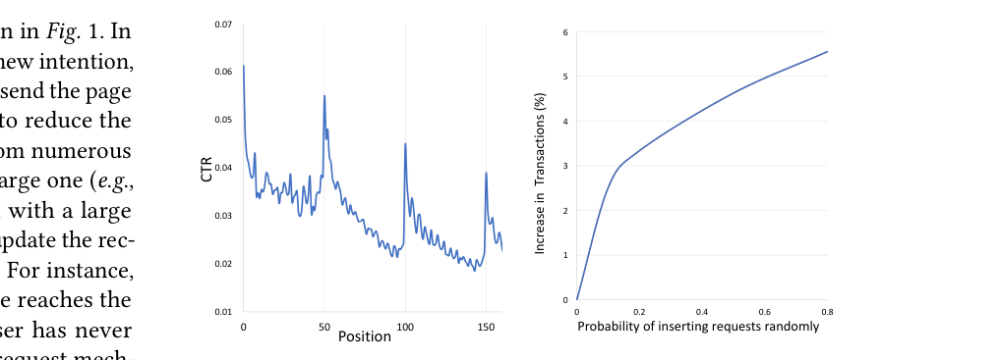
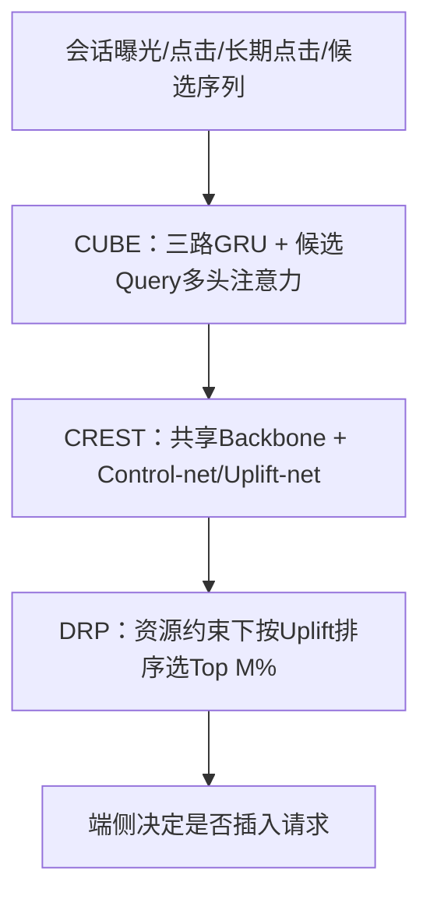
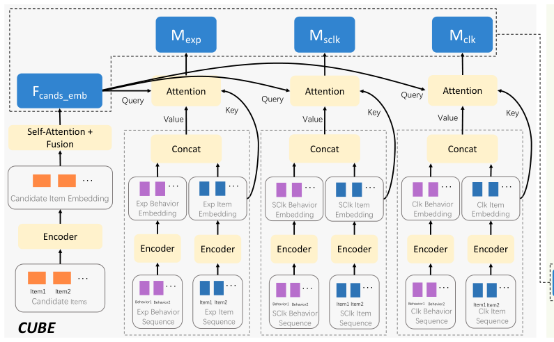

# Intelligent Request Strategy Design in Recommender System (推荐系统中的智能请求策略设计)

- **会议/期刊**: KDD 2022
- **作者与机构**: Xufeng Qian, Yue Xu, Fuyu Lv, Shengyu Zhang, Ziwen Jiang, Qingwen Liu, Xiaoyi Zeng, Tat-Seng Chua, Fei Wu；阿里巴巴、浙江大学、新加坡国立大学等
- **推荐链路定位**: 端侧请求插入策略（重排/端到端决策）
- **研究方向**: 强化学习与动态探索推荐
- **论文原文**: [论文原文链接](https://arxiv.org/abs/2206.12296v1)
- **开源代码**: 暂未开源

## TL;DR (1分钟核心速览)

瀑布流推荐的分页请求页大小固定，用户实时兴趣突变时无法及时刷新推荐；均匀/随机插入额外请求虽能提升成交，却造成 QPS 与带宽浪费。本文提出端侧自适应框架 AdaRequest：CUBE 用多粒度行为匹配捕捉意图漂移，CREST 用因果推断估计插入请求带来的购买 uplift，DRP 在资源约束下按 uplift/资源比贪心选择插入时机。离线 Qini AUUC 达 1.8288，显著优于 OneModel、TwoModel 等基线；淘宝在线 A/B 7 天、千万用户，GMV 提升超过 3%。

## Background & Motivation (背景与核心矛盾)

- **主流范式**: 瀑布流推荐采用固定页大小的分页请求，用户滚完一页后边缘端向云端请求新页，云端重新分析意图并返回候选物品。
- **前人局限**: 页大小过大（如 50 条）导致推荐更新滞后；在页内均匀或随机插入额外请求虽能提高成交，但不区分用户意图，造成大量无效请求与资源浪费。
- **核心洞察 (Key Insight)**: 淘宝统计显示，分页请求前 CTR 持续下降、请求后 CTR 骤升；随机插入请求越多，成交增量越大，但资源消耗线性增长。关键不是“多插请求”，而是“在用户意图发生变化的时机插请求”。
- **本文切入点**: 将问题形式化为资源约束下的智能请求策略设计（IRSD），用端侧实时行为匹配判断意图漂移，用因果 uplift 衡量请求收益，再按资源预算动态选择插入时机。

<figure class="paper-figure" markdown="span">
  <figcaption>图2：（左）点击率（CTR）与分页请求的相关性。每 50 个条目有一个分页请求。（右）在两个分页请求之间插入越来越多请求时，交易量的增长。</figcaption>
</figure>
图 2：CTR 随分页位置下降、请求后回升；随机增加请求可提升成交，但资源开销同步增长。

## Method (核心方法设计)

### 1. 整体框架 (Overall Architecture)

AdaRequest 部署在边缘端，输入当前会话曝光序列、会话点击序列、长期点击序列、候选物品序列及上下文特征。CUBE 将三类行为序列分三路独立 GRU 编码，并用候选物品作为 query 做多头注意力匹配，输出 $M_{exp},M_{sclk},M_{clk}$ 表征候选与实时/长短期兴趣的匹配程度。CREST 将 CUBE 输出与用户、上下文特征拼接，经共享 backbone 后分两头：Control-net 预测无请求购买率，Uplift-net 预测请求带来的增量 logit。DRP 按 uplift 与资源消耗比排序，在 QPS 预算内选择 top M% 的案例插入请求。训练用 Control/Treatment 两组购买标签做交叉熵，推理只跑 Uplift-net，端侧单次约 500ms。

<figure class="paper-figure" markdown="span">
  <figcaption>图3：AdaRequest 框架概览。</figcaption>
</figure>
图 3：AdaRequest 框架概览：CUBE 捕捉意图变化，CREST 估计因果 uplift，DRP 做资源约束请求规划。

### 2. 关键设计拆解 (Key Designs)

1. **CUBE 多粒度行为匹配（捕捉意图漂移）**：用户意图隐式变化，且曝光序列远比长期点击稠密，联合编码会被主导。CUBE 对 $F_{exp},F_{sclk},F_{clk}$分别用参数独立的 GRU 编码行为序列与物品序列，候选序列经 GRU+self-attention+mean-pooling 得到$F_{cands\_emb}$；再以候选为 query 对三组历史做多头注意力，得到匹配向量$M_{sclk}=\sum_i \alpha_i F_i^{sclk\_embs}$，其中$\alpha_i=\mathrm{softmax}(F_{cands\_emb}^{\top}\hat{F}_i^{sclk\_item})$。若候选与实时点击匹配度低，说明云端候选已不满足当前意图，插入请求的潜在收益更高。

2. **CREST 因果 uplift 估计（解决反事实不可观测）**：同一用户在同一时刻无法同时观测“有请求”和“无请求”的购买结果。CREST 随机划分 Control/Treatment 组，共享 CUBE backbone，Control-net 输出 $Logits_{ctrl}$，Uplift-net 输出$V_{uplift}$，则$P_{ctrl}=\sigma(Logits_{ctrl})$，$P_{trt}=\sigma(Logits_{ctrl}+V_{uplift})$，$\widehat{CATE}_P=P_{trt}-P_{ctrl}$。损失为两组交叉熵之和$\mathcal{L}=\mathcal{L}_{ctrl}+\mathcal{L}_{trt}$。共享 backbone 使表征一致且抗过拟合，单次推理避免 TwoModel 的双模型开销。

3. **DRP 资源约束请求规划（QPS 预算下选时机）**：目标为 $\max \sum_i z_i CATE_P(X_i)$，约束$\sum_i z_i CATE_Q(X_i)<\theta$，且单次请求资源近似常数$\lambda$，故按$g(X_i)=CATE_P(X_i)/\lambda$排序选 top M%。线上无法预知当前周期全部得分，用上一周期 top M% 的最小$V_{uplift}$ 作阈值近似。训练无负采样概念；推理仅端侧轻量网络，embedding 大矩阵留在云端按需回传。

## Experimental Setup & Evaluation Protocol (实验设置与评估协议)

- **数据集与预处理**: 淘宝“Guess You Like”工业日志 TaoBao Request，包含 $1.76\times 10^8$ 条行为与请求记录；原文未披露用户/物品数。数据按随机分组构造 Control（无额外请求）与 Treatment（随机插入请求）观测日志。

| 数据集 | #Users | #Items | #Interactions | 稀疏度/密度 | 特征/场景说明 |
| :--- | :---: | :---: | :---: | :---: | :--- |
| TaoBao Request | 未披露 | 未披露 | $1.76\times 10^8$ | 未披露 | 瀑布流首页推荐；会话曝光/点击、长期点击、候选序列、上下文 |

- **数据划分与防穿越 (Splitting Strategy)**: 离线实验基于工业观测日志；原文未明确训练/测试比例或时间切分。在线 A/B 持续 7 天，覆盖超过 1000 万用户，按用户随机分流，避免同一用户跨组泄漏。
- **排名评测协议 (Ranking Protocol)**: 离线非传统 Full-Ranking，而采用 uplift 评估：Qini AUUC、Qini(50)、MSE$_{Y^*}$，以及购买率 AUC/MSE。线上采用请求后后续$N$条的购买率 PR in$N$ 与 GMV-QPS 曲线。
- **对比基线与超参设置**: 非自适应策略 StaticR（均匀固定插入）、RandR（随机插入）、PoolR（按边缘候选数插入）；模型型基线 Greedy（绝对购买率）、ClassTrans、TwoModel、OneModel。显著性检验 $p<0.05$；embedding 维度原文未披露。

## Key Experimental Results (实验关键数据)

### 1. 主实验对比 (Main Results)

| 模型 | Qini AUUC↑ | Qini(50)↑ | AUC↑ |
| :--- | :---: | :---: | :---: |
| **AdaRequest** | **1.8288** | **4.3450** | **0.8145** |
| OneModel | 1.4767 | 3.8859 | 0.7980 |
| TwoModel | 1.4007 | 3.8061 | 0.7980 |
| ClassTrans | 1.3558 | 3.7662 | - |
| Greedy | 0.4802 | 2.8371 | 0.7974 |
| RandR | 0.0398 | 1.9209 | 0.5017 |
| PoolR | -3.0404 | -2.3353 | 0.4706 |
| StaticR | -1.6724 | 0.1229 | 0.4817 |
| p-value | $2.31\times10^{-6}$|$3.05\times10^{-3}$|$3.52\times10^{-9}$ |

### 2. 消融实验 (Ablation Study)

| 变体 | Qini AUUC↑ | Qini(50)↑ | 说明 |
| :--- | :---: | :---: | :--- |
| AdaRequest | **1.8288** | **4.3450** | 完整模型 |
| w/o CUBE | 1.5894 | 4.0260 | 均值池化替代多粒度匹配 |
| w/o BShare | 1.6629 | 4.0852 | 双 CUBE 独立建模，不共享 backbone |
| w/o CREST w. CT | 1.4722 | 3.9057 | ClassTrans 式 uplift |
| w/o CREST w. CO | 1.7300 | 4.2053 | OneModel 式 0/1 条件信号 |
| w/o Uplift | 0.5339 | 3.3332 | 只追绝对购买率 |
| w/o $F_{exp}$ | 1.6980 | 4.1253 | 去除当前会话曝光序列 |
| w/o $F_{sclk}$ | 1.8188 | 4.2852 | 去除当前会话点击序列 |
| w/o $F_{clk}$ | 1.7899 | 4.3250 | 去除长期点击序列 |
| w/o $F_{context}$ | 1.7480 | 4.3251 | 去除上下文特征 |

### 3. 关键实验发现 (Key Findings)

1. **因果 uplift 排序显著优于绝对购买率排序**：Greedy 的 Qini AUUC 仅 0.4802，而 AdaRequest 达 1.8288；去掉 uplift 目标后模型暴跌至 0.5339，证明“预测请求带来的增量”而非“预测购买率”是策略有效的关键。
2. **CUBE 与共享 backbone 缺一不可**：去掉 CUBE 后 Qini AUUC 从 1.8288 降至 1.5894（-13.1%），去掉 backbone 共享降至 1.6629；说明多粒度实时行为匹配和一致表征学习共同贡献主要增益。特征消融中 $F_{exp}$ 影响最大（1.6980），验证曝光负反馈对判断意图漂移的价值。
3. **线上收益与资源约束强相关**：AdaRequest 使 PR in 10 从 StaticR 的 1.130 提升至 2.289，PR in 20 从 2.045 提升至 4.173；GMV 相对 StaticR 提升超过 3%。离线 Qini 曲线显示资源越紧（$K<50$）时相对增益越大，正好匹配线上 QPS 受限场景。

## Highlights & Limitations (亮点、对比与审稿批判)

- **与代表作对比 (vs. Prior Work)**: 相较 StaticR/RandR/PoolR 的非自适应插入，AdaRequest 按实时意图和因果 uplift 选时机；相较 TwoModel/OneModel/ClassTrans，它共享 CUBE backbone、单次推理输出 uplift，并用 DRP 显式处理 QPS 预算，而非只做 uplift 预测。
- **可迁移亮点**: “端侧轻量意图匹配 + 因果 uplift 排序 + 上一周期阈值近似 top-M”可迁移到搜索、广告、推送等资源受限的主动请求场景；用曝光序列作为负反馈信号也值得借鉴。
- **审稿级局限批判**: 离线数据集划分、用户/物品统计与 embedding 维度披露不足，复现门槛高；端侧 500ms 推理对低端机型仍可能偏重；DRP 阈值依赖历史窗口，用户分布突变时可能滞后；未开源代码。

## Rating (四维评分)

- **方法创新性 (Novelty)**: ⭐⭐⭐⭐ （首次形式化 IRSD，将因果 uplift 与资源约束请求规划结合，但 CUBE/CREST/DRP 多为已有模块的组合创新）
- **评估协议与实验扎实度 (Protocol & Experiments)**: ⭐⭐⭐⭐ （离线工业大数据 + 7 天千万用户在线 A/B，显著性检验完整；但离线划分细节不透明）
- **写作与数学规范度 (Clarity & Rigor)**: ⭐⭐⭐⭐ （三模块职责清晰，CATE 与 DRP 公式完整；部分表格排版和指标单位略混乱）
- **工业落地与复现价值 (Industrial & Practical Value)**: ⭐⭐⭐⭐⭐ （淘宝全量部署，GMV 提升 >3%，端侧 500ms，资源约束设计直接对应工业 QPS 痛点）

