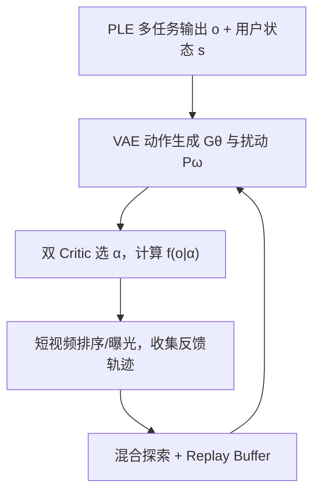
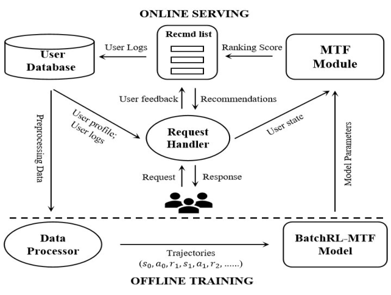

# Multi-Task Fusion via Reinforcement Learning for Long-Term User Satisfaction in Recommender Systems (基于强化学习的长周期用户满意度多任务融合)

- **会议/期刊**: KDD 2022
- **作者与机构**: Qihua Zhang, Junning Liu, Yuzhuo Dai, Yiyan Qi, Yifan Yuan, Kunlun Zheng, Fan Huang, Xianfeng Tan；腾讯
- **推荐链路定位**: 精排末端 MTF（多任务融合）
- **研究方向**: 强化学习与动态探索推荐 / 多任务学习与列表级重排
- **论文原文**: [https://arxiv.org/abs/2208.04560v2](https://arxiv.org/abs/2208.04560v2)
- **开源代码**: 暂未开源

## TL;DR (1分钟核心速览)

针对 MTF 多目标融合长期依赖 Grid Search/BO/ES 静态权重、忽略延迟满意度的问题，本文将融合权重学习写成会话内 MDP，用 BCQ 式 Batch RL 从日志学习个性化 $\alpha$，并混合随机探索与动作噪声探索。离线以 Conservative-OPEstimator 评估，线上真实短视频平台 A/B 中主模型 ADTime +2.216%、UPIRate +9.118%，调权后达 +2.550%/+9.651%。

## Background & Motivation (背景与核心矛盾)

- **主流范式**: 工业排序由 MTL 预测点击、点赞、分享等多目标，再由 MTF 将多任务输出融合为最终排序分；MTF 权重通常靠网格搜索、贝叶斯优化或进化策略调节。
- **前人局限**: 静态/全局融合权重无法按用户与上下文个性化；且这些方法只贪心优化即时反馈，忽略当前曝光对后续会话行为的影响。
- **离线 RL 矛盾**: 直接在线 RL 试错会伤害用户体验，纯离线 off-policy 又受 Deadly Triad 与外推误差困扰，OOD 动作的 Q 值会被严重高估。
- **核心洞察 (Key Insight)**: 推荐会话中“融合权重”本身就是动作，用户反馈构成状态转移；长期满意度可拆成用户粘性与用户活跃两个可观测维度。
- **本文切入点**: 用 Batch RL 在日志动作流形内学习个性化融合策略，再用混合在线探索补足高价值样本，避免局部最优。

## Method (核心方法设计)

### 1. 整体框架 (Overall Architecture)

MTL 采用 PLE 输出 $k$个反馈分数$o=(o_1,\dots,o_k)$，MTF 按$f(o|\alpha)=\sum_i\alpha_i\log(o_i+\beta_i)$生成排序分。状态$s$由用户画像与最近 500 条观看交互拼接，动作$a=\alpha\in\mathbb{R}^{12}$，奖励由播放时长、完播、互动等反馈加权得到。离线用 BCQ 式 VAE 动作生成器、扰动网络和双 Critic 学习策略，线上按状态实时输出$\alpha$ 并回写轨迹；每日用近三天轨迹重训。混合探索使新轨迹既覆盖随机动作，又围绕当前最优动作探索高价值邻域。

<figure class="paper-figure" markdown="span">
  <figcaption>图4：我们的短视频推荐系统的BatchRL-MTF框架。</figcaption>
</figure>
图 4：BatchRL-MTF 在短视频推荐系统中的离线训练与在线服务闭环。

### 2. 关键设计拆解 (Key Designs)

1. **会话 MDP 与粘性/活跃双目标奖励**：把融合权重 $\alpha$作为动作而非物品，状态融入近 500 次观看行为，奖励$r(s,a)=\sum_{i=1}^{m}w_i v_i$，$v_i$覆盖播放时长、完播、点赞/分享/评论等；$w_i$ 由行为与未来 App 时长的统计关系设定。直觉是即时行为经加权后近似长期满意度，并迫使策略在“停留”与“正向互动”间权衡。
2. **BCQ 式动作硬约束**：传统 TD3/CQL 在日志外动作上易 Q 值外推；VAE $G_\theta$将候选$\alpha$拉回行为数据流形，$P_\omega$仅在$[-\rho,\rho]$内扰动，取$\pi(s)=\arg\max_{\hat{a}_i+\xi_i}Q(s,\hat{a}_i+\xi_i)$。直觉是“先像日志、再略优”，从动作源头抑制 OOD 高估。
3. **训练目标、探索与推理效率**：VAE 损失为 $\mathcal{L}_{VAE}=\sum_{(s,a)\in\mathcal{B}}\|a-G_\theta(s)\|_2^2+D_{KL}(E_{\theta_1}(z|s,a)\|\mathcal{N}(0,1))$，扰动网用 DPG 最大化$Q$；Critic 用 clipped double Q：$y=r+\gamma\max_{a'}\min_{j=1,2}Q_{\phi'_j}(s',a')$。无需负采样；线上仅前向 MLP 输出 12 维$\alpha$，延迟低。线上探索混合动作噪声$\pi_{ep}(s)=\pi_t^*(s)+\epsilon,\ \epsilon\sim\mathcal{N}(0,0.1)$ 与随机探索，既保留最优邻域又覆盖未知动作。

## Experimental Setup & Evaluation Protocol (实验设置与评估协议)

- **数据集与预处理**: 真实短视频工业日志，未做 5-core 过滤；动作维度 12，状态含画像与近 500 条观看行为。

| 数据集 | #Users | #Items | #Interactions | 稀疏度/密度 | 特征/场景说明 |
| :--- | :---: | :---: | :---: | :---: | :--- |
| 短视频推荐日志 | 未披露 | 未披露 | 11.155M | — | 3.142M sessions；画像+近500条交互；12维融合权重 |

- **数据划分与防穿越**: 按会话时间顺序取前 90% sessions 训练、后 10% sessions 测试；线上部署一个月做真实 A/B，非 Leave-One-Out。
- **排名评测协议**: 离线不是 Full-Ranking/Sampled Ranking，而是用 Conservative-OPEstimator 估计策略值 $\hat{V}(\pi_e)$；线上为全流量真实排序 A/B。
- **对比基线与超参**: 非 RL 基线 BO、ES；RL 基线 TD3、UWAC+TD3、CQL+SAC。$\rho=0.15$、$\gamma=0.95$、batch=256、replay=100k；线上指标显著性$p<0.05$。

## Key Experimental Results (实验关键数据)

### 1. 主实验对比 (Main Results)

| 方法 | 离线 $\hat{V}(\pi_e)$ | ADTime Δ vs BO | UPIRate Δ vs BO |
| :--- | :---: | :---: | :---: |
| BO | — | 0* | 0* |
| ES | — | +0.376% | +0.402% |
| TD3 | -648.162 | — | — |
| UWAC+TD3 | -297.053 | -0.513% | +16.061% |
| CQL+SAC | **5.194** | +2.322% | +10.258% |
| BatchRL-MTF | 4.126 | +2.216% | +9.118% |
| BatchRL-MTF-RE | 3.023 | +0.862% | -1.282% |
| BatchRL-MTF-Rinteraction | — | **+2.550%** | **+9.651%** |

### 2. 消融实验 (Ablation Study)

论文未给标准逐模块消融，以下为探索策略与奖励权重变体：

| 变体 | 离线 $\hat{V}$ | ADTime | UPIRate | 说明 |
| :--- | :---: | :---: | :---: | :--- |
| BatchRL-MTF | 4.126 | +2.216% | +9.118% | 完整混合探索 |
| w/o Mixed Exploration | 3.023 | +0.862% | -1.282% | 仅随机探索 |
| Reward↑playtime | — | +2.254% | +8.877% | 增大播放时长权重 |
| Reward↑integrity | — | +1.996% | +9.464% | 增大完播权重 |
| Reward↑interaction | — | **+2.550%** | **+9.651%** | 增大互动权重 |

### 3. 关键实验发现 (Key Findings)

- TD3 与 UWAC+TD3 的离线 OPE 分别为 -648.162、-297.053，线上 UWAC+TD3 的 ADTime 仍为 -0.513%；而动作硬约束的 BatchRL-MTF 达 +2.216%/+9.118%，说明仅惩罚 OOD 不够，约束动作分布更关键。
- 仅随机探索的 -RE 虽提升 ADTime +0.862%，却使 UPIRate 下降 1.282%；完整混合探索提升至 +2.216%/+9.118%，表明全动作空间噪声会损伤活跃度与用户体验。
- 奖励权重存在“粘性—活跃”跷跷板：提高播放时长/完播权重仅得 +2.254%/+8.877% 与 +1.996%/+9.464%，提高互动权重达 +2.550%/+9.651%，稀疏但强信号的互动更能引导长期满意。

## Highlights & Limitations (亮点、对比与审稿批判)

- **与代表作对比 (vs. Prior Work)**: 相比 BO/ES 的全局静态权重，本文按会话状态输出个性化 $\alpha$ 并优化长期回报；相比 CQL+SAC 的软惩罚，BCQ 式动作生成从流形上硬约束，收敛更稳；相比 TD3/UWAC，显式缓解日志外动作外推。
- **可迁移亮点**: “先约束动作流形、再混合探索”可迁移到竞价、创意选择等工业决策任务；Conservative-OPEstimator 可在上线前低成本预筛高风险策略。
- **审稿级局限批判**: 仅在单一大规模短视频平台验证，奖励权重依赖人工统计关系，跨业务泛化性未证；离线 OPE 仍依赖 CQL 正则与 $\alpha$ 设置，且无公开数据/代码，复现与公平比较受限。

## Rating (四维评分)

- **方法创新性 (Novelty)**: ⭐⭐⭐⭐ （将 MTF 权重学习形式化为会话 MDP，BCQ 硬约束与混合探索组合在工业推荐中较新颖）
- **评估协议与实验扎实度 (Protocol & Experiments)**: ⭐⭐⭐⭐ （离线 OPE + 一个月线上 A/B、$p<0.05$ 显著性较扎实，但缺公开基准与标准消融）
- **写作与数学规范度 (Clarity & Rigor)**: ⭐⭐⭐ （系统闭环清楚、核心公式完整，但奖励权重启发式较强，部分实验设置与结论表述略含混）
- **工业落地与复现价值 (Industrial & Practical Value)**: ⭐⭐⭐⭐⭐ （已服务亿级用户并带来 ADTime +2.550%、UPIRate +9.651%，对精排融合落地参考价值高）

