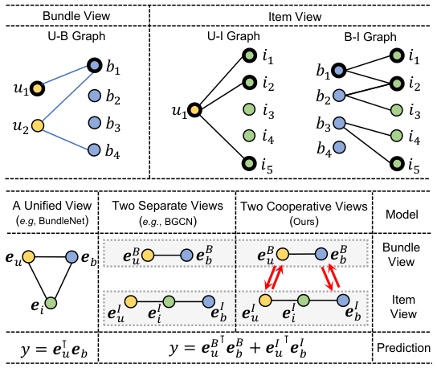
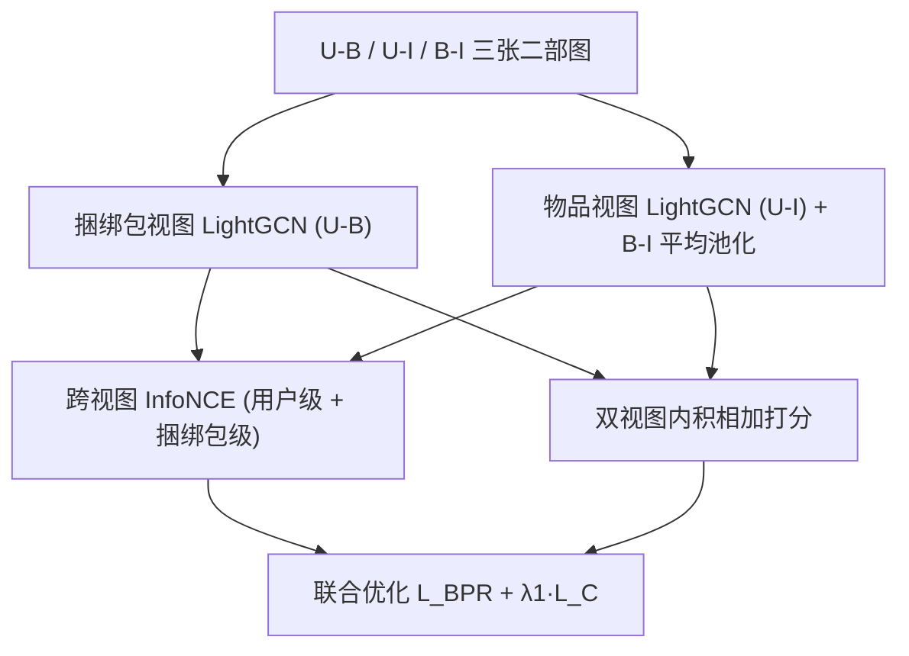
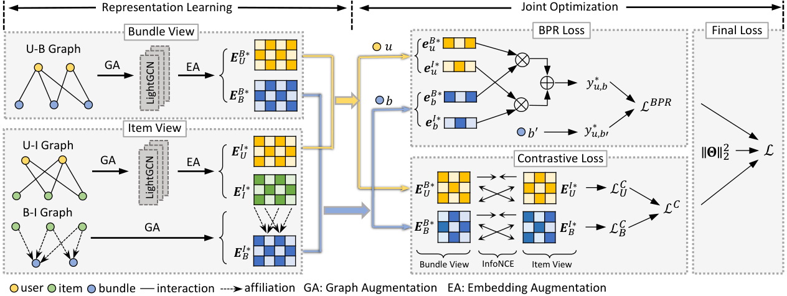

# CrossCBR: Cross-view Contrastive Learning for Bundle Recommendation (跨视图对比学习捆绑包推荐)

- **会议/期刊**: KDD 2022 (August 14–18, Washington, DC, USA)
- **作者与机构**: Yunshan Ma, Yingzhi He, An Zhang, Xiang Wang, Tat-Seng Chua (Sea-NExT Joint Lab & NUS; USTC)
- **推荐链路定位**: 召回 (用户–捆绑包 Top-K 排序)
- **研究方向**: 自监督对比学习与交互去噪 / 图神经网络推荐
- **论文原文**: [https://arxiv.org/abs/2206.00242v5](https://arxiv.org/abs/2206.00242v5)
- **开源代码**: [https://github.com/mysbupt/CrossCBR](https://github.com/mysbupt/CrossCBR)

## TL;DR (1分钟核心速览)

捆绑包推荐中存在两个天然互补视图：刻画用户行为相似性的 `U-B 捆绑包视图` 与刻画内容相关性的 `U-I / B-I 物品视图`。前人要么把三张图混成统一三部图（BundleNet，视图差异被抹平），要么各自预测后再融合（BGCN，仅停留在预测级、无法互促表征）。本文提出 CrossCBR，用**跨视图 InfoNCE 对比损失**在表征层强制同一用户/捆绑包的双视图对齐、并间接拉大不同用户/捆绑包在同视图内的距离。在 Youshu / NetEase / iFashion 三数据集、全库 Full-Ranking 协议下，NDCG@20 相对最强基线提升 **8.3% / 22.0% / 29.6%**，且单 epoch 训练时间仅为 BGCN 的 1/4.5（NetEase）。

## Background & Motivation (背景与核心矛盾)

- **主流范式**: 以用户–捆绑包交互 ($\mathbf{X}$)、用户–物品交互 ($\mathbf{Y}$)、捆绑包–物品归属 ($\mathbf{Z}$) 构建图，用 GNN 学用户与捆绑包表征；代表作 BundleNet（三部图）、BGCN（双视图分别建模后加和预测）。
- **前人局限一**: BundleNet 将三类关系盲目合并为统一三部图，用户行为相似性与捆绑包内容相关性被混入同一表征空间，视图分工丢失。
- **前人局限二**: BGCN 虽拆出双视图，但仅在**预测分数**层面相加，协同信号未回传到表征优化，两视图无法互促；且其图结构含自连接、bundle-bundle 重叠边与非线性变换，既冗余又昂贵。
- **核心洞察 (Key Insight)**: 同一用户在两个视图下的表征应指代同一潜在偏好（应对齐），而不同用户/捆绑包在任何视图下都应彼此区分（应分散）；**对齐会作为"桥"把跨视图分散传导为视图内分散**，从而提升自判别性。
- **本文切入点**: 以"对齐 + 分散"的跨视图对比损失替代预测级松耦合，把协同关联注入表征本身。

<figure class="paper-figure" markdown="span">
  <figcaption>图1：上：U-B、U-I 和 B-I 图中展示的捆绑包视图和物品视图。下：我们的工作对视图间的协作关联进行建模，其中上标 𝐵 和 𝐼 分别表示捆绑包视图和物品视图，下标 𝑢、𝑏 和 𝑖 分别表示用户、捆绑包和物品。</figcaption>
</figure>

## Method (核心方法设计)

### 1. 整体框架 (Overall Architecture)

输入三张二部图：U-B 图（捆绑包视图）、U-I 图与 B-I 图（物品视图）。捆绑包视图用一层 LightGCN 得到 $\boldsymbol{e}^{B*}_u,\boldsymbol{e}^{B*}_b$；物品视图用另一层 LightGCN 在 U-I 图上得到$\boldsymbol{e}^{I*}_u,\boldsymbol{e}^{I*}_i$，再依 B-I 图对捆绑包内物品做平均池化得到$\boldsymbol{e}^{I*}_b$。两视图的初始用户嵌入共享参数以压缩参数量。训练时联合优化 BPR 排序损失与跨视图对比损失；推理时两视图内积相加得到最终打分，不做任何图增广，开销与 BGCN 同阶但常数更小。

<figure class="paper-figure" markdown="span">
  <figcaption>图2：CrossCBR 的整体框架由两部分组成：(1) 用户和捆绑包两个视图的表示学习；(2) BPR 损失 L𝐵𝑃𝑅 与对比损失 L𝐶 的联合优化。</figcaption>
</figure>

### 2. 关键设计拆解 (Key Designs)

1. **双视图轻量图学习（去除自连接与 bundle-bundle 边）**：BGCN 的 bundle-bundle 重叠边需按物品重叠度手工构图，代价高且信息冗余。CrossCBR 只保留标准化邻居聚合 $\boldsymbol{e}^{B(k)}_u=\sum_{b\in\mathcal{N}_u}\frac{1}{\sqrt{|\mathcal{N}_u|}\sqrt{|\mathcal{N}_b|}}\boldsymbol{e}^{B(k-1)}_b$，并做层拼接$\boldsymbol{e}^{B*}_u=\sum_{k=0}^{K}\boldsymbol{e}^{B(k)}_u$。直觉：捆绑包间重叠度可由 B-I 图经物品视图池化$\boldsymbol{e}^{I*}_b=\frac{1}{|\mathcal{N}_b|}\sum_{i\in\mathcal{N}_b}\boldsymbol{e}^{I*}_i$ 免费获得，无需显式连边——消融中 `+BB` 反而降点并带来 3 倍训练开销。

2. **跨视图 InfoNCE 对齐 + 分散**：对用户与捆绑包分别构造正对（同一对象的两视图）与 in-batch 负对：

$$\mathcal{L}_{C}=\frac{1}{2}\Big(\mathcal{L}^{U}_{C}+\mathcal{L}^{B}_{C}\Big),\quad \mathcal{L}^{U}_{C}=\frac{1}{|\mathcal{U}|}\sum_{u\in\mathcal{U}}-\log\frac{\exp\big(s(\boldsymbol{e}^{B*}_u,\boldsymbol{e}^{I*}_u)/\tau\big)}{\sum_{v\in\mathcal{U}}\exp\big(s(\boldsymbol{e}^{B*}_u,\boldsymbol{e}^{I*}_v)/\tau\big)}$$

其中 $s(\cdot,\cdot)$为余弦相似度、$\tau$为温度。物理直觉：分子拉近同对象双视图（对齐，蒸馏互补信息），分母推开跨视图异对象（直接分散）；由三角不等式式的传导效应，跨视图分散会**间接**放大同视图内$(\boldsymbol{e}^{B*}_{u_1},\boldsymbol{e}^{B*}_{u_2})$ 的距离，实现双视图自判别性增强。作者进一步拆解验证：只对齐 (`CrossCBR_A`) 或只分散 (`CrossCBR_D`) 均显著掉点，后者甚至接近崩溃，证明二者必须协同。

3. **训练目标、负采样与推理效率**：$\mathcal{L}=\mathcal{L}_{BPR}+\lambda_1\mathcal{L}_{C}+\lambda_2\|\Theta\|_2^2$，其中$\mathcal{L}_{BPR}=\sum_{(u,b,b')}-\ln\sigma(y^*_{u,b}-y^*_{u,b'})$，$y^*_{u,b}=\boldsymbol{e}^{B*\top}_u\boldsymbol{e}^{B*}_b+\boldsymbol{e}^{I*\top}_u\boldsymbol{e}^{I*}_b$。对比学习**免显式负采样**，全部负例来自 in-batch；参数仅三组嵌入$\Theta=\{\mathbf{E}^{B(0)}_U,\mathbf{E}^{B(0)}_B,\mathbf{E}^{I(0)}_I\}$，空间复杂度$O((M+N+O)d)$，无特征变换矩阵。

## Experimental Setup & Evaluation Protocol (实验设置与评估协议)

- **数据集与预处理**: 覆盖图书清单、音乐歌单、时尚穿搭三类场景，捆绑包规模差异极大（平均 3.86 至 77.80 件）。

| 数据集 | #Users | #Items | #Bundles | #U-I | #U-B | 平均包内物品数 / 说明 |
| :--- | :---: | :---: | :---: | :---: | :---: | :--- |
| Youshu | 8,039 | 32,770 | 4,771 | 138,515 | 51,377 | 37.03 / 图书清单 |
| NetEase | 18,528 | 123,628 | 22,864 | 1,128,065 | 302,303 | 77.80 / 音乐歌单（极稀疏） |
| iFashion | 53,897 | 42,563 | 27,694 | 2,290,645 | 1,679,708 | 3.86 / 穿搭，用户 20-core、outfit 10-core 过滤 |

- **数据划分与防穿越**: **随机比例划分** 70% / 10% / 20%（train/valid/test），NDCG@20 在验证集上早停选模；未采用时间戳切分，存在轻度未来信息穿越风险。
- **排名评测协议**: **无偏 Full-Ranking**——测试阶段对全部未交互捆绑包排序（非采样排序），指标 Recall@$\{20,40\}$、NDCG@$\{20,40\}$。
- **对比基线与超参设置**: ① 通用物品推荐：MFBPR、LightGCN、SGL；② 捆绑包专用：DAM、BundleNet、BGCN。嵌入维度 $d=64$，Xavier 初始化，Adam（lr=0.001），batch=2048；$\lambda_1\in\{0.01,\dots,1\}$、$\lambda_2\in\{10^{-6},\dots,10^{-4}\}$、$\tau\in\{0.05,\dots,0.5\}$、$K\in\{1,2,3\}$；提升显著（$p\ll0.05$）。

## Key Experimental Results (实验关键数据)

### 1. 主实验对比 (Main Results)

| 模型 | Youshu R@20 | Youshu N@20 | Youshu R@40 | Youshu N@40 | NetEase R@20 | NetEase N@20 | NetEase R@40 | NetEase N@40 | iFashion R@20 | iFashion N@20 | iFashion R@40 | iFashion N@40 |
| :--- | :---: | :---: | :---: | :---: | :---: | :---: | :---: | :---: | :---: | :---: | :---: | :---: |
| MFBPR | 0.1959 | 0.1117 | 0.2735 | 0.1320 | 0.0355 | 0.0181 | 0.0600 | 0.0246 | 0.0752 | 0.0542 | 0.1162 | 0.0687 |
| LightGCN | 0.2286 | 0.1344 | 0.3190 | 0.1592 | 0.0496 | 0.0254 | 0.0795 | 0.0334 | 0.0837 | 0.0612 | 0.1284 | 0.0770 |
| SGL | 0.2568 | 0.1527 | 0.3537 | 0.1790 | 0.0687 | 0.0368 | 0.1058 | 0.0467 | 0.0933 | 0.0690 | 0.1389 | 0.0851 |
| DAM | 0.2082 | 0.1198 | 0.2890 | 0.1418 | 0.0411 | 0.0210 | 0.0690 | 0.0281 | 0.0629 | 0.0450 | 0.0995 | 0.0579 |
| BundleNet | 0.1895 | 0.1125 | 0.2675 | 0.1335 | 0.0391 | 0.0201 | 0.0661 | 0.0271 | 0.0626 | 0.0447 | 0.0986 | 0.0574 |
| BGCN | 0.2347 | 0.1345 | 0.3248 | 0.1593 | 0.0491 | 0.0258 | 0.0829 | 0.0346 | 0.0733 | 0.0531 | 0.1128 | 0.0671 |
| **CrossCBR** | **0.2813** | **0.1668** | **0.3785** | **0.1938** | **0.0842** | **0.0457** | **0.1264** | **0.0569** | **0.1173** | **0.0895** | **0.1699** | **0.1080** |
| Improv.% | +9.57 | +9.26 | +7.02 | +8.28 | +22.57 | +24.33 | +19.48 | +21.96 | +25.76 | +29.63 | +22.33 | +26.85 |

### 2. 消融实验 (Ablation Study)

| 变体 (NetEase / iFashion) | NetEase R@20 | NetEase N@20 | iFashion R@20 | iFashion N@20 | 说明 |
| :--- | :---: | :---: | :---: | :---: | :--- |
| BGCN | 0.0491 | 0.0258 | 0.0733 | 0.0531 | 双视图预测级融合 SOTA |
| CrossCBR-CL | 0.0608 | 0.0320 | 0.0852 | 0.0626 | 去掉 $\mathcal{L}_C$ |
| CrossCBR_A | 0.0602 | 0.0314 | 0.0664 | 0.0474 | 只保留跨视图对齐 |
| CrossCBR_D | 0.0410 | 0.0208 | 0.0568 | 0.0402 | 只保留跨视图分散（崩溃） |
| CrossCBR_OP | 0.0831 | 0.0452 | 0.1167 | 0.0891 | 原样保留（无增广，默认） |
| CrossCBR_ED | **0.0842** | **0.0457** | **0.1176** | 0.0891 | 图增广：边丢弃 |
| CrossCBR_MD | 0.0828 | **0.0457** | 0.1173 | **0.0895** | 嵌入增广：消息丢弃 |
| CrossCBR+SC | 0.0831 | 0.0455 | 0.1146 | 0.0873 | 恢复自连接 |
| CrossCBR+BB | 0.0828 | 0.0444 | 0.1163 | 0.0887 | 恢复 bundle-bundle 边 |
| **CrossCBR** (OP/ED/MD 最优) | **0.0842** | **0.0457** | **0.1173** | **0.0895** | 相对 BGCN +71.4% / +77.3% (NetEase) |

### 3. 关键实验发现 (Key Findings)

1. **对比损损失是主增益来源、且零额外代价**：去掉 $\mathcal{L}_C$ 后 NetEase N@20 从 0.0457 掉到 0.0320（-30%），但仍高于 BGCN 的 0.0258——说明增益由"LightGCN 精简主干 + 跨视图对齐"两段构成；而 `Cr-CL` 与 `Cr_OP` 单 epoch 训练时间几乎相同（4.67s vs 5.09s，Titan V），对比项开销可忽略。
2. **对齐必须与分散共存**：只对齐（`_A`）在 iFashion 上 N@20 仅 0.0474（低于 BGCN 的 0.0531），只分散（`_D`）两数据集全面崩塌（NetEase R@20=0.0410）；表征度量也印证：NetEase 跨视图用户对齐度由 0.638 升至 0.932，同时视图内用户相似度由 0.313 / 0.044 降至 0.049 / 0.004，即"桥"传导成立。
3. **数据增广近乎无效，视图天然差异即足够**：三种增广（OP/ED/MD）差异在 ±0.001 量级，说明 U-B 与 U-I 两视图来源本身已提供充分方差；而恢复 `+SC`/`+BB` 结构均掉点，NetEase 上 `+BB` 训练耗时 18.59s 约为 CrossCBR 的 3.7 倍，验证"重叠信息可从物品视图蒸馏"的删边设计。此外跨视图预测分析显示**捆绑包视图单独预测已优于物品视图**（NetEase 中甚至略优于双视图加和），解释了纯 U-B 的 SGL 为何能压过多个双视图基线。

## Highlights & Limitations (亮点、对比与审稿批判)

- **与代表作对比**: vs **BundleNet**——后者三部图混一，抹平视图差异，本文显式分离并建立视图间对齐；vs **BGCN**——后者只在预测层相加、且依赖自连接/BB 重叠边与非线性变换，本文把协同信号下沉到表征层、删边后更轻（NetEase 单 epoch 32.05s → 7.04s）；vs **SGL**——SGL 只在 U-B 单图上做图增广对比，本文用"天然双视图"替代随机增广，故增益更大且无需调增广超参。
- **可迁移亮点**: ① 凡存在两类异构数据源（如社交图 + 行为图、跨域源域 + 目标域），均可用"跨视图 InfoNCE 对齐 + 同视图间接分散"这一免负采样、免增广范式；② "删去手工构图边，让另一视图通过对比对齐蒸馏该信息"的思路，可直接用于简化 KG 增强推荐的元路径构图。
- **审稿级局限批判**: ① 数据划分采用随机 70/10/20 而非全局时间戳切分，U-I 与 U-B 交互可能跨越时间泄漏，离线分数偏乐观；② 性能对温度 $\tau$ 高度敏感（偏离最优即显著掉点），且 batch=2048 才达平台期，小批量场景（边缘部署）收益存疑；③ 对比损失为 batch 内负采样，捆绑包数极多时（NetEase 22,864）分母仅覆盖一个 batch，负例覆盖不足，理论上限制分散效果。

## Rating (四维评分)

- **方法创新性 (Novelty)**: ⭐⭐⭐⭐ （首次将"双视图协同关联"形式化为跨视图对齐–分散，并给出间接分散的机理诠释，但 InfoNCE 本身为成熟工具的组合式创新）
- **评估协议与实验扎实度 (Protocol & Experiments)**: ⭐⭐⭐⭐ （三数据集跨场景、无偏 Full-Ranking、$p\ll0.05$、消融/机理/效率四类分析齐全；扣分于随机划分带来的时间穿越风险）
- **写作与数学规范度 (Clarity & Rigor)**: ⭐⭐⭐⭐ （公式简洁、复杂度分析到 $O((M+N+O)d)$ 与逐项耗时归因清晰；视图内分散度量采用简化的平均余弦，理论刻画略粗）
- **工业落地与复现价值 (Industrial & Practical Value)**: ⭐⭐⭐⭐⭐ （代码与数据全开源；仅三组嵌入、无特征变换、训练时间降至 BGCN 的 1/4.5，推理复杂度与 BGCN 同阶，极易上线）

