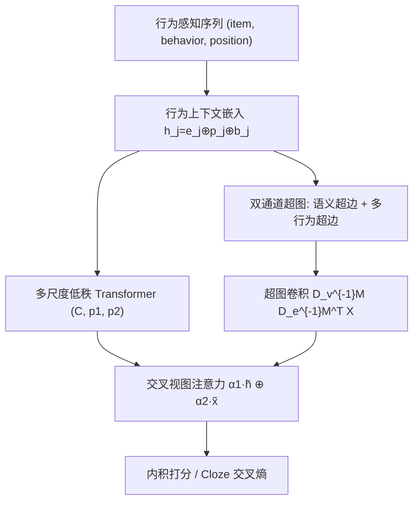
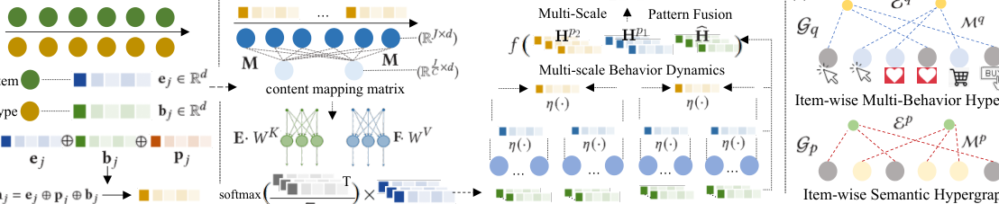

# Multi-Behavior Hypergraph-Enhanced Transformer for Sequential Recommendation (多行为超图增强 Transformer 序列推荐)

- **会议/期刊**: KDD 2022 (Full Paper)
- **作者与机构**: Yuhao Yang, Chao Huang, Lianghao Xia (香港大学), Yuxuan Liang (NUS), Yanwei Yu (中国海洋大学), Chenliang Li (武汉大学)
- **推荐链路定位**: 召回 (Next-Item 序列召回)
- **研究方向**: 序列与会话推荐 / 图神经网络与知识图谱推荐
- **论文原文**: [https://arxiv.org/abs/2207.05584v2](https://arxiv.org/abs/2207.05584v2)
- **开源代码**: [https://github.com/yuh-yang/MBHT-KDD22](https://github.com/yuh-yang/MBHT-KDD22)

## TL;DR (1分钟核心速览)

现有序列推荐只建模单一类型交互（如点击），丢失了 `pv→fav→cart→buy` 的异构行为语义。MBHT 用**多尺度低秩自注意力**编码行为感知的短期/中期转移，再用**双通道超图**（度量学习语义超边 + 个性化多行为超边）建模长程高阶依赖，最后注意力加权融合两视图。在 Taobao/Retailrocket/IJCAI 上采用 Leave-One-Out + 1:100 流行度负采样协议，HR@5 相对最强基线分别提升 **48.8%/6.0%/16.5%**。

## Background & Motivation (背景与核心矛盾)

- **主流范式**: GRU4Rec/Caser 用 RNN/CNN 编码序列，SASRec/BERT4Rec 用自注意力做 item-item 对建模，SR-GNN/SURGE 在序列图上做消息传递。
- **前人局限**: ① 所有上述模型都只吃**单一行为类型**的 item 序列，无法利用"浏览→收藏→加购→购买"的跨类型转化信号；② 多行为工作（MB-GCN/MB-GMN/NMTR）把行为关系当作**静态**图，忽略时间演化，且只能表达成对（dyadic）关系，无法刻画三元及以上的高阶行为依赖。
- **核心洞察 (Key Insight)**: 行为依赖是**个性化且多阶**的——有人"先大量收藏再少量购买"，有人"收藏即购买意图"；同时不同品类商品存在日/周/月的多周期节律，因此必须在**多时间粒度**与**多阶关系**两个维度同时建模。
- **本文切入点**: 用多尺度 Transformer 管"局部时序"，用超图管"全局高阶"，两视图注意力融合。

<figure class="paper-figure" markdown="span">
  ![图1：(a) 多行为动态序列推荐示例。(b) BERT4Rec 与我们的 MBHT 针对邻近 {\[4\], \[5\], \[6\]} 间短期物品相关性及 {\[2\], \[13\], \[15\]} 间长程依赖学习到的行为感知依赖权重。](../../../../assets/papers/2207.05584v2/figure_1.png)<figcaption>图1：(a) 多行为动态序列推荐示例。(b) BERT4Rec 与我们的 MBHT 针对邻近 {[4], [5], [6]} 间短期物品相关性及 {[2], [13], [15]} 间长程依赖学习到的行为感知依赖权重。</figcaption>
</figure>

## Method (核心方法设计)

### 1. 整体框架 (Overall Architecture)

输入为用户的行为感知序列 $S_i=[(v_{i,1},b_{i,1}),\dots,(v_{i,J},b_{i,J})]$，其中$b$为行为类型。三路并行：**(a)** 行为上下文嵌入把物品、位置、行为三向量相加；**(b)** 多尺度 Transformer（低秩注意力 + 两级窗口聚合）输出细/中/粗三尺度序列表征并融合；**(c)** 对每个用户序列构建双通道超图，经超图卷积得到全局物品表征；**(d)** 交叉视图注意力按位置自适应加权两视图，点积打分预测第$J+1$ 步的目标行为物品。训练采用 Cloze 掩码目标（掩掉所有 target 行为物品），推理时取末位表征全库内积排序。

<figure class="paper-figure" markdown="span">
  <figcaption>图2：MBHT 的模型流程。(a) 将行为感知交互上下文注入物品嵌入 h𝑗= e𝑗⊕p𝑗⊕b𝑗。(b) 多尺度 Transformer 架构，通过低秩自注意力与多尺度序列聚合捕获行为感知转移模式。尺度特定行为模式通过融合函数 eH = 𝑓(bH ∥H𝑝1 ∥H𝑝2) 融合。(c) 通过我们的超图神经网络架构在 G 上捕获全局与个性化多行为依赖学习。</figcaption>
</figure>

### 2. 关键设计拆解 (Key Designs)

1. **多尺度低秩自注意力（把 $O(J^2)$压到$O(J^2/C)$）**：原始注意力的$J\times J$上下文矩阵在长序列（IJCAI 平均 78.6）上不可承受。作者引入两个可学习投影$E,F\in\mathbb{R}^{\frac{J}{C}\times J}$，先把 Key/Value 压到$\frac{J}{C}$ 维潜空间再算注意力：
$\hat{\mathbf{H}}=\mathrm{softmax}\!\left(\frac{\mathbf{H}W_Q(E\mathbf{H}W_K)^{\top}}{\sqrt{d}}\right)F\mathbf{H}W_V$直觉是低秩分解保留了主要注意力子空间，同时把上下文矩阵从$\mathbb{R}^{J\times J}$降到$\mathbb{R}^{J\times \frac{J}{C}}$。再对子序列窗口做均值池化$\Gamma_p=[\eta(h_1..h_p);\dots]$得到尺度$p_1,p_2$的粗粒度序列，各自过注意力后拼接融合$\tilde{\mathbf{H}}=f(\hat{\mathbf{H}}\|H_{p_1}\|H_{p_2})$，以匹配日/周/月不同周期。

2. **双通道个性化超图（把成对关系升级为高阶超边）**：普通图边只能连两个物品。这里为**每个用户序列**单独构图：① **语义超边**用多通道度量学习算相关性 $\beta_{j,j'}=\frac{1}{N}\sum_{n}\tau(\boldsymbol{w}_n\odot v_j,\boldsymbol{w}_n\odot v_{j'})$，为每个物品连 top-$k$语义近邻，补足"序列中未相邻但同类兴趣"的长程关联；② **多行为超边**把同一用户在同一物品上发生过的多种行为（pv/fav/cart/buy）聚成一条超边，直接编码跨类型高阶依赖。两者连接矩阵拼接$\mathbf{M}=\mathbf{M}_p\|\mathbf{M}_q$，再做两阶段超图卷积：
$\mathbf{X}^{(l+1)}=\mathbf{D}_v^{-1}\mathbf{M}\mathbf{D}_e^{-1}\mathbf{M}^{\top}\mathbf{X}^{(l)}$由于不同用户构图不同，超图天然是**个性化**的；实现上用预计算的$\beta_{j,j'}$近似$\mathbf{M}\mathbf{M}^{\top}$以避免$\mathbf{M}\mathbf{M}^{\top}$ 的高昂开销，并去掉非线性以简化传播。

3. **训练目标、负采样与推理效率**：掩码所有 target 行为（购买）物品，并把其行为嵌入也替换为 `[mask]` 防标签泄漏，被掩物品从超图构建中剔除，其超图表征由窗口 $(m-q_1,m+q_2)$ 邻域均值池化补齐。损失为全物品集 softmax 交叉熵：
$\mathcal{L}=\frac{1}{|T|}\sum_{t\in T,m\in M}-\log\frac{\exp \hat{y}_{m,t}}{\sum_{j\in V}\exp \hat{y}_{m,j}}$
即训练阶段**免负采样**（全库 softmax）；在线推理只需一次前向 + 内积近邻检索，超图部分可离线按用户序列预构建。

## Experimental Setup & Evaluation Protocol (实验设置与评估协议)

| 数据集 | #Users | #Items | #Interactions | 平均长度 / 密度 | 行为类型 |
| :--- | :---: | :---: | :---: | :---: | :--- |
| Taobao | 147,892 | 99,038 | 7,092,362 | 48.23 / $5\times10^{-6}$ | buy, cart, fav, pv |
| Retailrocket | 11,649 | 36,223 | 87,822 | 14.55 / $1\times10^{-6}$ | buy, cart, pv |
| IJCAI | 200,000 | 808,354 | 13,072,940 | 78.58 / $7\times10^{-7}$ | buy, cart, fav, pv |

- **数据划分**: `Leave-One-Out`——每用户最后一次**购买**为测试、倒数第二次为验证，其余训练。
- **排名评测协议**: `Sampled Ranking`，每个正样本按**物品流行度**采 100 个负例（1:100），指标 HR@5/10、NDCG@5/10、MRR。**注意这是乐观估计**，未做 Full-Ranking。
- **对比基线与超参**: 基线覆盖通用序列（Caser/HPMN/GRU4Rec/SASRec/BERT4Rec）、图序列（SR-GNN/GCSAN/HyperRec/SURGE）与多行为（BERT4Rec-MB/MB-GCN/NMTR/MB-GMN）；超图层数 $\{1,2,3,4\}$，注意力与度量学习头数均为 2，top-$k\in[4,14]$，尺度$(C,p_1,p_2)\in\{20,40\}\times\{4,8\}\times\{20,40\}$；最优结果以$p<0.01$ 标注显著性。

## Key Experimental Results (实验关键数据)

### 1. 主实验对比 (Main Results)

| 模型 | Taobao HR@5 | NDCG@5 | HR@10 | Retailrocket HR@5 | NDCG@10 | IJCAI HR@5 | NDCG@5 | MRR |
| :--- | :---: | :---: | :---: | :---: | :---: | :---: | :---: | :---: |
| SASRec | 0.150 | 0.110 | 0.206 | 0.669 | 0.650 | 0.146 | 0.110 | 0.122 |
| BERT4Rec | 0.198 | 0.153 | 0.254 | 0.808 | 0.694 | 0.297 | 0.220 | 0.227 |
| GCSAN | 0.217 | 0.160 | 0.305 | 0.872 | 0.851 | 0.119 | 0.086 | 0.101 |
| SURGE | 0.122 | 0.078 | 0.193 | 0.878 | 0.887 | 0.226 | 0.159 | 0.171 |
| BERT4Rec-MB | 0.211 | 0.169 | 0.263 | 0.875 | 0.863 | 0.257 | 0.189 | 0.197 |
| MB-GMN | 0.196 | 0.115 | 0.319 | 0.853 | 0.830 | 0.235 | 0.161 | 0.176 |
| **MBHT** | **0.323** | **0.257** | **0.405** | **0.931** | **0.950** | **0.346** | **0.268** | **0.272** |
| Improv.% | +48.84 | +52.07 | +26.95 | +6.04 | +7.10 | +16.50 | +21.82 | +19.82 |

### 2. 消融实验 (Ablation Study)

| 变体 | Taobao HR@5 | NDCG@5 | Retailrocket HR@5 | NDCG@5 | IJCAI HR@5 | NDCG@5 |
| :--- | :---: | :---: | :---: | :---: | :---: | :---: |
| MBHT (全模型) | **0.323** | **0.257** | **0.956** | **0.950** | **0.346** | **0.268** |
| w/o 多行为超边 | 0.261 | 0.206 | 0.883 | 0.861 | 0.320 | 0.249 |
| w/o 度量学习语义超边 | 0.271 | 0.212 | 0.898 | 0.874 | 0.328 | 0.256 |
| w/o 整个超图 | 0.246 | 0.194 | 0.813 | 0.839 | 0.301 | 0.234 |
| w/o 多尺度低秩注意力 | 0.253 | 0.200 | 0.816 | 0.832 | 0.329 | 0.256 |

### 3. 关键实验发现 (Key Findings)

1. **超图视图贡献大于序列视图，且随序列变长而放大**：去掉整个超图使 Taobao HR@5 从 0.323 跌至 0.246（−23.8%），跌幅超过去掉多尺度注意力（0.253）；图 3 的注意力权重分布显示在长序列的 Taobao/IJCAI 上超图视图均值明显高于序列视图，说明长程高阶依赖才是长序列场景的瓶颈。
2. **两条超边互补而非冗余**：多行为超边（Taobao −19.2%）比语义超边（−16.1%）更关键，但去掉任一都会显著掉点，说明"跨类型行为共现"与"跨位置语义近邻"捕获的是不同侧面的物品关联。
3. **多行为建模的收益远大于单纯换骨干**：仅把行为嵌入注入 BERT4Rec（BERT4Rec-MB）在 Taobao 上只带来 0.198→0.211 的 HR@5 提升，而 MBHT 进一步到 0.323；同时 MBHT 在 Taobao/IJCAI 上分别第 2/第 8 个 epoch 即收敛，远快于 BERT4Rec 的 10/15 epoch，说明双视图提供了更强的梯度信号。

## Highlights & Limitations (亮点、对比与审稿批判)

- **与代表作对比**: 相对 **BERT4Rec**（单向/双向纯注意力、无行为语义）与 **HyperRec**（用"用户"作超边，只有单行为高阶关系），MBHT 同时引入行为类型与**按用户定制的双通道超边**；相对 **MB-GMN**（静态多行为元图），MBHT 把多行为关系放进了时间序列而非静态交互图，这是它在 Taobao 上 HR@5 高出 12.7 个百分点的结构性原因。
- **可迁移亮点**: ① 低秩 Key/Value 投影 + 多尺度窗口池化是低成本把 Transformer 拉到长序列的通用配方，可直接搬到长会话/长行为流召回；② "同一用户-物品的多种行为合成一条超边"这一构图思路可迁移到电商以外的多信号场景（如短视频的曝光/完播/点赞/分享）。
- **审稿级局限批判**: ① 评测只用 1:100 流行度采样排序，未给 Full-Ranking 结果，且负例按流行度采样会高估强模型，绝对提升幅度需打折看待；② 超图按**每个用户序列**单独构建，$\mathbf{M}$与$\mathbf{D}_v,\mathbf{D}_e$随用户数线性增长，训练时 batch 内构图与近似$\mathbf{M}\mathbf{M}^{\top}$ 的实现开销论文只放在附录，线上实时更新成本存疑；③ 只在"购买"作为唯一 target 行为上验证，未讨论多目标（如同时预测加购与购买）场景。

## Rating (四维评分)

- **方法创新性 (Novelty)**: ⭐⭐⭐⭐ （多尺度低秩注意力 + 双通道个性化超边的组合是首个把"时间多粒度"与"行为多阶"统一进序列推荐的框架，但单点技术均为已有模块的巧妙拼装）
- **评估协议与实验扎实度 (Protocol & Experiments)**: ⭐⭐⭐ （三个真实数据集 + 12 个基线 + 显著性检验齐全，但仅采样排序、无 Full-Ranking 与线上 A/B，评测偏乐观）
- **写作与数学规范度 (Clarity & Rigor)**: ⭐⭐⭐⭐ （公式与三模块流程清晰，复杂度分析置于附录，超图近似 $\mathbf{M}\mathbf{M}^{\top}$ 的细节略欠展开）
- **工业落地与复现价值 (Industrial & Practical Value)**: ⭐⭐⭐⭐ （代码已开源，Cloze 全库 softmax 免负采样、超图可离线预构建，但按用户构图的内存与时延开销是大规模部署的主要障碍）

