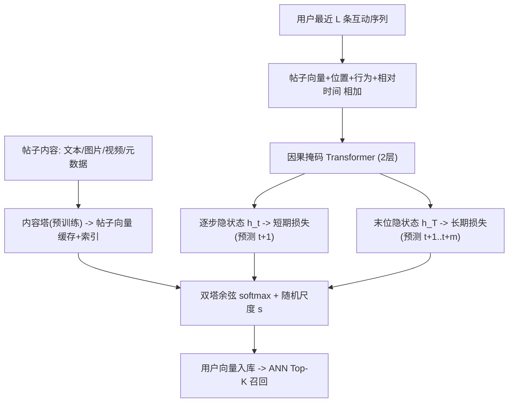
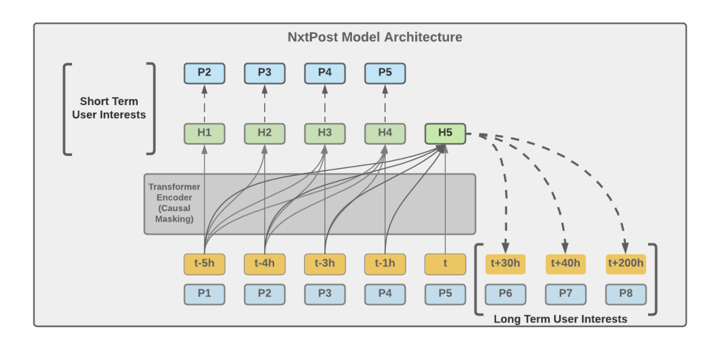

# NxtPost: User to Post Recommendations in Facebook Groups (Facebook 群组中的用户-帖子序列推荐)

- **会议/期刊**: KDD 2022 (Applied Data Science Track)
- **作者与机构**: Kaushik Rangadurai, Yiqun Liu, Siddarth Malreddy 等，Meta Platforms Inc.
- **推荐链路定位**: 召回（User-to-Post 向量检索）
- **研究方向**: 序列与会话推荐 / 协同过滤与双塔召回
- **论文原文**: [https://arxiv.org/abs/2202.03645v1](https://arxiv.org/abs/2202.03645v1)
- **开源代码**: 暂未开源

## TL;DR (1分钟核心速览)

Facebook Groups 的帖子**新、多、且生命周期极短**（本周被互动的帖子仅 23% 下周还有互动），传统 ID-based 协同过滤与固定词表的 SASRec/BERT4Rec 都失效。NxtPost 把 NLP 的因果 Transformer 迁移到推荐：删掉可学习 token 嵌入层与分类头，改用**预训练帖子内容向量 + 双塔 in-batch softmax**，并用因果掩码同时优化用户**短期**（下一步）与**长期**（未来 m 步）兴趣。离线 Batch Hits@1 从 0.15 提升到 0.64（+49% 绝对），线上 A/B 使 0.6% 更多用户获得有效群组连接。

## Background & Motivation (背景与核心矛盾)

- **主流范式**: 工业界以 ID 特征 Wide&Deep / 双塔 CF，或 SASRec、BERT4Rec 式的 ID 词表序列模型为主，用户历史多用平均池化或固定规模 item 词表建模。
- **前人局限**: ①**词表爆炸**——每日数十亿新帖，分类头与 token 嵌入层的参数量与更新频率不可承受；②**时效衰减**——帖子相关性半衰期以天计，ID 模型对新帖必须重训，冷启动（cold-start）与边缘用户（仅数次互动）几乎无从建模。
- **核心洞察 (Key Insight)**: 用户未来互动的帖子与其**最近若干条历史**高度相似（图 5），且帖子内容向量本身已编码语义；因此可把"序列建模"建在**内容向量空间**而非 ID 词表空间，词表规模就与参数量彻底解耦。同时，只用"预测下一步"会让用户向量被短期热点绑架、随时间迅速漂移（7 天内 KNN Hits@20 掉 30%）。
- **本文切入点**: 用"内容向量 + 双塔 + 因果多头注意力 + 短/长期双损失"四件套，一次性解决词表规模、时效性与用户兴趣漂移。

## Method (核心方法设计)

### 1. 整体框架 (Overall Architecture)

帖子侧由独立的内容塔离线产出向量（文本经共享 6 层 XLM-R、多图经共享 MLP + Deep Sets 融合、视频用预训练视频向量，再以注意力加权融合多通道），写入分布式向量缓存与检索索引；用户侧取最近 $L=100$ 条互动帖，将"帖子向量 + 位置嵌入 + 行为类型嵌入（点赞/评论/转发）+ 相对时间特征"逐位相加后送入 2 层因果掩码 Transformer，输出隐状态既作为逐步预测信号（短期损失），又以末位隐状态匹配未来多帖（长期损失）；检索时对用户向量做 L2 归一化后走 FAISS 类 ANN 索引取 Top-K 召回。

<figure class="paper-figure" markdown="span">
  <figcaption>图 3：NxtPost 的架构，同时优化用户的短期与长期兴趣。</figcaption>
</figure>

### 2. 关键设计拆解 (Key Designs)

1. **预训练帖子向量替代词表嵌入 + 双塔替代分类头**：痛点是 $|\mathcal{V}|\sim10^9$使 token 嵌入与输出投影成为参数与更新瓶颈。做法是把第$t$步输入直接写成$\boldsymbol{x}_t=\boldsymbol{p}_t+\boldsymbol{e}^{pos}_t+\boldsymbol{e}^{act}_t+\boldsymbol{W}_r\boldsymbol{\tau}_t$，其中$\boldsymbol{p}_t$为冻结的内容向量、$\boldsymbol{\tau}_t$为相对互动时间；输出端改为$[B,B]$ 的双塔余弦 logits。直觉：模型只学"如何在语义空间里聚合历史"，新帖零样本即可进入检索池，参数量与词表规模解耦。
2. **因果掩码 + 短期/长期双损失**：痛点是无掩码双向编码会"偷看未来"，且单标签训练只能学到单一兴趣。短期损失把每个位置 $t$的隐状态与$t+1$帖对齐，一个 batch 内可产出$B\times(L-1)$个 (history, label) 训练对；长期损失用末位隐状态$\boldsymbol{h}_T$同时匹配$t+1,\dots,t+m$ 多个未来帖，形成多标签多分类。有效原因：短期项提供密集梯度，长期项迫使用户向量落在"未来数天的兴趣质心"上，显著抑制时间漂移。
3. **训练目标、负采样与推理开销**：总损失为两项加权和，采用带温度缩放的 in-batch softmax 交叉熵（尺度 $s\in[15,20]$，对收敛至关重要），负样本即同 batch 内其他用户的全部帖子：

$$\mathcal{L}=\mathcal{L}_{short}+\lambda\mathcal{L}_{long},\quad \ell_{i}=-\log\frac{\exp(s\cdot\cos(\boldsymbol{u}_i,\boldsymbol{p}_i))}{\sum_{j=1}^{B}\exp(s\cdot\cos(\boldsymbol{u}_i,\boldsymbol{p}_j))}$$

线上：帖子向量在发帖/更新时异步写入索引，用户向量对当日有新互动的用户**每日重算**并写入 KV 存储，检索毫秒级取用户向量、百毫秒级返回候选。

## Experimental Setup & Evaluation Protocol (实验设置与评估协议)

- **数据集与预处理**: 取自 Facebook 生态内用户对公开群组/主页帖子的互动日志（点赞、评论、转发、点击、停留），先做完整性安全过滤（剔除违规帖），并过滤互动数少于 $N$ 的帖子；论文未披露精确统计量，仅给出规模量级：

| 数据集 | #Users | #Items | #Interactions | 稀疏度/密度 | 特征/场景说明 |
| :--- | :---: | :---: | :---: | :---: | :--- |
| FB Groups 生产日志 | 数亿级 | 日新增十亿级帖子 | 未披露 | 极稀疏 | 帖子含文本/多图/视频/语言/国家元数据；帖子半衰期以天计 |
| 冷启动子集 | 仅含 cold-start 与 marginal 用户 | 全库检索池 | 未披露 | 0–数次互动 | 单独评测，用于评估回填策略 |

- **数据划分与防穿越 (Splitting Strategy)**: **全局时间戳切分**——训练数据收集完毕后**留出未来一天**做评测；对每条样本严格只取目标帖之前的用户历史，绝不使用未来信息。
- **排名评测协议 (Ranking Protocol)**: 双重口径。①`Batch Hits@K`：在 batch 内 $[B,B]$ 相似度矩阵中判断对角元素是否进入该行 Top-K，与训练目标一致、迭代快，但属于采样排序；②`KNN Hits@K`：对全量帖子语料做 ANN 最近邻检索后判断命中，属于近似 `Full-Ranking`，更贴近线上。
- **对比基线与超参设置**: 基线为 ID 特征的 Wide&Dense（Que2Search 式，Liu et al. 2021）以及 TTT 的各消融变体；超参：嵌入维度沿用内容塔输出、序列长度 100、2 层编码器、dropout 0.2、梯度裁剪 1.0、学习率 $7\times10^{-4}$、batch 1024、Adam；在线用 A/B 实验，指标为"通过群组结识新人/获得支持"的用户占比。

## Key Experimental Results (实验关键数据)

### 1. 主实验对比 (Main Results)

| 模型 / 配置 | Batch Hits@1 | 绝对提升 (Improv.) |
| :--- | :---: | :---: |
| Wide & Dense (ID 特征基线) | 0.15 | — |
| Two Tower Transformer (TTT) | 0.44 | +29% |
| TTT + [CLS] 占位符 | 0.46 | +31% |
| TTT + Causal Mask | 0.46 | +31% |
| TTT + 长期兴趣损失 | 0.60 | +45% |
| TTT + 长期 + 短期兴趣损失 | 0.62 | +47% |
| **NxtPost (再加相对时间特征)** | **0.64** | **+49%** |
| 线上 A/B: TTT | +0.18% | 相对提升 |
| 线上 A/B: TTT + long-range | +0.50% | 相对提升 |
| **线上 A/B: TTT + short & long** | **+0.60%** | 相对提升 |

### 2. 消融实验 (Ablation Study)

| 消融配置 | 指标变化 (Batch Hits@1) |
| :--- | :---: |
| NxtPost 完整模型 | 基线 0.64 |
| w/o 相对互动时间特征 | −1.6% |
| 负样本下采样至 1000 | −3.1% |
| 负样本下采样至 500 | −5.3% |
| 冷启动子集: 仅热门帖回填 | +3.2% |
| 冷启动子集: 相似用户个性化回填 | +6.1% |
| 序列长度 50 → 100 | 收益饱和，>100 边际递减 |
| 编码器层数 2 → 更深 | Hits@1 增益慢于算力开销 |

### 3. 关键实验发现 (Key Findings)

1. **长期兴趣损失是最大单点收益**：仅加入 long-range 多标签匹配即把 Hits@1 从 0.46 抬到 0.60（+14 点），且把 7 天内 KNN Hits@20 的衰减从 30% 压到 2.3%——证明"多未来标签"实质是在做时间维度的正则化，而非简单增加监督信号。
2. **负样本"越多越好"而非"越精越好"**：把 in-batch 全池下采样到 1000/500 反而掉 3.1%/5.3%，说明在海量新帖场景下，负样本覆盖面（对长尾/新帖的区分度）比难负样本挖掘更关键。
3. **新鲜度是线上命门**：用户向量不每日刷新时 Recall@20 一天掉 3%、两天掉 5%、六天掉 20%；同时加入按 CTR 阈值过滤后，线上 CTR 从 −6.2% 回归到中性，说明序列召回的"相关性"提升必须配合精度闸门才能不损效率。

## Highlights & Limitations (亮点、对比与审稿批判)

- **与代表作对比 (vs. Prior Work)**: 相比 SASRec/BERT4Rec 依赖固定 item 词表与分类头，NxtPost 用外部内容向量把词表"无限化"；相比 Que2Search 式纯 ID 特征 Wide&Dense 双塔，它引入了位置—行为—时间的序列结构；相比 GCN 类（PinSage）只做邻域加权聚合，它用因果注意力显式区分历史位置权重并支持前缀级训练。
- **可迁移亮点**: ①"[CLS] 占位 + 热门/相似用户历史回填"是解决序列模型冷启动的低成本通用手段；②用**相对互动时间**特征同时缓解"旧互动偏好"与"跨会话长期兴趣"识别，可直接迁移到短视频/信息流召回。
- **审稿级局限批判**: ①离线基线几乎只有自家 Wide&Dense，未与 SASRec/BERT4Rec 等公开 SOTA 在同一数据上做数值对比，+49% 的可比性弱；②Batch Hits@1 是采样内排序指标，量级偏乐观；③双损失权重 $\lambda$、缩放尺度$s$、序列长度均靠经验网格且未给敏感度曲线；④线上收益仅 0.6%，且需额外 CTR 阈值过滤，端到端增益与工程成本的性价比讨论不足。

## Rating (四维评分)

- **方法创新性 (Novelty)**: ⭐⭐⭐⭐ （把"预训练内容向量 + 双塔 + 因果掩码 + 长期多标签"组合成可上线的序列召回范式，单点算子新意有限但组合与解耦思路清晰）
- **评估协议与实验扎实度 (Protocol & Experiments)**: ⭐⭐⭐ （有离线 Batch/KNN 双口径、冷启动子集与线上 A/B，但缺公开 SOTA 数值对比与显著性检验）
- **写作与数学规范度 (Clarity & Rigor)**: ⭐⭐⭐⭐ （工程叙事清楚、公式精简；但数据集统计与部分符号（如 $\lambda$、$m$）取值未明确）
- **工业落地与复现价值 (Industrial & Practical Value)**: ⭐⭐⭐⭐⭐ （已在 Facebook Groups 服务数亿用户，给出向量索引、日更用户向量、新鲜度衰减与 CTR 闸门等完整部署经验，复用价值极高）

