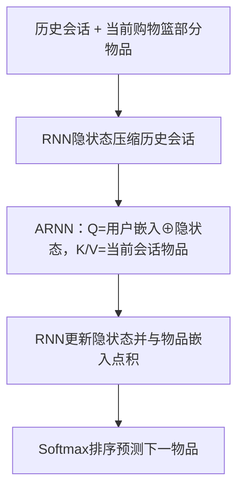

# PARSRec: Explainable Personalized Attention-fused Recurrent Sequential Recommendation Using Session Partial Actions (基于会话部分行为的可解释个性化注意力融合循环序列推荐)

- **会议/期刊**: KDD 2022
- **作者与机构**: Ehsan Gholami, Mohammad Motamedi, Ashwin Aravindakshan；UC Davis
- **推荐链路定位**: 召回/精排（序列 next-item 预测）
- **研究方向**: 序列与会话推荐
- **论文原文**: [https://arxiv.org/abs/2209.13015v1](https://arxiv.org/abs/2209.13015v1)
- **开源代码**: [https://github.com/ehgh/PARSRec](https://github.com/ehgh/PARSRec)

## TL;DR (1分钟核心速览)

针对序列推荐中“全局 item-item 关系淹没用户个体差异、会话内物品常无自然顺序、长历史需截断”的痛点，PARSRec 将**显式用户嵌入作为注意力 Query**，与 RNN 融合：RNN 压缩历史会话，注意力只审视当前会话已购部分。Nielsen 上采用 100 候选采样排序，NDCG@5 较 BERT4Rec 提升 **27.9%**，HR@1 提升 **38.8%**。

## Background & Motivation (背景与核心矛盾)

- **主流范式**: SASRec/BERT4Rec 用 self-attention 学全局 item-item 关系，GRU4Rec 等用 RNN 将历史压入隐状态。
- **前人局限**: self-attention 依赖位置嵌入且需截断长历史；RNN 易把购物篮中互不相关物品纠缠进单一表示。二者多只学“通用”物品关系，难以表达用户 A 买牛奶配饼干、用户 B 买牛奶配麦片这类个体差异。
- **核心洞察 (Key Insight)**: 当前会话的部分行为通常比久远历史更能决定下一件物品；会话内物品不应假设有序，而会话之间有时序。
- **本文切入点**: 把“历史会话”和“当前会话部分动作”分开建模，并用显式用户嵌入调制注意力，从而同时获得个性化与可解释性。

## Method (核心方法设计)

### 1. 整体框架 (Overall Architecture)

输入用户 $u$ 的历史会话与当前购物篮已购物品。RNN 隐状态压缩历史行为，初始隐状态为历史物品嵌入的加权平均；每个 ARNN 块以“用户嵌入 + 上一隐状态”为 Query，以当前会话物品嵌入为 Key/Value 做多头注意力，输出送入 RNN 更新隐状态，再与物品嵌入矩阵点积并 softmax 预测下一物品。所有 ARNN 块共享参数，且不依赖位置嵌入，因此历史长度不增加模型容量，计算主要取决于当前会话长度。

### 2. 关键设计拆解 (Key Designs)

1. **个性化注意力 Query（ARNN 核心）**：传统 self-attention 的 Q/K/V 均来自物品嵌入，只能学全局关系。PARSRec 令 $Q_j=[\mathbf{e}_u;\tilde{h}_{j-1}]$，$K=V=\mathbf{E}_V[S^{(u)}_{t_i,<j}]$，$\tilde{v}_j=\mathrm{MHA}(Q_j,K,V)$。用户嵌入进入 Query 后，注意力权重随用户变化，可直接可视化“该用户当前篮中哪些物品影响下一件”。

2. **会话部分动作 + 改进 Teacher Forcing**：训练时按当前篮子逐步预测，若上一步预测命中篮中剩余物品则作为下一步输入，否则从剩余物品随机选一个；只使用已见前缀，避免未来信息泄漏。该策略把强相关物品在位置上拉近，缓解“篮子内无序”与单向/双向建模的矛盾。

3. **训练目标、负采样与推理效率**：输出 $\hat{y}_j=\mathrm{softmax}(\tilde{h}_j\mathbf{E}_V^\top)$，损失为$\mathcal{L}=-\log\frac{\exp(\hat{y}_j[v'_{j+1}])}{\sum_k\exp(\hat{y}_j[k])}$。训练用全库 softmax 交叉熵，**无显式负采样**；评估时用 100 个采样候选加真实物品排序。推理每步需$O(|V|d)$ 打分，注意力开销随当前会话长度增长，不随历史长度增长。

## Experimental Setup & Evaluation Protocol (实验设置与评估协议)

- **数据集与预处理**:

| 数据集 | #Users | #Items | #Interactions | 稀疏度/密度 | 特征/场景说明 |
| :--- | :---: | :---: | :---: | :---: | :--- |
| Synthetic | 8,192 | 2,000 | 5.8M | 0.10 | 受控模拟，类别协方差矩阵分组 |
| Nielsen | 12,800 | 1,302 | 15.1M | 0.21 | 家庭购物面板，Module 级物品；剔除少于 10 条记录的用户/物品 |

- **数据划分与防穿越**: 用户最后一个会话作测试，倒数第二个作验证，其余作训练；测试会话长度 >1，按篮子内顺序逐步预测。仅使用已见前缀，不泄漏当前步之后信息。
- **排名评测协议**: **Sampled Ranking**，每个正样本配 100 个随机采样物品再加真实物品；因 Nielsen 约 81% 测试篮物品在历史中出现，采样池同时含正/负物品。指标为 HR@1/5/10、NDCG@5/10、Sess-Prec@1/5/10。
- **对比基线与超参**: 原文仅对比 POPRec、SASRec、BERT4Rec 三个基线；$d_u=d_v=128$，$N=1$层注意力、$h=2$ 头，dropout 0.1，batch 256，Adam/SparseAdam，lr 0.001，梯度裁剪 30。原文称提升显著，但未报告 p 值细节。

## Key Experimental Results (实验关键数据)

### 1. 主实验对比 (Main Results)

| 数据集 | 指标 | POPRec | SASRec | BERT4Rec | PARSRec | Improv.% |
| :--- | :--- | ---: | ---: | ---: | ---: | ---: |
| Synthetic | HR@5 | 0.0028 | 0.3919 | 0.4150 | **0.4791** | +15.4 |
| Synthetic | NDCG@5 | 0.0013 | 0.2872 | 0.3061 | **0.3489** | +13.9 |
| Synthetic | Sess-Prec@5 | 0.0029 | 0.3931 | 0.4163 | **0.4784** | +14.9 |
| Nielsen | HR@1 | 0.0008 | 0.1663 | 0.1761 | **0.2444** | +38.8 |
| Nielsen | HR@5 | 0.0921 | 0.4235 | 0.4833 | **0.5934** | +22.7 |
| Nielsen | NDCG@5 | 0.0454 | 0.2991 | 0.3290 | **0.4208** | +27.9 |
| Nielsen | NDCG@10 | 0.0680 | 0.3497 | 0.3987 | **0.4632** | +16.1 |
| Nielsen | Sess-Prec@10 | 0.1632 | 0.5729 | 0.6344 | **0.7439** | +17.2 |

### 2. 消融实验 (Ablation Study)

| 变体 | Syn NDCG@10 | Syn Sess@10 | Nielsen NDCG@10 | Nielsen Sess@10 |
| :--- | ---: | ---: | ---: | ---: |
| PARSRec default | **0.3800** | **0.5792** | 0.4632 | 0.7439 |
| Remove LN | 0.3746 | 0.5756 | 0.4183 | 0.6775 |
| Remove Dropout | 0.3775 | 0.5780 | 0.4553 | 0.7356 |
| Remove Q in LN | 0.3745 | 0.5643 | 0.4601 | 0.7400 |
| #Att Layers=2 | 0.3622 | 0.5506 | 0.4543 | 0.7320 |
| #heads=1 | 0.3781 | 0.5769 | 0.4602 | 0.7399 |
| #heads=4 | 0.3799 | 0.5790 | 0.4628 | 0.7431 |
| FFN pre-RNN | 0.3775 | 0.5723 | 0.4637 | 0.7426 |
| FFN post-RNN | 0.3362 | 0.5009 | 0.4189 | 0.6900 |
| Extra user features | - | - | **0.4759** | **0.7591** |

### 3. 关键实验发现 (Key Findings)

1. **当前会话注意力是主要收益源**：Nielsen 上 NDCG@5 从 BERT4Rec 的 0.3290 升至 0.4208，HR@1 从 0.1761 升至 0.2444；说明在重复购买率高的购物篮场景，部分篮子信息比长历史全局注意力更关键。
2. **可解释性得到受控验证**：合成数据中，学到的类别注意力热图与人为设定的协方差矩阵及用户组差异一一对应，且无需类别标签；表明显式用户 Query 能恢复个性化的互补/替代关系。
3. **归一化与 RNN 后 FFN 极敏感**：移除 LN 使 Nielsen NDCG@10 从 0.4632 降至 0.4183；RNN 后加 FFN 在合成数据降至 0.3362。额外用户特征仅带来约 2% 提升（NDCG@10 0.4759），说明用户嵌入已捕获主要个性化信息。

## Highlights & Limitations (亮点、对比与审稿批判)

- **与代表作对比 (vs. Prior Work)**: SASRec/BERT4Rec 以物品自注意力学全局关系并依赖位置嵌入；PARSRec 用显式用户嵌入调制 Query，并将历史会话交给 RNN、当前篮子交给注意力，天然支持无序篮子和长历史。
- **可迁移亮点**: “用户嵌入拼入 Query”可低成本注入个性化到任意会话注意力；改进 teacher forcing 可把相关物品在序列中拉近，适合篮子/套装推荐。
- **审稿级局限批判**: 仅 3 个基线与单一下游数据集，采样 100 候选排序弱于 Full-Ranking，且未给显著性检验细节；模型假设会话内无序，在强顺序场景可能失效，随机 teacher forcing 也可能引入噪声。

## Rating (四维评分)

- **方法创新性 (Novelty)**: ⭐⭐⭐⭐ （显式用户 Query + RNN/注意力分工清晰，机制简单有效，但组件组合创新大于理论突破）
- **评估协议与实验扎实度 (Protocol & Experiments)**: ⭐⭐⭐ （有合成受控验证与消融，但仅 3 个基线、Sampled Ranking，统计检验不充分）
- **写作与数学规范度 (Clarity & Rigor)**: ⭐⭐⭐⭐ （架构与公式交代清楚，复杂度分析明确；部分实验细节与显著性说明略简）
- **工业落地与复现价值 (Industrial & Practical Value)**: ⭐⭐⭐⭐ （代码开源，历史长度不增参，适合购物篮补全；但全库 softmax 与注意力仍带来部署开销）

