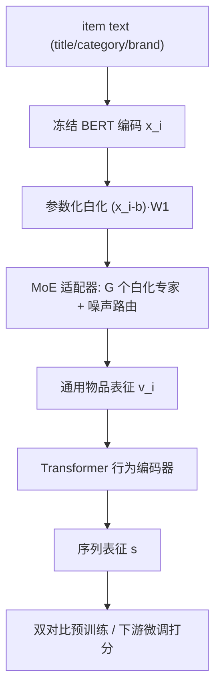

# Towards Universal Sequence Representation Learning for Recommender Systems (面向推荐系统的通用序列表征学习)

- **会议/期刊**: KDD 2022 (Research Track)
- **作者与机构**: Yupeng Hou, Shanlei Mu, Wayne Xin Zhao, Yaliang Li, Bolin Ding, Ji-Rong Wen（中国人民大学高瓴人工智能学院、阿里集团）
- **推荐链路定位**: 召回（Next-Item 序列召回）
- **研究方向**: 序列与会话推荐 / 跨域与多场景推荐
- **论文原文**: [https://arxiv.org/abs/2206.05941v1](https://arxiv.org/abs/2206.05941v1)
- **开源代码**: [https://github.com/RUCAIBox/UniSRec](https://github.com/RUCAIBox/UniSRec)

## TL;DR (1分钟核心速览)

现有序列推荐依赖显式 item ID 建模，换域即失效、冷启物品无解。UniSRec 彻底丢弃 ID 输入，改用商品描述文本经 BERT 编码，叠加**参数化白化**去各向异性与 **MoE 增强适配器**做域融合，再用"跨域负采样的序列-物品 / 序列-序列双对比预训练"学出通用序列表征；迁移到新域时只微调适配器少量参数。在 6 个数据集上采用 `Leave-One-Out + Full-Ranking` 协议，Pantry Recall@10 相对最优基线提升 **38.32%**，跨平台 Online Retail 亦提升 3.15%。

## Background & Motivation (背景与核心矛盾)

- **主流范式**: GRU4Rec / Caser / SASRec / BERT4Rec 等把用户行为构造为 ID 序列，用 RNN/Transformer 捕获转移模式，item embedding 与模型参数绑定在单一域的词表上。
- **前人局限**: ① 新域 ID 词表完全不同，模型必须从零重训，跨域复用几乎不可能；② 冷启/长尾物品交互稀少，ID embedding 学不出来。
- **已有迁移方案的不足**: CCDR、RecGURU、PeterRec 依赖重叠用户或重叠物品作锚点；ZESRec 虽用文本做零样本，但要求源域与目标域"语义相近"，且只沿用现成架构，无法融合多个弱相关域（易出现 seesaw 振荡）。
- **核心洞察 (Key Insight)**: 自然语言是天然的跨域语义桥梁；但 BERT 输出存在严重的**各向异性 (anisotropy)**，多域文本混合后语义空间更扭曲，直接当特征反而次优；且多域简单混合预训练会互相冲突。
- **本文切入点**: 以 item text 唯一作为物品标识，用"可学习白化 + 多专家自适应组合"把多域语义对齐到统一推荐空间，并用跨域负采样对比任务替代朴素混合训练。

## Method (核心方法设计)

### 1. 整体框架 (Overall Architecture)

输入是来自多个域的用户交互序列 $s=\{i_1,\dots,i_n\}$，每个物品只带描述文本$t_i$（title/category/brand）。固定 BERT 编码文本得$\boldsymbol{x}_i$，经参数化白化与 MoE 适配器得到通用物品表征$\boldsymbol{v}_i$；再送入自注意力行为编码器（取最后位置隐状态）得序列表征$\boldsymbol{s}$。预训练阶段联合优化序列-物品与序列-序列两个对比任务（in-batch 天然跨域负样本）。下游迁移时冻结 BERT 与行为编码器，仅微调白化/MoE 的少量参数，按是否有 ID 走 inductive 或 transductive 两种打分。

### 2. 关键设计拆解 (Key Designs)

1. **参数化白化 (Parametric Whitening)**：动机是 BERT 表征空间各向异性、多域混合后更严重，原版 whitening 用预设均值方差无法适配未见域。本文改为**可学习**的线性变换 $\tilde{\boldsymbol{x}}_i=(\boldsymbol{x}_i-\boldsymbol{b})\cdot\boldsymbol{W}_1$，$\boldsymbol{b}\in\mathbb{R}^{d_W}$、$\boldsymbol{W}_1\in\mathbb{R}^{d_W\times d_V}$均为参数。直觉：减均值去公共方向、乘矩阵重标定各向尺度，使表征更各向同性，且下游只需调$\boldsymbol{b},\boldsymbol{W}_1$ 即可快速适配新域（是"参数高效微调"的载体）。

2. **MoE 增强适配器 (MoE-enhanced Adaptor)**：单一映射难以同时容纳"食品域高频词 natural/sweet"与"电影域 war/love"的域偏置。本文并联 $G$个白化专家，用带噪声的 router 自适应加权：$\boldsymbol{v}_i=\sum_{k=1}^{G}g_k\cdot\tilde{\boldsymbol{x}}_i^{(k)}$，其中$\boldsymbol{g}=\mathrm{Softmax}(\boldsymbol{x}_i\boldsymbol{W}_2+\boldsymbol{\delta})$，$\boldsymbol{\delta}=\mathrm{Norm}()\cdot\mathrm{Softplus}(\boldsymbol{x}_i\boldsymbol{W}_3)$。以**原始 BERT 向量**（含域偏置）作路由输入，噪声项平衡专家负载；这样无需显式跨域语义映射，而由门控隐式建立域间相关性。

3. **双对比预训练目标与推理开销**：仅混合多域序列会 seesaw 冲突，故设两任务——序列-物品任务用跨域 in-batch 负样本做下一物品判别 $\ell_{S\text{-}I}=-\sum_j\log\frac{\exp(\boldsymbol{s}_j\cdot\boldsymbol{v}_j/\tau)}{\sum_{j'}\exp(\boldsymbol{s}_j\cdot\boldsymbol{v}_{j'}/\tau)}$；序列-序列任务以 item drop / word drop 增广正例$\ell_{S\text{-}S}$同式。总损失$\mathcal{L}_{PT}=\ell_{S\text{-}I}+\lambda\ell_{S\text{-}S}$（$\lambda=10^{-3}$，$G=8$）。**免负采样**（in-batch 即负例）；下游 inductive 用$P_I=\mathrm{Softmax}(\boldsymbol{s}\cdot\boldsymbol{v}_{i_{t+1}})$只调白化参数，transductive 追加 ID 向量$P_T=\mathrm{Softmax}(\tilde{\boldsymbol{s}}\cdot(\boldsymbol{v}_{i_{t+1}}+\boldsymbol{e}_{i_{t+1}}))$，骨干网络全程冻结，迁移成本极低。

## Experimental Setup & Evaluation Protocol (实验设置与评估协议)

- **数据集与预处理**: 全部按 `5-core` 过滤，按用户分组并按时间戳升序排列；Amazon 文本取 title+categories+brand 拼接，Online Retail 用 Description，截断 512 token。

| 数据集 | #Users | #Items | #Interactions | Avg. $n$ | 场景说明 |
| :--- | :---: | :---: | :---: | :---: | :--- |
| 预训练五源域(Food/CDs/Kindle/Movies/Home) | 1,361,408 | 446,975 | 14,029,229 | 13.51 | Amazon 五品类联合预训练 |
| Scientific | 8,442 | 4,385 | 59,427 | 7.04 | 跨域目标域 |
| Pantry | 13,101 | 4,898 | 126,962 | 9.69 | 跨域目标域 |
| Instruments | 24,962 | 9,964 | 208,926 | 8.37 | 跨域目标域 |
| Arts | 45,486 | 21,019 | 395,150 | 8.69 | 跨域目标域 |
| Office | 87,436 | 25,986 | 684,837 | 7.84 | 跨域目标域 |
| Online Retail | 16,520 | 3,469 | 519,906 | 26.90 | 跨平台(UK 零售)，与 Amazon 无重叠用户/物品 |

- **数据划分与防穿越**: `Leave-One-Out`——最后一项为测试、倒数第二项为验证、其余训练。
- **排名评测协议**: 无偏 `Full-Ranking`（"rank the ground-truth item among all the other items"），指标 Recall@{10,50}、NDCG@{10,50}，对全部测试用户取平均。
- **对比基线与超参**: SASRec、BERT4Rec、FDSA、S³-Rec、CCDR、RecGURU、ZESRec；batch size 2048，embedding 维度搜索 {64,128,300}，学习率 {3e-4,1e-3,3e-3,1e-2}，early stopping（patience=10，以 NDCG@10 为准），预训练 300 epoch；配对的 $t$-test，$p<0.01$ 标 `*`。

## Key Experimental Results (实验关键数据)

### 1. 主实验对比 (Main Results)

Recall@10（Bold 为最优，下划线为次优）：

| 数据集 | SASRec | BERT4Rec | FDSA | S³-Rec | ZESRec | RecGURU | UniSRec$_t$| UniSRec$_{t+ID}$ | Improv. |
| :--- | :---: | :---: | :---: | :---: | :---: | :---: | :---: | :---: | :---: |
| Scientific | 0.1080 | 0.0488 | 0.0899 | 0.0525 | 0.0851 | 0.1023 | 0.1188* | **0.1235*** | +14.35% |
| Pantry | 0.0501 | 0.0308 | 0.0395 | 0.0444 | 0.0454 | 0.0469 | 0.0636* | **0.0693*** | +38.32% |
| Instruments | 0.1118 | 0.0813 | 0.1070 | 0.1056 | 0.0783 | 0.1113 | 0.1189* | **0.1267*** | +13.33% |
| Arts | 0.1108 | 0.0722 | 0.1002 | 0.1003 | 0.0664 | 0.1084 | 0.1066 | **0.1239*** | +11.82% |
| Office | 0.1056 | 0.0825 | 0.1118 | 0.1030 | 0.0641 | 0.1145 | 0.1013 | **0.1280*** | +11.79% |
| Online Retail | 0.1460 | 0.1349 | 0.1490 | 0.1418 | 0.1103 | 0.1467 | 0.1449 | **0.1537*** | +3.15% |

NDCG@10 同向：Scientific +10.52%、Pantry +35.22%、Online Retail +0.70%；但 Instruments / Arts / Office 三域 NDCG@10 未超过 FDSA（如 Instruments FDSA 0.0796 vs. 0.0748），说明纯文本序列表征在"文本信息量充足、ID 协同信号仍强"的场景并非全胜。

### 2. 消融实验 (Ablation Study)

图 3 读图近似（Scientific / Online Retail 的 Recall@10 相对完整模型的变化，负号为下降）：

| 变体 | Scientific | Online Retail | 说明 |
| :--- | :---: | :---: | :--- |
| w/o MoE ($G=1$) | ≈ −1.3 pp | ≈ −0.6 pp | 退化最严重，域融合能力丧失 |
| w/o S-I（序列-物品对比） | ≈ −0.8 pp | ≈ −0.4 pp | 跨域物品负例缺失 |
| w/o PW（改普通线性层） | ≈ −0.5 pp | ≈ −0.3 pp | 各向异性未消除 |
| w/o S-S（序列-序列对比） | ≈ −0.3 pp | ≈ −0.2 pp | 序列级增广收益最小 |
| UniSRec (full) | 0.1235 | 0.1537 | — |

### 3. 关键实验发现 (Key Findings)

1. **多域联合 > 单域 > 无预训练**：图 2 显示在五源域"All"上预训练的模型在 Scientific 与 Online Retail 上均优于任一单域预训练与 "None"（从头训练），说明跨弱相关域融合确实带来增益而非振荡。
2. **长尾收益最大**：图 4 中在训练集出现次数最低的桶（Scientific `[0,5)`、Online Retail `[0,20)`），UniSRec 相对 SASRec 的 Recall@10 提升比最热门桶高出一个量级，印证文本语义可替代稀缺 ID 协同信号。
3. **跨平台迁移可行**：Amazon→Online Retail 无重叠用户与物品，UniSRec$_{t+ID}$ 仍达 Recall@10 0.1537 / NDCG@50 0.1239（+1.31%），案例显示模型学到了 "Dog→Cat" 这类跨平台语义转移模式。

## Highlights & Limitations (亮点、对比与审稿批判)

- **与代表作对比**: 相比 SASRec/BERT4Rec——彻底移除 ID 依赖，具备 inductive 冷启能力；相比 RecGURU/CCDR——不要求重叠用户/物品锚点，支持 $M\to N$多域预训练；相比 ZESRec——不限定源/目标域语义相近，且额外提供 MoE 域融合与双对比任务（表 1 中唯一同时覆盖 1→1、$M\to N$、无重叠、transductive、inductive 全部设定）。
- **可迁移亮点**: ①"固定 BERT + 只训白化/MoE"的参数高效迁移范式，可直接移植到多模态/LLM 文本表征的域适配；②跨域 in-batch 负采样是零成本正则，可插入任何对比式序列模型。
- **审稿级局限批判**: ① 文本是唯一标识，若商品描述缺失或噪声大（短标题、纯图片电商），表征质量会骤降，论文未做缺文本鲁棒性分析；② 跨平台提升幅度偏小（Recall@10 仅 +3.15%，Recall@50 相对 RecGURU 为 0.00%），显著性弱；③ 预训练需 300 epoch 且 BERT 前向依赖离线文本缓存，线上新增物品需实时编码，工程时延未评估；④ 多域负采样比例、专家数 $G$、$\lambda$ 均只给单点取值，缺敏感性分析。

## Rating (四维评分)

- **方法创新性 (Novelty)**: ⭐⭐⭐⭐ （首个把"ID-agnostic 通用序列表征"落到多域预训练+参数高效迁移的完整框架，白化与 MoE 组合有清晰几何直觉）
- **评估协议与实验扎实度 (Protocol & Experiments)**: ⭐⭐⭐⭐ （6 数据集跨域+跨平台、Full-Ranking 无偏评测、配对 t 检验齐全；但缺超参敏感性与长尾量化的绝对数值）
- **写作与数学规范度 (Clarity & Rigor)**: ⭐⭐⭐⭐ （公式简洁、每模块动机-算子-收益链条清晰，噪声路由式 (5) 的定义与实现细节略含糊）
- **工业落地与复现价值 (Industrial & Practical Value)**: ⭐⭐⭐⭐ （基于 RecBole 开源且放出预训练模型，冻结骨干只调小适配器，迁移成本低；线上需补文本实时编码延迟评估）

