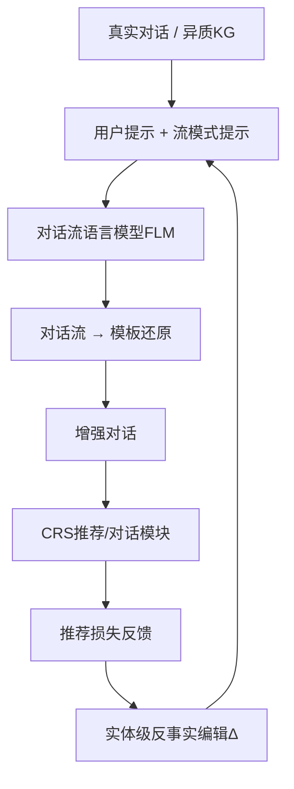
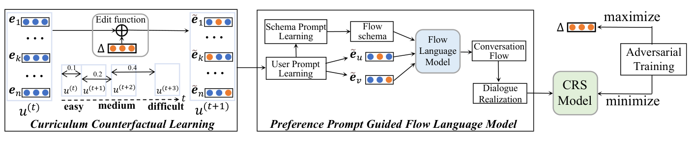

# Improving Conversational Recommendation Systems via Counterfactual Data Simulation (通过反事实数据模拟改进对话推荐系统)

- **会议/期刊**: KDD 2023
- **作者与机构**: Xiaolei Wang, Kun Zhou, Xinyu Tang, Wayne Xin Zhao, Fan Pan, Zhao Cao, Ji-Rong Wen；中国人民大学高瓴人工智能学院/信息学院、华为泊松实验室
- **推荐链路定位**: 端到端对话推荐（训练数据增强）
- **研究方向**: 对话推荐与智能体仿真 / 对话数据增强
- **论文原文**: [https://arxiv.org/abs/2306.02842v1](https://arxiv.org/abs/2306.02842v1)
- **开源代码**: [https://github.com/RUCAIBox/CFCRS](https://github.com/RUCAIBox/CFCRS)

## TL;DR (1分钟核心速览)

针对对话推荐系统（CRS）标注昂贵、训练数据稀缺的痛点，本文提出CFCRS：以实体级反事实编辑改写用户偏好，再由用户/模式提示引导的对话流语言模型生成对话，并用课程对抗训练优化编辑函数。在ReDial与INSPIRED上，对KBRD/BARCOR/UniCRS三种骨干均稳定提升，UniCRS的Recall@10分别提升6.5%与13.2%。

## Background & Motivation (背景与核心矛盾)

- **主流范式**: CRS通常由推荐模块与对话模块组成，借助知识图谱（KG）或预训练语言模型（PLM）增强实体语义与回复生成。
- **前人局限**: 高质量推荐型对话标注成本高，现有数据集规模有限；EDA/Mixup等启发式增强只做局部改写，难以保证对话流的合理性与全局一致性，甚至引入异常对话。
- **核心洞察 (Key Insight)**: 用户偏好是决定对话走向的关键因素；“若干预观测到的用户偏好，对话会变成什么样”可通过反事实数据模拟回答。
- **本文切入点**: 将对话抽象为实体序列（对话流）与类型序列（流模式），在实体表征层做可控干预，再以流语言模型生成连贯对话，并用课程对抗训练让增强数据服务于推荐目标。

## Method (核心方法设计)

### 1. 整体框架 (Overall Architecture)

CFCRS将对话组织为实体序列$f_{u,v}=\langle e_1,\dots,e_n\rangle$与流模式$s_{u,v}=\langle t_1,\dots,t_n\rangle$。先由R-GCN在异质KG上学习用户实体偏好，并以频繁模式分类预测流模式；二者作为提示输入Transformer FLM，自回归生成对话流，再经模板去词化还原为完整对话。训练时在实体表征上施加可控扰动，生成反事实用户偏好，并以课程对抗训练交替优化编辑函数与推荐模块，最后用增强数据训练对话模块。

<figure class="paper-figure" markdown="span">
  <figcaption>图1：我们的方法CFCRS概览。我们首先采用课程反事实学习在表示层面增强用户偏好，然后使用由用户提示和模式提示引导的流语言模型生成对话流，再将其实现为对话。编辑函数和CRS模型通过对抗训练进行优化，以同时提升增强数据的质量和推荐性能。</figcaption>
</figure>

### 2. 关键设计拆解 (Key Designs)

1. **偏好/模式提示驱动的对话流生成**：痛点在于自由对话难以保持信息寻求流程的连贯。本文将用户偏好与流模式作为FLM提示：$\boldsymbol{e}_u=\mathbf{E}_u\boldsymbol{\alpha}$，$\Pr(s_{u,v}|u,v)=\operatorname{softmax}(\operatorname{MLP}([\boldsymbol{e}_u,\boldsymbol{e}_v]))$，再生成$\Pr(f_{u,v})=\prod_{j=1}^{n}\Pr(e_j|e_{<j})$。实体级提示让生成既贴合用户偏好，又受模式约束。
2. **实体级反事实编辑**：离散选实体、连续改表征，$f(\boldsymbol{e}_i)=\boldsymbol{e}_i+\boldsymbol{\Delta}_i$，每次编辑一个实体并重复$k$次。相比整句改写，该方式不破坏对话流，且靠近决策边界的扰动更具判别性。
3. **课程对抗训练与推理效率**：编辑函数最大化推荐损失、推荐模块最小化损失：$\min_{\Theta_R}\max_{\Theta_E}\mathbb{E}_{C\sim\pi_{\Theta_E}}[\mathcal{L}_{\Theta_R}(C)-\lambda\|\Theta_E\|_2^2]$；离散对话生成用REINFORCE更新$\Theta_E$，并以$\lambda=\rho\times\delta(k)$由易到难增加扰动。推荐损失为全库softmax交叉熵，未额外负采样；模拟在离线完成，在线推理不增加FLM开销。

## Experimental Setup & Evaluation Protocol (实验设置与评估协议)

- **数据集与预处理**: 按原文预处理，未报告5-core过滤；两个英文电影推荐对话数据集：

| 数据集 | #Dialogues | #Utterances | #Items | 场景说明 |
| :--- | :---: | :---: | :---: | :--- |
| ReDial | 10,006 | 182,150 | 51,699 | 电影推荐，较大规模 |
| INSPIRED | 1,001 | 35,811 | 1,783 | 电影推荐，小规模 |

- **数据划分与防穿越 (Splitting Strategy)**: 沿用CRSLab的对话级训练/验证/测试划分；输入仅对话历史$C_j$，不泄露未来轮次，原文未披露具体划分比例。
- **排名评测协议 (Ranking Protocol)**: 全库排序，从整个物品集$\mathcal{I}$中排序，报告Recall@10/50、MRR@10/50、NDCG@10/50；训练用交叉熵，无额外负采样描述。
- **对比基线与超参设置**: 基线含BERT/GPT-2/DialoGPT、ReDial/KBRD/BARCOR/UniCRS，以及EDA/Mixup增强；FLM为12层Transformer、隐藏/嵌入768；最多20轮并早停；AdamW，学习率1e-4；$\lambda$初值{1e-1,1e-2,1e-3}，衰减{0.9,0.8,0.7}；t-test$p<0.05$。

## Key Experimental Results (实验关键数据)

### 1. 主实验对比 (Main Results)

| 模型 | ReDial R@10 | ReDial R@50 | ReDial NDCG@10 | INSPIRED R@10 | INSPIRED R@50 | INSPIRED NDCG@10 |
| :--- | :---: | :---: | :---: | :---: | :---: | :---: |
| ReDial | 0.129 | 0.287 | 0.005 | 0.117 | 0.285 | 0.005 |
| BERT | 0.156 | 0.357 | 0.079 | 0.179 | 0.328 | 0.098 |
| DialoGPT | 0.173 | 0.361 | 0.089 | 0.125 | 0.247 | 0.092 |
| KBRD | 0.170 | 0.366 | 0.088 | 0.210 | 0.390 | 0.135 |
| BARCOR | 0.169 | 0.374 | 0.088 | 0.185 | 0.339 | 0.104 |
| UniCRS | 0.217 | 0.428 | 0.118 | 0.272 | 0.441 | 0.184 |
| KBRD-CFCRS | 0.206 | 0.408 | 0.109 | 0.226 | 0.426 | 0.145 |
| BARCOR-CFCRS | 0.198 | 0.406 | 0.107 | 0.246 | 0.421 | 0.145 |
| **UniCRS-CFCRS** | **0.231** | **0.444** | **0.129** | **0.308** | **0.466** | **0.204** |

相对最强骨干UniCRS，UniCRS-CFCRS在ReDial上R@10 +6.5%、R@50 +3.7%、NDCG@10 +9.3%；在INSPIRED上R@10 +13.2%、R@50 +5.7%、NDCG@10 +10.9%。

### 2. 消融实验 (Ablation Study)

| 变体 | ReDial R@10 | ReDial R@50 | INSPIRED R@10 | INSPIRED R@50 |
| :--- | :---: | :---: | :---: | :---: |
| BARCOR | 0.169 | 0.374 | 0.185 | 0.339 |
| +CFCRS | 0.198 | 0.406 | 0.246 | 0.421 |
| -Curriculum | 0.187 | 0.399 | 0.190 | 0.405 |
| -Adversarial | 0.184 | 0.389 | 0.225 | 0.395 |
| -FLM | 0.181 | 0.385 | 0.211 | 0.390 |
| -Frequent Schema | 0.186 | 0.394 | 0.246 | 0.407 |
| -Template | 0.183 | 0.382 | 0.174 | 0.385 |

### 3. 关键实验发现 (Key Findings)

- **模型无关的稳定增益**：CFCRS对KBRD/BARCOR/UniCRS三种不同推荐模块均有效，UniCRS-CFCRS在ReDial/INSPIRED的R@10达0.231/0.308，说明增益不依赖单一架构。
- **模板还原与FLM是连贯性关键**：移除Template后BARCOR在INSPIRED的R@10从0.246降至0.174，移除FLM降至0.211；课程与对抗训练移除也稳定下降，证明“生成连贯流+可控扰动”缺一不可。
- **低资源场景收益更突出**：仅用20%训练数据时，CFCRS即可接近KBRD用100%数据的效果；但INSPIRED仅1,001段对话，对$\lambda$与增强比例更敏感，说明小数据下课程调度仍需精细调参。

## Highlights & Limitations (亮点、对比与审稿批判)

- **与代表作对比 (vs. Prior Work)**: EDA/Mixup只做启发式局部改写，不感知目标CRS模型；KBRD/UniCRS借助KG或PLM缓解数据稀缺但不直接扩充数据。CFCRS首次将反事实数据模拟用于CRS，并通过对抗训练让增强样本面向推荐损失。
- **可迁移亮点**: 实体级“离散选择+连续扰动”的编辑方式可迁移到序列推荐/对话推荐的数据增强；课程对抗调度可用于任何“生成器-推荐器”协同训练场景。
- **审稿级局限批判**: 多阶段“流生成→模板还原”依赖固定FLM与模板，语言多样性和真实感受限；仅在两个英文电影数据集验证，缺少线上A/B与跨域评估，小规模INSPIRED上超参敏感。

## Rating (四维评分)

- **方法创新性 (Novelty)**: ⭐⭐⭐⭐ （首次把反事实数据模拟引入CRS，实体级编辑+课程对抗的组合有新意）
- **评估协议与实验扎实度 (Protocol & Experiments)**: ⭐⭐⭐⭐ （两数据集、三骨干、人工评测、消融与低资源实验较完整，但域覆盖偏窄）
- **写作与数学规范度 (Clarity & Rigor)**: ⭐⭐⭐⭐ （流程与公式清晰，FLM/编辑/对抗三部分衔接自然；个别符号与生成概率写法可更严谨）
- **工业落地与复现价值 (Industrial & Practical Value)**: ⭐⭐⭐ （代码开源、模型无关，离线模拟有额外成本，模板化生成限制线上多样化部署）

