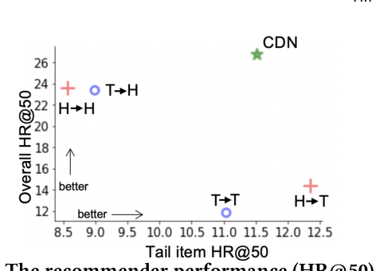
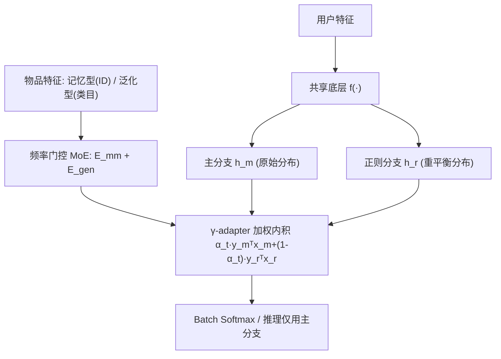
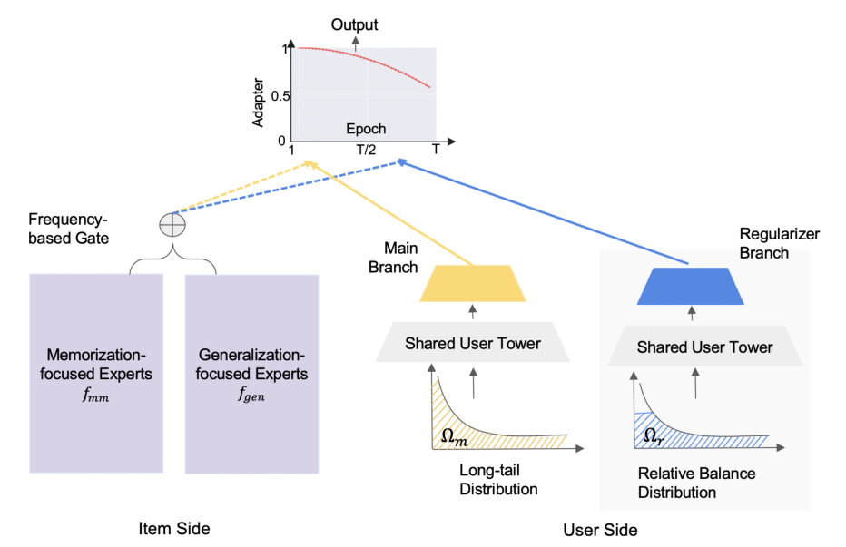

# Empowering Long-tail Item Recommendation through Cross Decoupling Network (CDN) (交叉解耦网络：面向长尾物品推荐的双侧偏差解耦)

- **会议/期刊**: KDD 2023 (Applied Data Science Track)
- **作者与机构**: Yin Zhang, Ruoxi Wang, Tiansheng Yao, Xinyang Yi, Lichan Hong, James Caverlee, Ed H. Chi, Derek Zhiyuan Cheng (Google Research Brain Team / Texas A&M University)
- **推荐链路定位**: 召回（双塔检索）
- **研究方向**: 冷启动与长尾推荐 / 去偏公平与工业架构
- **论文原文**: [https://arxiv.org/abs/2210.14309v3](https://arxiv.org/abs/2210.14309v3)
- **开源代码**: 暂未开源

## TL;DR (1分钟核心速览)

针对工业推荐中长尾偏斜导致“提尾部必伤整体”的困境，本文用贝叶斯分解指出偏差来自两处：物品先验 $p(i)$的训练/服务漂移与条件偏好$p(u|i)$在尾部物品上的欠拟合。CDN 在物品侧以频率门控 MoE 解耦记忆/泛化专家、在用户侧以双分支（主分支 + 重采样正则分支）解耦采样分布，并用随训练衰减的$\gamma$-adapter 柔性迁移注意力。在 MovieLens-1M 上 HR@50 整体 +8.39%、尾部 +11.53%，BookCrossing 尾部 HR@50 +13.31%，Google 线上稀疏切片 KPI +3.75%。

## Background & Motivation (背景与核心矛盾)

- **主流范式**: 工业界靠 LogQ 校正、重采样/重加权（ClassBalance）在双塔召回中压制头部；学术界则推崇两阶段解耦训练（NDP）——先按原始长尾分布学表征，再在均衡数据上微调分类器。
- **前人局限**: (1) 两阶段解耦在推荐场景出现**严重遗忘**：切换到均衡分布后，第一阶段学到的头部知识被覆盖，整体指标大幅下滑；(2) 两阶段训练在大规模系统中难以维护，元学习类方法训练开销翻倍，无法上线；(3) 这些方法只压物品分布偏差，忽略了 $p(u|i)$ 本身的偏差。
- **核心洞察 (Key Insight)**: 由贝叶斯定理，模型拟合的偏好为 $\hat{p}(i|u)\propto e^{s(u,i)-\log\frac{p(i)}{\hat{p}(i)}-\log\frac{p(u|i)}{\hat{p}(u|i)}}$，要逼近真实$p(i|u)$ 需两个对数比同时趋零。**物品侧**偏差源于先验不一致（需解耦记忆与泛化），**用户侧**偏差源于条件分布不一致（尾部样本稀缺导致欠拟合），必须双侧同时处理，且必须保证主分布不被遗忘。
- **本文切入点**: 把“两阶段硬切换”改为“单阶段联合训练 + 双分支软正则”，用结构解耦代替训练流程解耦。

<figure class="paper-figure" markdown="span">
  <figcaption>图1：不同方法在尾部物品（x轴）和整体物品（y轴）上的推荐性能（HR@50）。圆点和加号表示四种两阶段解耦方法。H 表示关注头部物品，T 表示关注尾部物品，→ 表示从第一阶段切换到第二阶段。当第二阶段聚焦尾部（T）时，尾部物品性能提升，但整体性能显著下降。我们的模型 CDN 在整体和尾部物品性能上均取得优异表现。</figcaption>
</figure>

## Method (核心方法设计)

### 1. 整体框架 (Overall Architecture)

输入为物品的记忆型特征（item ID 等满足唯一性与独立性的类别特征）与泛化型特征（类目、标签、连续特征），以及用户侧特征。物品塔由频率门控 MoE 聚合出 $y_m, y_r$；用户塔由共享底层$f(\cdot)$加两个分支头$h_m, h_r$产生$x_m, x_r$。每步训练同时从原始分布$\Omega_m$与重平衡分布$\Omega_r$各采一个样本，经$\gamma$-adapter 加权内积得到 logit 并做 batch softmax。推理时**只用主分支**$s(u,i)=y_m^\top x_m$，因此服务端零额外开销。

<figure class="paper-figure" markdown="span">
  <figcaption>图2：交叉解耦网络（CDN）。</figcaption>
</figure>

### 2. 关键设计拆解 (Key Designs)

1. **物品侧记忆-泛化解耦 MoE（抑制遗忘的结构根因）**：痛点是把 item ID 与类目特征混在同一塔里，尾部 ID embedding 梯度稀疏、噪声大，且均衡微调会覆盖头部记忆。CDN 按特征语义分组送入两类专家，用**物品频次**驱动的门控做软路由：
$$y=\sum_{k=1}^{n_1}G(i)_k E^{mm}_k(i^{mm})+\sum_{k=n_1+1}^{n_1+n_2}G(i)_k E^{gen}_k(i^{gen}),\quad G(i)=\mathrm{softmax}(\mathbf{W}\,i^{freq})$$
直觉是：尾部样本的梯度主要落在泛化专家上，头部记忆专家参数不被冲刷，从而在单阶段训练中天然规避了 NDP 的 catastrophic forgetting。

2. **用户侧正则化双分支采样（对齐先验 $p(i)$）**：$\Omega_r$保留全部尾部反馈、把头部下采样到与最热尾部物品同频，从而在不丢弃主分布的前提下补足尾部信号；两分支共享底层$f$ 保证知识互通并控参数量。

3. **$\gamma$-adapter 与训练目标**：若两分支等权（BBN 式），会因测试分布仍是长尾而失配。CDN 令权重随 epoch 衰减：
$$\alpha_t=1-\left(\frac{t}{\gamma T}\right)^2,\ \gamma>1,\qquad s=\alpha_t y_m^\top x_m+(1-\alpha_t)y_r^\top x_r$$
$$\mathcal{L}=-\sum_{u,i}\alpha_t\hat{d}(u_m,i_m)\log p(i|u)+(1-\alpha_t)\hat{d}(u_r,i_r)\log p(i|u)$$
约束 $\gamma>1$保证$\alpha_t$ 在全程不降到 0，主分支始终占主导，正则分支仅作“软正则”。负采样采用工业常用的 **batch softmax（in-batch 负样本）**，无额外 hard negative 挖掘。

## Experimental Setup & Evaluation Protocol (实验设置与评估协议)

- **数据集与预处理**: MovieLens-1M（稠密、含类型标签）与 BookCrossing（极稀疏），另加 Google App 安装广告生产日志（千亿级样本）。

| 数据集 | #Users | #Items | #Interactions | 稀疏度 | 特征/场景说明 |
| :--- | :---: | :---: | :---: | :---: | :--- |
| MovieLens-1M | 6,040 | 3,706 | 1,000,209 | 4.47% | 电影评分 + 类型标签 |
| BookCrossing | 278,858 | 271,379 | 1,149,780 | 0.0015% | 图书评分，极端长尾 |
| Google App Ads | 亿级 | 百万级 | 千亿级 | — | 安装率预估，线上 A/B |

- **数据划分与防穿越**: 论文未明确写出划分细节，仅说明沿用 [29] 的评测口径（每用户留出交互做测试），属于**复现信息缺口**，也是本文可批判处。
- **排名评测协议**: 指标为 **HR@50 / NDCG@50**，并在 **Overall / Head / Tail** 三个切片分别汇报；切片定义按帕累托原则——MovieLens-1M 取频次前 20% 为头部，BookCrossing 取前 0.1% 为头部，其余为尾部。未采用采样负例截断，与双塔全候选检索一致。
- **对比基线与超参**: 骨架为 Two-tower；重平衡类 ClassBalance、LogQ；解耦类 NDP（两阶段）、BBN（等权双分支）。所有方法训练时间相近、模型参数量对齐；结果为 5 次独立实验均值 ± 标准误。

## Key Experimental Results (实验关键数据)

### 1. 主实验对比 (Main Results)

MovieLens-1M（%）：

| Method | Overall HR@50 | Overall NDCG@50 | Head HR@50 | Tail HR@50 | Tail NDCG@50 |
| :--- | :---: | :---: | :---: | :---: | :---: |
| Two-tower | 24.68±0.16 | 7.29±0.06 | 33.83 | 10.32 | 2.96 |
| ClassBalance | 20.21 | 5.91 | 30.20 | 5.19 | 1.34 |
| LogQ | 13.37 | 3.50 | 10.75 | 17.30 | 4.81 |
| NDP (两阶段) | 14.72 | 4.28 | 14.92 | 14.41 | 4.41 |
| BBN | 16.18 | 4.84 | 22.55 | 6.19 | 1.61 |
| **CDN** | **26.75±0.12** | **7.93±0.04** | **36.46** | 11.51 | 3.15 |
| Improv.% | +8.39% | +8.78% | +7.77% | +11.53% | +6.42% |

BookCrossing（%）：CDN Overall HR@50 **2.52**（+8.94%）、Tail HR@50 **0.81**（+13.31%）、Tail NDCG@50 **0.22**（+12.90%）；Head HR@50 21.18（+7.21%）但 Head NDCG@50 7.42（-2.09%），说明极稀疏场景下头部排序质量仍有折损。

### 2. 消融实验 (Ablation Study)

| 变体 | Overall HR@50 | Overall NDCG@50 | Tail HR@50 | Tail NDCG@50 |
| :--- | :---: | :---: | :---: | :---: |
| Two-tower | 24.68 | 7.29 | 10.32 | 2.96 |
| BDN（用户侧等权双分支） | 18.35 | 5.27 | 12.26 | 3.64 |
| UDN（仅解耦用户侧） | 25.55 | 7.53 | 10.77 | 3.10 |
| IDN（仅解耦物品侧） | 25.85 | 7.58 | **11.79** | **3.37** |
| **CDN（双侧 + γ-adapter）** | **26.75** | **7.93** | 11.51 | 3.15 |
| 专家设计: Unbalanced/Balanced | 25.89 | 7.59 | 12.09 | 3.57 |
| 专家设计: Head/Tail 硬门控 | 25.25 | 7.48 | 10.52 | 2.97 |
| 专家设计: **Mem/Gen（本文）** | **26.75** | **7.93** | 11.51 | 3.15 |

### 3. 关键实验发现 (Key Findings)

1. **软正则显著优于硬均衡**：BDN 把正则分支当等权组件后整体 HR@50 从 24.68 跌到 18.35（-25.7%），而 CDN 的衰减式 $\alpha_t$ 让整体升到 26.75；LogQ 虽然在尾部拿到最高 HR@50（17.30），但整体塌陷到 13.37，证明“只解耦物品分布”是典型的越补越偏。
2. **双侧缺一不可，且分工不同**：IDN 单独解耦物品侧时尾部 NDCG@50 最高（3.37）、但整体增益有限；UDN 单独解耦用户侧整体达 25.55；二者结合后整体与头部同时最优，说明物品侧修的是“表征能力”，用户侧修的是“先验对齐”。
3. **门控行为与假设一致且可调**：图 3 显示头部物品对记忆专家权重更高、尾部物品对泛化专家权重更高（与 t-SNE 上 CDN 同类型电影聚簇更紧一致）；图 4 显示 $\gamma<5$时增大$\gamma$带来显著增益，$\gamma>5$后饱和，过大$\gamma$（如 4 附近对尾部）反而削弱正则效果。线上 A/B（14 天）中 AUC Loss 整体 -0.27%、稀疏切片 -0.66%，线上 KPI 整体 +1.43%、稀疏切片 +3.75%。

## Highlights & Limitations (亮点、对比与审稿批判)

- **与代表作对比 (vs. Prior Work)**: 相比 NDP 的“两阶段硬切换”，CDN 用频次门控 MoE 把记忆/泛化解耦**下沉到参数结构内部**，单阶段联合训练即可避免遗忘；相比 BBN 的双向重采样（把均衡分支视为主分支之一），CDN 明确把均衡分支降级为正则项并以 $\gamma$约束主导权，契合“测试集仍是长尾”的事实；相比 LogQ 等仅做 logit 校正的方法，CDN 额外修正了$p(u|i)$。
- **可迁移亮点**: (1) 按“唯一性/独立性”划分记忆型与泛化型特征，这一特征分组原则可直接迁移到 CTR 预估、跨域推荐的特征分塔设计；(2) $\alpha_t=1-(t/\gamma T)^2$ 的单调衰减权重是一套几乎零成本的课程学习式调度，可复用到任意“主任务 + 辅助分布”的联合训练。
- **审稿级局限批判**: (1) 数据划分与负采样细节缺失，HR@50 在 3,706 个物品上的全库排序口径未明示，复现门槛高；(2) 双分支意味着训练期前向计算量约 1.7 倍，Article 称"可忽略"但未给出 FLOPs 实测；(3) 头部 NDCG 在 BookCrossing 上仍为负增益（-2.09%），长尾极稀疏时头部排序的牺牲未被充分讨论；(4) 生产 A/B 只做了物品侧解耦，与论文主张的"cross"双侧解耦存在落地落差。

## Rating (四维评分)

- **方法创新性 (Novelty)**: ⭐⭐⭐⭐ （贝叶斯双侧偏差分解提供了清晰的设计动机，频率门控 MoE 解耦记忆/泛化虽非全新概念，但"结构解耦替代流程解耦"的思路扎实且优雅）
- **评估协议与实验扎实度 (Protocol & Experiments)**: ⭐⭐⭐⭐ （公开集 + 千亿级线上 A/B 双验证、5 次重复带标准误、含 Overall/Head/Tail 三切片，但划分与负采样协议描述缺失）
- **写作与数学规范度 (Clarity & Rigor)**: ⭐⭐⭐⭐ （公式推导简洁、$\gamma$约束的物理含义解释到位，缺陷在于$\alpha_t$ 与损失权重的耦合缺少收敛性分析）
- **工业落地与复现价值 (Industrial & Practical Value)**: ⭐⭐⭐⭐⭐ （推理零额外开销、参数量对齐双塔、单阶段易维护，且有 Google 线上 +3.75% 稀疏切片 KPI 佐证；唯一遗憾是未开源）

