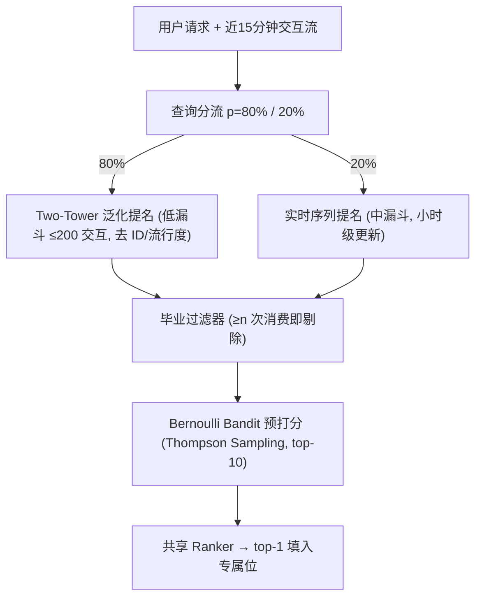

# Fresh Content Needs More Attention: Multi-funnel Fresh Content Recommendation (新鲜内容需要更多关注：多漏斗新鲜内容推荐)

- **会议/期刊**: KDD 2023 (Applied Data Science Track)
- **作者与机构**: Jianling Wang*, Haokai Lu*, Sai Zhang, Ed H. Chi, Minmin Chen 等，Google（十亿级用户商用推荐平台）
- **推荐链路定位**: 召回（提名）+ 精排（专属位端到端）
- **研究方向**: 冷启动与长尾推荐 / 强化学习与动态探索推荐
- **论文原文**: [https://arxiv.org/abs/2306.01720v1](https://arxiv.org/abs/2306.01720v1)
- **开源代码**: 暂未开源

## TL;DR (1分钟核心速览)

新鲜/长尾内容因交互日志缺失陷入"富者愈富"的反馈闭环，而随机探索又会伤害短期体验。本文在商用平台上搭建**专属新鲜内容推荐栈**（内容泛化双塔提名 → 毕业过滤 → Bandit 预打分 → 共享精排），并提出**多漏斗提名**：低漏斗走去掉 ID/流行度特征的双塔保覆盖，中漏斗走 15 分钟级近实时序列模型保相关性，用查询分流 $p=80\%$ 混合。通过**用户-语料共同分流**的在线 A/B 验证：DUIC@1K 较单漏斗双塔 +0.65%，平台日曝光唯一内容数 +4%~7.2%，创作者上传量持续上升，而整体停留时长仅 −0.12%。

## Background & Motivation (背景与核心矛盾)

- **主流范式**: 工业推荐以历史交互日志训练 ID-Embedding 协同过滤/双塔，靠既有曝光数据做个性化排序，冷启动物品靠内容特征兜底。
- **前人局限**: ① 交互日志被既有曝光策略条件化，形成强反馈闭环，新上传内容拿不到初始曝光就永远拿不到标签；② 泛化型内容模型（保覆盖）与实时记忆型模型（保相关性）在单一模型内难以兼得——泛化要求剔除 ID，实时学习又依赖 ID 记忆。
- **核心洞察 (Key Insight)**: 新鲜内容推荐必须同时用 **Coverage**（能否把更多唯一内容推出去）与 **Relevance**（推出去的是否被消费）双维度衡量；且平台指标存在"处理泄漏"——传统 user-diverted A/B 中实验组曝光的新内容会流回对照组语料，导致语料级收益被系统性低估。
- **本文切入点**: 划出**专属浮动位**做隔离实验 + 按内容漏斗分层部署异构提名器，用查询级概率分流调和覆盖与相关性。

## Method (核心方法设计)

### 1. 整体框架 (Overall Architecture)

请求进入后先由**新鲜内容提名器**从"$\leqslant X$天且正反馈$\lt Y$"的语料中召回 top-50；经**毕业过滤器**剔除已被消费$\geqslant n$次的内容（把曝光资源让给更冷的内容）；再由**轻量 Bandit 预打分器**基于近实时早期反馈筛出 top-10，交由与主系统共享的高容量 Ranker 选出 top-1 填入专属位，其余槽位仍由主推荐系统填充。提名阶段采用多漏斗：低漏斗（正反馈$\leqslant 200$）走内容泛化双塔，中漏斗走近实时序列模型，按查询随机分流混合。

### 2. 关键设计拆解 (Key Designs)

1. **去偏双塔提名器（用内容特征换覆盖）**：ID-Embedding 在长尾上标签稀疏、退化为训练噪声。作者在 item 塔**完全丢弃 item ID 与一切流行度指示特征**（曝光数、正反馈数），仅保留语义主题、分类主题、语种等可跨新旧内容迁移的元特征。消融式在线 A/B：DUIC@1K **+3.3%**（95% CI [3.0%, 3.7%]），新鲜内容停留时长 **+2.6%**——模型被迫从"记住某个视频"转为"学会某类视频"，泛化能力即覆盖能力。

2. **近实时序列提名器（用 ID 记忆换相关性）**：端到端时延从主系统的 18–24 小时压缩到**小时级**（近 15 分钟日志做标签、热启训练约 1 小时、下发多数据中心）。用户表征不用 RNN，而用注意力加权的历史内容嵌入和：
$$U=\sum_{i=1}^{n} w_i\cdot \mathrm{Emb}(V_i),\qquad w_i=\mathrm{softmax}\big(f(\text{dwell}_i,\ \text{gap}_i,\ \text{pos}_i)\big)$$
其中 dwell/gap/position 被量化成离散嵌入后经 $f$ 映射为标量权重，使"刚看过且看得久"的内容主导当前请求。为抑制新鲜内容内部的头尾失衡，分类特征按 **IDF 逆流行度加权**，让模型聚焦细粒度特征（如具体专辑）而非宽泛标签（如"音乐"）。实验表明换用更复杂序列模型并无增益，故刻意保持极简以压时延。

3. **Bandit 预打分与多漏斗混合**：预打分器对每个候选内容维护 Bernoulli 奖励（good CTR，即点击后停留 $\geqslant 10$s）的 Beta 后验$r_i\sim \mathrm{Beta}(\alpha_0+x_i,\ \beta_0+n_i-x_i)$，先验由曝光$\geqslant 100$的新鲜内容 MLE 估计，服务时用 Thompson Sampling 取 top-10——对低曝光内容天然给予不确定性奖励，实现"再分配式"冷启助推。两提名器不并行打分（否则中漏斗内容被 Ranker 的流行度偏置支配），而用**查询级多路复用**：$p\%$请求走双塔、$(100-p)\%$走实时模型，$p=80$ 在 DUIC 与停留时长间取得最优折中。

## Experimental Setup & Evaluation Protocol (实验设置与评估协议)

- **数据与实验配置**: 无公开离线数据集，全部结论来自商用平台在线实验（一个月量级）：

| 实验臂 | 流量 | 语料 | 主要用途 |
| :--- | :---: | :--- | :--- |
| Control | 1%（用户分流）/ 5%（语料共分流） | 主推荐系统全语料 | 短期用户指标对照 |
| Treatment | 同上 | 专属新鲜位 + 主系统 | 覆盖/语料/用户指标 |

- **数据划分与防穿越 (Splitting Strategy)**: **用户-语料共同分流（user-corpus co-diverted）**——先划出互不重叠的 $x\%$语料给对照组、另$x\%$ 给实验组，再按比例分配用户，且同一创作者的内容整体归入同一臂，杜绝跨臂泄漏；语料指标用 5% 大流量（幂律分布方差大），用户指标用 1% 流量。
- **排名评测协议 (Ranking Protocol)**: 非离线 Full-Ranking，而是在线语料级指标——`DUIC@K`（日曝光 $\geqslant K$次的唯一内容数，覆盖）、`Fresh DwellTime`（相关性）、`DiscoverableCorpus@X,Ydays`（毕业后$Y$天内自主获得$X$ 次正反馈的内容数，长期价值）、`整体/小创作者停留时长` 与 `good CTR`；均报 95% 置信区间。
- **对比基线与超参**: 单漏斗 `S-two-tower`、单漏斗 `S-real-time`、多漏斗（$p=80$、$n_{low}=200$）、上下文化分流（核心用户 20%~50% 走实时模型）。

## Key Experimental Results (实验关键数据)

### 1. 主实验对比 (Main Results)

| 方案 | DUIC@1K | 小创作者停留 | 7 日新鲜正反馈 | Discoverable@1K,7d |
| :--- | :---: | :---: | :---: | :---: |
| S-two-tower（基线） | 0 | 0 | 0 | 0 |
| S-real-time | **−1.79%** | −1.41% | 显著更高 | −0.11% |
| Multi-funnel (本文) | **+0.65%** | **+0.45%** | 高于基线 | **+1.60%** |
| 专属位整体（vs 主系统） | +4%~+7.2% | **+5.5%** | **+2.52%** | +0.6%~+1.6% |

DiscoverableCorpus@X,7days（相对 S-two-tower，95% CI）：S-real-time 在 $X=100$为 **−1.68%** [−2.33%, −1.04%]；Multi-funnel 在$X=1K/2K/5K$ 分别为 **+1.60%** [0.45%, 2.75%]、**+1.62%** [0.27%, 2.96%]、**+1.63%** [−0.12%, 3.39%]。

### 2. 消融实验 (Ablation Study)

| 消融项 | 设置 | 指标变化 |
| :--- | :--- | :--- |
| 去 item ID + 流行度特征 | vs 保留全特征双塔 | DUIC@1K **+3.3%**，DwellTime **+2.6%** |
| 低漏斗交互上限 $n_{low}$ | 400 / 200 / 100 | DUIC@1K +0.28% / **+0.40%** / +0.39% |
| 双塔分流比例 $p$| 90 / **80** / 70 / 60 |$p\leqslant70$ 时 DUIC 增益消失，停留时长上升 |
| 核心用户走实时模型比例 | 20 / 30 / **40** / 50 | DwellTime −1.97% / +3.42% / **+8.17%** / +12.77%；good CTR −1.17% / +2.06% / **+4.47%** / +7.75% |

### 3. 关键实验发现 (Key Findings)

1. **单模型无法兼顾覆盖与相关性**：S-real-time 在 DUIC@1K 上掉 1.79%、小创作者停留掉 1.41%，说明纯实时记忆模型会主动收缩长尾覆盖面；多漏斗把它的相关性优势（7 日正反馈更高）与双塔的覆盖优势解耦后再组合，才实现 DUIC 由负转正（−1.79% → +0.65%）。
2. **专属位带来"语料级"而非"流量级"收益**：日曝光唯一内容数提升 4%~7.2%、毕业后 7 天内自主获得正反馈的内容数提升 0.6%~1.6%、创作者上传量持续攀升，而平台整体停留仅 −0.12%、小创作者停留 +5.5%——即用可忽略的短期体验代价换取语料池扩张与供给侧激励。
3. **分流应按用户活跃度上下文化**：双塔与实时模型在核心用户上的 good CTR 差距远大于 casual/emerging 用户；仅让 40% 核心用户走实时模型即可在 DUIC 中性（−0.07%）前提下取得 DwellTime +8.17%、good CTR +4.47%，验证"同质概率分流"存在明显次优性。

## Highlights & Limitations (亮点、对比与审稿批判)

- **与代表作对比 (vs. Prior Work)**: 相对内容特征补全冷启动（如 content-based / 元学习类工作），本文不追求单一更强模型，而是**按漏斗分层部署异构提名器 + 概率路由**；相对经典 hybrid/ensemble 推荐（线性加权、meta-learned 模型选择器），本文的混合发生在**查询维度**而非分数维度，天然规避了精排流行度偏置对中漏斗的支配；相对工业冷启动实践，本文最大贡献是提出 user-corpus co-diverted 实验范式，解决了语料级收益无法被传统 A/B 度量的问题。
- **可迁移亮点**: ① "剔除 ID 与流行度特征"可作为任何冷启动召回器的低成本去偏正则；② 用 Beta-Bernoulli Thompson Sampling 作为精排前的轻量预打分，兼顾探索与低时延，可直接复用到新品/新内容冷启。
- **审稿级局限批判**: ① 全部证据为单平台在线 A/B，缺少离线可复现基准与理论分析，$p=80$、$n_{low}=200$、毕业阈值$n$ 等超参靠经验网格搜索，跨平台迁移性未知；② 双提名器 + Bandit + 大 Ranker 的级联使服务成本与工程复杂度显著上升，论文未给出延迟/算力开销的量化对比，也未讨论探索带来的用户疲劳与长期留存风险。

## Rating (四维评分)

- **方法创新性 (Novelty)**: ⭐⭐⭐⭐ （单点模型创新有限，但"多漏斗提名 + 查询分流 + 漏斗分层"的系统级组合与用户-语料共同分流实验范式具方法论价值）
- **评估协议与实验扎实度 (Protocol & Experiments)**: ⭐⭐⭐⭐⭐ （十亿级平台多轮在线 A/B、95% 置信区间、语料级指标设计严谨，并系统消融 $n_{low}$、$p$、核心用户比例）
- **写作与数学规范度 (Clarity & Rigor)**: ⭐⭐⭐ （工程叙述清晰、公式极简，但缺乏损失函数与复杂度分析，理论刻画薄弱）
- **工业落地与复现价值 (Industrial & Practical Value)**: ⭐⭐⭐⭐ （方案可直接落地于内容平台冷启场景，但无开源代码且强依赖平台实验基建，复现门槛高）

