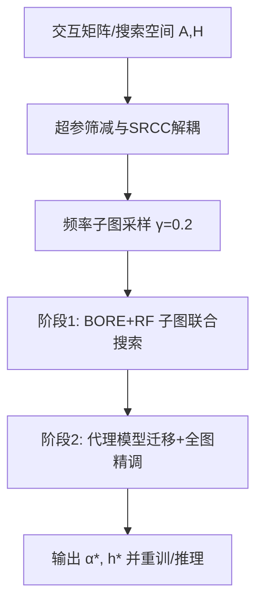
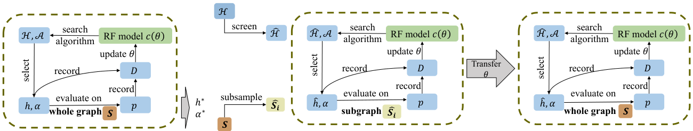

# Efficient and Joint Hyperparameter and Architecture Search for Collaborative Filtering (面向协同过滤的高效联合超参数与架构搜索)

- **会议/期刊**: KDD 2023
- **作者与机构**: Yan Wen, Chen Gao, Lingling Yi, Liwei Qiu, Yaqing Wang, Yong Li；清华大学电子系/北京国家信息科学与技术研究中心、腾讯、百度
- **推荐链路定位**: 召回/模型设计（CF 模型自动设计）
- **研究方向**: 协同过滤与双塔召回 / 图神经网络与知识图谱推荐
- **论文原文**: [论文原文链接](https://arxiv.org/abs/2307.11004v1)
- **开源代码**: [开源代码仓库链接](https://github.com/overwenyan/Joint-Search)

## TL;DR (1分钟核心速览)

针对现有CF AutoML只搜架构或只调超参、忽略二者强耦合的痛点，本文把CF模型设计建模为超参与架构联合双层优化，先用排名分布与SRCC筛减/解耦超参，再以频率子图采样和BORE+RF代理模型两阶段搜索并迁移到全图。在ML-100K/1M/Yelp/Amazon-Book上按Recall@20/NDCG@20评估，较最优基线提升2.33%–13.02%。

## Background & Motivation (背景与核心矛盾)

- **主流范式**: CF模型多由人工设计，或分别用NAS搜架构、HPO调超参；SIF搜交互函数，AutoCF搜四段架构但HP固定/离散化，[37]搜图模型。
- **前人局限**: ① 架构与HP强耦合，固定HP会低估好架构，HP选择也依赖架构；② 联合空间巨大且全图评估昂贵。
- **核心洞察 (Key Insight)**: 超参性能排名在不同数据集上有稳定分布，SRCC显示嵌入维等可解耦；子图与全图的架构排名在$\gamma\ge0.2$时高度一致。
- **本文切入点**: 先筛HP再用子图两阶段联合搜索，把评估成本转移到小图并迁移代理模型。

## Method (核心方法设计)

### 1. 整体框架 (Overall Architecture)

搜索空间$\mathcal{A}$含输入(ID/H)、嵌入(Mat/MLP/GraphSAGE/HadamardGCN/SGC)、交互(multiply/minus/min/max/concat)、预测(SUM/VEC/MLP)；$\mathcal{H}$含优化器、学习率、嵌入维、权重衰减、批大小。先按控制变量实验的排名分布缩小$\mathcal{H}$，并用SRCC解耦高一致性HP；再按物品频率采样$\gamma=0.2$子图，以BORE+RF代理模型在子图上联合搜索；第二阶段把代理模型参数迁移到全图，提升嵌入维并精调top候选，输出$\alpha^*,h^*$。

<figure class="paper-figure" markdown="span">
  <figcaption>图1：传统方法与本文方法的联合搜索策略。</figcaption>
</figure>

### 2. 关键设计拆解 (Key Designs)

1. **超参筛减与解耦**：固定其他HP、遍历架构得到每个HP取值的相对排名分布，据此把优化器缩到Adam/Adagrad、lr缩到[1e-5,1e-2]、嵌入维缩到[2,64]；再用SRCC量化只变一个HP时架构排名的稳定性，$\operatorname{SRCC}_i=\frac{1}{|\mathcal{H}_i|^2}\sum_{(\lambda_1,\lambda_2)}\operatorname{SRCC}(\lambda_1,\lambda_2)$。高SRCC的HP可单独调，低SRCC需联合调，从而在缩小空间的同时保留HP-架构耦合。
2. **频率子图采样与可迁移评估**：按物品出现频率保留top-$\gamma N$物品或按频率分布采样，构造子图$\hat{\mathcal{S}}$；用$\operatorname{SRCC}_\gamma$检验子图与全图的架构排名一致性。$\gamma=0.2$时一致性与成本折中最好，使阶段1可用小图快速评估，阶段2再全图校准。
3. **两阶段 BORE+RF 联合搜索**：把问题写成双层优化：$\alpha^*,h^*=\max_{\alpha\in\mathcal{A},h\in\mathcal{H}}\mathcal{M}(f(P^*;\alpha,h),\mathcal{S}_{val})$，s.t.$P^*=\arg\max_P\mathcal{M}(f(P;\alpha,h),\mathcal{S}_{tra})$。阶段1在多个子图上用RF分类器+BORE采集函数联合选$\alpha,h$并更新代理；阶段2迁移RF参数到全图，提升嵌入维并精调top候选。训练用BPR损失，常规均匀负采样；搜索离线，部署后仅查表+交互/预测，全库打分$O(|\mathcal{I}|d)$。

## Experimental Setup & Evaluation Protocol (实验设置与评估协议)

- **数据集与预处理**: 原文表A2给出统计与预处理，正文未展开；ML-100K/1M为常用版本，Yelp/Amazon-Book按原文过滤（未说明是否5-core）。

| 数据集 | #Users | #Items | #Interactions | 稀疏度/说明 |
| :--- | :---: | :---: | :---: | :--- |
| ML-100K | 943 | 1,682 | 100,000 | 6.30%；常用版本 |
| ML-1M | 6,040 | 3,706 | 1,000,209 | 4.47%；常用版本 |
| Yelp | 见原文表A2 | 见原文表A2 | 见原文表A2 | 本地生活；按原文预处理 |
| Amazon-Book | 见原文表A2 | 见原文表A2 | 见原文表A2 | 图书；按原文预处理 |

- **数据划分与防穿越 (Splitting Strategy)**: 比例划分（Algorithm 2 的 train/valid/test），非Leave-One-Out、非全局时间戳、非冷启动。
- **排名评测协议 (Ranking Protocol)**: Recall@20/NDCG@20；原文未显式声明Full-Ranking或Sampled Ranking，表3按CF常用全库未交互排序口径解读，复现需确认。
- **对比基线与超参设置**: MF/FISM/NCF/J-NCF/PinSage/NGCF/LightGCN/SIF/AutoCF；嵌入维搜索[2,64]、lr[1e-5,1e-2]、Adam/Adagrad、batch=2000、weight decay=1e-1；BPR；未报告显著性检验。

## Key Experimental Results (实验关键数据)

### 1. 主实验对比 (Main Results)

| 方法 | ML-100K R@20 | N@20 | ML-1M R@20 | N@20 | Yelp R@20 | N@20 | Amazon R@20 | N@20 |
| :--- | :---: | :---: | :---: | :---: | :---: | :---: | :---: | :---: |
| NCF | 0.1980 | 0.1521 | 0.1204 | 0.0684 | 0.0534 | 0.0335 | 0.0315 | 0.0223 |
| J-NCF | 0.2016 | 0.1448 | 0.1265 | 0.0629 | 0.0636 | 0.0393 | 0.0351 | 0.0252 |
| PinSage | 0.1561 | 0.1421 | 0.1354 | 0.0631 | 0.0561 | 0.0417 | 0.0321 | 0.0239 |
| NGCF | 0.1654 | 0.1479 | 0.1678 | 0.0852 | 0.0573 | 0.0454 | 0.0349 | 0.0247 |
| LightGCN | 0.2342 | 0.1755 | 0.1637 | 0.0842 | 0.0689 | 0.0471 | 0.0355 | 0.0273 |
| SIF | 0.1935 | 0.1532 | 0.1294 | 0.0695 | 0.0581 | 0.0459 | 0.0350 | 0.0249 |
| AutoCF | 0.2259 | 0.1703 | 0.1309 | 0.0739 | 0.0643 | 0.0467 | 0.0354 | 0.0265 |
| **Ours** | **0.2647** | **0.1913** | **0.1787** | **0.0945** | **0.0721** | **0.0482** | **0.0365** | **0.0281** |
| Improv. | +13.02% | +9.00% | +6.50% | +10.92% | +4.64% | +2.33% | +2.82% | +2.93% |

### 2. 消融实验 (Ablation Study)

| 设置 | ML-100K | ML-1M | Yelp | Amazon-Book |
| :--- | :---: | :---: | :---: | :---: |
| $\gamma=5\%$ | 0.2113 | 0.1471 | 0.0523 | 0.0311 |
| $\gamma=10\%$ | 0.2224 | 0.1632 | 0.0654 | 0.0342 |
| $\gamma=20\%$ | **0.2646** | **0.1787** | **0.0721** | **0.0365** |
| $\gamma=50\%$ | 0.2623 | 0.1715 | 0.0706 | 0.0356 |
| AutoCF | 0.2259 | 0.1309 | 0.0643 | 0.0354 |
| AutoCF+HP | 0.2335 | 0.1358 | 0.0672 | 0.0359 |
| Δ | +3.36% | +3.74% | +4.51% | +1.41% |

### 3. 关键实验发现 (Key Findings)

1. 联合搜索全面优于人工模型与SIF/AutoCF；小数据集增益更大（ML-100K Recall +13.02%、NDCG +9.00%），说明数据特异性架构收益显著。
2. 采样比$\gamma=20\%$最优：5%子图信息不足（ML-1M 0.1471 vs 0.1787），50%评估过慢反而低于20%（0.1715 vs 0.1787）。
3. 将HP搜索接入AutoCF即可稳定提升1.41%–4.51%；top架构多共享H输入、SGC、multiply、VEC/MLP，验证了“HP-架构联合”的必要性。

## Highlights & Limitations (亮点、对比与审稿批判)

- **与代表作对比 (vs. Prior Work)**: SIF只搜交互函数且对HP网格搜索；AutoCF搜四段架构但忽略逐架构HPO，并将HP视为离散组件；[37]在图模型空间随机搜索。本文首次把CF的HP与架构放入同一双层搜索空间，并用子图迁移降低评估成本。
- **可迁移亮点**: ① 频率子图采样+SRCC一致性检验，可用于昂贵NAS/HPO的快速预评估；② RF+BORE对混合类别/连续配置做代理建模，适合推荐系统AutoML。
- **审稿级局限批判**: ① 评估协议未明确Full/Sampled Ranking与数据过滤细节，且无显著性检验，复现口径存在歧义；② 搜索空间仍为手工设计，离线搜索成本高，$\gamma$与空间筛减依赖经验，缺少线上A/B与大规模工业验证。

## Rating (四维评分)

- **方法创新性 (Novelty)**: ⭐⭐⭐⭐ （首次将CF的HP与架构联合建模，两阶段子图迁移有增量价值，但组件多为已有AutoML技术的组合）
- **评估协议与实验扎实度 (Protocol & Experiments)**: ⭐⭐⭐ （四个数据集与强基线较完整，但Full/Sampled、过滤细节和显著性检验缺失）
- **写作与数学规范度 (Clarity & Rigor)**: ⭐⭐⭐⭐ （双层优化、SRCC与算法流程清晰，部分统计与超参细节下放附录）
- **工业落地与复现价值 (Industrial & Practical Value)**: ⭐⭐⭐⭐ （代码开源，搜索离线、部署后推理开销低，但搜索成本与线上收益仍需验证）

