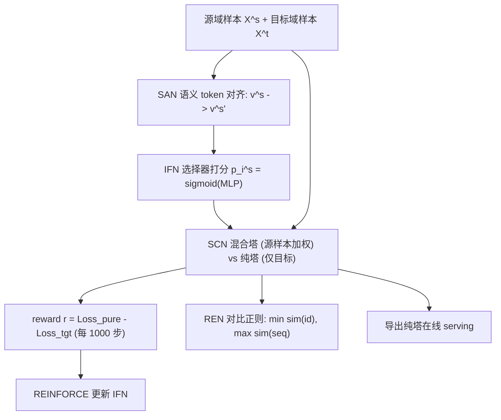
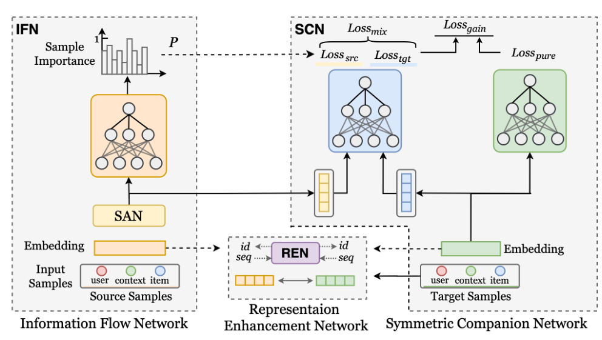

# A Collaborative Transfer Learning Framework for Cross-domain Recommendation (面向跨域推荐的协同迁移学习框架)

- **会议/期刊**: KDD 2023 (ACM SIGKDD)
- **作者与机构**: Wei Zhang, Pengye Zhang, Bo Zhang, Xingxing Wang, Dong Wang（美团）
- **推荐链路定位**: 精排（跨业务域 CTR 预估模型训练）
- **研究方向**: 跨域与多场景推荐 / CTR 预估与特征交叉
- **论文原文**: [https://arxiv.org/abs/2306.16425v1](https://arxiv.org/abs/2306.16425v1)
- **开源代码**: 暂未开源

## TL;DR (1分钟核心速览)

跨域 CTR 的主流做法（多样本混合多任务 或 预训练+微调）都把源域样本"无差别"喂给目标域模型，导致稀疏目标域陷入**跷跷板效应**与**微调非最优解**（负迁移）。本文提出 CCTL：用**对称伴随网络 SCN**（混合塔 vs 纯目标塔的 loss 差）在线估计源域总体增益并作为 reward，用**信息流网络 IFN**（语义对齐 SAN + REINFORCE 选择器）为每条源样本预测加权权重，再用**表征增强网络 REN** 做"ID 相斥、序列相近"的对比约束保住域特异信息。在 Meituan 工业集、Amazon、Taobao 上 AUC 分别较最优基线提升 0.69%/1.54%/0.88%，线上 A/B 取得 CTR +4.37%、GMV +5.43%，且**在线仅部署纯目标塔，零额外推理开销**。

## Background & Motivation (背景与核心矛盾)

- **主流范式**: 工业界跨域 CTR 有两条路——① 源/目标样本 union 后做多任务学习（STAR 的星型拓扑、CoNet 的跨连接单元、MiNet 的长短期兴趣拆分）；② 源域预训练后在目标域微调（Finetune）。
- **前人局限**: 范式①假设网络结构能自动分辨域的共性与差异，但数据量悬殊时训练被富数据域主导，稀疏域欠拟合（seesaw effect）；范式②的源域最优点对目标域常是局部极小，参数难以跳出（non-optimal solution finetune）。两者共同的病根是**把源域样本当成同质、无权重地全部使用**，在特征 schema 与数据量差异巨大的 domain shift 下必然引入噪声。
- **核心洞察 (Key Insight)**: 作者借用"控制变量法"——若两座结构、学习率完全相同的塔只有一处差异（是否读入源域样本），则同一批目标样本上的 loss 差 $r$就是源域信息增益的无偏代理；$r>0$表示正迁移，$r\le 0$ 表示负迁移。该标量信号可反过来指导"哪些源样本该被保留"。
- **本文切入点**: 把"跨域迁移"重构为**样本级信息流调控**问题：SCN 负责"评估"、IFN 负责"预测与加权"、REN 负责"保域特异"，三者构成预测–评估闭环。

## Method (核心方法设计)

### 1. 整体框架 (Overall Architecture)

输入为源域样本 $X^s$与目标域样本$X^t$。目标域特征的 one-hot 经 embedding 拼接成$\boldsymbol{v}^t_i$，源域样本先经 SAN 压缩到与目标域各语义 token 同维；随后 SCN 的混合塔同时读入两侧样本、纯塔只读目标样本，按$k=1000$步把混合塔参数同步给纯塔以抑制双塔漂移；每$k$ 步用两塔在同一批目标样本上的 loss 差作为奖励回传，更新 IFN 选择器；REN 的对比辅助损失直接加在混合塔表征上。训练完成后**只导出纯塔上线**。

<figure class="paper-figure" markdown="span">
  <figcaption>图1：CCTL模型概览。a）对称伴随网络（SCN）通过双塔框架评估源域样本对目标域的信息增益。b）信息流网络（IFN）评估每个源样本能带来多少信息，并通过输出权重帮助信息部分流动。c）表示增强网络（REN）是一个辅助组件，试图通过对比设计保留不同域的独特信息。</figcaption>
</figure>

### 2. 关键设计拆解 (Key Designs)

1. **对称伴随网络 SCN（把"负迁移"变成一个可微分数值）**：前人无法量化单批源样本的价值 $\to$SCN 用同构的混合塔/纯塔，在同一批目标样本上求 loss 差，得到信息增益$r=\sum_{x_i\in X^t}\left[L(y_i^t,f(x_i,\Theta_{pure}))-L(y_i^t,f(x_i,\Theta_{mixed}))\right]$ $\to$直觉上"混合塔在同一批目标样本上预测更准"即源域真带来了可迁移知识，$r$ 因此天然以目标域指标为优化目标，避免了对齐目标与业务目标错位。

2. **信息流网络 IFN（语义对齐 + 样本级门控）**：域间特征 schema 数量不一致导致无法共用同一塔 $\to$先把源样本拆成 user / item / context 三个语义 token（如$\boldsymbol{v}^s_{user}=[e_{uid}\|e_{male}\|e_{ios}]$），再用 MLP 压缩到目标域对应 token 维度：$\boldsymbol{v}^{s'}_{user}=\mathrm{MLP}(\boldsymbol{v}^s_{user})\in\mathbb{R}^{dim^t_{user}}$；选择器输出$p_i^s=\sigma(\mathbf{W}_m\mathbf{h}_{m-1}+b_m)$作为该源样本 loss 的权重。由于$r$是批级标量、无样本级标签，选择器无法用 SGD 更新，作者用 REINFORCE 以累积奖励$r_{accu}=r_k+\gamma r_{k+1}+\dots\;(\gamma=0.80)$回传：$\Theta_{ifn}\leftarrow\Theta_{ifn}+\alpha\frac{1}{N}\sum_{i=1}^{N_s}\nabla_{\Theta_{ifn}}\log(p_i^s)\,r_{accu}$。$\alpha$是源域影响力旋钮，$\alpha=0$ 即退化为普通混合多任务。

3. **表征增强网络 REN 与训练目标**：单纯对齐会抹平域特异知识 $\to$用类极小极大约束：ID embedding 要拉开（保留差异化微观信息）、行为序列池化 embedding 要靠近（同一用户跨域兴趣稳定），$\mathcal{L}_{ren}=\mathrm{sim}(\boldsymbol{v}^s_{id},\boldsymbol{v}^t_{id})-\mathrm{sim}(\boldsymbol{v}^s_{seq},\boldsymbol{v}^t_{seq})$，$\mathrm{sim}$为余弦相似度。总损失$\mathcal{L}=\mathrm{Loss}_{mixed}+\lambda\mathcal{L}_{ren}$，其中$\mathrm{Loss}_{mixed}=\sum p_i^sL(y_i^s,\cdot)+\sum L(y_i^t,\cdot)$。**免负采样**（曝光日志全量交叉熵），在线推理仅跑纯塔，复杂度与原单域模型等价。

## Experimental Setup & Evaluation Protocol (实验设置与评估协议)

- **数据集与预处理**：

| 数据集 | 域 | #Users | #Items | #Samples | 场景说明 |
| :--- | :--- | :---: | :---: | :---: | :--- |
| Amazon | 源 Books / 目标 Movies&TV | 61,437（两域共享） | 835,005 / 368,953 | 979,151 / 432,286 | 评分 4–5 视为正样本 |
| Taobao | 源（Top-70% 类目）/ 目标（其余 30%） | 690,006 / 296,716 | —（原文统计列排版错位） | 70.0M / 30.2M | 点击/加购/收藏行为日志 |
| Meituan | 源（列表页）/ 目标（展示广告） | 230M / 183M | 1.1M / 0.7M | 1200M / 250M | 用户重叠 67.83%、物品重叠 70.26% |

- **数据划分与防穿越 (Splitting Strategy)**: 论文未显式声明时间切分方式，仅说明按类目占比（Taobao 前 70% 类目为源、后 30% 为目标）与工业场景自然域划分；**未给出全局时间戳切分的严格描述**，属于该文评估章节的薄弱点。
- **排名评测协议 (Ranking Protocol)**: 采用**点击级 pointwise 评估**——AUC（pairwise 排序能力）+ LogLoss（概率校准），**未做 Full-Ranking 全库未交互排序**；训练为曝光全样本、无负采样比例可调。
- **对比基线与超参设置**: 单域 LR / DNN / DeepFM / DIN / AFM；跨域 Finetune / DANN / CoNet / MiNet / STAR。Embedding 维度 $d=8$，DNN 4 层（工业 [1024,512,128,1]、公开集 [256,128,32,1]），Adam，batch 8192（工业）/128（公开集），各法跑 3 次取均值；未报告显著性检验。

## Key Experimental Results (实验关键数据)

### 1. 主实验对比 (Main Results)

| 类别 | Model | Meituan AUC | Meituan LogLoss | Amazon AUC | Amazon LogLoss | Taobao AUC | Taobao LogLoss |
| :--- | :--- | :---: | :---: | :---: | :---: | :---: | :---: |
| 单域 | DIN (最强单域) | 0.6932 | 0.5468 | 0.7480 | 0.4454 | 0.8095 | 0.3692 |
| 单域 | AFM | 0.6923 | 0.5457 | 0.7460 | 0.4492 | 0.7990 | 0.3854 |
| 跨域 | Finetune | 0.6921 | 0.5452 | 0.7564 | 0.4381 | 0.8280 | 0.3585 |
| 跨域 | DANN | 0.6946 | 0.5404 | 0.7610 | 0.4331 | 0.8420 | 0.3601 |
| 跨域 | CoNet | 0.6942 | 0.5416 | 0.7621 | 0.4332 | 0.8418 | 0.3666 |
| 跨域 | MiNet | 0.6953 | 0.5377 | 0.7665 | 0.4305 | 0.8447 | 0.3640 |
| 跨域 | STAR | 0.6945 | 0.5391 | **0.7672** | 0.4298 | 0.8440 | 0.3643 |
| — | **CCTL** | **0.7001** | **0.5288** | **0.7790** | **0.4230** | **0.8521** | **0.3578** |
| — | Improv. | +0.69% | −1.66% | +1.54% | −1.58% | +0.88% | −0.20% |

（Improv. 相对于各数据集最强跨域基线：Meituan/Taobao 为 MiNet，Amazon 为 STAR；LogLoss 相对降幅。）

### 2. 消融实验 (Ablation Study)

| 变体 (Taobao) | AUC | LogLoss | 说明 |
| :--- | :---: | :---: | :--- |
| CCTL w/o IFN | 0.8385 | 0.3647 | 源样本无权重全量混训（≈ Finetune 的 0.8280 水平） |
| CCTL w/o REN | 0.8493 | 0.3602 | 去掉域特异对比约束 |
| **Full CCTL** | **0.8521** | **0.3578** | 完整模型 |

### 3. 关键实验发现 (Key Findings)

1. **"选样本"远比"堆模型"划算**：去掉 IFN 后 AUC 从 0.8521 掉到 0.8385（−1.6%），几乎回落到 Finetune 的 0.8280 附近；而单域从 DeepFM 升级到 DIN/AFM 的增益普遍不足 +0.3%，说明跨域收益主要来自样本质量筛选而非容量扩张。
2. **IFN 的贡献大于 REN**：w/o REN 只损失 0.0028 AUC，w/o IFN 损失 0.0136 AUC，约 5 倍差距；REN 的 ID 相斥/序列相近约束是"锦上添花"，真正的去负迁移主力是样本级加权。$\alpha$敏感度曲线（图 5(b)）显示 AUC 随$\alpha$ 从 0→1 单调上升并在接近 1 时饱和，印证门控机制确实在起作用。
3. **不加筛选的跨域迁移可能不如单域**：Meituan 上 Finetune（0.6921）甚至略逊于 DIN（0.6932），STAR 与 MiNet 的领先幅度也仅 0.2–0.3 个点，直观复现了"微调非最优解"与"域偏移负迁移"；CCTL 在同一数据上把差距拉到 +0.5 点以上，是少数在工业量级数据上仍稳定为正的方法。

## Highlights & Limitations (亮点、对比与审稿批判)

- **与代表作对比 (vs. Prior Work)**: 相较 STAR 的"共享+私有 MLP 拓扑硬分离"和 CoNet 的"隐层交叉连接"，CCTL 的差异在于**动态、样本级、以目标域 loss 为奖励闭环**的软门控；相较 MiNet 的长短期兴趣拆分（仍全量使用源样本），CCTL 显式拒斥无益样本；相较 DANN 的对抗对齐（把所有源样本映射到同一空间、可能引入噪声），CCTL 只让"能降目标 loss"的信息流过。
- **可迁移亮点**: ① "双塔异构输入 + 同构结构 + 定期参数同步 → 用 loss 差作为可量化迁移信号"这一 trick 可直接搬去多场景/多目标融合、乃至跨模态特征注入的增益评估；② "ID 相斥、序列相近"的双表征对比约束，是极低成本（两个余弦相似度项）的域特异信息保留方案；③ 线上仅导出纯塔，工程上等价于原单域模型，规避了跨域模型普遍的 serving 膨胀问题。
- **审稿级局限批判**: ① **信用分配粗糙**：reward 是批级标量，却被用于逐样本策略梯度，方差大；文中只能靠"累积 1000 步再回传 + $\gamma=0.80$"稳定，缺少与 Gumbel/REINFORCE-with-baseline 等更稳方案的对比，也未分析选择器权重的收敛性证明。② **评估协议偏弱**：仅用 AUC/LogLoss 点式指标，未做全库排序或校准曲线分析；划分方式（尤其 Taobao 按类目占比切分、Amazon 用共享用户）未交代时间防穿越，跨域"源/目标"构造与工业上真实的多域冷启动差异较大，泛化结论需谨慎；公开集统计表本身存在排版错位，复现性受影响。

## Rating (四维评分)

- **方法创新性 (Novelty)**: ⭐⭐⭐⭐ （把负迁移从"架构假设问题"重构为"样本级信息增益可测量+可门控"问题，SCN 的控制变量式奖励设计简洁且有说服力，但 REINFORCE 门控在推荐域已有类似思路）
- **评估协议与实验扎实度 (Protocol & Experiments)**: ⭐⭐⭐ （三套数据含 12 亿样本工业集与三个月线上 A/B 很有分量，但仅 AUC/LogLoss、无显著性检验、划分协议与统计表交代不清，消融只在单一数据集上做）
- **写作与数学规范度 (Clarity & Rigor)**: ⭐⭐⭐ （三模块动机–公式–直觉链条清晰，符号统一；但公式排版多处缺编号与符号定义不全，SAN/REN 的极小极大约束未给出收敛性讨论）
- **工业落地与复现价值 (Industrial & Practical Value)**: ⭐⭐⭐⭐⭐ （线上仅部署纯塔、推理零增量开销，已在美团广告主流量服务，CTR +4.37%/GMV +5.43% 属可观的真实收益；唯代码未开源，复现依赖细节补全）

