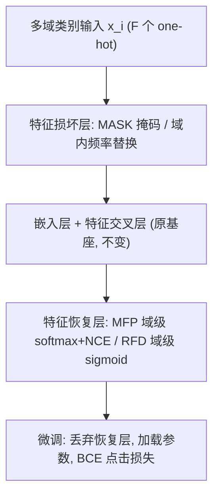
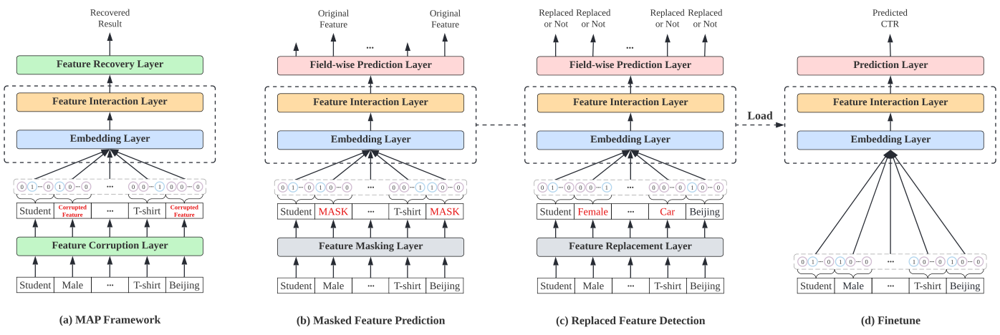

# MAP: A Model-agnostic Pretraining Framework for Click-through Rate Prediction (模型无关的点击率预估预训练框架)

- **会议/期刊**: KDD 2023
- **作者与机构**: Jianghao Lin, Yanru Qu, Xinyi Dai, Yong Yu, Weinan Zhang (上海交通大学)；Wei Guo, Ruiming Tang (华为诺亚方舟实验室)
- **推荐链路定位**: 精排 (CTR 预估) 的训练范式层
- **研究方向**: CTR/CVR 预估与特征交叉 / 自监督对比学习与交互去噪
- **论文原文**: [https://arxiv.org/abs/2308.01737v1](https://arxiv.org/abs/2308.01737v1)
- **开源代码**: [https://github.com/CHIANGEL/MAP-](https://github.com/CHIANGEL/MAP-)

## TL;DR (1分钟核心速览)

CTR 模型长期受困于 1-bit 点击信号监督不足，而现有多域类别数据预训练方法要么受百万级特征空间拖累（MF4UIP），要么因双视图对比带来 2× 开销与 $O(B^2)$ 复杂度（SCARF）。本文提出模型无关预训练框架 MAP，通过"特征损坏层 + 特征恢复层"派生 MFP（掩码特征预测 + NCE）与 RFD（替换特征检测，二分类）。在 Avazu/Criteo 的 8:1:1 划分、AUC/LogLoss 协议下，RFD 在 8 种基座上一致最优，DNN 上 Avazu AUC 相对提升 1.22%，且预训练比 MF4UIP 快约 18×。

## Background & Motivation (背景与核心矛盾)

- **主流范式**: Deep CTR 模型（DeepFM / xDeepFM / DCNv2 / AutoInt / FiGNN）均按"嵌入层 → 特征交叉层 → 预测层"堆叠，从随机初始化出发用点击标签端到端监督训练。
- **前人局限**: ① 1-bit 点击信号信息量过低，无法充分约束百万级稀疏特征嵌入；② 面向序列/图/多模态的 SSL 方法与多域类别（multi-field categorical）格式本质不兼容；③ MF4UIP 在全局特征空间做 softmax，复杂度 $O(BM)$ 不可扩展；SCARF 需构造双视图，吞吐与显存翻倍且仅有实例级粗粒度监督，易陷入表征早期退化。
- **核心洞察 (Key Insight)**: 多域类别样本天然具有"域内冗余、域间强依赖"结构，把单个域的特征挖掉或替换，恰好强制模型学习跨域特征交叉模式——即 pretext task 与下游 CTR 任务共享同一归纳偏置。
- **本文切入点**: 不改动基座结构、不增加推理开销，只在训练前插入一个可定制的"损坏-恢复"预训练阶段。

## Method (核心方法设计)

### 1. 整体框架 (Overall Architecture)

采用 pretrain-finetune 两阶段：预训练阶段冻结下游任务，输入样本 $x_i=[x_{i,1},...,x_{i,F}]$先经**特征损坏层**（掩码或替换，比例$\gamma$）得到$x_i^c$，再走原基座的嵌入层与特征交叉层得到紧凑表征$q_i^c$，最后接入**特征恢复层**（域级 MLP + 相应输出头）计算自监督损失；微调阶段丢弃恢复层，加载嵌入层与特征交叉层参数初始化，用原始 BCE 点击损失精调。由于只替换输入与预测头，该框架对任意神经 CTR 模型即插即用，推理时延与原始模型完全一致。

<figure class="paper-figure" markdown="span">
  <figcaption>图2：(a) MAP 框架、(b) 掩码特征预测（MFP）、(c) 替换特征检测（RFD）和 (d) 微调的示意图。MFP 和 RFD 通过定制特征损坏层和特征恢复层的设计，由 MAP 框架衍生而来。在微调阶段，我们保持相同的模型结构，并加载预训练模型的参数来初始化嵌入层和特征交互层。</figcaption>
</figure>

### 2. 关键设计拆解 (Key Designs)

1. **掩码特征预测 MFP（生成式，需 NCE 救场）**：为解决"恢复原特征"在百万级特征空间上 softmax 不可算的问题，对每个被掩码域 $f\in\mathcal{I}$用独立 MLP$g_f$输出 logits，并把候选空间从域内扩展到全局（增加任务难度以逼出泛化表征）；再用 NCE 将$O(M)$多分类降为$O(Km)$ 二分类：
$\mathcal{L}^{\mathrm{NCE}}_i=-\frac{1}{|\mathcal{I}|}\sum_{f\in\mathcal{I}}\big[\log\sigma(z_{i,f,t})+\sum_{k=1}^{K}\log(1-\sigma(z_{i,f,k}))\big]$
其中噪声特征按训练集频次分布采样。直觉：频次采样让模型必须区分"语义合理"的负例，而非靠频次先验蒙对。

2. **替换特征检测 RFD（判别式，更简更强）**：MFP 只用 10%–30% 的被掩码域做监督，信号稀疏；RFD 改为把选中域替换为该域经验边缘分布下的随机特征，然后对**全部 $F$ 个域**做二分类"是否被替换"：
$p_i=\sigma(\mathrm{MLP}(q_i^c))\in\mathbb{R}^{F},\quad \mathcal{L}^{\mathrm{RFD}}_i=\frac{1}{F}\sum_{f=1}^{F}\mathrm{BCE}(p_{i,f},r_{i,f})$关键细节是替换必须**域内**采样：跨域替换（如把 Gender 换成 Item 值）会使任务过于简单，模型只学到"域不匹配"这一捷径并过拟合 pretext task（实验上 G-U 策略 Avazu AUC 掉到 0.7955）。RFD 等价于把 ELECTRA 式判别预训练迁移到多域类别数据，复杂度仅$O(BF)$。

3. **训练目标、负采样与推理效率**：预训练阶段 MFP 用 NCE（$K=25$即足够，$K$从 10 到 100 性能波动 <0.0003），RFD 无需负采样；微调阶段统一用标准 BCE。复杂度对比：MF4UIP$O(BlN+BM)$、MFP$O(BlN+BKm)$、RFD$O(BlN+BF)$、SCARF$O(2BlN+4B^2N)$。在线推理零额外开销，仅在训练管线中增加一次性预训练成本。

## Experimental Setup & Evaluation Protocol (实验设置与评估协议)

- **数据集与预处理**: 两套工业级大规模基准，低频特征统一替换为 `<Unknown>`（Avazu 出现 <2 次，Criteo <10 次），Criteo 数值特征经 log 变换离散化为类别特征。

| 数据集 | #Train | #Valid | #Test | #Fields | #Features | 特征/场景说明 |
| :--- | :---: | :---: | :---: | :---: | :---: | :--- |
| Avazu | 32,343,172 | 4,042,897 | 4,042,898 | 25 | 4,428,327 | 广告点击日志，时间戳拆为 4 个域，去除 id 域 |
| Criteo | 36,672,493 | 4,584,062 | 4,584,062 | 39 | 1,086,794 | 26 类别域 + 13 数值域（离散化后） |

- **数据划分与防穿越 (Splitting Strategy)**: 按 **8:1:1 比例随机划分**（非时间戳切分），预训练集与微调集为同一训练集以充分利用数据。
- **排名评测协议 (Ranking Protocol)**: 二分类评测，指标为 **AUC 与 Log Loss**（非 Full-Ranking 列表指标）；作者声明 AUC 提升 0.001 即视为显著，并对 MFP/RFD 相对两个基线做了 $p<0.001$ 的显著性检验。
- **对比基线与超参设置**: 8 个基座覆盖三类交叉算子——乘积 (DeepFM, xDeepFM, DCNv2)、卷积 (FiGNN, FGCNN)、注意力 (AutoInt, Transformer)，外加 DNN；5 种训练方案 = Scratch（无预训练）+ MF4UIP（生成式基线）+ SCARF（对比式基线）+ MFP + RFD。损坏比例 $\gamma$网格$\{0.1,...,0.5\}$，NCE 噪声数$K\in\{10,25,50,75,100\}$。

## Key Experimental Results (实验关键数据)

### 1. 主实验对比 (Main Results)

| 基座 | 数据集 | Scratch | MF4UIP | SCARF | MFP (Ours) | RFD (Ours) | ΔAUC↑ (RFD) |
| :--- | :---: | :---: | :---: | :---: | :---: | :---: | :---: |
| DNN | Avazu | 0.7920 | 0.7991 | 0.7989 | 0.8006 | **0.8016** | +1.22% |
| DCNv2 | Avazu | 0.7964 | 0.7987 | 0.8019 | 0.8029 | **0.8037** | +0.92% |
| DeepFM | Avazu | 0.7924 | 0.7970 | 0.7992 | 0.7998 | **0.8010** | +1.09% |
| Transformer | Avazu | 0.7922 | 0.7945 | 0.7958 | 0.7968 | **0.8003** | +1.02% |
| DNN | Criteo | 0.8105 | 0.8135 | 0.8122 | 0.8145 | **0.8152** | +0.58% |
| DCNv2 | Criteo | 0.8118 | 0.8149 | 0.8143 | 0.8164 | **0.8165** | +0.58% |
| DeepFM | Criteo | 0.8103 | 0.8109 | 0.8117 | 0.8126 | **0.8139** | +0.44% |
| xDeepFM | Criteo | 0.8112 | 0.8130 | 0.8126 | 0.8145 | **0.8152** | +0.49% |

### 2. 消融实验 (Ablation Study)

| 消融维度 | 设置 | DNN/Avazu AUC | DCNv2/Criteo AUC | 说明 |
| :--- | :--- | :---: | :---: | :--- |
| RFD 替换策略 | F-F（本文，域内频次） | **0.8016** | **0.8165** | 域内频次最优 |
| | F-U（域内均匀） | 0.8012 | 0.8163 | 频次采样略优 |
| | G-F（全局频次） | 0.7996 | 0.8152 | 跨域替换引入捷径 |
| | G-U（全局均匀） | 0.7955 | 0.8131 | 甚至劣于部分基线 |
| 损坏比例 $\gamma$| 0.1 / 0.2 / 0.3 | 最优区间 | 最优区间 |$\gamma>0.4$ 破坏样本语义 |
| NCE 噪声数 $K$ | 10→100 | 波动 ≤0.0003 | 波动 ≤0.0003 | 极不敏感 |

### 3. 关键实验发现 (Key Findings)

1. **预训练显著降低了对模型结构设计的依赖**：DNN 在 Scratch 下仅 0.7920（Avazu），但在 RFD 下跃至 0.8016，反超精心设计的 xDeepFM (0.8012)、FiGNN (0.7990)、FGCNN (0.7992) 等；反之 FGCNN 这类"Scratch 强者"在预训练范式下收益最小（+0.52%）。作者据此猜想：预训练更偏爱 bit-wise 交叉（DCNv2）而非 field-wise 交叉（Transformer）。
2. **效率优势是本文最硬的贡献**：MFP 借 NCE 把预测层 softmax 从 $O(M)$降到$O(Km)$，在 Avazu 上每轮耗时较 MF4UIP 约提速 18×（15 min vs. 494 min 量级）；RFD 参数量与单轮时间全场最低，且仅需 10–30 个预训练 epoch 即达到最优，而 SCARF 因双视图前向导致耗时翻倍并具$O(B^2)$ 复杂度。
3. **pretext task 的"难度校准"是成败关键**：任务过难（MFP 预测全局百万级特征）需 NCE 与更多 epoch 才收敛；任务过易（RFD 跨域替换）会让模型学到域不匹配的捷径，Avazu AUC 从 0.8016 掉至 0.7955（−0.61%），说明损坏算子的设计必须保持在"同域语义分布内"。

## Highlights & Limitations (亮点、对比与审稿批判)

- **与代表作对比 (vs. Prior Work)**: 相较 MF4UIP（BERT 式全局 softmax，$O(BM)$不可扩展），本文用 NCE 把生成式预训练拉进工业可用区间；相较 SCARF（SimCLR 式实例级对比，双视图 +$O(B^2)$），RFD 提供域级细粒度监督且单次前向；相较 VIME 等半监督方案，本文是严格的 pretrain-finetune 两阶段，可复用同一份预训练权重服务多个下游模型。
- **可迁移亮点**: ① "域内频率采样替换"这一构造负例的方式可直接迁移到任何表格型/多域类别特征的自监督任务；② "判别式预训练（检测是否被改）优于生成式（还原原值）"的结论在 CTR 场景再次复现了 ELECTRA vs. BERT 的经验，可作为预训练任务选型的默认先验。
- **审稿级局限批判**: ① 评估仅限 Avazu/Criteo 两个公开数据集，且预训练集与微调集完全相同，**未验证跨时间段/跨场景迁移与冷启动增益**，削弱了"预训练"叙事的说服力；② 缺少与 VIME 等半监督基线、以及更大规模预训练数据（作者自述饱和点未知）的对照；③ 数据划分为随机 8:1:1 而非时间切分，存在轻微信息泄漏风险；④ 共享 `<MASK>` token 会抹去域身份信息，文中未对该设计做消融。

## Rating (四维评分)

- **方法创新性 (Novelty)**: ⭐⭐⭐⭐ （框架本身是 BERT/ELECTRA 思想在多域类别数据上的系统性迁移，MFP→RFD 的判别式改造与域内频率替换策略具有实质增量，但理论新颖度有限）
- **评估协议与实验扎实度 (Protocol & Experiments)**: ⭐⭐⭐⭐ （8 个基座 × 5 种方案 × 2 数据集的覆盖度扎实、含 $p<0.001$ 显著性检验，但缺少时间切分与跨域迁移验证）
- **写作与数学规范度 (Clarity & Rigor)**: ⭐⭐⭐⭐⭐ （MFP/RFD 公式、四方法复杂度对比、替换策略四象限表格均定义清晰，动机与实验一一对应）
- **工业落地与复现价值 (Industrial & Practical Value)**: ⭐⭐⭐⭐⭐ （模型无关、推理零开销、RFD 仅 $O(BF)$ 且 10–30 epoch 收敛，PyTorch 与 MindSpore 双实现已开源，具备直接嵌入现有精排训练管线的条件）

