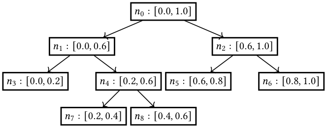
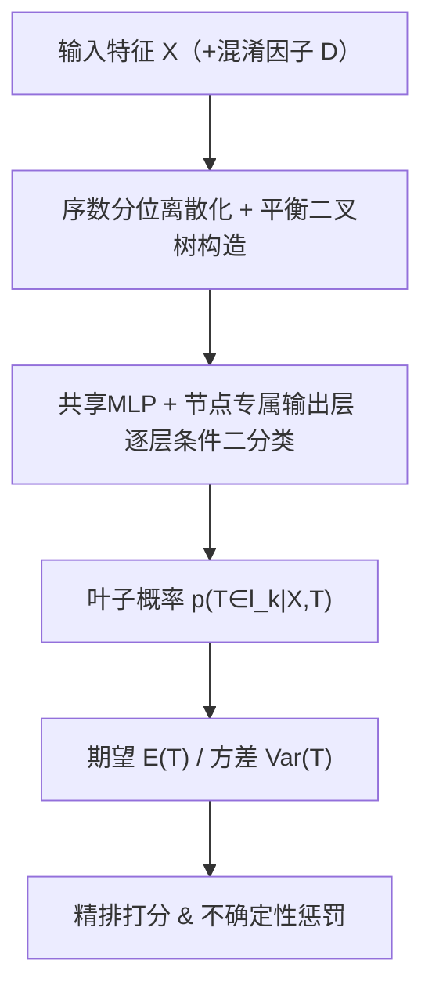

# Tree based Progressive Regression Model for Watch-Time Prediction in Short-video Recommendation (面向短视频推荐的树状渐进回归观看时长预测模型)

- **会议/期刊**: KDD 2023 (Long Beach)
- **作者与机构**: Xiao Lin, Xiaokai Chen, Linfeng Song, Jingwei Liu, Biao Li, Peng Jiang（快手科技）
- **推荐链路定位**: 精排（排序阶段的多目标预估分量，观看时长回归）
- **研究方向**: CTR/CVR 预估与特征交叉 / 去偏、公平与工业架构
- **论文原文**: [论文原文链接](https://arxiv.org/abs/2306.03392v1)
- **开源代码**: [TPM](https://github.com/jackielinxiao/TPM)

## TL;DR (1分钟核心速览)

短视频全屏场景中，观看时长既是连续值又具序数性，且存在"看一半才能看完"的条件依赖、点估计无法表达不确定性、日志数据带来时长偏置放大。TPM 把时长按分位切成序数区间，用一棵条件依赖二叉树把回归拆成逐层二分类，得到时长的多项式分布并显式优化其方差；后门调整可直接映射为按混淆因子分组建树。Kuaishou 离线 MAE 4.741（较 D2Q 降 12.6%）、XAUC 0.599，线上 4 天观看时长稳定 +0.21%~+0.27%，短播（负反馈）下降最多 0.31%。

## Background & Motivation (背景与核心矛盾)

- **主流范式**: WLR 将时长当作加权二分类的 odds 近似（YouTube 系），D2Q 按时长分组做分位回归 + 后门调整去时长偏置；两者均为**点估计**。
- **前人局限**: ① 点估计/分位回归丢失了时长值之间的**序数关系**——MAE 相同但 3.5s 与 4.5s 的预测在"取高者推荐"的排序逻辑下后果完全不同；② 忽略观看行为的**条件依赖**（看完 100% 必先看完 50%），WLR 还需人为构造负样本，全屏场景下并不存在真实负例；③ 无法表达预测置信度，低置信高打分会造成 bad case。
- **核心洞察 (Key Insight)**: 时长预测本质是"在序数刻度上做搜索"，任一搜索路径（线性搜索=非平衡树、二分搜索=平衡树）都等价于一串条件依赖的二分类判定；一旦输出落在各叶子区间的概率，时长即成为多项式随机变量，**方差可解析计算**，天然充当不确定性度量。
- **本文切入点**: 用树分解同时把序数性、条件依赖、不确定性、去偏四件事装进同一框架，并证明 D2Q 只是 TPM 的一个特例。

<figure class="paper-figure" markdown="span">
  <figcaption>图1：TPM中树的一个示例。每个节点分配一个分类器，用于判定观看时长预测所属的区间。每条边表示父节点决策的一个结果，作为当前节点的条件。例如，节点(0.2, 0.6)表示在观看时长预测属于(0.2, 0.6)的条件下，决定其应前往(0.2, 0.4)还是(0.4, 0.6)。</figcaption>
</figure>
图 1：TPM 中一棵分解树示例，每个内部节点挂一个二分类器判定时长落入哪个子区间，父节点决策结果作为子节点的条件。

## Method (核心方法设计)

### 1. 整体框架 (Overall Architecture)

输入用户/视频特征 $X$（可选混淆因子$D$，如视频时长），先按时长分位数$\{\gamma_0\le\gamma_1\le\cdots\le\gamma_m\}$做序数离散化，再自底向上合并相邻区间构造一棵完全平衡二叉树$\mathcal{T}$（叶子=最细区间，内部节点=一个二分类任务）。样本按真实时长落到叶子$l_k$，并激活根到$l_k$路径上的所有分类器；每个分类器共享底层 MLP 隐层、仅保留节点专属输出层$o_{n_j}(X)$，以此控制模型规模。前向时沿树逐层相乘得到叶子概率，汇总得期望$\mathbb{E}(\hat{T})$与方差，三项损失联合反传。推理只需一次前向 + 一次$O(|\mathcal{L}_\mathcal{T}|)$ 的加权求和，与叶子数线性、与打分候选数无关。

### 2. 关键设计拆解 (Key Designs)

1. **条件依赖树分解（序数性 + 条件依赖）**：痛点是把回归直接压成点值会丢掉序关系、也无法表达"必须先看一半"。TPM 令叶子概率为路径上各节点条件概率之积
$p(T\in l_k\mid X,\mathcal{T})=\prod_{1\le i\le d(l_k)}p\big(T\in\hat{n}_{\phi_{l_k}(i)}\mid X,\mathcal{T},\,T\in\hat{n}_{\phi_{l_k}(i-1)}\big)$，
再按区间中点回填 $\mathbb{E}(T\mid T\in l_k)=(\gamma_{l_k}+\gamma_{l_k+1})/2$，得$\mathbb{E}(T\mid X,\mathcal{T})=\sum_{l_k\in\mathcal{L}_\mathcal{T}}\mathbb{E}(T\mid T\in l_k)\,p(T\in l_k\mid X,\mathcal{T})$。直觉：每个分类器只回答"落在左半还是右半"这一局部比较，序关系被逐层显式编码，同时父节点输出作为子节点条件，条件依赖被结构性而非损失项地注入。
2. **方差作为不确定性正则**：点估计无法区分"均值同为 4.5s 但一个尖峰一个双峰"的两个模型。由于 $T$服从叶子上的多项式分布，方差可解析写出$\mathrm{Var}(T\mid X,\mathcal{T})=\mathbb{E}(T^2\mid X,\mathcal{T})-\mathbb{E}(T\mid X,\mathcal{T})^2$，并以标准差形式入损失：$\mathcal{L}=\alpha_1\log p(\hat{T}\in l_{k(T)}\mid X,\mathcal{T})-\alpha_2\mathrm{Var}(\hat{T}\mid X,\mathcal{T})^{0.5}-\alpha_3\|\mathbb{E}(\hat{T})-T\|_2$。物理直觉：惩罚方差等于要求模型把概率质量集中到真实区间附近，等价于"高置信地答对"，直接压低线上 bad case。
3. **后门调整的无缝嵌入与训练开销**：因果图 $D\to X\to T$、$D\to T$ 下，去混淆估计为
$\mathbb{E}(T\mid do(X))=\sum_{d}P(D=d)\,\mathbb{E}(T\mid X,D=d)$，
代入树期望后等价于**按混淆因子分组建树、分组训练分类器**——只需在输入与标签上追加 $D$，无需 IPS 权重或对抗训练。训练采用路径内所有节点二分类的联合似然（免负采样，正负由左右子节点自然定义），推理开销与单塔 MLP 同量级，仅多出叶子聚合。

## Experimental Setup & Evaluation Protocol (实验设置与评估协议)

| 数据集 | #Users/Sessions | #Items | #Interactions | 密度/说明 |
| :--- | :---: | :---: | :---: | :--- |
| Kuaishou (KuaiRec) | 7,176 | 10,728 | 12,530,806 曝光 | 全屏播放，无真实负例，短播样本作负例 |
| CIKM16 | 310,302 sessions | 122,991 | 平均会话长 3.981 | 搜索会话 dwell time，会话内每 item 作单特征 |

- **数据划分与防穿越**: 原文未披露显式时间戳切分，按样本级划分训练/测试，**未做全局时间切分**，存在轻度信息泄漏风险（审稿可质疑点）。
- **排名评测协议**: 属精排打分回归，**不做候选负采样或全库排序**；指标为 MAE（回归精度）与 XAUC（均匀采样样本对、统计预测序与真实时长序一致的比例，等价于无偏成对排序能力）。
- **对比基线与超参**: WLR、D2Q（时长分组数 32）、OR（序数回归，同样注入去混淆因子以保证公平）；所有方法共享 MLP 骨干，仅输出层与损失不同；TPM 叶子数 32、时长分组 32；损失权重 $\alpha_{1,2,3}$ 与方差权重做了敏感性扫描（图 9）。

## Key Experimental Results (实验关键数据)

### 1. 主实验对比 (Main Results)

| 方法 | Kuaishou MAE↓ | Kuaishou XAUC↑ | CIKM16 MAE↓ | CIKM16 XAUC↑ |
| :--- | :---: | :---: | :---: | :---: |
| WLR | 6.047 | 0.525 | 0.998 | **0.672** |
| D2Q | 5.426 | 0.565 | 0.899 | 0.661 |
| OR | 5.321 | 0.558 | 0.918 | 0.664 |
| **TPM** | **4.741** | **0.599** | **0.884** | **0.676** |
| Improv. vs best baseline | **-12.6%** | **+6.0%** | **-1.7%** | +0.6% |

### 2. 消融实验 (Ablation Study, KuaiRec)

| 变体 | 时长 MAE↓ | 时长 XAUC↑ | 时长比 MAE↓ | 时长比 XAUC↑ |
| :--- | :---: | :---: | :---: | :---: |
| TPM (full) | **4.741** | **0.599** | **0.467** | **0.712** |
| w/o MSE 项 | 4.887 | 0.595 | 0.482 | 0.711 |
| w/o 方差项 | 4.875 | 0.592 | 0.480 | 0.706 |
| w/o 去混淆 | 4.984 | 0.576 | 0.497 | 0.691 |
| OR w/o 去混淆 | 5.312 | 0.549 | 0.517 | 0.673 |

**线上 A/B（快手，20% 流量，4 天，相对提升）**：观看时长 Day1~Day4 分别为 +0.246% / +0.210% / +0.234% / +0.265%；短播率 -0.312% / -0.139% / -0.110% / -0.220%；转发率波动 ±0.04%~0.23%（约束指标未破 1% 红线）。

### 3. 关键实验发现 (Key Findings)

1. **序数分解是主要增益来源**：TPM vs OR（同为分类式分解）在 Kuaishou 上 MAE 从 5.321→4.741（-10.9%）、XAUC 0.558→0.599，说明增益不止来自"分类替代回归"，更来自**条件依赖的树式串联**；OR w/o 去混淆 5.312 也印证单纯阈值化分类并不够。
2. **不确定性约束既提精度又降负反馈**：去掉方差项 MAE 退化 2.8%（4.741→4.875）、XAUC 掉 0.007；线上对应短播率稳定下降，验证"低方差=高置信"确实转化为用户体验指标。
3. **去偏项贡献最大但非唯一**：去掉去混淆后 MAE 退化 5.1%（4.741→4.984）、XAUC 0.599→0.576，是单项最大跌幅；但即使无去偏，TPM 仍优于带去偏的 OR（4.984 vs 5.312），说明序数+条件依赖+方差三项已构成强基线，去偏是正交增量。

## Highlights & Limitations (亮点、对比与审稿批判)

- **与代表作对比**: 相比 WLR，TPM 摆脱了"人造负样本 + 时长加权"的近似，序关系与置信度都被显式建模；相比 D2Q，TPM 把"按时长分组"从**硬分组回归**升级为**分布建模**，并证明 D2Q 是 TPM 在特定树结构下的特例；相比 TDM 的树用于**语料划分/召回**，TPM 的树用于**标签空间划分/回归分解**，目的与遍历方式（求期望 vs. beam search）完全不同。
- **可迁移亮点**: ① 任何连续目标（时长、GMV、LTV）都可用"分位离散 + 平衡树二分类 + 期望回填"替代点回归，且天然输出方差用于置信度门控或级联融合；② 后门调整"按混淆因子分组建树"的做法可零成本迁移到多场景/多时长桶的工业精排。
- **审稿级局限批判**: ① 缺少时间切分与冷启动划分说明，KuaiRec 的样本级划分可能高估泛化；仅 3 个基线且无显著性检验，CIKM16 上 XAUC 仅 +0.6%（甚至 WLR 的 0.672 与 TPM 0.676 差距极小），证据强度偏弱。② 叶子数 32 / 分组数 32 / 方差权重均需网格搜索（图 8、图 9 显示存在明显最优点），且每个节点一个输出头，叶子数增大时参数量与路径似然计算线性增长，超参敏感与工程调参成本被低估。

## Rating (四维评分)

- **方法创新性 (Novelty)**: ⭐⭐⭐⭐ （把序数回归、条件依赖树与方差不确定性统一进一个可解析的分布框架，并给出 D2Q 为其特例的理论归约，机制新颖）
- **评估协议与实验扎实度 (Protocol & Experiments)**: ⭐⭐⭐ （有公开数据集 + 3 亿 DAU 线上 A/B 双重验证，但基线仅 3 个、无显著性检验、划分方式未披露，离线证据略薄）
- **写作与数学规范度 (Clarity & Rigor)**: ⭐⭐⭐⭐ （Eq.1–Eq.8 推导链完整，树-搜索-分布三者的等价关系讲得清楚；但部分符号在正文与算法伪码间略有重复定义）
- **工业落地与复现价值 (Industrial & Practical Value)**: ⭐⭐⭐⭐⭐ （代码开源、共享 MLP + 节点输出头使开销接近单塔，已在快手全量部署，是少见的"论文-线上"闭环工作）

