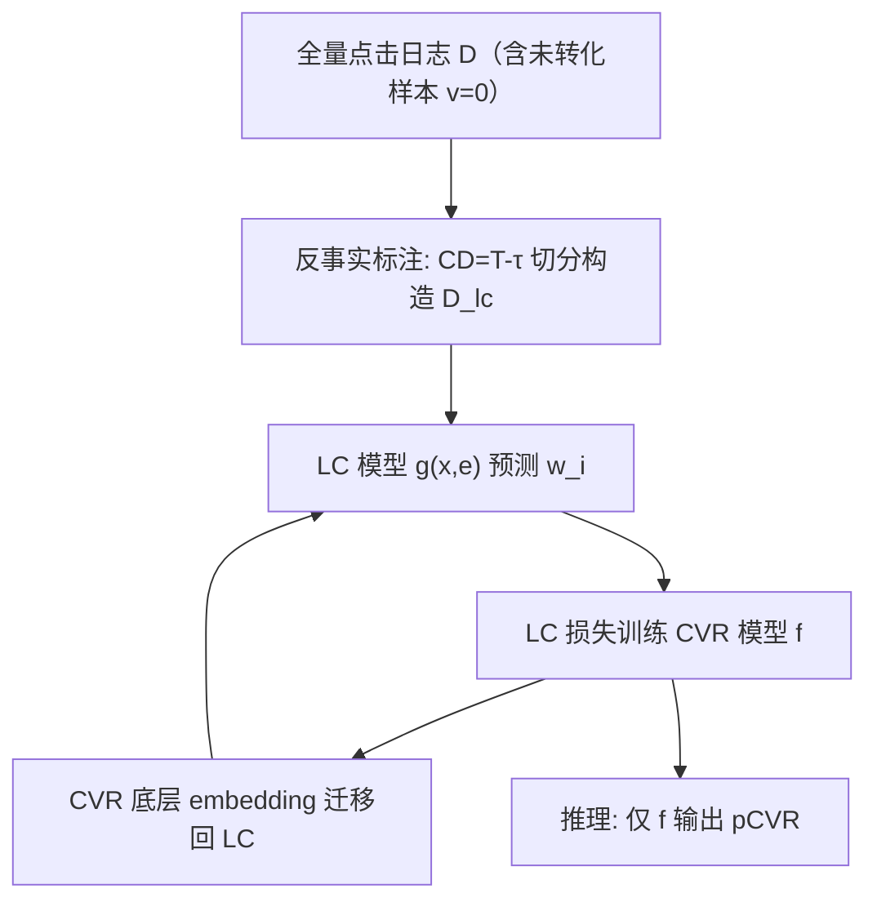
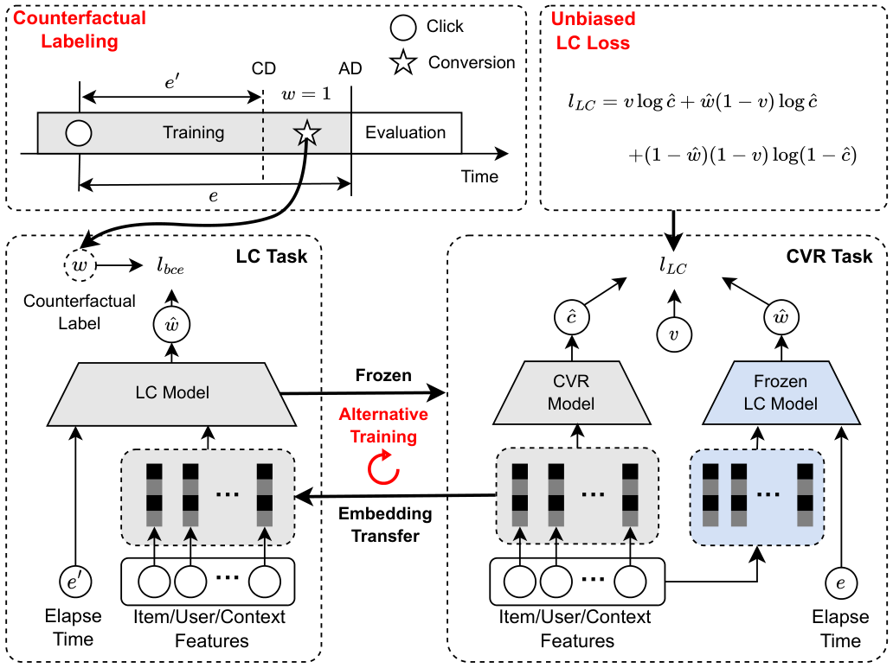

# Unbiased Delayed Feedback Label Correction for Conversion Rate Prediction (面向转化率预估的无偏延迟反馈标签纠正)

- **会议/期刊**: KDD 2023 (Long Beach, CA, USA)
- **作者与机构**: Yifan Wang, Peijie Sun, Min Zhang*, Shaoping Ma (清华大学 DCST/BNRist)；Qinglin Jia, Jingjie Li (华为诺亚方舟实验室)
- **推荐链路定位**: 精排 (CVR 预估)
- **研究方向**: CTR/CVR 预估与特征交叉 / 去偏与可信推荐
- **论文原文**: [arxiv.org/abs/2307.12756v1](https://arxiv.org/abs/2307.12756v1)
- **开源代码**: [github.com/yfwang2021/ULC](https://github.com/yfwang2021/ULC)（另有 [MindSpore 版](https://gitee.com/mindspore/models/tree/master/research/recommend/ULC)）

## TL;DR (1分钟核心速览)

离线 CVR 训练中，"点击后尚未转化"的样本被一律记为负，产生假负样本，且越新鲜的数据误标越严重——这是"模型新鲜度 vs 标签正确性"的两难。本文提出 ULC：先用一个辅助标签纠正 (LC) 模型预测每个观测负样本的真实转化概率 $w_i$，并证明由此得到的 LC 损失是 Oracle 损失的无偏估计；LC 模型的训练数据通过"反事实截止时间"人工构造，再用嵌入迁移式交替训练补足其数据利用不足的问题。在 Criteo 全库排序与华为游戏广告私有集上，ULC 平均相对最优基线 FSIW 提升 AUC 0.76%、PRAUC 1.02%、LL 1.85%，并将 Vanilla 与 Oracle 的差距填补 77.55%(AUC)。

## Background & Motivation (背景与核心矛盾)

- **主流范式**: 离线设置下按日/周在全量数据上重训 CVR 模型以保持新鲜度；处理延迟反馈有两条线——显式延迟时间建模（DFM 假设指数分布、非参延迟分布）与无偏损失构造（FSIW 重要性加权、nnDF 用久远窗口标签校正近期偏置）。
- **前人局限**: (i) DFM 类方法依赖延迟分布假设，实际延迟常不服从，且优化的是"已观测转化"而非真实转化；(ii) FSIW/nnDF 虽理论无偏，但只"降权"假负样本（误标样本权重趋 0）或干脆不处理近期样本，无法为某个具体假负样本**补入对应的正确正样本信息**。在数据分布近期漂移、假负样本又集中于新鲜数据时，这类间接补偿失效。
- **核心洞察 (Key Insight)**: 延迟反馈**只**造成标签错误——只要把错标纠正过来，就可以直接计算 Oracle 损失，而不必绕道重加权或延迟分布建模。因此问题等价于：训练一个足够准的"该负样本最终会转化吗"的概率估计器。
- **本文切入点**: 用辅助 LC 模型显式输出纠正概率 $w_i$，把假负样本"半个正样本"的信息直接写进交叉熵；再用反事实截止时间造 LC 的训练集。

## Method (核心方法设计)

### 1. 整体框架 (Overall Architecture)

框架由 CVR 主模型 $f(\cdot;\theta)$与标签纠正模型$g(\cdot;\psi)$组成。第一轮：在全量训练数据$\mathcal{D}$（含未转化样本）上用普通交叉熵训练 CVR 模型；同时以反事实截止时间 CD$=T-\tau$从同一批日志中切出子集$\mathcal{D}_{lc}$（CD 前点击且 CD 前未转化者为候选，CD 与 AD 之间发生转化者标$w=1$，否则$w=0$），训练 LC 模型。第二轮起：冻结 LC 模型，对全部观测负样本推断$w_i$，用 LC 损失重训 CVR 模型；随后把 CVR 模型的底层 embedding 迁移给 LC 模型重新初始化并重训 LC，如此交替$n$轮（实验表明$n=1$ 已足够）。推理阶段只需 CVR 模型，线上打分零额外开销。

<figure class="paper-figure" markdown="span">
  <figcaption>图1：我们提出的框架 ULC 的示意图。</figcaption>
</figure>

### 2. 关键设计拆解 (Key Designs)

1. **无偏标签纠正损失 (LC Loss)**：痛点是对假负样本只能"减权不能纠正"。本文对每个观测负样本引入纠正权重 $w_i=P(c_i=1\mid x_i,e_i,v_i=0)$，把其交叉熵拆成"以$w_i$记正、以$1-w_i$ 记负"两项：
$\mathcal{L}_{LC}=\frac{1}{|\mathcal{D}|}\sum_{i=1}^{|\mathcal{D}|}\big[v_i\log f(x_i)+w_i(1-v_i)\log f(x_i)+(1-w_i)(1-v_i)\log(1-f(x_i))\big]$定理 1 证明：当$w_i$取真实后验时$\mathbb{E}[\mathcal{L}_{LC}]=\mathbb{E}[\mathcal{L}_{oracle}]$（对$(x,e)$联合分布展开，合并$p(v=1,c=1)+p(c=1,v=0)=p(c=1\mid x,e)$即得）。直觉上，重加权只是让错标样本"少说话"，而 LC 损失直接为它造出了一个权重为$w_i$ 的正样本副本，信息被补上而非抹去。

2. **反事实标注 (Counterfactual Labeling)**：LC 模型需要 $v=0,c=1$这种现实中不存在的样本。做法是假想一个更早的收集时刻 CD，用"CD 之后、AD 之前是否转化"作为伪真值。$\tau$控制"标签正确性 vs 数据新鲜度"：$\tau$越大，落在 AD 之后转化而被误标为负的比例越小（正样本召回率单调上升），但$\mathcal{D}_{lc}$越陈旧、越无法纠正当前新鲜假负样本；Criteo 上最优$\tau\approx$ 一周。

3. **训练目标、负采样与推理效率**：CVR 模型总损失即 $\mathcal{L}_{LC}$，无额外正则；训练数据为全量曝光-点击日志（天然负采样，无人工负采样），batch size 1024。交替训练以"嵌入迁移"替代联合学习：因$\mathcal{D}_{lc}\subset\mathcal{D}$且$P(c=1\mid x)$与$P(c=1\mid x,e,v=0)$ 语义相近，底层特征表示可共享；只迁移 embedding 层、其余层重初始化，避免早期不准的 LC 梯度污染 CVR。推理解码为标准 sigmoid 打分，与 Vanilla 完全一致。

## Experimental Setup & Evaluation Protocol (实验设置与评估协议)

| 数据集 | #Users | #Items | #Interactions | 稀疏度/密度 | 特征/场景说明 |
| :--- | :---: | :---: | :---: | :---: | :--- |
| Criteo (公开) | 列匿名，不可用用户建模 | 同左 | 6,363,085 clicks / 23 days | CVR = 0.2294 | 类别+连续特征，含点击与转化时间戳 |
| Production (私有) | 未知 | 未知 | 2,400,000+ clicks / 30 days | CVR ≈ 0.0050 | 华为游戏广告，游戏内付费为转化 |

- **数据划分与防穿越**: 全局时间戳切分。Criteo 用末 23 天：连续 3 周训练、第 22 天验证、第 23 天测试；Production 末两天分别为验证/测试。CVR 样本按"点击样本"训练、按曝光样本推断的选择偏差不在本文讨论范围。验证集上假定 $c_i$ 未知，用 LC 损失做超参选择（防泄漏）。
- **排名评测协议**: Criteo/Production 测试集均保留完整曝光-点击日志与最终真实转化 $c_i$，指标在**全测试集**上计算，属全库排序口径（非采样负例排序）；额外以 Oracle/Vanilla 为上下界换算相对改进 RI。
- **对比基线与超参设置**: 基线 Vanilla、Oracle、DFM、FSIW、nnDF；骨干 MLP、DeepFM、AutoInt、DCNV2（embedding 维 $d=64$，MLP 三层 [256,256,128] + LeakyReLU，Adam，lr ∈ {1e-3,5e-4,1e-4}，L2 ∈ {0,1e-7,…,1e-4}）。每实验 5 个随机种子取均值并做$t$-检验（** 表示$p\le 0.01$）。

## Key Experimental Results (实验关键数据)

### 1. 主实验对比 (Main Results)

Criteo 数据集（↑越高越好，↓越低越好；最优加粗，`Improv.` 为 MLP 骨干下 ULC vs 最优基线 FSIW 的相对提升）：

| Backbone | Method | AUC↑ | PRAUC↑ | LL↓ | RI-AUC↑ | RI-LL↑ |
| :--- | :--- | :---: | :---: | :---: | :---: | :---: |
| MLP | Vanilla | 0.8208 | 0.6356 | 0.4505 | 0.000 | 0.000 |
| MLP | Oracle (上界) | 0.8441 | 0.6595 | 0.4025 | 1.000 | 1.000 |
| MLP | DFM | 0.8264 | 0.6398 | 0.4378 | 0.2403 | 0.2645 |
| MLP | FSIW (最优基线) | 0.8335 | 0.6465 | 0.4178 | 0.5450 | 0.6812 |
| MLP | nnDF | 0.6859 | 0.4169 | 0.5969 | −5.789 | −3.05 |
| MLP | **ULC** | **0.8403** | **0.6543** | **0.4104** | **0.8369** | **0.8354** |
| | *Improv.* | *+0.82%* | *+1.21%* | *+1.77%* | — | — |
| DeepFM | FSIW → **ULC** | 0.8326 → **0.8393** | 0.6451 → **0.6525** | 0.4195 → **0.4104** | 0.4774 → **0.7792** | 0.5981 → **0.8107** |
| AutoInt | FSIW → **ULC** | 0.8329 → **0.8388** | 0.6460 → **0.6517** | 0.4192 → **0.4114** | 0.4619 → **0.7428** | 0.6230 → **0.7990** |
| DCNV2 | FSIW → **ULC** | 0.8328 → **0.8391** | 0.6461 → **0.6519** | 0.4174 → **0.4105** | 0.4541 → **0.7431** | 0.6422 → **0.8004** |

四骨干平均：相对最优基线 AUC +0.76%、PRAUC +1.02%、LL +1.85%；RI 口径分别 +60.3% / +81.43% / +27.76%。私有 Production 集（MLP 骨干）ULC 同样稳定优于 FSIW 与 DFM，且显著高于 Vanilla、逼近 Oracle。

### 2. 消融实验 (Ablation Study)

| 变体（Criteo, MLP 骨干） | 相对完整 ULC 的变化 | 说明 |
| :--- | :--- | :--- |
| ULC-A（去掉嵌入交替训练，$n=0$） | 下降，但仍优于最优基线 FSIW | LC 损失本身即有效 |
| JL（LC 与 CVR 共享底层联合学习） | **大幅下降**（PRAUC/LL 均劣化明显） | 早期不准的 LC 梯度误导 CVR |
| PT-hard / PT-soft / PT-drop（用 CVR 预测挖掘 AD 后转化样本） | 轻微下降 | 长延迟潜在正样本与真负样本比例约 1:50，噪声 > 收益 |
| **ULC（嵌入迁移交替，$n=1$）** | **0.6543 / 0.4104** | 最优配置 |
| 反事实间隔 $\tau$：1→10 天 |$\tau\approx7$天最优，过小标签脏、过大$D_{lc}$ 陈旧 | 标签正确性 vs 新鲜度的 U 形曲线 |

### 3. 关键实验发现 (Key Findings)

1. **补齐幅度是最硬的证据**：ULC 把 Vanilla 与 Oracle 之间的可改进空间填补了 77.55%(AUC)、66.55%(PRAUC)、83.13%(LL)，而最强基线 FSIW 仅 46–68%，说明"直接补正样本"确实比"给负样本降权"信息量更大；nnDF 因需全量批次优化而塌陷至 0.6859 AUC，也侧面印证离线延迟去偏必须保持 batch-wise 训练。
2. **交替训练的收益主要来自一次初始化迁移**：图 5 显示 $n=0\to1$提升最陡，$n\ge2$ 几乎饱和；同时 JL 的严重退化说明"迁移 embedding 但隔离梯度"是必要设计而非可选技巧，直接把两模型端到端耦合反而有害。
3. **长延迟样本是主要受益区间**：把测试正样本按延迟时长分五组（G1 最短、G5 最长）后，ULC 相对 Vanilla/FSIW 的增益随延迟单调扩大（图 6）；但 LC 模型自身识别假负样本的能力随延迟下降（AUC 由 G1 的 0.8698 降至 G5 的 0.7811，PRAUC 0.1397→0.0398），暴露出"AD 后才转化的超长延迟样本被反事实标注误判为负"的残余瓶颈。

## Highlights & Limitations (亮点、对比与审稿批判)

- **与代表作对比 (vs. Prior Work)**: 与 DFM 的本质区别是放弃延迟时间分布假设、改成"判别式标签纠正"；与 FSIW 的区别是**补信息**而非**减权重**（FSIW 对假负样本只降到 0 权重，其对应正样本信息仍缺失）；与 nnDF 的区别是处理最新鲜的数据而非回落至久远窗口，且保持 mini-batch 可优化性。
- **可迁移亮点**: (i) "反事实截止时间"这一造监督信号的范式可平移到退款预测、订阅流失、长期留存等一切"观测窗内未发生 ≠ 不会发生"的任务；(ii) 冻结辅助模型 + 仅共享底层 embedding 的交替训练，是避免弱辅助任务拖累主任务的一种通用轻量方案。
- **审稿级局限批判**: (i) $\tau$ 为手工超参且数据依赖强（Criteo 约 7 天），无自适应机制，工业落地需反复调参；同时反事实标注需"已经过去的未来标签"，冷启动业务线首月难以启用。(ii) LC 模型自身仍受延迟污染（AD 后转化为负），且每轮交替需训练两个模型，离线重训成本翻倍；nnDF 因全 batch 限制被削弱，与 Vanilla 的比较公平性存疑。(iii) 论文仅在离线设置下验证，未与选择偏差（ESMM/IPS 类）联合，也未与在线 streaming 方案对比，线上部署结论留白。

## Rating (四维评分)

- **方法创新性 (Novelty)**: ⭐⭐⭐⭐ （把延迟反馈重述为"可被无偏纠正的标签噪声"并给出定理 1 的闭式证明，思路干净；但 LC 损失本质仍是加权交叉熵的期望修正，与重要性加权属同一谱系）
- **评估协议与实验扎实度 (Protocol & Experiments)**: ⭐⭐⭐⭐ （四个特征交叉骨干 + 公开/私有双数据集 + 5 seed 显著性检验 + Oracle 上界与 RI 归一化到位；扣分在消融仅以图呈现无具体数值、$\tau$ 无自适应分析）
- **写作与数学规范度 (Clarity & Rigor)**: ⭐⭐⭐⭐ （定理证明推导完整、符号表清晰、算法 1 可复现；但对 LC 模型为何"足够准即可"的误差界未做敏感性定量刻画）
- **工业落地与复现价值 (Industrial & Practical Value)**: ⭐⭐⭐⭐ （代码与 MindSpore 版本均已开源；推理零额外开销、仅离线重训成本增加，且直接面向"日更/周更 + CPA 计费"的真实广告链路，工程可移植性强）

