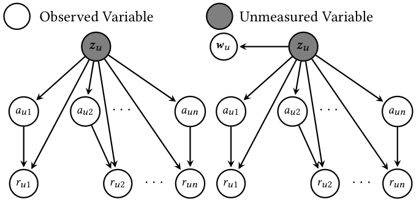
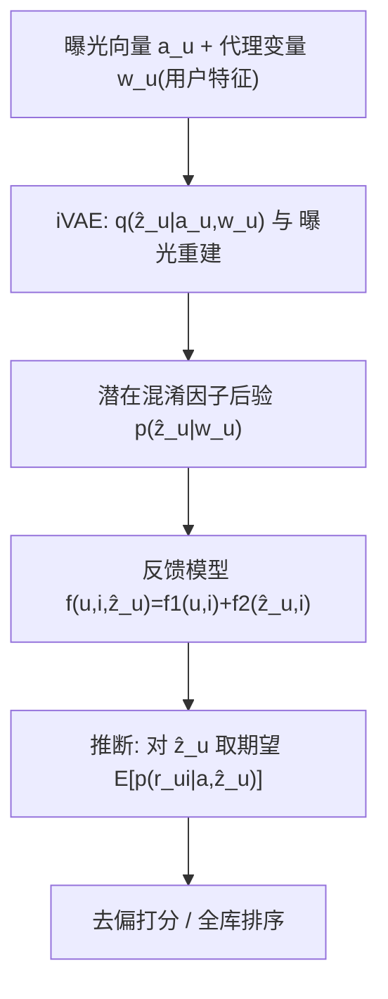

# Debiasing Recommendation by Learning Identifiable Latent Confounders (通过学习可识别潜在混淆因子实现推荐去偏)

- **会议/期刊**: KDD 2023 (29th ACM SIGKDD)
- **作者与机构**: Qing Zhang、Jiheng Zhang (HKUST)；Xiaoying Zhang、Yang Liu、Ruocheng Guo (ByteDance Research)；Hongning Wang (University of Virginia)；Min Gao (重庆大学)
- **推荐链路定位**: 精排（反馈/偏好预估打分）
- **研究方向**: 去偏公平、可信隐私与工业架构 / 协同过滤
- **论文原文**: [https://arxiv.org/abs/2302.05052v2](https://arxiv.org/abs/2302.05052v2)
- **开源代码**: [https://github.com/BgmLover/iDCF](https://github.com/BgmLover/iDCF)

## TL;DR (1分钟核心速览)

推荐系统要预测"若曝光则用户会给什么反馈"的反事实结果，但用户社会经济地位等**不可观测混淆因子**同时影响曝光与反馈，导致伪相关。既有 Deconfounder 从曝光向量反推替代混淆因子，存在**不可识别性**：在有限数据集下反事实概率只能落到一个可行区间而非唯一点。本文提出 iDCF，引入用户特征作为混淆因子的**代理变量 (proxy)**，用近端因果推断额外增加一个条件边缘约束，使 $p(r^{\boldsymbol{a}}_{ui})$ 唯一可识别并有定理保证。在 Coat/Yahoo!R3/KuaiRand 的无偏全库排序上，NDCG@5 相对最优基线分别提升 3.89%/0.70%/0.37%，小样本 Coat 提升最显著。

## Background & Motivation (背景与核心矛盾)

- **主流范式**: 把曝光视为 treatment、反馈视为 potential outcome；对**可测**混淆因子（物品流行度、视频时长、创作者）用后门调整/IPW，对**不可测**混淆因子则用有界假设下的鲁棒优化 (RD-IPS)、不变学习 (InvPref)、工具变量/中介变量，或 Deconfounder 从曝光序列学替代混淆因子。
- **前人局限**: ① 有界/环境/IV 假设过强且无法给出反事实的可识别性保证，实际常次优；② Deconfounder 虽不需辅助变量，但把 4 个未知联合概率 $p_{zr|\boldsymbol{a}}$ 只压在 3 个约束（归一化 + 两个边缘）上，**自由度恒为 1**，反事实概率只能确定在一个区间内——数据无穷也不收敛。
- **核心洞察 (Key Insight)**: 用户特征（如近期消费水平）是混淆因子（收入）的**后代节点**，满足"给定混淆因子与曝光后与反馈独立"的排除限制，因而可作为 proximal proxy 补上第 4 个约束。
- **本文切入点**: 将推荐建模为**多 treatment**（多物品曝光）下的近端因果推断问题，用代理变量推断潜在混淆因子，从而**识别**而非仅"近似"反事实反馈。

<figure class="paper-figure" markdown="span">
  <figcaption>图 2：推荐系统中多处理变量的因果图。𝒂𝑢𝑖：用户 𝑢 对物品 𝑖 的曝光，𝑟𝑢𝑖：用户 𝑢 对物品 𝑖 的反馈，𝒛𝑢：未测量的混杂因子，𝒘𝑢：混杂因子的代理变量。</figcaption>
</figure>

## Method (核心方法设计)

### 1. 整体框架 (Overall Architecture)

iDCF 是**与反馈模型无关 (feedback-model-agnostic)** 的两阶段框架。第一阶段：以曝光向量 $\boldsymbol{a}_u$为观测、代理变量$\boldsymbol{w}_u$为辅助条件，用 iVAE 学后验$q_\phi(\hat{\boldsymbol{z}}_u|\boldsymbol{a}_u,\boldsymbol{w}_u)$，其解码器重建整条曝光向量，从而把$\hat{\boldsymbol{z}}_u$学到"与真混淆因子相差一个双射变换"的等价类。第二阶段：把$\hat{\boldsymbol{z}}_u$送入任意打分模型$f(u,i,\hat{\boldsymbol{z}}_u;\eta)$，对后验取期望拟合真实反馈。推断时不再依赖曝光的反推，而是对$p(\hat{\boldsymbol{z}}_u|\boldsymbol{w}_u)$ 取期望做后门调整，输出去偏分数用于排序。

<figure class="paper-figure" markdown="span">
  ![图 3：所提出方法 iDCF 的框架。关键在于推断 𝑝(ˆ𝒛𝑢) 和 𝑝(𝑟𝑢𝑖|𝒂, ˆ𝒛𝑢)，由此得到所提出方法 iDCF 的以下两步流程：• 学习潜在混杂因子：该阶段旨在借助代理变量学习潜在混杂因子 ˆ𝒛𝑢，使得学习到的 ˆ𝒛𝑢在某种变换下等价于真实未测量的混杂因子 𝒛𝑢 \[9, 17\]，并能提供额外约束以推断用户反馈 𝑟𝑢𝑖，这是 Deconfounder 中的替代混杂因子无法实现的。具体而言，我们旨在学习其先验分布，即 𝑝(](../../../../assets/papers/2302.05052v2/figure_3.png)<figcaption>图 3：所提出方法 iDCF 的框架。关键在于推断 𝑝(ˆ𝒛𝑢) 和 𝑝(𝑟𝑢𝑖|𝒂, ˆ𝒛𝑢)，由此得到所提出方法 iDCF 的以下两步流程：• 学习潜在混杂因子：该阶段旨在借助代理变量学习潜在混杂因子 ˆ𝒛𝑢，使得学习到的 ˆ𝒛𝑢在某种变换下等价于真实未测量的混杂因子 𝒛𝑢 [9, 17]，并能提供额外约束以推断用户反馈 𝑟𝑢𝑖，这是 Deconfounder 中的替代混杂因子无法实现的。具体而言，我们旨在学习其先验分布，即 𝑝(</figcaption>
</figure>

### 2. 关键设计拆解 (Key Designs)

1. **代理变量补约束，破解不可识别性**: 引入 $\boldsymbol{w}_u=g(\boldsymbol{z}_u)$、$\boldsymbol{w}_u\perp r_{ui}|(\boldsymbol{z}_u,\boldsymbol{a}_u)$后，未知量仍是 4 个但约束增至 4 条（多出$\boldsymbol{w}_u=0/1$两条条件边缘），方程组恰定，$p(r^{\boldsymbol{a}}_{ui})$ 有唯一解。直观上：消费水平这一"影子"把收入这一隐变量钉死了。
2. **iVAE 学潜在混淆因子（含曝光重建项）**: 最大化证据下界
$\mathcal{L}(\theta,\phi)=\mathbb{E}_{q_\phi}\big[\log p_\theta(\hat{\boldsymbol{z}}_u|\boldsymbol{w}_u)-\log q_\phi(\hat{\boldsymbol{z}}_u|\boldsymbol{a}_u,\boldsymbol{w}_u)\big]+\mathbb{E}_{q_\phi}\big[\log p_\theta(\boldsymbol{a}_u|\hat{\boldsymbol{z}}_u)\big]$，
其中先验/后验取高斯位置-尺度族、第二项为逐物品 Bernoulli 的负交叉熵。该项迫使 $\hat{\boldsymbol{z}}_u$ 能重建**整条**曝光向量（而非只解释曝光频次），这是相对 Deconfounder 的关键增量。
3. **加性反馈模型与推断期调整**: $f(u,i,\hat{\boldsymbol{z}}_u)=f_1(u,i)+f_2(\hat{\boldsymbol{z}}_u,i)$把内在偏好与混淆效应解耦；训练目标$\mathcal{L}_{iDCF}(\eta)=\frac{1}{|\mathcal{D}|}\sum_{(u,i)\in\mathcal{D}} l\big(\mathbb{E}_{q_\phi} [f(u,i,\hat{\boldsymbol{z}}_u;\eta)],r_{ui}\big)$（MSE/BCE）。因$\boldsymbol{w}_u$在训练与测试期不变，推断式为$p(r^{\boldsymbol{a}}_{ui}|\boldsymbol{w}_u)=\mathbb{E}_{\hat{\boldsymbol{z}}_u|\boldsymbol{w}_u}[p(r_{ui}|\boldsymbol{a},\hat{\boldsymbol{z}}_u)]$。采用 point-wise 拟合，**免负采样**；推理仅需一次编码器前向 + 少量采样期望，开销为$O(d)$ 级。

## Experimental Setup & Evaluation Protocol (实验设置与评估协议)

- **数据集与预处理**:

| 数据集 | #Users | #Items | #Biased (训练) | #Unbiased (验证/测试) | 场景 |
| :--- | :---: | :---: | :---: | :---: | :--- |
| Coat | 290 | 300 | 6,960 | 4,640 | 服饰评分 |
| Yahoo!R3 | 5,400 | 1,000 | 129,179 | 54,000 | 音乐评分 |
| KuaiRand | 23,533 | 6,712 | 1,413,574 | 954,814 | 短视频点击 |

- **数据划分与防穿越**: 全部 biased 数据作训练集；unbiased（随机曝光试验收集）30% 作验证、70% 作测试，避免用有偏日志评估。
- **排名评测协议**: 无偏 `Full-Ranking`——每个用户在测试期全部未交互物品上排序，指标 NDCG@5 / Recall@5。正样本定义：Coat/Yahoo!R3 评分 $\geq 4$；KuaiRand 用平台 `IsClick`。
- **对比基线**: MF、MF-WF（加用户特征）、IPS、RD-IPS、InvPref、DCF、DeepDCF-MF、iDCF-W（消融变体，VAE 无 proxy）。显著性用配对 t-test 报 p-value；合成数据额外验证可识别性（MCC 与可视化）。

## Key Experimental Results (实验关键数据)

### 1. 主实验对比 (Main Results)

| 模型 | Coat N@5 | Coat R@5 | Yahoo N@5 | Yahoo R@5 | Kuai N@5 | Kuai R@5 |
| :--- | :---: | :---: | :---: | :---: | :---: | :---: |
| MF | 0.5524 | 0.5294 | 0.5629 | 0.7129 | 0.3748 | 0.3247 |
| MF-WF | 0.5529 | 0.5341 | 0.5649 | 0.7144 | 0.3762 | 0.3255 |
| IPS | 0.5450 | 0.5260 | 0.5490 | 0.6967 | 0.3696 | 0.3224 |
| RD-IPS | 0.5448 | 0.5240 | 0.5550 | 0.7020 | 0.3690 | 0.3207 |
| InvPref | 0.5405 | 0.5295 | 0.5928 | 0.7414 | 0.3778 | 0.3283 |
| DCF | 0.5509 | 0.5329 | 0.5675 | 0.7116 | 0.3751 | 0.3243 |
| DeepDCF-MF | 0.5373 | 0.5141 | 0.6395 | 0.7729 | 0.4078 | 0.3491 |
| iDCF-W | 0.5255 | 0.4971 | 0.6410 | 0.7712 | 0.4072 | 0.3481 |
| **iDCF (ours)** | **0.5744** | **0.5504** | **0.6455** | **0.7837** | **0.4093** | **0.3513** |
| **Improv.%** | **+3.89%** | **+3.05%** | **+0.70%** | **+1.40%** | **+0.37%** | **+0.63%** |
| p-value | 7e-4 | 2e-2 | 2e-3 | 1e-4 | 5e-3 | 1e-4 |

### 2. 消融实验 (Ablation Study)

| 变体 | 混淆因子 | 代理变量 | Coat N@5 | Yahoo N@5 | Kuai N@5 | 合成 $\beta=3.0$ N@5 |
| :--- | :---: | :---: | :---: | :---: | :---: | :---: |
| MF-WF（无去偏） | ✗ | ✗ | 0.5529 | 0.5649 | 0.3762 | 0.8220 |
| iDCF-W（VAE，无 proxy） | ✓ | ✗ | 0.5255 | 0.6410 | 0.4072 | 0.8226 |
| **iDCF（iVAE + proxy）** | ✓ | ✓ | **0.5744** | **0.6455** | **0.4093** | **0.8368** |

### 3. 关键实验发现 (Key Findings)

1. **可识别性在稀疏小样本上决定生死**：Coat 仅 290 用户时，DCF / DeepDCF-MF / iDCF-W 全部**低于**基线 MF（0.5373/0.5255 vs 0.5524），而 iDCF 反升到 0.5744（+3.89%）；说明"能否唯一识别"比"模型拟合容量"更关键，参数化混淆因子在小数据上反而过拟合。
2. **代理变量的收益随混淆强度放大**：真实数据上 iDCF 相对 iDCF-W 仅 +0.70%/+0.37%，但在合成数据 $\beta=3.0$（强混淆）时升至 +1.73%（0.8368 vs 0.8226），$p=8e{-}13$；$\beta$ 从 1.0 到 3.0 性能差单调扩大，直接验证去偏机制的有效性来源。
3. **学到的混淆因子保真度与排序性能正相关**：$\gamma=0$时 MCC 为 0.8394 (iDCF) vs 0.6050 (iDCF-W)；曝光噪声$\gamma=20$时仍保持 0.6062 vs 0.0682（近 9 倍），且性能同步衰减——证明"代理变量$\to$可识别混淆因子$\to$更准反事实"这条因果链是可度量的。

## Highlights & Limitations (亮点、对比与审稿批判)

- **与代表作对比 (vs. Prior Work)**: 相比 **DCF/DeepDCF**，本文不满足于"用曝光学替代混淆因子"，而是补齐约束使其**可识别**，并提供定理 4.3；相比 **RD-IPS** 的有界鲁棒假设与 **InvPref** 的多环境假设，iDCF 只要求用户特征是混淆因子的后代且满足排除限制，假设更弱、更易在工业数据上落地。独特之处是把推荐形式化为**多 treatment** 问题，从而能复用曝光向量的重建信息，放松了对 proxy 的信息量要求。
- **可迁移亮点**: ① "加一个代理变量补一条边缘约束"的思路可直接迁移到曝光去偏、位置去偏、延迟反馈等隐变量识别场景；② 加性分解 $f_1(u,i)+f_2(\hat{\boldsymbol{z}}_u,i)$ 让去偏模块与任意 backbone（MF/GNN/Transformer）解耦，工程上可插拔。
- **审稿级局限批判**: ① 依赖 completeness / equivalence 等不可检验假设，proxy 选错（如 Yahoo!R3 中问卷特征与反馈无关）会引入噪声，DeepDCF-MF 在该集上被 iDCF-W 反超即是警示；② 训练需两阶段串行 + iVAE 隐变量采样，推理需对后验做蒙特卡洛期望，相对单塔 MF 有额外延迟与调参（$\boldsymbol{z}$ 维度、先验方差）敏感度，论文未给在线 A/B 或时延数据；③ 仅验证 MF 系 backbone 与三个中等规模数据集，未覆盖序列/生成式精排。

## Rating (四维评分)

- **方法创新性 (Novelty)**: ⭐⭐⭐⭐ （首次将 proximal causal inference 引入多 treatment 推荐，明确指出并量化 Deconfounder 的自由度缺陷，附识别性定理）
- **评估协议与实验扎实度 (Protocol & Experiments)**: ⭐⭐⭐⭐ （三个真实集均用随机曝光 unbiased 数据做 Full-Ranking，配 p-value 与合成集 ground-truth MCC 验证，但缺线上实验与更大 backbone）
- **写作与数学规范度 (Clarity & Rigor)**: ⭐⭐⭐⭐ （Example 3.1 的 4 未知 3 约束推演极清晰，公式编号与假设逐条对应；常数/超参细节下放附录略有割裂）
- **工业落地与复现价值 (Industrial & Practical Value)**: ⭐⭐⭐⭐ （代码开源、框架与反馈模型无关可直接插拔；两阶段训练与后验采样带来额外链路成本，需权衡）

