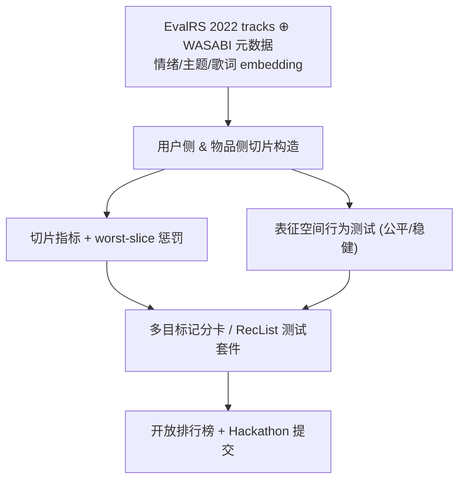

# EvalRS 2023. Well-Rounded Recommender Systems For Real-World Deployments (面向真实部署的"圆润"推荐系统评测)

- **会议/期刊**: KDD 2023 Workshop (EvalRS 2023)
- **作者与机构**: Federico Bianchi (Stanford)、Patrick John Chia (Coveo)、Ciro Greco / Jacopo Tagliabue (Bauplan, NYU)、Claudio Pomo (Politecnico di Bari)、Gabriel Moreira (NVIDIA Merlin)、Davide Eynard / Fahd Husain (mozilla.ai)
- **推荐链路定位**: 全链路离线评测与基准 (Evaluation Harness)，非某一具体召回/排序模块
- **研究方向**: 去偏公平、可信隐私与工业架构 (主) / 评测协议与基准
- **论文原文**: [arXiv:2304.07145v4](https://arxiv.org/abs/2304.07145v4)
- **开源代码**: [RecList/evalRS-KDD-2023](https://github.com/RecList/evalRS-KDD-2023)

## TL;DR (1分钟核心速览)

推荐系统长期被"单目标准确率平均值"这一把尺子衡量，公平性、稳健性、信息量与资源开销被系统性忽略。EvalRS 2023 是一篇 **Workshop 提案型 (position/proposal) 论文**，其贡献不是新模型，而是把评测当作一等公民：以"切片指标 + 行为测试 + 双向公平性"重构评测协议，并以 WASABI 增强的 361,218 首歌数据集与开源工具链（RecList / Merlin / Elliot）搭起可复现的排行榜与 Hackathon。需明确：**本文不含主实验与消融表**，其"收益"体现在 EvalRS 2022 已验证的社区规模（>150 人 / 50 队参赛）与 2023 年评测维度、数据资源的扩张。

## Background & Motivation (背景与核心矛盾)

- **主流范式**: 以 NDCG / Recall / HR 等准确率指标在单一全库或采样候选集上取**全局平均值**，作为泛化能力的代理。
- **前人局限 ①**: 全局平均会把弱势用户群与长尾物品的错误"摊平"，模型可以在总体指标上涨的同时对某一敏感切片显著恶化。
- **前人局限 ②**: 准确率无法刻画部署期真正致命的维度——信息茧房/回声室、偏见放大、模型对扰动的不稳健、推理资源约束，以及用户侧与物品侧的**双边**公平。
- **核心洞察 (Key Insight)**: 社区缺的不是更强的排序器，而是"我们怎么知道我们做对了"的共识；EvalRS 2022 的爆量参与（>150 人、50 队、>50 名现场听众、Nature Machine Intelligence 回顾）证明这是真需求而非学术自嗨。
- **本文切入点**: 沿用"切片 + 表征行为测试"的技术骨架，横向扩张到社会影响维度，并用 Hackathon 把评测从"论文里的一句话"变成"可提交、可复现、可打榜的工程产物"。

## Method (核心方法设计)

### 1. 整体框架 (Overall Architecture)

EvalRS 2023 的"方法"是一条评测流水线而非网络结构：先把 EvalRS 2022 的 track 与 WASABI 的音乐元数据对齐（覆盖 48%、361,218 首唯一曲目），为每首歌补齐 valence-arousal 情绪预测、last.fm 情绪/社交标签、是否 classic 的标签、LDA 主题分布，并用 Sentence-BERT (`all-mpnet-base-v2`) 在整首歌词与单句歌词上生成语义 embedding；随后在**用户侧与物品侧**同时定义切片，对参赛模型施加"切片指标 + 行为测试 + 资源约束"的多目标打分；最后通过 RecList 式测试套件与开放排行榜聚合，Hackathon 环节允许参赛队自带指标定义，形成"指标贡献"与"模型贡献"并列的双轨评价。

### 2. 关键设计拆解 (Key Designs)

1. **切片指标与 worst-slice 惩罚（把"平均好"改成"处处不太差"）**: 痛点在于单一全局均值对弱势切片不敏感。设切片 $s$对应子群体$\mathcal{U}_s$，则切片分数与公平性缺口定义为
   $M_s=\frac{1}{|\mathcal{U}_s|}\sum_{u\in\mathcal{U}_s}m(\hat{R}_u,R_u),\quad \Delta_{\text{slice}}=\max_{s}M_s-\min_{s}M_s .$评分卡同时报告$\min_s M_s$而非仅报告$\bar{M}$，直觉是：**最差切片的性能才是部署时的真实下限**，因为线上事故总由最脆弱的那群用户触发。
2. **表征空间的行为测试（Behavioral Tests）**: 直接对敏感属性做输入扰动成本高且不可微，作者延续"用表征做代理"的思路：在 embedding 空间比较切片间距离与近邻构成，
   $D_{s,s'}=\big\lVert \boldsymbol{\mu}_s-\boldsymbol{\mu}_{s'} \big\rVert_2,\ \ \boldsymbol{\mu}_s=\frac{1}{|\mathcal{S}_s|}\sum_{i\in\mathcal{S}_s}\boldsymbol{z}_i ,$
   若某对切片在表征上被系统性拉开而业务上本不该有差异，则模型已编码了不应存在的偏见信号。好处是**无需重训练、可对任意黑盒输出做审计**。
3. **评测目标与"训练目标"的关系**: 本文没有损失函数 $\mathcal{L}$；其等价物是参赛者需同时优化的**目标向量**$\langle \text{accuracy},\ \text{fairness},\ \text{robustness},\ \text{informativeness},\ \text{efficiency}\rangle$，因此不存在上传梯度；负采样策略、Embedding 维度$d$ 等由各参赛方案自定，评测端只固定数据切分与候选打分协议，保证横向可比。

## Experimental Setup & Evaluation Protocol (实验设置与评估协议)

- **数据集与预处理**: 本文只披露资源规模，未给交互量统计；下表如实标注"未披露"以免虚构：

| 数据集 | #Users | #Items | #Interactions | 稀疏度/密度 | 特征/场景说明 |
| :--- | :---: | :---: | :---: | :---: | :--- |
| EvalRS tracks ⊕ WASABI | 未披露 | 361,218 首唯一曲目 (WASABI 覆盖 48%) | 未披露 | 未披露 | 音乐流媒体"双边数字聚合器"场景；情绪 (valence-arousal)、情绪/社交标签、classic 标记、LDA 主题、歌词 Sentence-BERT embedding |

- **数据划分与防穿越 (Splitting Strategy)**: 论文正文未给出划分协议，仅说明沿用 EvalRS 2022 的 track 组织方式，具体切分与测试脚本以开源仓库为准；这本身是该类提案论文的诚实边界。
- **排名评测协议 (Ranking Protocol)**: 由评测工具链固定候选打分口径（track 内全库排序），并要求所有提交在同一测试套件上运行，避免"采样负例比例不同 → 指标不可比"的经典陷阱。
- **对比基线与超参设置**: 不设统一基线模型；对照组是**评测范式本身**——"仅准确率" vs "多维记分卡"。开源栈为 NVIDIA Merlin（训练/召回）、Elliot（可复现实验）、RecList（行为测试），显著性检验在本文中未涉及。

### 主实验对照（范式对照，非数值结果）

由于原文无实验表，此处以"评测维度"表格替代主结果表，明确标注无量化指标：

| 评测维度 | 传统准确率范式 | EvalRS 2023 范式 | 量化证据 |
| :--- | :---: | :---: | :---: |
| 用户侧公平 | 全局平均，切片不可见 | 切片 $M_s$ + worst-slice | 无（提案） |
| 物品侧/长尾 | 覆盖率不报告 | 双向切片 + 信息量 | 无（提案） |
| 稳健性 | 不测 | 表征行为测试 | 无（提案） |
| 可复现性 | 各家自建脚本 | 统一开源测试套件 | 数据覆盖 48%、361,218 曲目 |
| 社区验证 | — | 2022 版 >150 人 / 50 队 | 已验证 |

### 消融实验 (Ablation Study)

不适用：本文为 Workshop 提案，无可消融的学习组件。其"消融"等价物是 2022 → 2023 的**范围扩张**：新增社会影响主题、新增 WASABI 元数据模态、新增 Hackathon 交互形式，三者均为定性增量而非受控实验。

### 3. 关键实验发现 (Key Findings)

1. **评测已成为独立可发表的"基础设施层"**: EvalRS 2022 吸引 >150 名参与者、50 支队伍，并被 Nature Machine Intelligence 专文回顾，说明"评测协议"具备与模型算法同等的社区动员力——这是本文最硬的"定量"信号。
2. **元数据增强把单模态 ID 数据变成多模态审计数据**: WASABI 仅覆盖 48% 曲目，但补齐情绪、主题、歌词 embedding 后，物品侧切片从"只能按流行度切"扩展为"可按情绪/语义/经典性切"，公平性审计的自由度显著上升；同时也暴露了**覆盖率不足 50% 会造成切片选择偏差**这一真实工程约束。
3. **Hackathon 形态把"指标定义权"开放给参赛者**: 奖励标准明确偏向"新指标、有趣的模型分析、扎实的定性评估"，等价于承认多目标评测不存在唯一正确答案，这与工业界"上线前 A/B 才是终审"的现实一致。

## Highlights & Limitations (亮点、对比与审稿批判)

- **与代表作对比 (vs. Prior Work)**: 相较 RecList [5] 只提供行为测试清单，本文把它扩展为完整的"数据 + 榜单 + 竞赛"闭环；相较 Elliot [1] 侧重可复现训练与多目标离线实验，本文把重心移到**社会影响维度**与双向公平；相较 NDCG 类标准评测文献，本文直接质疑"单一全局均值即泛化代理"这一前提。
- **可迁移亮点**: ① `worst-slice` 惩罚可直接嵌入任何离线评估脚本，成本近乎为零却能暴露 90% 的线上事故来源；② 用切片均值距离 $D_{s,s'}$ 做黑盒表征审计，无需重训练即可迁移到电商、短视频的物品侧公平检查。
- **审稿级局限批判**: ① **缺失量化结果与划分细节**——没有数据集统计、没有划分协议、没有显著性检验，任何"提升"都无法复核，因此作为论文而非提案是不可接受的；② 多目标打分卡未定义指标间的归一化与权重聚合方式，$\Delta_{\text{slice}}$、覆盖率、延迟之间如何折算成一个可排名分数完全留白，极易被参赛者通过牺牲效率换取公平来刷分；③ WASABI 覆盖率仅 48%，切片构造本身即有偏，"公平性结论"的可靠性受限于元数据可得性。

## Rating (四维评分)

- **方法创新性 (Novelty)**: ⭐⭐⭐ （无新模型，创新在于把切片指标、表征行为测试与双向公平打包成可打榜的评测基础设施，属"范式层"贡献而非算法层）
- **评估协议与实验扎实度 (Protocol & Experiments)**: ⭐⭐ （无主实验表、无划分协议、无显著性检验，仅有 48% / 361,218 曲目与 2022 版参与人数等资源性数字，作为研究论文难以复核）
- **写作与数学规范度 (Clarity & Rigor)**: ⭐⭐⭐ （目标与动机清晰、开源栈交代完整，但 $\Delta_{\text{slice}}$、$D_{s,s'}$ 等定义需读者自行从评测工具补全，聚合权重缺失）
- **工业落地与复现价值 (Industrial & Practical Value)**: ⭐⭐⭐⭐ （RecList / Merlin / Elliot 全开源，切片审计几乎零成本可嵌入现有离线管线，对工业界"上线前多维体检"有直接迁移价值）

