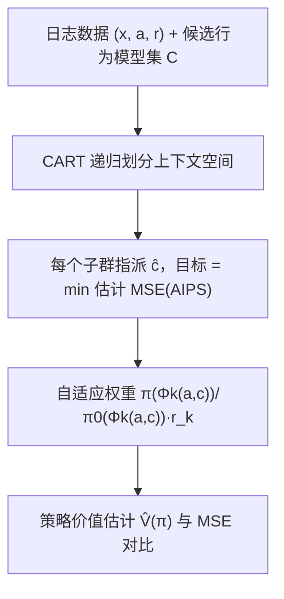
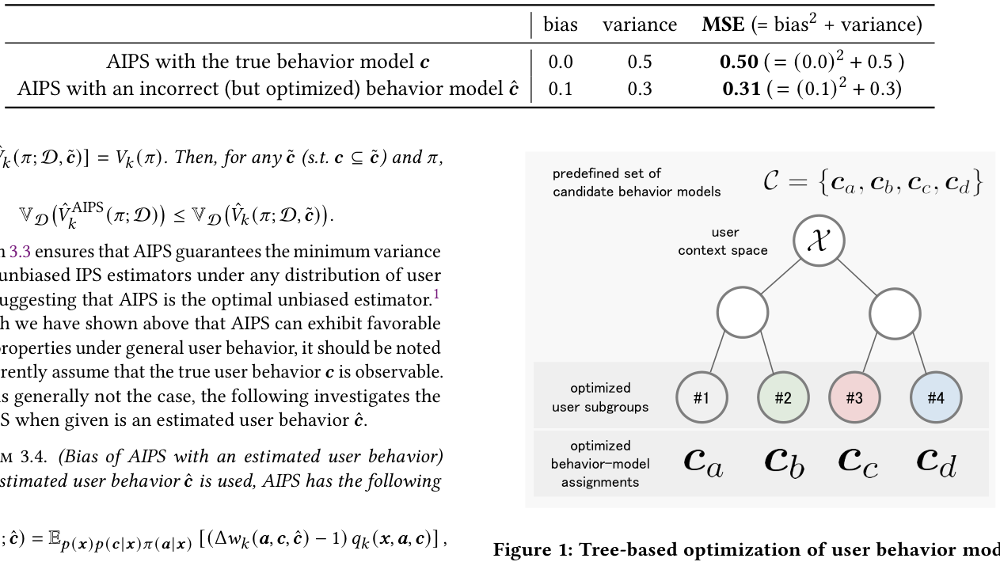

# Off-Policy Evaluation of Ranking Policies under Diverse User Behavior (异构用户行为下的排序策略离线评估)

- **会议/期刊**: KDD 2023 (Research Track)
- **作者与机构**: Haruka Kiyohara (Hanjuku-Kaso)、Masatoshi Uehara / Yuta Saito (Cornell)、Yusuke Narita (Yale)、Nobuyuki Shimizu / Yasuo Yamamoto (Yahoo Japan)
- **推荐链路定位**: 重排（排序列表策略的离线评估 / 反事实评测）
- **研究方向**: 去偏公平、可信隐私与工业架构 / 强化学习与动态探索推荐
- **论文原文**: [https://arxiv.org/abs/2306.15098v1](https://arxiv.org/abs/2306.15098v1)
- **开源代码**: [https://github.com/aiueola/kdd2023-aips](https://github.com/aiueola/kdd2023-aips)

## TL;DR (1分钟核心速览)

排序策略的 IPS 离线评估在组合爆炸的动作空间上方差极大，现有 IIPS（位置独立）/RIPS（级联）靠单一用户行为假设降方差，但真实用户行为异构且随上下文变化，单一假设必然带来"错配偏差 + 冗余方差"。本文引入动作-奖励交互矩阵 $\boldsymbol{c}\sim p(\boldsymbol{c}|\boldsymbol{x})$，提出自适应重要性加权的 AIPS：对任意行为分布无偏、且在全部无偏 IPS 类中方差最小；进一步发现"真行为模型并非 MSE 最优"，改用 CART 直接优化$\hat{\boldsymbol{c}}$以最小化 MSE。合成实验（$n{=}8k,K{=}8$）与真实电商 A/B 日志上，AIPS 在 76% 试验中 SE 最优，最差 30% 试验的 CVaR 比 RIPS 降低 30% 以上。

## Background & Motivation (背景与核心矛盾)

- **主流范式**: 排序 OPE 以 IPS 为基准，用列表级重要性权重 $\pi(\boldsymbol{a}|\boldsymbol{x})/\pi_0(\boldsymbol{a}|\boldsymbol{x})$纠偏；为压制$|\mathcal{A}|^K$带来的方差，IIPS 假设位置独立、RIPS 假设级联（自上而下顺序浏览），分别只对$a_k$、$\boldsymbol{a}_{1:k}$ 加权。
- **前人局限**: ①所有估计器对**全体用户**施加同一个通用假设，行为异构时强假设（独立）在复杂子群上产生大偏差、弱假设（级联）在简单子群上产生冗余方差；②假设越弱方差越大，长列表 $K\ge 10$ 时 RIPS 方差同样爆炸，没有"局部自适应"的中间档位。
- **核心洞察 (Key Insight)**: 用户行为应被建模为**上下文相关的隐变量分布**而非单一假设；更反直觉的是，由于 MSE = 偏差² + 方差，**故意使用有偏（更稀疏）的行为模型换取大幅方差下降，可以比使用真实行为模型得到更低的 MSE**（原文表 2 玩具例：真模型 MSE 0.50 vs 错误模型 MSE 0.31）。
- **本文切入点**: 用"每个位置 $k$只依赖哪些动作"的 0-1 交互矩阵$\boldsymbol{c}$统一泛化 IPS/IIPS/RIPS，并把$\hat{\boldsymbol{c}}(\boldsymbol{x})$ 当作可直接优化的超结构而非待估参数。

## Method (核心方法设计)

### 1. 整体框架 (Overall Architecture)

输入为日志数据 $\mathcal{D}=\{(\boldsymbol{x}_i,\boldsymbol{a}_i,\boldsymbol{r}_i)\}_{i=1}^n$与候选行为模型集合$\mathcal{C}=\{\hat{\boldsymbol{c}}_0,\dots,\hat{\boldsymbol{c}}_m\}$（如 S/C/I 及其扰动变体）。首先用 CART 在上下文空间上递归划分用户子群，并同时为左右子节点各指派一个候选行为模型，分裂准则直接是**估计出的 AIPS 的 MSE**；训练完成后，叶子节点即"子群 → 行为模型"的映射$\hat{\boldsymbol{c}}(\boldsymbol{x})$。推理阶段，对每条日志按所属叶子的$\hat{\boldsymbol{c}}$计算自适应重要性权重$\pi(\Phi_k)/\pi_0(\Phi_k)$，聚合得到位置级与整体策略价值$\hat{V}^{\text{AIPS}}(\pi)$。MSE 的估计被设计为可插拔模块（实验中用 PAS-IF 仅依赖可观测日志），因此整个流程不依赖真实行为标签。

<figure class="paper-figure" markdown="span">
  <figcaption>图1：用户行为模型的基于树的优化，该方法优化上下文空间中的划分以及每个子组（#1 至 #4）的用户行为模型分配，从而使得到的 AIPS 的 MSE 最小化。</figcaption>
</figure>

### 2. 关键设计拆解 (Key Designs)

1. **动作-奖励交互矩阵与 AIPS 估计器**：用 $\boldsymbol{c}\in\{0,1\}^{K\times K}$的$c_{k,l}$表示"第$l$位动作是否影响第$k$位奖励"，定义相关动作集$\Phi_k(\boldsymbol{a},\boldsymbol{c})=\{a_l\in\mathcal{A}\mid c_{k,l}=1\}$，则 AIPS 只对相关动作做重要性加权：

$$\hat{V}^{\text{AIPS}}_k(\pi;\mathcal{D})=\frac{1}{n}\sum_{i=1}^{n}\frac{\pi(\Phi_k(\boldsymbol{a}_i,\boldsymbol{c}_i)\mid\boldsymbol{x}_i)}{\pi_0(\Phi_k(\boldsymbol{a}_i,\boldsymbol{c}_i)\mid\boldsymbol{x}_i)}r_{i,k}$$

当 $\boldsymbol{c}$取全 1、上三角、对角时分别退化为 IPS、RIPS、IIPS，故是统一泛化。**命题 3.1** 证明对任意$p(\boldsymbol{c}|\boldsymbol{x})$均无偏；**定理 3.3** 证明在满足无偏性的所有$\tilde{\boldsymbol{c}}\ (\boldsymbol{c}\subseteq\tilde{\boldsymbol{c}})$中 AIPS 方差最小——直觉是：把与$r_k$ 无关的动作从权重中剔除，既消掉组合爆炸的乘性方差，又不引入近似偏差。

2. **估计行为模型下的偏差刻画与"策略性方差削减"**：**定理 3.4** 给出

$$\text{Bias}=\mathbb{E}_{p(\boldsymbol{x})p(\boldsymbol{c}|\boldsymbol{x})\pi(\boldsymbol{a}|\boldsymbol{x})}\big[(\Delta w_k(\boldsymbol{a},\boldsymbol{c},\hat{\boldsymbol{c}})-1)\,q_k(\boldsymbol{x},\boldsymbol{a},\boldsymbol{c})\big]$$

其中 $\Delta w_k$是"真实相关集减去估计相关集"上的倾向比。结论有二：只要$\boldsymbol{c}\subseteq\hat{\boldsymbol{c}}$就仍无偏；偏差大小由$\Phi_k(\boldsymbol{a},\boldsymbol{c})\setminus\Phi_k(\boldsymbol{a},\hat{\boldsymbol{c}})$的基数决定。因此稠密$\hat{\boldsymbol{c}}$偏差小而方差大、稀疏$\hat{\boldsymbol{c}}$反之——$\hat{\boldsymbol{c}}$ 成为显式的偏差-方差旋钮，真模型只是"方差最优"而非"MSE 最优"。

3. **树模型直接优化 MSE 与训练/推理开销**：由于目标不可微，采用 CART，在父节点 $l$ 上同时搜索划分与模型指派：

$$(l^{(l^*)},l^{(r^*)},\hat{\boldsymbol{c}}^{(l^*)},\hat{\boldsymbol{c}}^{(r^*)})=\arg\min\widehat{\text{MSE}}\big(\hat{\boldsymbol{c}}^{(l)},\hat{\boldsymbol{c}}^{(r)};l^{(l)},l^{(r)}\big)$$

$\widehat{\text{MSE}}=\widehat{\text{Bias}}^2+\hat{\mathbb{V}}$，偏差项可来自带噪估计（实验中加$\sigma_\Delta=0.3|\widehat{\text{Bias}}_{\text{on}}|$的高斯噪声以模拟真实情形）。无需梯度、无需负采样；离线开销仅为树搜索（$O(|\mathcal{C}|^2\times\text{候选分裂数})$），线上推理只是查表 + 一次重要性加权，与日志量线性。

## Experimental Setup & Evaluation Protocol (实验设置与评估协议)

- **数据集与预处理**:

| 数据集 | #Users/样本 | #Items/动作 | #Interactions | 稀疏度/密度 | 特征/场景说明 |
| :--- | :---: | :---: | :---: | :---: | :--- |
| Synthetic (OpenBanditPipeline) | $n=8k$（扫 1k–16k） |$K=8$（扫 1–20） | 1000 次重复仿真 | 奖励$r_k\sim\mathcal{N}(q_k,0.5^2)$|$d=5$上下文；6 类行为 {S,R6,R3,C2,C1,I1} 由 softmax 依$\delta$ 混合 |
| Real-world 电商 A/B | $|\mathcal{D}_A|{=}1979$,$|\mathcal{D}_B|{=}1954$|$|\mathcal{A}|{=}2$,$K{=}6$| 100 次 bootstrap | 二值点击，极稀疏 | 首页"模块"排序（商品/活动模块），$d=5$ 用户上下文 |

- **数据划分与防穿越 (Splitting Strategy)**: 无传统 train/test 划分；采用 A/B 双日志设计——$\pi_A$作 logging policy（$\mathcal{D}_A$用于估计$\pi_B$），$\pi_B$的 on-policy 估计（$\mathcal{D}_B$）作为 ground truth 代理，避免信息泄漏。
- **排名评测协议 (Ranking Protocol)**: 合成实验报告**归一化 MSE**（除以真实 $V(\pi)$）、偏差与方差，1000 次独立重复、95% 置信区间；真实实验报告相对 AIPS 的**平方误差 CDF** 与 **CVaR（最差$\alpha$ 比例试验的平均 SE）**，即侧重尾部风险而非均值。
- **对比基线与超参设置**: IPS / IIPS / RIPS 三个主流估计器，另加不可实现的 **AIPS(true)** 作为上界参照；默认 $n=8k,K=8,\delta=0.6,\epsilon=0.3$，真实实验候选集$\mathcal{C}=\{\boldsymbol{c}_S,\boldsymbol{c}_C,\boldsymbol{c}_I,\boldsymbol{c}',\boldsymbol{c}''\}$。

## Key Experimental Results (实验关键数据)

### 1. 主实验对比 (Main Results)

原文主结果为图 2–5 的 MSE 曲线（未给表），下表汇总其明确报告的统计量与定性结论：

| 估计器 | 行为假设 | 偏差 | 方差 | $n\uparrow$时 MSE |$K\ge10$|$\delta\ge0.6$ | 真实数据 CDF 胜率 | 尾部 CVaR |
| :--- | :--- | :---: | :---: | :---: | :---: | :---: | :---: | :---: |
| IPS | 无 | ≈0 | 极高 | 缓慢下降 | 爆炸 | 爆炸 | 劣于 AIPS | 差 |
| IIPS | 位置独立 | 大 | 低 | **不下降**（偏差主导） | 偏差主导 | 最差 | 劣于 AIPS | 差 |
| RIPS | 级联 | 中 | 中 | **不下降** | 差 | 差 | 劣于 AIPS | 基准 |
| AIPS (true) | 真实 $\boldsymbol{c}$| 0 | 中高 | 下降但小$n$ 差 | 爆炸 | 恶化 | 不可用 | — |
| **AIPS (ours)** | 优化 $\hat{\boldsymbol{c}}$ | 小 | **最低** | **最优** | **最优** | **最优** | **76%** | **比 RIPS 降 >30%** |

### 2. 消融实验 (Ablation Study)

| 配置 | 变化 | 结论 |
| :--- | :--- | :--- |
| w/o 行为模型优化（= AIPS(true)） | 用真 $\boldsymbol{c}$但方差高 |$n\le2k$时劣于 RIPS；$K\ge10$与$\delta\ge0.6$ 时 MSE 明显恶化 |
| w/ 优化但 $\widehat{\text{MSE}}$加噪$\sigma_\Delta=0.3\vert\widehat{\text{Bias}}_{\text{on}}\vert$ | 偏差估计含 30% 噪声 | 仍稳定优于全部基线，说明树搜索对 MSE 估计误差鲁棒 |
| 候选集仅 {S, C, I} vs 扩充 {$\boldsymbol{c}',\boldsymbol{c}''$} | 候选多样性 | 小候选集亦有效，但多样候选带来更细的子群适配 |
| 替换为强假设（IIPS/RIPS 固定 $\hat{\boldsymbol{c}}$） | 关闭自适应 | 真实数据 CDF 胜率从 76% 显著回落，验证自适应加权是主要收益来源 |

### 3. 关键实验发现 (Key Findings)

1. **偏差主导 vs 方差主导的分界清晰**：IIPS/RIPS 的 MSE 随日志量 $n$增大**几乎不下降**（偏差随$n$不衰减），而 IPS 在$n\le2k$时因权重爆炸远差于 RIPS——AIPS 是唯一在$n\in[1k,16k]$ 全区间保持最低 MSE 的估计器。
2. **"用错模型"反而更准**：在 $\delta\ge0.6$（复杂异构行为）与$K\ge10$（长列表）两个最现实也最困难的区间，优化后的 AIPS **优于**使用真实行为模型的 AIPS(true)，因为稀疏化$\hat{\boldsymbol{c}}$换来的方差下降远超引入的小偏差；$K\le8$时则优先降偏差、$\delta\le0.4$ 时 AIPS(true) 才占优，说明树目标自动完成了"按场景调节偏差-方差"。
3. **工业尾部风险显著收敛**：真实电商 A/B 中 AIPS 在 76% 的 bootstrap 试验里 SE 最小，且在最差 $\alpha$ 比例试验上 CVaR 比 RIPS 降低 30% 以上——对"上线前安全评估"而言，尾部风险比平均误差更关键。

## Highlights & Limitations (亮点、对比与审稿批判)

- **与代表作对比 (vs. Prior Work)**: 相比 IIPS（Saito et al.）/RIPS（McInerney et al.）把用户行为当作**全局单一硬假设**，AIPS 将其变为**上下文条件分布 + 可优化超结构**；相比 Cascade-DR（Kiyohara et al.）依赖级联结构做控制变量，AIPS 不预设任何结构；与点击模型文献（PBM/Cascade click model）目标相反——后者追求"估准行为"，本文追求"MSE 最小"，因而敢于故意用错模型。
- **可迁移亮点**: ①"相关集加权"思想可直接移植到**列表级重排的离线评测**与生成式推荐的 slate 评估，把 $\Phi_k$ 定义在语义 ID 或 item 簇上即可缓解动作空间爆炸；②"不估真值、直接优化下游 MSE"的元思路可迁移到去偏学习中的倾向/曝光模型调参。
- **审稿级局限批判**: ①**动作空间仍未解决**：$|\mathcal{A}|$很大时$\pi_0(\Phi_k)$仍难支撑（论文自认需借动作嵌入），且候选集$\mathcal{C}$大小与树搜索成本随$K$ 组合增长；②**MSE 估计依赖外部方法**（PAS-IF），真实实验仅 1 个平台、2 个动作、约 2k 样本，统计功效有限，AIPS(true) 在真实数据中无法实现也削弱了归因链条；③树划分在上下文维度高时易过拟合子群，缺少对划分稳定性的理论保证。

## Rating (四维评分)

- **方法创新性 (Novelty)**: ⭐⭐⭐⭐⭐ （用交互矩阵统一 IPS/IIPS/RIPS 并给出"任意行为分布无偏 + 无偏类内方差最小"两条硬定理，"故意用错模型降 MSE"的反直觉洞察尤具启发性）
- **评估协议与实验扎实度 (Protocol & Experiments)**: ⭐⭐⭐⭐ （合成 1000 次重复 + 真实 A/B 双日志代理真值、CDF/CVaR 尾部评估很扎实，但真实场景规模偏小、缺显著性检验与多平台验证）
- **写作与数学规范度 (Clarity & Rigor)**: ⭐⭐⭐⭐⭐ （命题-定理-证明链条完整，表 1 的假设-估计器-相关集对应表与表 2 的玩具例极具解释力，偏差/方差归因清晰）
- **工业落地与复现价值 (Industrial & Practical Value)**: ⭐⭐⭐⭐ （代码开源且基于 OpenBanditPipeline，推理仅查表加权；但需可观测位置级奖励与 full-support 日志，MSE 估计模块与树搜索成本是落地门槛）

