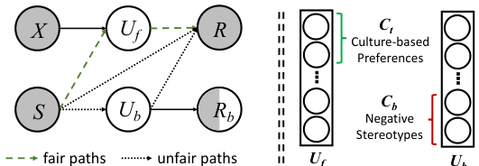
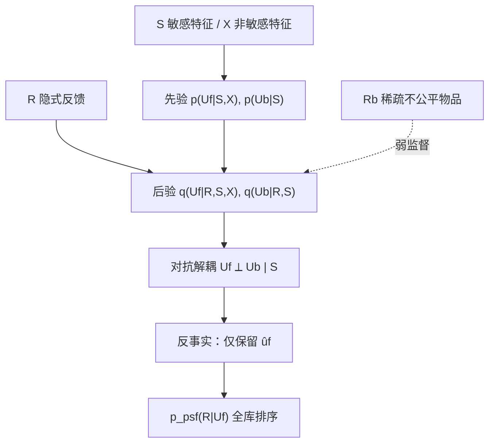

# Path-Specific Counterfactual Fairness for Recommender Systems (面向推荐系统的路径特定反事实公平性)

- **会议/期刊**: KDD 2023 (Research Track)
- **作者与机构**: Yaochen Zhu, Jing Ma, Jundong Li (University of Virginia); Liang Wu, Qi Guo, Liangjie Hong (LinkedIn Inc.)
- **推荐链路定位**: 召回（隐式反馈全库排序）
- **研究方向**: 去偏公平、可信隐私与工业架构 / 协同过滤与双塔召回
- **论文原文**: [论文原文链接](https://arxiv.org/abs/2306.02615v1)
- **开源代码**: [PSF-VAE](https://github.com/yaochenzhu/PSF-VAE)

## TL;DR (1分钟核心速览)

现有公平推荐把敏感特征（种族、性别）对推荐的**全部**因果影响一律阻断，却误杀了"种族→文化偏好→兴趣"这类合法影响，导致推荐多样性塌陷。本文把敏感特征的影响拆成公平中介 $U_f$与偏差中介$U_b$，用嵌套潜在结果定义 **PS-Bias**，并以 Pearl 最小改动原则求解约束优化$\text{PSBias}^*=0$，落地为弱监督变分模型 PSF-VAE。在 ML-1M / AM-VG（半模拟）与 LinkedIn（真实）上，公平指标 HiR@10 较朴素 CondVAE 降 5.1%–9.9%，同时 N@100 比 Fair-ADV 高 5.0%–25.9%。

## Background & Motivation (背景与核心矛盾)

- **主流范式**: 因果感知公平推荐（Fair-ADV、Fair-MMD）在 Mult-VAE 上学 $U$，再用对抗训练或 MMD 强行约束$U \perp S$，把敏感特征的一切因果通道全部掐断。
- **前人局限其一（过公平）**: 敏感特征既可能带来歧视性刻板印象（$S\to C_b\to R$），也可能带来合法的文化/技能偏好（$S\to C_t\to R$）。一刀切阻断后，`筷子推荐给东亚用户`、`学历→技能→岗位` 这类必要多样性被牺牲，推荐精度也随之下滑（实验中 Fair-ADV 的 R@20 相比 CondVAE 掉 17%–23%）。
- **前人局限其二（不可辨识 + 冷启动）**: 路径特定推断通常要求预先知道并测量出公平/不公平中介；但推荐场景中决定行为的中介**全部潜变量**，无法枚举；而工业上能拿到的"用户举报的不公平物品" $R_b$ 极度稀疏（稀疏度 99.6%+），多数用户完全没有。
- **核心洞察**: 不必显式枚举所有不公平中介——只需假设存在一个**一步潜代理中介** $U_b$，它阻断所有不公平路径、同时不阻断$U_f$ 解析的公平路径（Assumption 1，Kilbertus 的怀疑论立场）。
- **本文切入点**: 只在反事实世界中对**不公平路径**做干预，其余因果机制 $p(U_f|S,X)$、$p(U_b|S)$ 原封不动，从而"最小改动"地获得公平。

<figure class="paper-figure" markdown="span">
  <figcaption>图1：观测评分𝑅与半观测不公平项目𝑅𝑏生成过程的因果图。</figcaption>
</figure>

## Method (核心方法设计)

### 1. 整体框架 (Overall Architecture)

PSF-VAE 分"事实建模"与"反事实推理"两阶段。事实阶段：由 $S$（敏感特征）与$X$（非敏感特征）经两个先验网络生成公平潜变量$u_f$与偏差潜变量$u_b$；$R$由$[u_f\|u_b]$的多项分布解码，半观测的不公平物品$R_b$仅由$u_b$经 Bernoulli 解码，构成弱监督信号；同时用判别器$p_d(U_b|U_f,S)$与编码器做 min-max 博弈，保证$U_f\perp U_b\mid S$。反事实阶段：冻结$U_f$编码器取后验均值$\hat{u}_f$，单独训练只依赖$\hat{u}_f$的评分头$p_{psf}(R|U_f)$，即彻底"丢掉"$U_b$ 通道后对未交互物品全库排序。

### 2. 关键设计拆解 (Key Designs)

1. **嵌套潜在结果与 PS-Bias（把"哪条路径该改"形式化）**: 普通潜在结果 $R_{S\leftarrow s'}$会把公平路径一起改掉，无法区分。作者定义嵌套潜在结果$R_{S\leftarrow s'}(U_{f,S\leftarrow s},U_{b,S\leftarrow s'})$：在$S\to R$与$S\to U_b\to R$上取反事实$s'$，在$S\to U_f\to R$上保留事实值$s$。
   $\text{PSBias}(x,s,s')=\mathbb{E}[R_{S\leftarrow s'}(U_{f,S\leftarrow s},U_{b,S\leftarrow s'})\mid X=x,S=s]-\mathbb{E}[R_{S\leftarrow s}(U_{f,S\leftarrow s},U_{b,S\leftarrow s})\mid X=x,S=s]$在 Sequential Ignorability 下可化为$\int p(r|u_f,u_b'(s'))p(u_f|s,x)p(u_b'|s')\,r$与事实项之差。直觉：分母里$u_f$始终以事实$s$ 采样，故文化偏好带来的合理性差异被消掉，剩下的纯是歧视性差异。
2. **最小改动原则 → 零 PS-Bias 的约束优化（为什么不用 $U\perp S$）**: 目标是在"尽量像事实分布"的前提下归零 PS-Bias：$\max_{p_{psf}}\mathcal{L}(p_{psf}(R|U_f,U_b);\mathcal{D}_R)\ \text{s.t.}\ \text{PSBias}^*(x,s,s')=0,\forall x,s,s'$。满足约束最简单的分布族是$p_{psf}(R|U_f)$，即打分时屏蔽$U_b$；而 Fair-ADV/MMD 的$U\perp S$会把$p(U_f|S,X)$ 一并抹平，属于非最小改动，这正是过公平的根源。
3. **弱监督推断与推理效率**: 关键技巧是**故意不用** $q_\phi(U_b|R_b,R,S)$而用$q_\phi(U_b|R,S)$，使$U_b$推断不依赖部分可观测的$R_b$，从而泛化到无举报用户；$R_b$仅通过$\mathbb{E}_{q_\phi(U_b|\cdot)}[\log p_\theta(R_b|U_b)]$反传指导编码器。总目标$\mathcal{L}=\text{ELBO}-\lambda\min_{q_\phi}\max_{p_d}\mathbb{E}_{q_\phi}\ln p_d(\hat{u}_b|U_f,S)$，其中 ELBO 含$R$、$R_b$两项重构与两项 KL。训练上先优化$U_b$相关项再固定$U_b$学其余项（两阶段）；推理仅需一次$U_f$编码 + 一个 MLP 打分，无负采样、无$U_b$ 前向，开销与 Mult-VAE 同级。

## Experimental Setup & Evaluation Protocol (实验设置与评估协议)

- **数据集与预处理**（原始交互已二值化，$R_b$对 70% 训练/验证用户掩码为零，测试用户$R_b$ 完整以保证公平评估无偏）：

| 数据集 | #Users | #Items | #Interactions | 稀疏度 (R / Rb) | 特征/场景说明 |
| :--- | :---: | :---: | :---: | :---: | :--- |
| ML-1M (半模拟) | 6,000 | 3,706 | 993,504 | 95.53% / 99.76% | 由预训练 Multi-VAE 潜维 $K=200$切出$U_f,U_b$ 注入受控因果 |
| AM-VG (半模拟) | 7,253 | 4,338 | 127,741 | 99.60% / 99.93% | 同上，含 $\lambda_f=\lambda_b=0.9$的混杂因子$c$ |
| LinkedIn (真实) | 8,896 | 5,931 | 1,055,241 | 98.01% / 99.62% | 岗位广告推荐；用户主动 dismiss 视为 $R_b$，$S$=年龄/性别/学历（VAE 匿名化到 50 维） |

- **数据划分与防穿越**: 用户级随机 `8:1:1` 划分训练/验证/测试；每个用户再留出 20% 已观测交互作评测，其余作训练输入；$U_b$维度在主实验固定$K_b=50$，另扫$K_b\in\{25,50,75\}$；掩码率$c_r=0.3$；所有结果取 10 次随机划分均值。
- **排名评测协议**: 采用无偏 `Full-Ranking`（对全部未交互物品排序），报告 R@20、N@100 与公平指标 HiR@10（Top-10 命中真实不公平物品的比例，越低越公平）；模型选择用复合验证指标 $\text{Metr}_f=\text{R@20}+\text{N@100}-\text{HiR@10}$。
- **对比基线与超参**: 四类基线——Unawareness (Multi-VAE)、Naive (CondVAE 及其早停版 CondVAE-ES，用于排除"欠拟合换公平"的解释)、Total Fairness (Fair-MMD、Fair-ADV)、Naive PS-Fair (PSF-NN，按敏感特征取近邻后硬删不公平物品)。

## Key Experimental Results (实验关键数据)

### 1. 主实验对比 (Main Results)

| 方法 | AM-VG R@20↑ | AM-VG N@100↑ | AM-VG HiR@10↓ | ML-1M R@20↑ | ML-1M N@100↑ | ML-1M HiR@10↓ | LinkedIn R@20↑ | LinkedIn N@100↑ | LinkedIn HiR@10↓ |
| :--- | :---: | :---: | :---: | :---: | :---: | :---: | :---: | :---: | :---: |
| Multi-VAE (Unaware) | 0.2454 | 0.2350 | 0.0297 | 0.5493 | 0.6556 | 0.0938 | 0.1665 | 0.2553 | 0.0703 |
| CondVAE (Naive) | **0.2780** | **0.2599** | 0.0315 | **0.5689** | **0.6757** | 0.0953 | **0.2056** | **0.3042** | 0.0718 |
| CondVAE-ES | 0.2686 | 0.2493 | 0.0302 | 0.5615 | 0.6665 | 0.0949 | 0.1991 | 0.2965 | 0.0705 |
| Fair-MMD | 0.2304 | 0.2147 | 0.0279 | 0.5312 | 0.6350 | 0.0893 | 0.1579 | 0.2398 | 0.0608 |
| Fair-ADV | 0.2285 | 0.2119 | **0.0274** | 0.5304 | 0.6348 | **0.0886** | 0.1573 | 0.2372 | **0.0591** |
| PSF-NN | 0.2702 | 0.2549 | 0.0310 | 0.5654 | 0.6701 | 0.0942 | 0.2032 | 0.3005 | 0.0709 |
| **PSF-VAE (本文)** | 0.2691 | 0.2507 | △0.0288 | 0.5601 | 0.6668 | △0.0904 | 0.2024 | 0.2987 | △0.0647 |
| Improv. vs CondVAE/Fair-ADV | Rec −3.2% | Rec −3.5% | **Fair ↓8.6%** | Rec −1.5% | Rec −1.3% | **Fair ↓5.1%** | Rec −1.6% | Rec −1.8% | **Fair ↓9.9%**；Rec 比 Fair-ADV **↑25.9%** |

### 2. 消融实验 (Ablation Study)

| 变体 | AM-VG N@100 | AM-VG HiR@10 | ML-1M N@100 | ML-1M HiR@10 | LinkedIn N@100 | LinkedIn HiR@10 |
| :--- | :---: | :---: | :---: | :---: | :---: | :---: |
| PSF-VAE-nLat（去 $U_b$，直接对抗$R_b$） | 0.2102 | 0.0270 | 0.6246 | 0.0869 | 0.2832 | 0.0614 |
| PSF-VAE-nWSL（去弱监督） | 0.2543 | 0.0299 | 0.6691 | 0.0932 | 0.3009 | 0.0675 |
| PSF-VAE-nADV（去对抗解耦） | 0.2528 | 0.0297 | 0.6687 | 0.0925 | 0.3004 | 0.0660 |
| PSF-VAE-Mask（掩码 $U_b$ 权重而非重训头） | 0.2463 | 0.0291 | 0.6659 | 0.0911 | 0.2969 | 0.0654 |
| **PSF-VAE 完整** | 0.2507 | **0.0288** | 0.6668 | **0.0904** | 0.2987 | **0.0647** |

### 3. 关键实验发现 (Key Findings)

1. **公平增益不是"欠拟合"换来的**: 精度对齐的 CondVAE-ES（N@100 与 PSF-VAE 最接近）在 ML-1M 上 HiR@10 仍为 0.0949，显著高于 PSF-VAE 的 0.0904；LinkedIn 上差距更明显（0.0705 vs 0.0647），说明降噪来自 $U_b$ 通道的定向切除而非容量压缩。
2. **"全阻断"路线的精度代价是数量级的**: Fair-ADV 虽把 HiR@10 压到 0.0591（LinkedIn 最低），但 N@100 仅 0.2372，比 PSF-VAE 低 25.9%；反之 CondVAE 精度最高却公平最差。PSF-VAE 用仅 ~2% 的精度让步换得 5%–10% 的公平改善，落在明显更优的 Pareto 前沿。
3. **弱监督与对抗解耦缺一不可，且 $U_b$结构化比直接对抗稀疏$R_b$更稳**: 去掉弱监督（nWSL）后 HiR@10 在 ML-1M 上升至 0.0932（+3.1%），去对抗（nADV）升至 0.0925；而 nLat 直接对高维稀疏$R_b$做对抗训练虽然在测试集 HiR 更低（0.0869），N@100 却暴跌至 0.6246（−6.3%），且无法泛化——印证"潜代理中介 + 弱监督"是稀疏监督下更鲁棒的可辨识方案。此外由图 7 的敏感性分析，$c_r$ 从 0.1 增至 0.4 时 HiR@10 单调下降约 3%–4%，精度几乎不变，说明该框架在极少举报信号下即可生效。

## Highlights & Limitations (亮点、对比与审稿批判)

- **与代表作对比 (vs. Prior Work)**: 相较 Fair-ADV [Li et al.] 与 Fair-MMD [Ma et al.] 的"全因果效应阻断"（约束 $U\perp S$），本文是**路径级**约束，理论上一针见血地指出前者违反最小改动原则、破坏$p(U_f|S,X)$ 结构；相较 PSF-NN 这类近邻硬删物品的工程启发式，本文给出可辨识的生成式建模，在 LinkedIn 上公平指标领先 8.7% 且精度基本持平。
- **可迁移亮点**: (1) "稀疏负面反馈作弱监督、且编码器**故意不输入**该监督"的推断设计，可直接迁移到假阳性去噪、举报驱动的内容安全等标签极度稀疏的场景；(2) 用嵌套潜在结果把"该保留的偏见"与"该消除的偏见"拆开的建模思路，可复用到跨域推荐中的场景偏差分析。
- **审稿级局限批判**: (1) 数据划分是**用户级随机划分**，而非全局时间戳切分，$R_b$掩码虽然模拟了冷启动，但与线上时序分布仍有差距，且半模拟数据的因果机制由作者假设（线性混杂 + ReDim），结论的外部效度依赖该假设；(2) 方法强依赖"仅存在一个一步潜代理中介$U_b$可阻断全部不公平路径"这一不可检验的 Assumption 1，若不公平效应分散在多个不可加性中介上则 PS-Bias 归零不再成立；(3) 两阶段训练（先$U_b$后其余）与对抗博弈带来额外超参（$K_f/K_b$、对抗权重、两阶段切换点），$K_b$ 从 25 变到 75 时相对排序虽稳健，但绝对 HiR 波动约 10%。

## Rating (四维评分)

- **方法创新性 (Novelty)**: ⭐⭐⭐⭐⭐ （首次将路径特定反事实引入推荐公平，用嵌套潜在结果与最小改动原则严格论证了"全阻断=过公平"的理论缺陷，形式化优雅）
- **评估协议与实验扎实度 (Protocol & Experiments)**: ⭐⭐⭐⭐ （Full-Ranking + 半模拟可控因果 + LinkedIn 真实数据三重验证，并设 CondVAE-ES 排除欠拟合解释；扣分在于随机划分而非时序切分、仅 10 次重复未报告显著性检验）
- **写作与数学规范度 (Clarity & Rigor)**: ⭐⭐⭐⭐⭐ （因果图—PS-Bias 定义—约束优化—ELBO 推导链条完整，附录给出零偏差与过公平的严格证明，符号体系统一）
- **工业落地与复现价值 (Industrial & Practical Value)**: ⭐⭐⭐⭐ （LinkedIn 真实业务场景落地、代码开源、推理仅需一次 $U_f$ 编码与 MLP 打分；但依赖平台具备"用户举报不公平物品"的反馈入口，冷启动平台难以直接复用）

