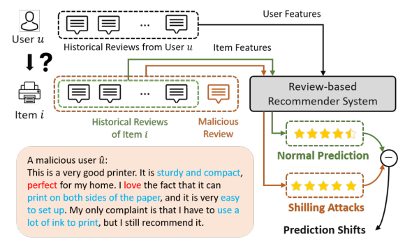
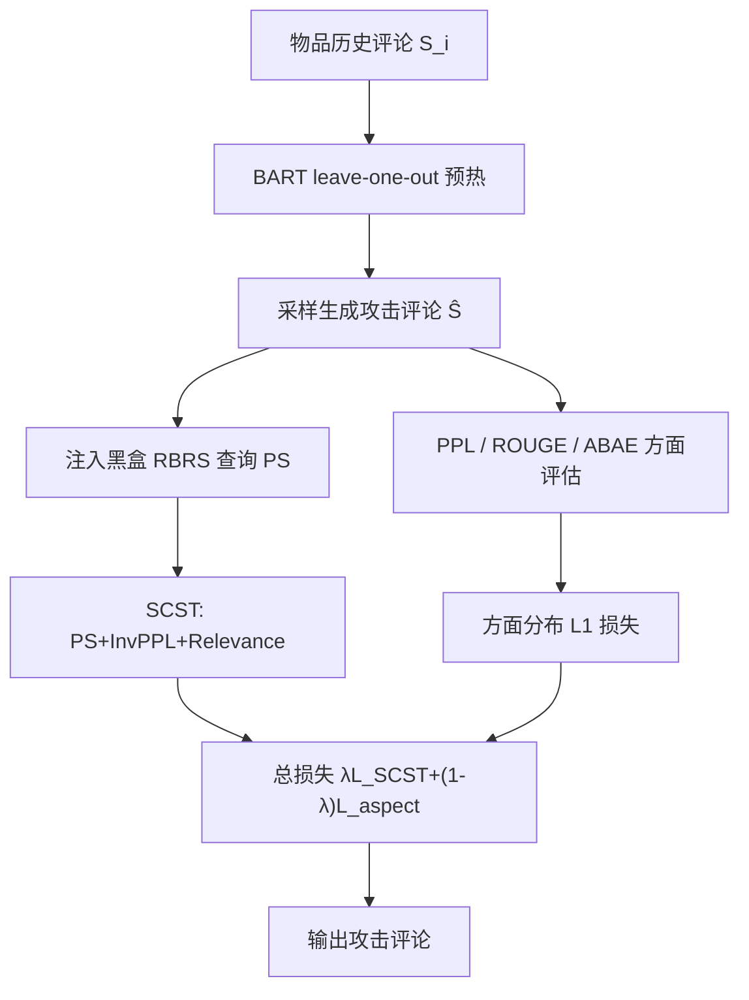
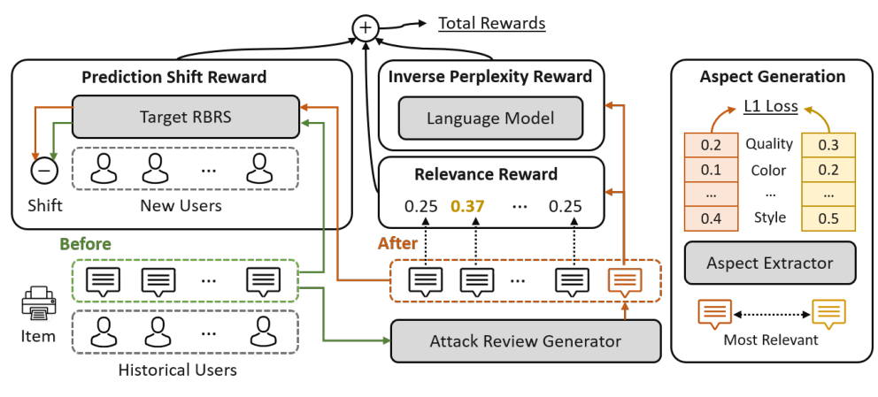

# Shilling Black-box Review-based Recommender Systems through Fake Review Generation (通过生成虚假评论攻击黑盒评论型推荐系统)

- **会议/期刊**: KDD 2023
- **作者与机构**: Hung-Yun Chiang、Jason S. Chang（National Tsing Hua University）；Yi-Syuan Chen、Yun-Zhu Song、Hong-Han Shuai（National Yang Ming Chiao Tung University）
- **推荐链路定位**: 精排/评分预测（黑盒攻击与防御）
- **研究方向**: 去偏公平、可信隐私与工业架构
- **论文原文**: [论文原文链接](https://arxiv.org/abs/2306.16526v1)
- **开源代码**: [开源代码仓库链接](https://github.com/hongyuntw/RBRS-ARG)

## TL;DR (1分钟核心速览)

本文研究评论型推荐系统（RBRS）被“假评论”刷评攻击的风险：现有攻击多依赖复制/改写已有评论，难以兼顾攻击性、流畅度与多样性。作者提出 ARG，用 BART 生成全新评论，并以黑盒预测漂移 PS、逆困惑度 InvPPL、ROUGE 相关性为 RL 奖励，辅以 ABAE 方面生成损失。在 Amazon 三领域与 Yelp 上，ARG 相对最优基线 PS 至少提升 40.5% 与 82.6%，且对抗训练后三类 RBRS 的受攻击漂移显著下降。

## Background & Motivation (背景与核心矛盾)

- **主流范式**: DeepCoNN、NRCMA、RMG 等将用户/物品历史评论编码进评分预测，推理时可直接吸收新评论，因而形成可被注入文本的攻击面。
- **前人局限**: 复制高分评论虽流畅但缺少“攻击关键词”，预测漂移小；TextBugger/HotFlip 等修改式文本攻击受原句词表与语义约束，难以生成高保真、全新且多样的评论。
- **核心洞察 (Key Insight)**: 黑盒 RBRS 的预测漂移不可微，但可直接作为 RL 奖励；评论的保真度、攻击性与方面丰富度可分别用 PPL、ROUGE、ABAE 方面分布分解监督。
- **本文切入点**: 用预训练生成器产生完整新评论，在 SCST 下直接优化黑盒 PS，并用方面损失增强细粒度与多样性。

图1展示假评论注入后推动 RBRS 评分上升的攻击示例。

<figure class="paper-figure" markdown="span">
  <figcaption>图1：所提出的攻击评论生成器实施托攻击的示例。生成一条恶意评论以提升某物品，即提高 RBRS 的预测评分。蓝色词语描述产品的详细特征；红色词语描述针对 RBRS 的攻击关键词。</figcaption>
</figure>

## Method (核心方法设计)

### 1. 整体框架 (Overall Architecture)

ARG 以物品历史评论 $S_i$为输入，先用 BART 编码器-解码器做 leave-one-out 预热，学习“由其余评论生成一条正常评论”；随后将生成器视为策略，采样得到攻击评论$\hat{S}_{\hat{u}i}$，注入目标黑盒 RBRS 查询用户评分变化，同时用外部 LM、ROUGE 与 ABAE 评估流畅度、相关性和方面分布。RL 以 SCST 策略梯度融合三类奖励，方面损失约束细粒度属性，最终输出可攻击且看似真实的评论。训练需反复查询黑盒 RBRS，推理仅为一次生成，开销较低。

图2概括了 ARG 的完整训练框架。

<figure class="paper-figure" markdown="span">
  <figcaption>图2：ARG 的训练框架。</figcaption>
</figure>

### 2. 关键设计拆解 (Key Designs)

1. **黑盒预测漂移奖励（Prediction Shift Reward）**：针对“无攻击评论真值、PS 不可微”的痛点，将注入评论前后的评分差作为奖励：$PS_u(\hat{S}_{\hat{u}i})=\hat{R}_{ui}-R_{ui}$，其中$\hat{R}_{ui}=RBRS(E_u,E_i,S_u,S_i\cup\hat{S}_{\hat{u}i})$。再用 SCST 策略梯度$\nabla_\theta L_{SCST}\propto-(R(S)-R(S^*))\nabla_\theta\log p_\theta(S)$ 更新生成器，使“查询黑盒输出”替代梯度反传。
2. **三奖励保真-攻击平衡**：仅用 PS 会生成“perfect perfect…”式重复关键词，PPL 高达 150.31。作者加入 $InvPPL(S)=1/PPL(S)$提升流畅度，加入$Relevance(S)=\frac{1}{H}\sum_h ROUGE(S,S_{u_hi})$约束物品相关性，总奖励为$R(S)=PS(S)+InvPPL(S)+Relevance(S)$。其物理直觉是：PS 负责“推评分”，PPL 抑制乱码，ROUGE 迫使评论吸收物品共同特征。
3. **方面生成与训练目标**：为补足人类评论中的细粒度属性，用 ABAE 得到方面分布 $\phi_S=ABAE(S)$；以当前生成评论最相似的物品历史评论$S^*_{u_hi}=\arg\max_h ROUGE(\hat{S},S_{u_hi})$的方面分布为目标，最小化$L_{aspect}=\sum_{k=1}^{K}|\phi^{target}_{S_i,k}-\phi_{\hat{S},k}|$。总损失$L_{total}=\lambda L_{SCST}+(1-\lambda)L_{aspect}$，$\lambda=0.5$。训练不使用负采样；推理为单次自回归生成，但 RL 训练阶段每条评论均需查询目标 RBRS。

## Experimental Setup & Evaluation Protocol (实验设置与评估协议)

- **数据集与预处理**: 原文使用 Amazon 5-score 三领域与 Yelp；未报告用户/物品/交互数量，故以“未报告”标注，不做臆造。

| 数据集 | #Users | #Items | #Interactions | 稀疏度/密度 | 特征/场景说明 |
| :--- | :---: | :---: | :---: | :---: | :--- |
| Amazon Musical Instruments | 未报告 | 未报告 | 未报告 | 未报告 | 5-score 评论；10-fold 80/10/10 |
| Amazon Video Games | 未报告 | 未报告 | 未报告 | 未报告 | 5-score 评论；10-fold 80/10/10 |
| Amazon Office Products | 未报告 | 未报告 | 未报告 | 未报告 | 5-score 评论；10-fold 80/10/10 |
| Yelp | 未报告 | 未报告 | 未报告 | 未报告 | 评论语料；10-fold 80/10/10 |

- **数据划分与防穿越 (Splitting Strategy)**: 采用随机 80%/10%/10% 的 10 折交叉验证；ARG 预训练另用 leave-one-out 构造评论生成样本。非全局时间戳切分，也未专门做冷启动划分。
- **排名评测协议 (Ranking Protocol)**: 本文是评分预测攻击，不是 Top-N 排名；测试集选 $Q=500$ 个物品，对每个物品在“所有未评分候选用户”上平均 PS，属黑盒全候选用户评估，而非 Full-Ranking 或 Sampled Ranking。
- **对比基线与超参设置**: 目标 RBRS 为 DeepCoNN、NRCMA、RMG；攻击基线为 Copycat（随机 5 星真实评论）、TextBugger、HotFlip。ARG 基座 bart-base-cnn，PPL 评估器 distil-gpt2，ABAE 方面数 $K=15$，最大长度 128，RL 5 epochs，$\lambda=0.5$。原文未报告显著性检验与 embedding 维度$d$。

## Key Experimental Results (实验关键数据)

### 1. 主实验对比 (Main Results)

原文仅设 3 类攻击基线，故下表保留全部基线并在 Amazon Musical Instruments 上报告核心指标；Improv.% 为 ARG 相对该目标最优基线的 PS 提升。

| 目标 RBRS | 方法 | PS↑ | PPL↓ | Rel↑ | %AW↑ | PS 提升 |
| :--- | :--- | :---: | :---: | :---: | :---: | :---: |
| DeepCoNN | Copycat | 0.012 | **6.72** | 0.201 | 10.19 | — |
| DeepCoNN | TextBugger | 0.017 | 36.75 | 0.160 | 9.97 | — |
| DeepCoNN | HotFlip | 0.035 | 7.22 | 0.211 | 10.04 | — |
| DeepCoNN | **ARG** | **0.363** | 6.96 | **0.262** | **14.34** | **+937.1%** |
| NRCMA | Copycat | 0.027 | 7.01 | 0.201 | 10.31 | — |
| NRCMA | TextBugger | 0.043 | 64.62 | 0.187 | 9.89 | — |
| NRCMA | HotFlip | 0.055 | 7.48 | 0.209 | 9.92 | — |
| NRCMA | **ARG** | **0.084** | **6.25** | **0.277** | **14.17** | **+52.7%** |
| RMG | Copycat | 0.014 | 6.84 | 0.201 | 11.21 | — |
| RMG | TextBugger | 0.031 | 61.42 | 0.187 | 10.05 | — |
| RMG | HotFlip | 0.055 | 7.37 | 0.207 | 11.81 | — |
| RMG | **ARG** | **0.091** | **6.32** | **0.267** | **14.15** | **+65.5%** |

### 2. 消融实验 (Ablation Study)

| 设置（DeepCoNN / Musical Instruments） | PS↑ | PPL↓ | Rel↑ | %AW↑ |
| :--- | :---: | :---: | :---: | :---: |
| 仅 PS 奖励 | **0.670** | 150.31 | 0.081 | — |
| PS + InvPPL | 0.619 | 6.87 | 0.198 | — |
| PS + InvPPL + Relevance | 0.391 | 8.32 | 0.253 | — |
| ARG w/o aspect | 0.391 | 8.32 | 0.257 | 8.21 |
| **完整 ARG** | 0.363 | **6.96** | **0.262** | **14.34** |

### 3. 关键实验发现 (Key Findings)

1. **生成式新评论比“复制/改写”更强**：DeepCoNN 上 ARG 的 PS 为 0.363，约为 HotFlip 0.035 的 10 倍；NRCMA、RMG 也分别相对最优基线提升 52.7%、65.5%。说明突破原句词表约束、生成整条评论是攻击增益的核心来源。
2. **奖励之间存在明确权衡**：仅 PS 时攻击性最高（0.670），但 PPL 达 150.31、Rel 仅 0.081；加入 InvPPL 后 PPL 降至 6.87，再加入 Relevance 后 Rel 升至 0.253，完整 ARG 以略低 PS 换取可用文本质量，PPL 6.96、Rel 0.262。
3. **方面损失提升“像人”程度与细粒度**：方面生成使 %AW 从 8.21 提升到 14.34；人类评测中 ARG 流畅度 4.03、信息量 3.98，优于 Copycat 的 4.00/3.47；对抗训练后 DeepCoNN、NRCMA、RMG 对 ARG 的攻击漂移分别至少下降 51.34%、91.86%、60.71%，MSE 仍约 0.86。

## Highlights & Limitations (亮点、对比与审稿批判)

- **与代表作对比 (vs. Prior Work)**: Copycat 仅复制真实 5 星评论，缺少攻击关键词；TextBugger/HotFlip 只做词级替换/插入/删除，受原句与语义约束。ARG 首次把“整条新评论生成 + 黑盒 PS 奖励 + 方面约束”统一起来，攻击性与保真度同时可调。
- **可迁移亮点**: 将不可微的黑盒业务指标直接作为 RL 奖励，并用外部模型构造辅助奖励，可迁移到推荐鲁棒性评估、广告文案对抗测试与数据增强；ABAE 方面分布可作为生成文本的细粒度可控约束。
- **审稿级局限批判**: 其一，RL 训练需对每个生成评论反复查询目标 RBRS，黑盒查询成本高，且奖励等权（PS/InvPPL/Relevance 直接相加）缺乏自适应权重；其二，评估以评分预测 PS 为主，未做 Top-N 排名与显著性检验，对抗训练虽保持 MSE，但防御收益对攻击样本配置较敏感，线上部署仍需重训与检测联动。

## Rating (四维评分)

- **方法创新性 (Novelty)**: ⭐⭐⭐⭐ （首次用生成式假评论攻击 RBRS，RL+三奖励+方面生成组合有明确增量）
- **评估协议与实验扎实度 (Protocol & Experiments)**: ⭐⭐⭐⭐ （覆盖 3 类 RBRS、4 数据集、人类评测与检测器，但缺显著性检验与排名协议）
- **写作与数学规范度 (Clarity & Rigor)**: ⭐⭐⭐⭐ （PS、PPL、ROUGE、ABAE 损失定义清晰，奖励等权与黑盒查询复杂度讨论略简）
- **工业落地与复现价值 (Industrial & Practical Value)**: ⭐⭐⭐⭐ （开源代码完整，攻击/防御闭环可做风控红队；RL 查询开销与对抗重训成本是落地门槛）

