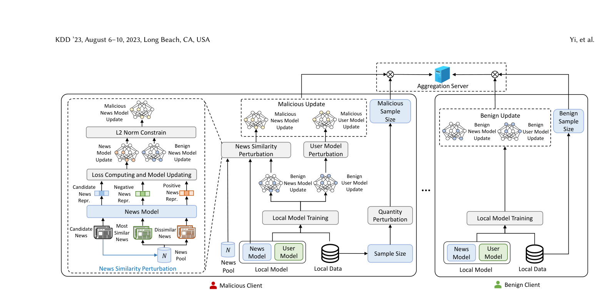
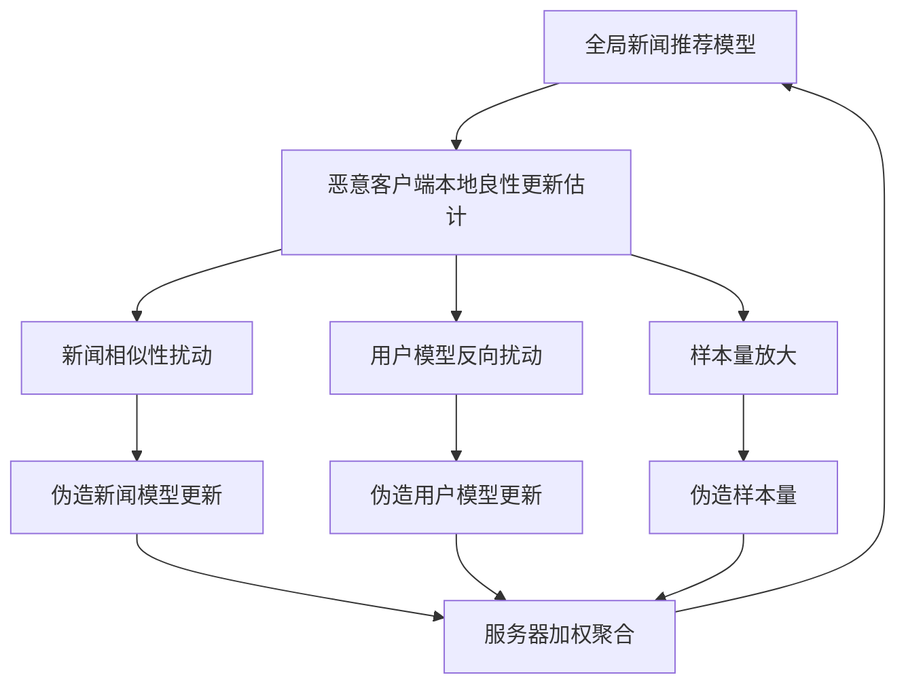

# UA-FedRec: Untargeted Attack on Federated News Recommendation (联邦新闻推荐的无目标攻击)

- **会议/期刊**: KDD 2023
- **作者与机构**: Jingwei Yi, Fangzhao Wu, Bin Zhu, Jing Yao, Zhulin Tao, Guangzhong Sun, Xing Xie；USTC、MSRA、中国传媒大学
- **推荐链路定位**: 精排（新闻推荐模型训练阶段的联邦聚合）
- **研究方向**: 去偏公平、可信隐私与工业架构（联邦推荐安全）
- **论文原文**: [https://arxiv.org/abs/2202.06701v2](https://arxiv.org/abs/2202.06701v2)
- **开源代码**: [https://github.com/yjw1029/UA-FedRec](https://github.com/yjw1029/UA-FedRec)

## TL;DR (1分钟核心速览)

联邦新闻推荐默认“上传模型更新即安全”，本文首次揭示其无目标投毒风险：UA-FedRec 用新闻相似性反转、用户模型反向扰动和样本量放大三重手段污染本地更新。在 MIND/Feeds 两个真实数据集、NRMS/LSTUR 两种模型上，仅 1% 恶意客户端即使 AUC 相对下降 8.9%–18.5%，且在 Norm-Bounding、Multi-Krum 防御下仍显著降效。

## Background & Motivation (背景与核心矛盾)

- **主流范式**: FedRec 类方法让客户端在本地训练新闻模型与用户模型，服务器用 FedAvg/FedAdam 按样本量加权聚合更新，避免共享原始点击日志。
- **前人局限**: 现有推荐投毒攻击多针对集中式或 ID-embedding 模型（PipAttack 需定向目标、FedAttack 依赖 ID 嵌入），而 LIE/Fang 等联邦投毒通常需要 20% 以上恶意客户端，在 1% 低比例、内容化新闻模型下失效。
- **核心洞察 (Key Insight)**: 新闻推荐性能高度依赖新闻建模与用户建模；联邦聚合权重由客户端样本量决定；新闻语义近邻关系在约 100 轮内高度稳定（Pearson $r>0.97$）。
- **本文切入点**: 不伪造样本，而是直接构造“看似合理”的模型更新，同时破坏新闻相似性结构与用户兴趣建模，并利用样本量异构性放大攻击权重。

## Method (核心方法设计)

### 1. 整体框架 (Overall Architecture)

恶意客户端先接收全局模型，用本地良性数据计算“若正常训练”会得到的良性更新，作为估计基准；随后分别对新闻模型、用户模型施加扰动，并伪造上传样本量。服务器按 FedAdam 聚合并下发全局模型；攻击只在训练轮次发生，推理阶段不增加任何开销。整体闭环为“本地良性估计 $\to$三重扰动$\to$加权聚合$\to$ 全局模型退化”。

<figure class="paper-figure" markdown="span">
  <figcaption>图1：我们的 UA-FedRec 方法框架。</figcaption>
</figure>

### 2. 关键设计拆解 (Key Designs)

1. **新闻相似性扰动（News Similarity Perturbation）**：新闻模型若正常训练，相似新闻表征应靠近、不相似新闻应远离；本文反转该结构，对每篇新闻检索最相似 $n_i^n$与最不相似$n_i^f$，最大化“相似对”距离、最小化“不相似对”距离：
   $\mathcal{L}_{n}=\sum_{n_i\in\mathcal{N}}\left[(\boldsymbol{n}_i-\boldsymbol{n}_{i}^{f})^{\top}(\boldsymbol{n}_i-\boldsymbol{n}_{i}^{f})-(\boldsymbol{n}_i-\boldsymbol{n}_{i}^{n})^{\top}(\boldsymbol{n}_i-\boldsymbol{n}_{i}^{n})\right]$该损失直接污染新闻语义空间，使后续用户建模失去可靠输入。为规避范数检测，将更新裁剪到良性范数分布上界：$\boldsymbol{g}^{m}_{n}=\boldsymbol{g}_{n}\max\left(1,\|\boldsymbol{g}_{n}\|_2/(\mu_n+\lambda_2\sigma_n)\right)$2. **用户模型反向扰动（User Model Perturbation）**：先估计恶意客户端良性用户更新的均值$\boldsymbol{\mu}_u$与标准差$\boldsymbol{\sigma}_u$，再沿良性更新反方向推一步，使聚合后的用户表征偏离真实兴趣：
   $\boldsymbol{g}^{m}_{u}=\boldsymbol{\mu}_u-\lambda_1\operatorname{sign}(\boldsymbol{\mu}_u)\odot\boldsymbol{\sigma}_u,\quad \lambda_1\le 4$相比随机噪声，这种“有方向的反向扰动”在聚合后保留更强破坏性，同时幅度受$\sigma_u$ 约束，不易被离群检测。

3. **样本量扰动与训练/推理开销**：FedAvg 按样本量加权，故恶意客户端上报
   $s_m=\lfloor \mu_s+\lambda_3\sigma_s\rfloor,\quad 0\le\lambda_3\le 4$利用新闻推荐客户端样本量重尾分布（MIND 均值 3.14、标准差 3.00、最大 62），把权重抬到合理上界而不触发异常。攻击损失即$\mathcal{L}_{attack}=\mathcal{L}_{n}$，用户模型通过直接更新操纵实现；训练用每正样本 4 负例的采样 softmax，推理阶段与正常 FedRec 完全一致。每轮额外开销为$O(qmD\|\boldsymbol{\Theta}\|+qL\|\boldsymbol{\Theta}_n\|+qL^2d/K)$，其中近邻每$K=100$ 轮刷新一次。

## Experimental Setup & Evaluation Protocol (实验设置与评估协议)

- **数据集与预处理**:

| 数据集 | #Users | #Items(news) | #Interactions(impressions) | 稀疏度/密度 | 特征/场景说明 |
| :--- | :---: | :---: | :---: | :---: | :--- |
| MIND (small) | 94,057 | 65,238 | 230,117 | 正样本 347,727 / 负样本 8,236,715 | 微软新闻六周行为日志，新闻标题文本 |
| Feeds | 10,000 | 643,177 | 320,578 | 正样本 437,072 / 负样本 6,621,187 | 微软新闻 App 2020-08 一个月日志 |

- **数据划分与防穿越**: MIND 使用官方 train/val/test；Feeds 前 3 周训练、随后 2 天验证、最后 1 周测试，均按时间切分，避免未来曝光穿越。
- **排名评测协议**: 采用曝光内候选新闻排序（impression-level candidate ranking），并非全库 Full-Ranking；训练每正样本采 4 个负例，评测在良性测试集上计算 AUC、MRR、nDCG@5、nDCG@10。
- **对比基线与超参**: 数据投毒 LF、Pop、FedAttack；模型投毒 Gaussian、LIE、Fang；另设 No Attack 上界。新闻表征维度 $d=400$，学习率$1\times10^{-4}$，dropout 0.2，每轮采样 50 个客户端，恶意比例默认 1%（MIND 500 个、Feeds 100 个），聚合器 FedAdam；$\lambda_1,\lambda_2,\lambda_3$ 默认 3.0（LSTUR/Feeds 为 1.5、1.5、3.0）。每个实验独立重复 5 次，报告均值±标准差，未做显著性检验。

## Key Experimental Results (实验关键数据)

### 1. 主实验对比 (Main Results)

下表单元格为 `AUC / nDCG@10`，数值越低表示攻击越强，**加粗**为各列最优攻击结果。

| 攻击方法 | MIND-NRMS | MIND-LSTUR | Feeds-NRMS | Feeds-LSTUR |
| :--- | :---: | :---: | :---: | :---: |
| No Attack | 66.73 / 40.75 | 66.67 / 40.67 | 65.05 / 42.15 | 65.17 / 42.19 |
| LF | 66.69 / 40.69 | 66.63 / 40.58 | 64.90 / 42.00 | 65.12 / 42.09 |
| Pop | 66.72 / 40.74 | 66.81 / 40.76 | 64.99 / 32.11 | 65.30 / 42.32 |
| FedAttack | 66.65 / 40.68 | 66.87 / 40.75 | 65.04 / 42.08 | 65.10 / 42.17 |
| Gaussian | 66.64 / 40.71 | 66.69 / 40.62 | 64.87 / 42.04 | 65.15 / 42.18 |
| LIE | 59.52 / 35.03 | 63.56 / 37.91 | 61.63 / 38.85 | 63.93 / 40.91 |
| Fang | 62.92 / 37.52 | 63.87 / 38.25 | 61.04 / 38.31 | 61.81 / 38.92 |
| **UA-FedRec** | **55.81 / 31.79** | **54.33 / 30.96** | **58.96 / 36.39** | **59.36 / 36.64** |

UA-FedRec 相对 No Attack 的 AUC 降幅分别为 **16.4% / 18.5% / 9.4% / 8.9%**；同等 1% 恶意比例下，最强基线 LIE 仅降 10.8%（MIND-NRMS），Fang 仅 5.7%，数据投毒类几乎无效。

### 2. 消融实验 (Ablation Study)

| 变体 | MIND-NRMS AUC | MIND-LSTUR AUC | Feeds-NRMS AUC | Feeds-LSTUR AUC |
| :--- | :---: | :---: | :---: | :---: |
| UA-FedRec 完整 | **55.8** | **54.3** | **59.0** | **59.4** |
| w/o 用户模型扰动 | 56.1 | 55.6 | 59.9 | 59.8 |
| w/o 样本量扰动 | 60.2 | 60.6 | 63.2 | 62.4 |
| w/o 新闻相似性扰动 | 65.0 | 62.4 | 63.2 | 62.2 |
| No Attack | 66.7 | 66.7 | 65.1 | 65.2 |

### 3. 关键实验发现 (Key Findings)

1. **新闻相似性扰动是主引擎**：去掉它后 MIND-NRMS AUC 从 55.8 回升到 65.0，几乎回到无攻击的 66.7；原因是新闻表征被污染后，用户模型即便不被扰动也无法准确捕捉兴趣，故用户扰动的边际贡献仅约 0.3–1.3 个点。
2. **样本量扰动显著放大攻击**：去掉后 MIND-NRMS AUC 回升 4.4 个点、Feeds-LSTUR 回升 3.0 个点，验证了 FedAvg 按样本量加权本身即是可被利用的攻击面；同时仅 0.1% 恶意客户端即可起效，1% 是兼顾隐蔽性与破坏力的实用档位。
3. **现有防御存在“可用性—安全性”两难**：Median/Krum/Trimmed-Mean 在无攻击时就把 NRMS-MIND AUC 从 66.7 压到 56.1–63.6，部署代价过高；可用的 Norm-Bounding 下 UA-FedRec 仍把 AUC 从 66.9 降到 57.0（NRMS-MIND），Multi-Krum 下从 65.8 降到 60.3，说明范数裁剪与多数投票无法识别“方向正确但语义反向”的更新。

## Highlights & Limitations (亮点、对比与审稿批判)

- **与代表作对比 (vs. Prior Work)**: 相比 LIE/Fang 在参数空间加各向同性噪声，本文利用新闻语义相似性与用户建模两个推荐域先验，把所需恶意比例从 20% 级降到 1%；相比 FedAttack 依赖 ID embedding、PipAttack 需定向目标，UA-FedRec 面向内容化新闻模型且为无目标攻击；相比 LF/Pop 只改输入样本，它直接操纵模型更新，破坏力高一个量级。
- **可迁移亮点**: ①用“每 $K$轮缓存新闻近邻”把$O(L^2)$相似度计算摊薄，且实证近邻在 100 轮内稳定；②把恶意更新范数、样本量约束在良性分布$\mu+\lambda\sigma$ 内以规避检测，这套“分布内扰动”思路可迁移到其他联邦推荐攻击/鲁棒性评测。
- **审稿级局限批判**: ①威胁模型假设恶意客户端本地仍有良性数据来估计 $\boldsymbol{\mu}_u,\boldsymbol{\mu}_n$，若攻击者只掌握被污染数据或冷启动客户端，攻击效果会下降；②评测限于两个微软新闻数据集与 NRMS/LSTUR，未给出线上 A/B、跨域内容推荐或自适应防御下的结果；③$K=100$的近邻刷新与$\lambda$ 取值依赖数据集样本量分布，超参敏感度分析仍不充分。

## Rating (四维评分)

- **方法创新性 (Novelty)**: ⭐⭐⭐⭐ （首次系统研究联邦新闻推荐无目标攻击，新闻相似性反转与样本量扰动具有明确领域先验，但本质仍是模型投毒框架的领域化组合）
- **评估协议与实验扎实度 (Protocol & Experiments)**: ⭐⭐⭐⭐ （MIND/Feeds 双数据集、两种模型、5 次重复、7 个基线及两类防御较完整；但评测为曝光内排序而非全库排序，且缺少显著性检验与线上验证）
- **写作与数学规范度 (Clarity & Rigor)**: ⭐⭐⭐⭐ （三重扰动公式简洁、复杂度分析清晰，攻击与防御实验组织有条理；部分符号在正文与附录间重复定义，攻击损失的整体优化目标可再统一）
- **工业落地与复现价值 (Industrial & Practical Value)**: ⭐⭐⭐⭐ （代码开源，攻击仅在训练期发生、推理零开销，1% 恶意比例贴近真实威胁模型；但实际部署需先获得新闻标题与本地良性样本，防御方案仍待补全）

