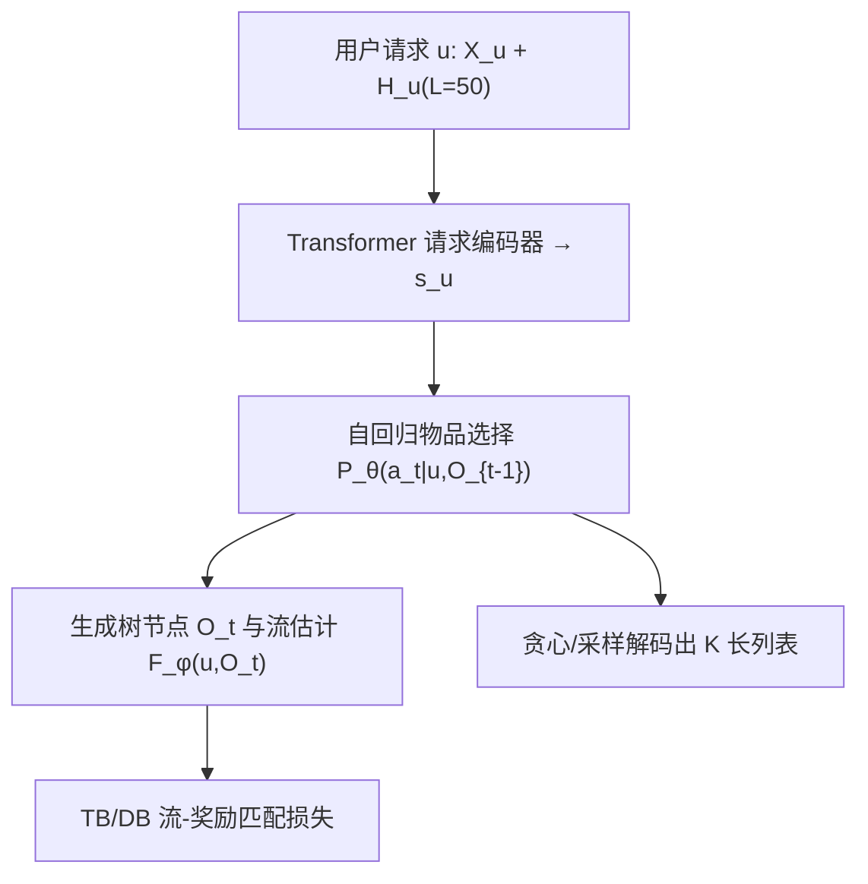
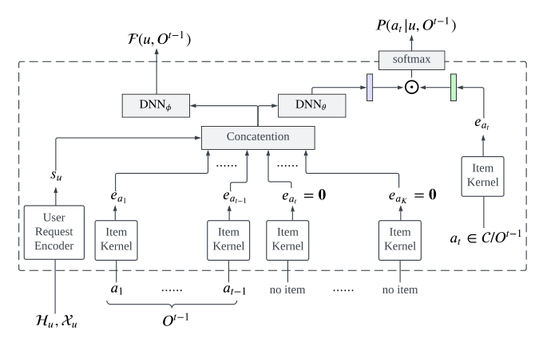
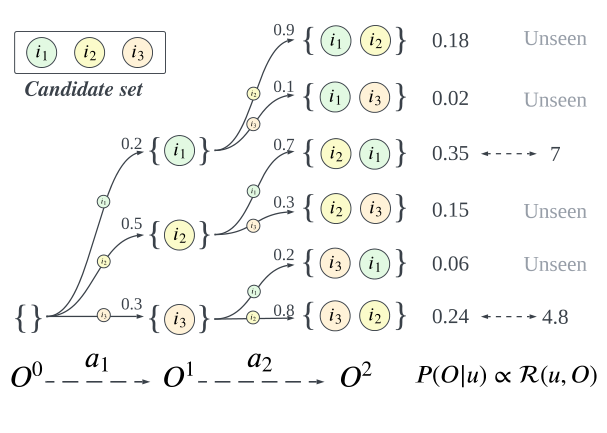

# Generative Flow Network for Listwise Recommendation (生成流网络驱动的列表级推荐)

- **会议/期刊**: KDD 2023 (29th ACM SIGKDD)
- **作者与机构**: Shuchang Liu, Qingpeng Cai, Dong Zheng, Peng Jiang (快手); Zhankui He, Julian McAuley (UCSD); Bowen Sun (北大); Kun Gai
- **推荐链路定位**: 重排 / 端到端列表生成式
- **研究方向**: 生成式推荐 / 强化学习与动态探索
- **论文原文**: [https://arxiv.org/abs/2306.02239v4](https://arxiv.org/abs/2306.02239v4)
- **开源代码**: [https://github.com/CharlieMat/GFN4Rec](https://github.com/CharlieMat/GFN4Rec)

## TL;DR (1分钟核心速览)

点式打分模型无法建模同一曝光列表内物品的相互影响，而现有列表级生成方法（ListCVAE）虽多样性高却准确率崩塌，交叉熵训练又使策略迅速塌缩到 top-K 局部最优。本文提出 GFN4Rec，把自回归选品过程建模为生成树上的概率流，用轨迹平衡（TB）/细节平衡（DB）损失令列表生成概率正比于其奖励（对数尺度匹配），并引入 $b_z,b_r,b_f$ 三个偏置稳定训练。在两个真实数据集构建的在线模拟器 + 离线评测中，KR1K 上平均奖励较最强基线 PRM 提升 11.0%，探索模式物品覆盖率较 CF/PRM 提升约 4 倍。

## Background & Motivation (背景与核心矛盾)

- **主流范式**: 点式/成对 LTR 为每个物品独立打分后取 top-$K$；列表级方法分为"学评估器再指导生成"（PRM 类 reranker）与"直接学列表生成器"（ListCVAE 类 CVAE）。
- **前人局限**: ① 评估器范式高度依赖评估精度，级联误差难控；② 生成器范式使用交叉熵，使 $\log P(i|u)\to R(u,i)$，独立聚合后$P(O|u)\to\prod e^{R(u,a_t)}$，对高分物品指数级敏感，策略迅速收敛到少数高分列表，多样性骤降。
- **核心洞察 (Key Insight)**: 若把对齐目标从"概率-奖励"改为"对数概率-对数奖励"，即 $\log P(O|u)\to\log R(u,O)$，则$P(O|u)\propto R(u,O)$ 线性可分，略低分列表仍保留可观曝光概率——这正是 GFlowNet 的流匹配性质，天然缓解 mode collapse。
- **本文切入点**: 将列表生成视为树上的一次完整轨迹，用流匹配损失替换交叉熵，把"探索多样性"内嵌进训练目标而非靠采样温度外挂。

## Method (核心方法设计)

### 1. 整体框架 (Overall Architecture)

输入一个用户请求 $u$（静态画像$X_u$+ 最近$L=50$条行为历史$H_u$），Transformer 历史编码器与 DNN 特征模块输出用户状态$\boldsymbol{s}_u$；生成阶段从空列表$O_0=\varnothing$出发，每步由物品选择模型在候选集$\mathcal{C}\setminus O_{t-1}$上做 softmax 采样$a_t\sim P_\theta(i|u,O_{t-1})$并追加到列表尾部，共$K$步得到$O_K$；同时一个以$\boldsymbol{s}_u$与当前部分列表为输入的流估计器$F_\phi(u,O_t)$ 给出该节点的流量，用于计算 TB/DB 损失；推理时关闭采样改为贪心取 top 分（greedy），或保留采样即 GFN4Rec(Explore)。

<figure class="paper-figure" markdown="span">
  <figcaption>图3：GFN4Rec 中的流估计器 𝜙 和物品选择模型 𝜃。我们在附录 A.1 中给出用户请求编码器和物品核的细节。⊙ 表示点积。</figcaption>
</figure>

### 2. 关键设计拆解 (Key Designs)

1. **生成树与轨迹概率（把组合空间变成树上的流量）**：列表组合空间 $O(|\mathcal{C}|^K)$无法枚举，作者改为有序自回归生成，使每条列表唯一对应一条根到叶轨迹，且树结构保证反向概率恒为 1：$P(O|u)=\prod_{t=1}^{K}P_\theta(a_t|u,O_{t-1})$。由此列表概率可被逐边分解、并行优化，也自然刻画了"已选物品对未来选择的影响"。

<figure class="paper-figure" markdown="span">
  <figcaption>图2：K=2、|C|=3 的生成树示例。</figcaption>
</figure>

2. **对数尺度奖励匹配（TB/DB 损失，核心去塌缩机制）**：令源节点流量 $F(u,\varnothing)$表征用户奖励先验，叶节点满足$b_zF(u,O)=R(u,O)$。轨迹平衡损失直接对齐整条轨迹：
$$\mathcal{L}_{TB}=\left(\log b_z+\log\frac{F_\phi(u,\varnothing)\prod_{t=1}^{K}P_\theta(a_t|u,O_{t-1})}{R(u,O_K)+b_r}\right)^2$$
细节平衡则逐边约束（叶节点用 $\left(\log F_\phi(u,O_K)-\log(R(u,O_K)+b_r)\right)^2$，中间节点用$\left(\frac{\log b_z}{K}+\log\frac{F_\phi(u,O_{t-1})P_\theta(a_t|u,O_{t-1})}{F_\phi(u,O_t)}\right)^2$）。关键在于分母是奖励而非$e^{R}$，使低分列表不被指数压制，探索空间得以保留。

3. **训练稳定性偏置与训练目标**：由于 $P_\theta(a_t|\cdot)\approx 1/|\mathcal{I}|$远小于奖励与流量尺度，取对数后负值方差极大、开局梯度失控，故引入奖励平滑$b_r$、全局归一$b_z$与前向概率平移$b_f$（即$\log(P+b_f)$，取$b_f=1$可保证非负）。总损失即$\mathcal{L}_{TB}$或$\mathcal{L}_{DB}$，**无需负采样**（奖励自带权重），在线训练采用"半新样本 + 半全缓冲均匀采样"防灾难遗忘，batch=128。

## Experimental Setup & Evaluation Protocol (实验设置与评估协议)

| 数据集 | #Users | #Items | #Interactions | 过滤/密度 | 特征/场景说明 |
| :--- | :---: | :---: | :---: | :---: | :--- |
| ML1M | 6,400 | 3,706 | 1,000,208 | 20-core | 评分转为 click/like/star 三类行为，$R\in[0,3]$ |
| KR1K | 1,000 | 69,219 | 2,597,865 | 20-core | 快手短视频 7 类行为（hate 权重 $-1$），$R\in[-1,6]$ |

- **数据划分与防穿越**: 历史切成 $K=6$的片段，每段视作一条观测列表；离线评测取每用户最后$N$条交互为测试（ML1M$N=1$，KR1K$N=4$），其余训练。另建**随机用户响应模拟器**（AUC 0.7–0.9，含物品相似度抑制项$\rho=0.2/0.1$）做在线学习回路。
- **排名评测协议**: 全候选打分（ranking 场景 $\mathcal{C}=\mathcal{I}$；reranking 场景$\mathcal{C}\subset\mathcal{I}$），指标为奖励化 **R-NDCG** 与 **R-MRR**（以$R(u,i)$ 替代相关性标签），另报 Avg.R / MaxR / Coverage / ILD。
- **对比基线与超参**: CF、ListCVAE ($\beta$网格)、RerankCF、PRM（PV loss 系数网格）；所有模型共享同一用户请求编码器；GFN4Rec 网格搜索$b_r\in\{0.1,0.3,1.0,1.5\}$、$b_f\in\{0.1\!-\!2.0\}$、$b_z\in\{0.1,0.5,1.0,1.5\}$，5 随机种子均值。

## Key Experimental Results (实验关键数据)

### 1. 主实验对比 (Main Results)

在线学习（表 2，模拟器实测）：

| 方法 | ML1M Avg.R | ML1M MaxR | ML1M Coverage | ML1M ILD | KR1K Avg.R | KR1K MaxR | KR1K Coverage | KR1K ILD |
| :--- | :---: | :---: | :---: | :---: | :---: | :---: | :---: | :---: |
| CF | 2.073 | 2.939 | 13.963 | 0.529 | 2.253 | 4.039 | 100.969 | 0.543 |
| ListCVAE | 0.940 | 2.209 | 262.420 | 0.796 | 2.075 | 4.042 | 446.100 | 0.565 |
| RerankCF | — | — | — | — | — | — | — | — |
| PRM | 2.156 | 2.967 | 18.647 | 0.559 | 2.174 | 3.811 | 27.520 | 0.538 |
| GFN4Rec(Explore) | 2.047 | 2.938 | 87.660 | 0.617 | 2.212 | 3.984 | 415.515 | 0.591 |
| **GFN4Rec** | **2.172** | **2.972** | 15.693 | 0.565 | **2.414** | **4.054** | 21.267 | 0.520 |

离线训练模型再上模拟器（表 4 节选）：ML1M R-NDCG(online) **0.665** / R-MRR(online) **0.0848**（vs PRM 0.636 / 0.0812，提升 **+4.6%**）；KR1K R-NDCG(test) **0.362**、R-MRR(test) **0.0421** 为最优。

### 2. 消融实验 (Ablation Study)

KR1K 离线训练下 TB vs. DB（原文表 5；其 Coverage 行与 Avg.R 完全同值，疑为排版笔误，故未列）：

| 变体 | Avg.R | MaxR | ILD | R-NDCG(online) | R-MRR(online) | R-NDCG(test) | R-MRR(test) |
| :--- | :---: | :---: | :---: | :---: | :---: | :---: | :---: |
| GFN_TB | 1.962 | 3.870 | **0.630** | 0.393 | 0.0834 | 0.362 | 0.0421 |
| **GFN_DB** | **2.034** | **3.905** | 0.582 | **0.400** | **0.0859** | **0.363** | **0.0423** |

### 3. 关键实验发现 (Key Findings)

1. **质量-多样性不再是零和**：GFN4Rec(Explore) 在 KR1K 上 Coverage 达 415.5（CF 101.0、PRM 27.5，约 **4×**），同时 Avg.R 2.212 仍高于 PRM 2.174；而 ListCVAE 虽 Coverage 446.1 相近，ML1M 上 Avg.R 仅 0.940（不足 CF 之半），说明多样性必须由对数奖励匹配"兜底"才不退化为质量崩塌。
2. **对数匹配直接转化为奖励增益**：KR1K 上 GFN4Rec 平均奖励 2.414 vs PRM 2.174（**+11.0%**）、vs CF 2.253（+7.1%）；ML1M 也做到 2.172 高于带额外排序级的 PRM 2.156，验证了"探索到的高分列表"确实被策略学到了。
3. **DB 更适合大动作空间**：DB 损失把 $|\mathcal{C}|=69$K 的 KR1K 上的 Avg.R 从 TB 的 1.962 提到 2.034（+3.7%）、R-MRR(online) +3.0%，代价是 ILD 从 0.630 降至 0.582——逐边学习方差更小，是实践中更稳的选择；同时离线训练 Avg.R 仅 1.962 而在线训练 2.414，印证离线日志对反事实探索的天然缺陷。

## Highlights & Limitations (亮点、对比与审稿批判)

- **与代表作对比 (vs. Prior Work)**: 相比 ListCVAE 以奖励为生成条件、准确率-多样性严重失衡，GFN4Rec 把奖励作为**流匹配的目标**而非输入，天然兼容探索；相比 PRM 需"初排 + 重排"两阶段且多样性受初排上限约束，本方法是单阶段生成器；相比标准 RL 依赖中间步奖励与折扣累积，本文只在叶节点给奖励，用流守恒替代 Bellman 更新的方差问题。
- **可迁移亮点**: ① 用"对数尺度奖励对齐"替代交叉熵，可作为任意生成式检索/重排模型的通用损失改造；② 三个尺度偏置 $b_z,b_r,b_f$的工程技巧（尤其$\log(P+b_f)\ge0$）可直接复用到其它 flow/能量模型训练中。
- **审稿级局限批判**: ① 奖励定义 $R(u,O)=\frac{1}{K}\sum_i R(u,i)$仍逐物品线性可加，与"列表内相互影响"的动机存在张力，真正的互补/竞争效应全靠模拟器里的抑制项人为注入；② 训练需额外搜索三个偏置超参且在线需同步跑模拟器与回放缓冲，端到端部署与实时生成（每请求$K$ 次前向 + 流估计）开销偏大，论文亦未给推理延迟数据；③ 主要结论依赖自建模拟器，虽然离线与在线指标一致性被验证，但作者也承认若预训练不规整仍可能模式崩塌。

## Rating (四维评分)

- **方法创新性 (Novelty)**: ⭐⭐⭐⭐⭐ （把 GFlowNet 的流匹配首次迁移到列表级推荐，并用"对数 vs. 指数聚合"给出清晰的理论解释，机制新颖且自洽）
- **评估协议与实验扎实度 (Protocol & Experiments)**: ⭐⭐⭐⭐ （模拟器 + 离线双轨验证、R-NDCG/R-MRR 指标设计合理，但仅两数据集、列表长度固定 $K=6$，模拟器真实性仍是主要争议点）
- **写作与数学规范度 (Clarity & Rigor)**: ⭐⭐⭐⭐ （TB/DB 推导与偏置动机交代清楚，与 CE/RL 的对比分析到位；但表 5 存在 Coverage 行复制错误，个别符号排版散乱）
- **工业落地与复现价值 (Industrial & Practical Value)**: ⭐⭐⭐⭐ （代码已开源、损失可直接套用；但超参敏感 + 自回归 $K$ 步推理，需在时延敏感的线上重排环节做工程折衷）

