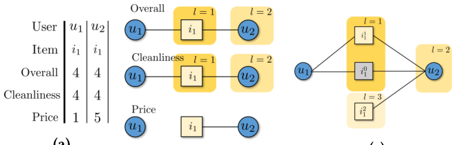
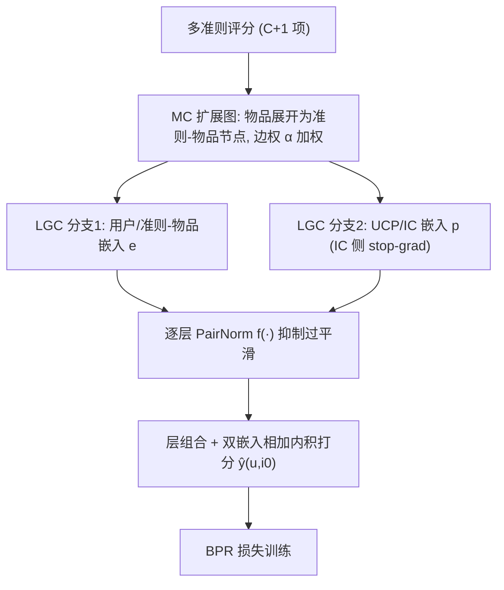

# Criteria Tell You More than Ratings: Criteria Preference-Aware Light Graph Convolution for Effective Multi-Criteria Recommendation (准则比总体评分说得更多：准则偏好感知轻量图卷积多准则推荐)

- **会议/期刊**: KDD 2023 (29th ACM SIGKDD)
- **作者与机构**: Jin-Duk Park, Won-Yong Shin (Yonsei University); Siqing Li, Xin Cao (UNSW Australia)
- **推荐链路定位**: 召回 / Top-K 排序（端到端打分）
- **研究方向**: 图神经网络与知识图谱推荐 / 协同过滤
- **论文原文**: [https://arxiv.org/abs/2305.18885v4](https://arxiv.org/abs/2305.18885v4)
- **开源代码**: [https://github.com/jindeok/CPA-LGC-Recbole](https://github.com/jindeok/CPA-LGC-Recbole)

## TL;DR (1分钟核心速览)

多准则（MC）推荐长期被矩阵分解/自编码器垄断，这些方法只能把各准则评分当作独立的侧信息拼接，**无法显式刻画"用户在价格上相似、在清洁度上相反"这类跨准则的高阶行为相似性**。本文首次将 GNN 引入 MC 推荐：把每件物品展开为 $C+1$ 个"准则-物品"节点构建 **MC 扩展图**，并额外维护用户准则偏好 (UCP) 与物品准则 (IC) 两套嵌入做第二次图卷积，用 PairNorm 抑制扩展图加剧的过平滑。在 TA/YM/RB/YP 四数据集、Per-user 70/10/20 划分 + 全库未交互排序协议下，P@5 相对最强 MC 基线最高 **+141.20%**，相对最强 GNN 基线最高 **+58.66%**。

## Background & Motivation (背景与核心矛盾)

- **主流范式**: MC 推荐以 CF 为主——UBM/DMCF/AEMC 属于"两阶段"（先预测各准则分再加权聚合总体分），CFM 属于集体矩阵分解（联合分解总体与准则评分矩阵），ExtendedSAE 用堆叠自编码器建模准则-总体映射。
- **前人局限**: ① 两阶段方法把准则分与总体分的预测解耦，误差逐级累积；② 上述方法均只在"用户-物品"二维交互上做表征学习，无法显式利用跨准则的高阶拓扑邻近性；③ ExtendedSAE 的输入/输出维度是用户数×物品数的乘积，在 YP 这种规模上直接 OOM。
- **核心洞察 (Key Insight)**: 图 2 的反例最能说明问题——$u_1$与$u_2$对同一酒店$i_1$的 cleanliness 评分一致、price 评分相反。若按准则各建$C+1$张独立二部图（图 2b），$u_2$的 price 信息永远无法传播到 overall/cleanliness 图里；而把准则显式"节点化"后（图 2c），三层卷积即可把这条跨准则信号汇入$u_1$ 的表示。
- **本文切入点**: 不做异构多关系图（R-GCN 需按关系学变换矩阵、依赖元路径），而是把准则编码进**节点身份**，退化为一张加权同构二部图上的 LightGCN 式传播，参数量与复杂度都保持线性。

<figure class="paper-figure" markdown="span">
  <figcaption>图2：一个示例，展示 (a) 包含三个准则评分的评分实例，(b) 三个图，每个图由各准则的评分构建，以及 (c) 我们的MC扩展图。在 (b) 和 (c) 中，创建了对应评分3–5的边，且为目标用户𝑢1在各GNN层中新涉及的节点用不同颜色标记。</figcaption>
</figure>

## Method (核心方法设计)

### 1. 整体框架 (Overall Architecture)

模型输入为用户 ID 嵌入与 $C+1$组"准则-物品"ID 嵌入；每条边$(u,i_c)$的权重$w_{u,i_c}$由该准则评分决定（仅保留 3–5 分正反馈边），其中总体评分（criterion 0）边权放大为$\alpha$（默认 1.5）以强调其主导地位。在 MC 扩展图上并行跑两条轻量图卷积：一条传播常规用户/准则-物品嵌入$e$，另一条传播 UCP/IC 嵌入$p$（IC 侧加 stop-gradient）。每层卷积后接 PairNorm 做逐层去平滑，各层输出取均值做层组合，最终以两套嵌入之和做内积打分。训练用 BPR 损失，推理只需对 criterion 0 节点打分。

### 2. 关键设计拆解 (Key Designs)

1. **MC 扩展图 + 加权对称归一化 LGC**：痛点是用多关系图建模代价高、用独立分图又割裂跨准则信号 $\to$把物品复制成$C+1$ 个节点、只保留正反馈边，把关系信息下沉到节点身份：

$$e_u^{(l)}=\sum_{i_c\in\mathcal{N}_u}\frac{w_{u,i_c}}{\sqrt{\sum_{i_c\in\mathcal{N}_u}w_{u,i_c}}\sqrt{\sum_{v\in\mathcal{N}_{i_c}}w_{v,i_c}}}\,\tilde{e}_{i_c}^{(l-1)}$$

   直觉：分母沿用 GCN 对称归一化防止加权后尺度爆炸；由于 $\mathcal{N}_{i_c}$只包含"在该准则上给过好评"的用户，$i_c$ 的邻居集天然编码了"谁在意这条准则"，卷积即在准则维度上做软聚类。
2. **UCP / IC 双嵌入与准则偏好对齐**：仅靠 ID 嵌入无法表达"某用户更看重哪条准则" $\to$增设用户准则偏好嵌入$p_u$与物品准则嵌入$p_{i_c}$，用同一套传播算子（上式替换$e\to p$）迭代。关键技巧是$p_{i_c}^{(0)}$**在同准则内共享初始化**（作为$C+1$个互斥"标签"），且 IC 侧前向加 stop-gradient 阻断反传以省显存。多层堆叠会让相连节点表征趋同，于是$p_u^{(L)}$ 被拉向其所连准则的 IC 嵌入方向——用户偏好因此"几何化"为嵌入空间中的方位（图 4）。
3. **PairNorm 去平滑与训练目标**：扩展图使每用户邻居数放大约 $\gamma$倍，过平滑更严重$\to$每层后做中心化+重缩放：$\tilde{e}_v^{(l)}=s\sqrt{|V|}\big(e_v^{(l)}-\tfrac{1}{|V|}\sum_i e_i^{(l)}\big)/\|E^{(l)}\|_F$，保持全层成对距离总量不变。预测为$\hat{y}_{u,i_c}=(\tilde{e}_u^{*}+\tilde{p}_u^{*})\cdot(\tilde{e}_{i_c}^{*}+\tilde{p}_{i_c}^{*})^{\top}$，仅取$c=0$；损失为 BPR：$\mathcal{L}=-\sum_u\sum_{i_c\in\mathcal{N}_u}\sum_{j_r\notin\mathcal{N}_u}\ln\sigma(\hat{y}_{u,i_c}-\hat{y}_{u,j_r})+\lambda\|\Theta\|_2^2$，负样本按均匀采样从用户未交互集取，复杂度对$|E|$ 线性（等价于带关系转移的简化 R-GCN）。

## Experimental Setup & Evaluation Protocol (实验设置与评估协议)

- **数据集与预处理**（`5-core`：用户与物品各至少 5 条交互）：

| 数据集 | #Users | #Items | #Overall Ratings | #MC Ratings | 稀疏度/密度 | 特征/场景说明 |
| :--- | :---: | :---: | :---: | :---: | :---: | :--- |
| TA (TripAdvisor) | 4,265 | 6,275 | 34,383 | 202,859 | 密度 ≈ 0.13% | 酒店，$C=7$，$\gamma=5.9$ |
| YM (Yahoo!Movie) | 1,821 | 1,472 | 46,176 | 175,468 | ≈ 1.7% | 电影，$C=4$，$\gamma=3.8$ |
| RB (RateBeer) | 4,017 | 3,422 | 159,755 | 607,067 | ≈ 1.2% | 啤酒，$C=4$，$\gamma=3.8$ |
| YP (Yelp-2022) | 58,971 | 19,820 | 445,724 | 1,408,487 | ≈ 0.04% | 商户，$C=3$，$\gamma=3.1$ |

- **数据划分与防穿越**: `比例划分`——对**每个用户**随机取 70% 交互训练、10% 验证、20% 测试；非全局时间戳切分，故未显式防止未来信息泄漏（数据本身无时间戳约束）。
- **排名评测协议**: `Full-Ranking (全库未交互排序)`——测试集正样本与所有未观测物品共同排序，非采样排序；指标 Precision/Recall/NDCG@$\{5,10\}$，报告 10 次独立划分的均值。
- **对比基线与超参**: 5 个 MC 基线（ExtendedSAE、UBM、DMCF、AEMC、CFM）+ 6 个 GNN 基线（GC-MC、SpectralCF、NGCF、DGCF、LightGCN，以及作者自建的 LightGCN-MC 变体：按准则各建图后拼接表征）。统一 $d=64$、Adam、batch=1024、lr=$10^{-3}$、$\lambda=10^{-3}$；层数$L=1$（YM）/$L=3$（其余）；$\alpha=1.5$、PairNorm$s=1$；YP 因$\gamma$最小、过平滑不严重而**不加**$f(\cdot)$。

## Key Experimental Results (实验关键数据)

### 1. 主实验对比 (Main Results)

| 方法 | TA P@5 | TA N@10 | YM P@5 | YM N@10 | RB P@5 | RB N@10 | YP P@5 | YP N@10 |
| :--- | :---: | :---: | :---: | :---: | :---: | :---: | :---: | :---: |
| ExtendedSAE | 0.0012 | 0.0043 | 0.0675 | 0.1154 | 0.0210 | 0.0435 | OOM | OOM |
| UBM | 0.0158 | 0.0346 | 0.0160 | 0.0245 | 0.0250 | 0.0440 | 0.0137 | 0.0341 |
| AEMC | 0.0156 | 0.0241 | 0.0358 | 0.0693 | 0.0997 | 0.1780 | 0.0093 | 0.0544 |
| CFM | 0.0220 | 0.0480 | 0.0420 | 0.0583 | 0.0739 | 0.1391 | 0.0180 | 0.0492 |
| NGCF | 0.0181 | 0.0454 | **0.0814** | 0.1277 | 0.1730 | 0.2534 | 0.0232 | 0.0600 |
| LightGCN | 0.0267 | 0.0671 | 0.0771 | 0.1278 | 0.1732 | 0.2512 | 0.0235 | 0.0603 |
| LightGCN-MC | *0.0283* | *0.0699* | 0.0795 | *0.1301* | *0.1802* | *0.2566* | *0.0267* | *0.0625* |
| **CPA-LGC** | **0.0449** | **0.0880** | **0.1012** | **0.1532** | **0.2177** | **0.2892** | **0.0360** | **0.0859** |
| Improv.% (vs 次优) | +58.66% | +25.89% | +24.30% | +17.76% | +20.81% | +12.70% | +34.83% | +37.44% |

相对最强 MC 基线的 P@5 提升分别为 **+104.09%** (TA)、**+49.93%** (YM)、**+136.37%** (RB)、**+100.00%** (YP)。

### 2. 消融实验 (Ablation Study)

NDCG@10：

| 变体 | TA | YM | RB | YP |
| :--- | :---: | :---: | :---: | :---: |
| CPA-LGC (完整) | **0.088** | **0.153** | **0.289** | 0.068 |
| w/o MC 扩展图 (仅总体评分图, -MC) | 0.064 | 0.128 | 0.251 | *0.060* |
| w/o UCP & IC 嵌入 (-c) | 0.067 | 0.134 | 0.253 | 0.058 |
| w/o PairNorm (-f) | *0.070* | *0.131* | *0.259* | **0.072** |

### 3. 关键实验发现 (Key Findings)

1. **扩展图是最大功臣**：去掉 MC 扩展图（只在总体评分图上卷积）在 TA 上 NDCG@10 从 0.088 掉到 0.064（-27.3%），跌幅显著大于去掉 UCP/IC（-23.9%）与去掉 PairNorm（-20.5%），说明"把准则变成节点"比"多加两套嵌入"更本质。
2. **UCP/IC 与 PairNorm 互补且与图密度相关**：PairNorm 在 TA/YM/RB（$\gamma\ge3.8$）全部正收益，但在$\gamma=3.1$的 YP 上反而使 0.068→0.072 变差，符合"节点度放大越少、过平滑越轻、归一化越可能是噪声"的推断；图 6 的欧氏距离分布也证实加$f(\cdot)$ 后层间距离分布整体右移。
3. **超参存在明确拐点**：$L$在 TA/RB/YP 上取 3 最优、YM 上单调下降（只需一阶邻居）；$\alpha=1.5$全数据一致最优，继续放大总体评分权重会稀释其他准则信号而掉点，$d>256$ 后收益转负——这三点共同界定了"轻量"的边界。

## Highlights & Limitations (亮点、对比与审稿批判)

- **与代表作对比 (vs. Prior Work)**: 与 CFM（集体矩阵分解）相比，本文不改分解目标而是改**图的构造方式**，从而获得高阶邻近性；与 LightGCN-MC（本文自建的最强 GNN 对手，先按准则各建图再拼接）相比，关键差别在于"分图后拼接"只做表征层融合，而扩展图让跨准则信号在**传播过程中**就发生交互，故 P@5 仍高出 20.8%–34.8%；与 R-GCN 相比，本文用节点身份替代关系矩阵，参数量从 $O(C\cdot d^2)$ 降到 0，且被证明是 R-GCN 在特定简化下的特例。
- **可迁移亮点**: ① "把离散属性值/类别复制成独立节点、只保留正反馈边"这一构图技巧可直接迁移到多行为（点击/收藏/加购）推荐或带属性权重的场景图；② 用**同组共享初始化 + stop-gradient** 让一组嵌入充当聚类锚点，是一种廉价的可解释偏好建模手段。
- **审稿级局限批判**: ① 评估采用 per-user 随机 70/10/20 划分而非全局时间切分，训练集含"未来"交互，存在时序泄漏风险，线上收益可能被高估；② 边权 $w_{u,i_c}$ 与阈值（3–5 分算正反馈）均为人工设定，作者也把"可学习边权"列为未来工作，说明模型对评分尺度/稀疏度敏感；③ 仅在 4 个"每用户准则结构统一"的数据集上验证，未讨论各物品准则数异构（部分物品缺某准则评分）时的图补全问题。

## Rating (四维评分)

- **方法创新性 (Novelty)**: ⭐⭐⭐⭐ （首次把 GNN 引入 MC 推荐，MC 扩展图 + UCP/IC 双嵌入的"偏好几何化"思路清晰，并给出与 R-GCN 的等价性分析）
- **评估协议与实验扎实度 (Protocol & Experiments)**: ⭐⭐⭐ （11 个基线 + 全库排序 + 10 次重复较扎实，但随机比例划分未做时间切分、无显著性检验）
- **写作与数学规范度 (Clarity & Rigor)**: ⭐⭐⭐⭐ （公式紧凑、复杂度定理与过平滑距离分布可视化到位，个别记号如 $\tilde{e}$与$f(\cdot)$ 的层级关系需对照图 3 才明确）
- **工业落地与复现价值 (Industrial & Practical Value)**: ⭐⭐⭐⭐ （复杂度对 $|E|$ 线性、开源 RecBole 实现、无关系矩阵参数，唯边权需人工调参，落地时要做准则缺失的工程兜底）

