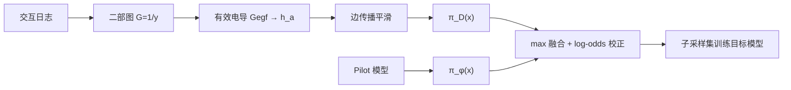
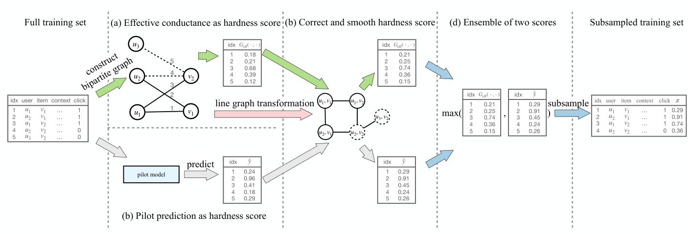
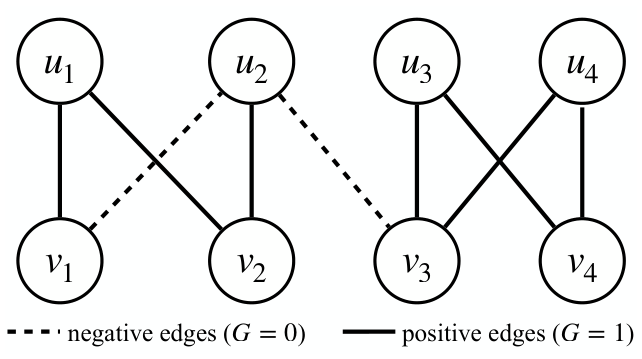

# Graph-Based Model-Agnostic Data Subsampling for Recommendation Systems (面向推荐系统的基于图的免模型数据子采样)

- **会议/期刊**: KDD 2023 (ACM SIGKDD)
- **作者与机构**: Xiaohui Chen, Li-Ping Liu (Tufts University)；Jiankai Sun, Taiqing Wang (ByteDance Inc.)；Ruocheng Guo (ByteDance Research)；Aonan Zhang (Apple Inc.)
- **推荐链路定位**: 召回/精排共用的**训练数据层**（负样本子采样与采样率校正），不改变线上打分结构
- **研究方向**: 图神经网络与知识图谱推荐 / 协同过滤与负采样理论
- **论文原文**: [https://arxiv.org/abs/2305.16391v2](https://arxiv.org/abs/2305.16391v2)
- **开源代码**: 暂未开源（自动检测到的 `rixwew/pytorch-fm` 仅为第三方 W&D 实现依赖，非作者官方仓库）

## TL;DR (1分钟核心速览)

工业界负样本子采样普遍依赖 pilot 模型打分（Opt-Sampling），但线上 v1 模型写入的采样率要供离线 v2 训练使用，一旦模型失配（misspecification）采样率即失真且与训练强耦合。本文提出 **MA-EC**：把"样本难度"换成用户-物品二部图上的**有效电导** $G_{\text{eff}}(u,v)$，仅用输入图结构、不碰任何模型，再用**边传播**平滑噪声，并可与模型法 max 融合。在 KuaiRec/MIND 上按 80/10/10 随机划分、CTR-AUC 评估、平均负采样率$\alpha=0.2$，相对均匀采样 AUC 提升约 0.3%–0.4%（绝对值 +0.003），MIND 上 Opt-Sampling 完全失效而 MA-EC 仍稳定增益。

## Background & Motivation (背景与核心矛盾)

- **主流范式**: 不平衡点击数据用负采样（NS）降本；非均匀 NS 用 pilot 模型的预测分数（及其一阶/二阶导数）度量难度，理论上最优采样率 $\pi^\ast(x)\propto \tilde f(x)$，即"难负样本 = 被 pilot 判为高点击概率的负例"。
- **前人局限①**: 图 1 的工业流水线中采样发生在 I/O 之前、由**线上模型**决定，而模型按 CI/CD 持续迭代，"pilot 正确指定"这一理论前提几乎从不成立，采样率与训练目标错配。
- **前人局限②**: 采样与训练耦合，模型换一版就要重算一遍采样率，系统维护成本与技术债高；且采样率静态写入存储，无法像 SRNS/IRGAN 那样 on-the-fly 更新。
- **核心洞察 (Key Insight)**: 难度其实写在**数据拓扑**里——若用户 $u$与物品$v$之间存在多条高电导路径（蕴含间接偏好），而该$(u,v)$最终被标为负，这条负样本才"反直觉"、才难。图 3 给出直观例：$u_2$到$v_1$有 3 跳通路，故$(u_2,v_1)$比无通路的$(u_2,v_3)$ 更难。
- **本文切入点**: 把二部图视作电路网络，用**有效电导**替代模型打分作为免模型难度分数。

## Method (核心方法设计)

### 1. 整体框架 (Overall Architecture)

输入为交互三元组 $(u_{i_n},v_{j_n},y_n)$。先在正边上赋电导$G=1$、负边$G=0$构造二部图，通过随机游走近似 commute time 再换算得每条边的有效电导$G_{\text{eff}}$，减去直接电导得到免模型难度$h_a$；随后在**线图/原图**上做不确定性传播把稀疏图导致的噪声难度平滑，归一化到平均采样率$\alpha$得到$\pi_D(x)$；可选地与 pilot 模型给出的$\pi_\phi(x)$做 max 融合；最后按$\pi(x)$ 伯努利采样并配合 log-odds 校正训练目标模型。

<figure class="paper-figure" markdown="span">
  <figcaption>图2：我们模型无关的子采样框架示意图。我们从训练数据构建用户-物品二部图，并使用有效电导估计样本难度（a）；用户-物品图可转换为线图，并通过传播平滑难度分数（c）；类似地，我们可以平滑由基于模型的方法得到的难度分数（b）；平滑后的分数（a-c、b-c）可进一步集成以计算最终子采样率（d）。</figcaption>
</figure>

### 2. 关键设计拆解 (Key Designs)

1. **MA-EC：以有效电导作为难度分数**——痛点是用 pilot 打分必然失配；改用电学量 $R_{\text{eff}}(u,v)=(\mathbf{e}_u-\mathbf{e}_v)^{\top}\mathbf{L}^{+}(\mathbf{e}_u-\mathbf{e}_v)$、$G_{\text{eff}}=1/R_{\text{eff}}$，并定义
$h_a(x_n)=G_{\text{eff}}(u_{i_n},v_{j_n})-G(u_{i_n},v_{j_n})$。
   对负样本 $G=0$，端点间高电导多路径 ⇒ 用户其实"应偏好"该物品 ⇒ 高难度；对正样本减去$G$则得到**反事实**难度，供 log-odds 校正使用（正样本不丢弃）。工程上先随机游走近似 commute time，再用$G_{\text{eff}}=2|E|/\text{comm}(u,v)$ 换算，避免直接求伪逆。

<figure class="paper-figure" markdown="span">
  <figcaption>图3：二部图上的有效电导解释。所有正边赋予电导 𝐺=1，所有负边的 𝐺=0。考虑两个用户-物品对 (𝑢2, 𝑣1)、(𝑢2, 𝑣3) 及其有效电导 𝐺eff (𝑢2, 𝑣1)=1/3、𝐺eff (𝑢2, 𝑣3)=0。有效电导体现用户偏好。我们观察到 𝑢2 与 𝑣1 之间存在一条 3 跳路径（𝑢2−𝑣2−𝑢1−𝑣1），但 𝑢2 与 𝑣3 之间不存在路径，因此 𝑢2 可能更偏好 𝑣3 而非 𝑣1。(𝑢2, 𝑣1) 对应比 (𝑢2, 𝑣3) 更难的负样本。</figcaption>
</figure>

2. **边属性传播：把难度分数平滑**——稀疏图下大量孤立正边 $h_a=0$，估计噪声大。作者把边传播归约为节点传播：转线图后求$\hat B=\arg\min_W \operatorname{tr}(W^\top(I-S)W)+\mu\|W-B\|_F^2$，$B=|Y-Z|$。但线图边数达$|E_L|=\big(\sum_u \text{Deg}(u)^2+\sum_v \text{Deg}(v)^2\big)/2-N$，故直接给出**原图边消息传递**等价式
   $B_n^{t+1}=(1-\gamma)B_n+\gamma\frac{m^t(u_{i_n})+m^t(v_{j_n})-2Z_n}{\text{Deg}(u_{i_n})+\text{Deg}(v_{j_n})-2}$，
   其中 $m^t(u)=\sum_{n:u=u_{i_n}}B_n^t$，只需在$|E|$ 条边上聚合，实现线性开销。

3. **训练目标、融合与推理开销**——采样后必须做 log-odds 校正以消除分布偏移：$\hat\theta=\arg\max_\theta\sum_n \delta_n[y_n g(x_n;\theta)-\log(1+e^{g(x_n;\theta)-\ell_n})]$，$\ell_n=\log\pi(x_n)$，$\delta_n$为采样指示（$\mathbb{I}$型 0/1）。融合采用$\pi_{\max}(x)=\rho_{\max}\max(\pi_D(x),\pi_\phi(x))$；论文实测 mean 无显著增益、product 反而退化。MA-EC **免负采样**、不依赖训练过程，采样率可一次算好复用：KuaiRec 150 秒、MIND 80 秒，相对训练开销可忽略，且线上 serving 延迟零影响。

## Experimental Setup & Evaluation Protocol (实验设置与评估协议)

| 数据集 | #Users | #Items | #Interactions | 正负比 | 特征/场景说明 |
| :--- | :---: | :---: | :---: | :---: | :--- |
| KuaiRec | 5,765 | 10,679 | 11,959,745 | 1:35 | 快手短视频；仅用稀疏矩阵部分（剔除全观测子矩阵以贴近自然曝光），`watch_ratio>3` 记为正 |
| MIND | 94,057 | 22,771 | 8,236,715 | 1:25 | 微软新闻曝光日志；不使用新闻正文内容特征 |

- **数据划分与防穿越**: `比例划分` 80% 训练 / 10% 验证 / 10% 测试，单次随机划分；每个配置跑 **8 次**随机初始化并报告均值±方差。
- **排名评测协议**: **非 Full-Ranking、非采样排序**，而是 holdout 上的 **pointwise CTR-AUC**（测试集固定负例，不构造候选池），因此指标反映的是二分类排序质量而非 Top-N 命中率。
- **对比基线与超参**: Uniform（均匀负采样）、Opt-Sampling（模型法近最优，pilot 用 10% 训练数据预训练）、MA-ER（有效电阻当难度，本文自建反例）、三种融合策略及其传播版本。目标模型固定为 **W&D**；pilot 可为 W&D/LR/AFI/NFM/DFM 以考察失配；$\alpha=0.2$，传播系数$\gamma\in\{0.05,0.1,0.2,0.3,0.4\}$，$\rho$调至平均采样率恰为$\alpha$；方差量级 ~0.001，差异按 1 个标准差以上判显著。

## Key Experimental Results (实验关键数据)

### 1. 主实验对比 (Main Results)

| 方法（目标模型 W&D, $\alpha=0.2$） | KuaiRec Test AUC↑ | MIND Test AUC↑ |
| :--- | :---: | :---: |
| Uniform 负采样 | 0.8553 | ≈0.7286 |
| Opt-Sampling（一致 pilot） | **0.8577** | ≈0.7284 |
| Opt-Sampling + Prop. | ≈0.8581 | ≈0.7287 |
| MA-EC（本文，无传播） | 0.8580 | ≈0.7290 |
| MA-EC + Prop. | ≈0.8583 | ≈0.7292 |
| Comb.(Max) + Prop.（本文完整版） | **0.8588** | **≈0.7295** |
| Improv. vs Uniform | +0.41% | +0.12% |

> 注：0.8553 / 0.8577 / 0.8580 取自原文 Table 3 与 Fig. 8 明确数值；标注 ≈ 者为 Fig. 5 曲线读数（误差 ±0.0005）。论文未给出完整主表，仅以箱线/曲线图呈现。

**Pilot 失配的量化证据（KuaiRec, 目标模型固定）**：只换 pilot 架构，目标模型 AUC 从 0.8557（AFI）漂到 0.8577（LR），跨度约 20 倍标准差；而 pilot 自身最优者并不带来最优子采样——NFM 训练 AUC 高达 0.9999、测试 AUC 0.8082，LR 训练仅 0.9487 但测试 0.8192，最终 LR 作 pilot 效果最好。

**换目标模型验证免模型性（LR 作目标模型）**：Uniform 0.8474±0.0012 → Opt-Sampling 0.8511±0.0009 → **MA-EC 0.8519±0.0005**，说明采样率可跨模型复用。

### 2. 消融实验 (Ablation Study)

| 配置（KuaiRec, W&D） | Test AUC↑ | 说明 |
| :--- | :---: | :--- |
| Uniform | 0.8553 | 参照 |
| MA-ER（有效**电阻**当难度） | 0.8535 | 反向度量失效，低于均匀采样 |
| MA-EC（无传播） | 0.8580 | 免模型难度本身有效 |
| MA-EC + 不确定性传播 | **0.8583** | 平滑带来 +0.0003 |
| Comb.(Max) 未翻转难度 | 0.8570±0.0009 | 融合基线 |
| Comb.(Max) 对照翻转（$\pi_D<0.2\ \&\ \pi_\phi>0.8$） | **0.8574±0.0011** | 互补性验证 |

### 3. 关键实验发现 (Key Findings)

1. **模型法脆弱、免模型法稳健**：pilot 架构一变目标 AUC 就漂移 0.002（≈20σ），且 AFI 作 pilot 时甚至不如均匀采样；而 MA-EC 在 MIND 上 Opt-Sampling 毫无增益（≈0.7284 < 均匀 ≈0.7286）时仍拿到 ≈0.7290，证明"数据拓扑"信号在模型失配场景下更可靠。
2. **有效电阻是错误方向，符号不能反**：MA-ER 得 0.8535 反低于均匀采样 0.8553，训练/测试 AUC 几乎无 gap（图 8 左），说明高电阻边是图割边而非难负例；MA-EC 则训练-测试 gap 显著拉大，正是"训练集含更多难负例"的直接证据。
3. **两种难度分数互补、且必须先各自平滑再融合**：对照实验仅把两法不一致的少数样本采样率"翻转"就能把 0.8570 提到 0.8574，说明模型法与图法各自漏掉的难负例不同；先融合两分数再传播（correcting ensemble scores）稳定更差，故采用"先 smooth 后 max"顺序。

## Highlights & Limitations (亮点、对比与审稿批判)

- **与代表作对比**: 相对 Opt-Sampling（Han et al.）——本文不需 pilot 预测值，采样率可离线一次算好并跨目标模型复用；相对 SRNS / IRGAN——那些需要 on-the-fly 更新采样率、与训练端到端耦合，无法适配"采样在 I/O 前、静态落盘"的工业流水线；相对经典图稀疏化（有效电阻采样）——本文证明电阻方向相反，必须用**电导**并配 log-odds 校正。
- **可迁移亮点**: ① 边属性传播用**原图消息传递**替代线图传播（$|E_L|$ 从线性级升到度数平方级），该技巧可迁移到任意"边级重要性平滑"任务；② "先平滑、后融合"的算子顺序经验，可直接用于多路采样分数/多路难度信号的组合。
- **审稿级局限批判**: ① 计算电导时**只用正边**，孤立正边难度恒为 0、须靠传播补救，冷启动物品与极稀疏用户上的难度估计噪声大，且不支持带上下文特征的难度（作者列为 future work）；② 绝对提升仅 0.0005–0.003，只在两个数据集、**一次随机划分**、单一目标架构上验证，缺 Full-Ranking/Top-N 指标与线上 A/B，泛化结论偏弱。

## Rating (四维评分)

- **方法创新性 (Novelty)**: ⭐⭐⭐⭐ （把"难负样本"重新诠释为图上的高有效电导，并用边传播补稀疏噪声，视角新颖但本质仍是难度加权的 HNS 框架）
- **评估协议与实验扎实度 (Protocol & Experiments)**: ⭐⭐⭐ （8 次重复与方差报告、pilot 失配扫描较充分，但仅一次数据划分、仅 pointwise AUC、无 Top-N 与显著性问题，主表缺失只能靠曲线读数）
- **写作与数学规范度 (Clarity & Rigor)**: ⭐⭐⭐⭐ （电导/电阻对比、线图到原图的等价推导与复杂度分析清晰，log-odds 校正引用得当；但传播正则式的收敛与超参 $\mu,\gamma$ 关系交代略简）
- **工业落地与复现价值 (Industrial & Practical Value)**: ⭐⭐⭐⭐ （采样率离线一次性计算，150s/80s 开销可忽略、线上零延迟影响，天然适配 CI/CD；但需图计算引擎支持电导查表，且无官方代码降低复现便利性）

