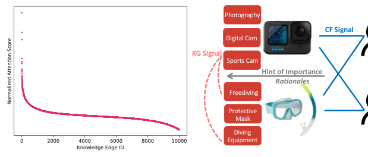
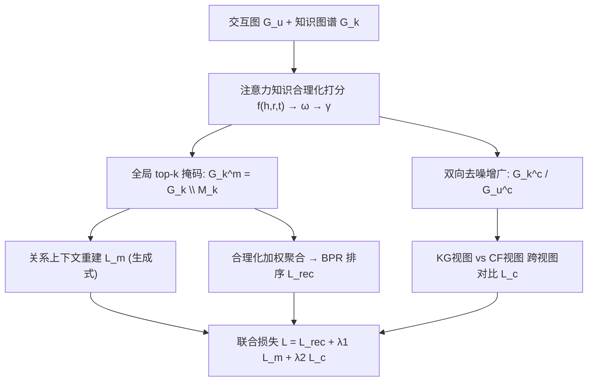

# Knowledge Graph Self-Supervised Rationalization for Recommendation (知识图谱自监督合理化推荐)

- **会议/期刊**: KDD 2023 (29th ACM SIGKDD)
- **作者与机构**: Yuhao Yang, Chao Huang(通讯), Lianghao Xia (香港大学 HKU)；Chunzhen Huang (腾讯微信)
- **推荐链路定位**: 召回 (KG 增强的 user-item 表征学习与 Top-N 排序)
- **研究方向**: 图神经网络与知识图谱推荐 / 自监督对比学习与交互去噪
- **论文原文**: [https://arxiv.org/abs/2307.02759v1](https://arxiv.org/abs/2307.02759v1)
- **开源代码**: [https://github.com/HKUDS/KGRec](https://github.com/HKUDS/KGRec)

## TL;DR (1分钟核心速览)

KG 增强推荐的核心痛点是：知识三元组对下游推荐任务的贡献极度长尾（KGAT 注意力分数呈重尾分布），随机图增广又会把噪声边当成对比正样本。KGRec 提出"注意力知识合理化"为每个三元组打分，并据此做两件事：掩掉高分三元组再在关系上下文中重建（生成式自监督），以及按分数双向裁剪 KG 与 user-item 图后做跨视图对比学习。在 Last-FM/MIND/Alibaba-iFashion 三个真实数据集、10-core 过滤 + 70/10/20 划分 + Full-Ranking 协议下，Recall@20 与 NDCG@20 全面超越 KGCL、KGIN 等 SOTA，Recall 相对提升 2.3%–4.2%。

## Background & Motivation (背景与核心矛盾)

- **主流范式**: GNN-based KG 推荐（KGCN / KGAT / KGIN）在知识图谱上做注意力加权邻居聚合，把多跳实体语义注入物品向量；近两年进一步用图对比学习（KGCL、MCCLK）缓解 KG 噪声与交互稀疏。
- **前人局限**: 其一，KGAT 式注意力只是"局部重要度"，其分数分布严重偏尾，绝大多数三元组几乎不参与推荐，但仍以等权或微权方式混入聚合，形成结构性噪声；其二，KGCL/MCCLK 采用随机边丢弃或直觉式跨视图配对构造对比对，会把真正无关甚至误导的知识边当作正样本，在 MIND 这类关系类型高达 512 种的异构 KG 上反而掉点。
- **核心洞察 (Key Insight)**: 三元组是否"合理"应由推荐任务的 CF 标签反向判定——潜水镜与水下相机共现，则使二者相连的 `Sports/Diving` 语义应被放大，而 `Photography/Digital Cam` 应被抑制。即合理化分数是任务驱动、可学习的，而非拓扑固有属性。
- **本文切入点**: 把"合理化分数"作为统一枢纽，同时驱动掩码重建（强调有用知识）与图增广（剔除无用知识），实现生成式与对比式自监督的联姻。

<figure class="paper-figure" markdown="span">
  <figcaption>图1：左图展示了KGAT基线方法中知识三元组的注意力分数分布，该分布偏向尾部。右图表明，可以通过分析用户-物品交互的训练标签来判断知识三元组对推荐的合理性。</figcaption>
</figure>

## Method (核心方法设计)

### 1. 整体框架 (Overall Architecture)

输入为 user-item 交互图 $\mathcal{G}_u$与知识图谱$\mathcal{G}_k$。首先由注意力合理化函数为每条三元组打分，并做邻居内 softmax 归一化与度数加权重标定，得到全局可比的$\gamma_{(h,r,t)}$；其次按$\gamma$取出全局 top-$k_m$三元组构成掩码集$\mathcal{M}_k$，在删边图$\mathcal{G}_k^m$上聚合表征并重建这些边（生成式任务）；同时按$\gamma$的最小$k$比例与物品级均值$\phi_v$ 分别裁剪 KG 与交互图，做 LightGCN 与 KG 聚合双视图的跨视图对比（对比式任务）；最后以掩码图表征做 BPR 打分排序，三损失联合优化。

### 2. 关键设计拆解 (Key Designs)

1. **注意力知识合理化与全局可比重标定**：局部 softmax 分数 $\omega$依赖头实体度数、跨实体不可比，无法做全图筛边。本文将关系嵌入与尾实体做逐元素旋转以注入关系上下文，并用$|N_h|$ 抵消归一化分母，再叠加 Gumbel 噪声保证采样鲁棒：

$$\omega_{(h,r,t)}=\frac{\exp\big(\mathbf{e}_h\mathbf{W}_Q(\mathbf{e}_t\mathbf{W}_K\odot\mathbf{e}_r)^{\top}/\sqrt{d}\big)}{\sum_{(h,r',t')\in N_h}\exp(f_{(h,r',t')})},\quad \gamma_{(h,r,t)}=|N_h|\cdot\omega_{(h,r,t)}-\log(-\log\epsilon)$$

直觉上 $\gamma$近似"该边在头实体邻域中的相对占比 × 邻域规模"，使不同度数实体的边可在同一尺度上竞争 top-$k$。

2. **合理化掩码重建（Rationale-aware Masked Autoencoder）**：随机掩码只会迫使模型学习泛化性拓扑先验，无法突出任务相关语义。KGRec 专掩"最重要"的三元组，令其在聚合阶段不可见，再用关系感知的点积 log-loss 强制复原：

$$\mathcal{L}_m=\sum_{(h,r,t)\in\mathcal{M}_k}-\log\sigma\big(\mathbf{e}_h^{\top}(\mathbf{e}_t\odot\mathbf{e}_r)\big)$$

由于被掩边恰是推荐最依赖的语义路径，重建难度即等价于对正样本的显式对齐（作者用 alignment/uniformity 分解证明 $\mathcal{L}_m$ 是式 (20) 的对齐损失特例），从而把"合理化"从软加权升级为硬性表征约束。

3. **去噪跨视图对比与训练/推理效率**：KG 侧丢弃 $\gamma$最低的$\rho_k$比例边；交互图侧以物品所连三元组分数均值$\phi_v$经 softmax 后按 multinomial 无放回采样丢边，避免高分物品被系统性过采样。双视图经各自聚合器与 MLP 映射后用"1 正 + 2 随机负"的改进 InfoNCE 对齐（规避大批量负样本中的假负例）。总损失$\mathcal{L}=\mathcal{L}_{rec}+\lambda_1\mathcal{L}_m+\lambda_2\mathcal{L}_c$，$\mathcal{L}_{rec}$为 BPR（均匀负采样）。工程关键技巧：推荐主任务直接复用掩码图$\mathcal{G}_k^m$ 的实体表征而不再对原始全图重聚合（掩码仅约 512 条 vs 全图百万级边），几乎不损精度却大幅省算力；推理阶段无任何额外自监督开销，退化为标准 KG 聚合 + 内积检索。

## Experimental Setup & Evaluation Protocol (实验设置与评估协议)

- **数据集与预处理**: 统一采用 **10-core** 过滤；Last-FM 映射至 Freebase，MIND 从 Wikidata 抽取，Alibaba-iFashion 用类目手工构图。

| 数据集 | #Users | #Items | #Interactions | 稀疏度 | KG 实体/关系/三元组 |
| :--- | :---: | :---: | :---: | :---: | :--- |
| Last-FM | 23,566 | 48,123 | 3,034,796 | 2.7e-3 | 58,266 / 9 / 464,567 |
| MIND | 100,000 | 30,577 | 2,975,319 | 9.7e-4 | 24,733 / 512 / 148,568 |
| Alibaba-iFashion | 114,737 | 30,040 | 1,781,093 | 5.2e-4 | 59,156 / 51 / 279,155 |

- **数据划分与防穿越**: 比例划分 **70% 训练 / 10% 验证调参 / 20% 测试**，无时间戳切分，属随机划分设定。
- **排名评测协议**: 无偏 **Full-Ranking（全库未交互物品排序）**，指标 Recall@20 与 NDCG@20；所有图模型 GNN 层数统一为 2。
- **对比基线与超参**: 覆盖 BPR/NeuMF/GC-MC/LightGCN/SGL（通用 CF）、CKE/KTUP（嵌入式 KG）、KGNN-LS/KGCN/KGAT/KGIN（GNN-KG）、MCCLK/KGCL（自监督 KG）。掩码规模 $k_m\in\{128,256,512,1024\}$，丢弃比例$\rho_k,\rho_u\in\{0.4,\dots,0.8\}$，温度$\tau\in\{0.1,\dots,1.0\}$ 网格搜索。

## Key Experimental Results (实验关键数据)

### 1. 主实验对比 (Main Results)

| 模型 | Last-FM R@20 | Last-FM N@20 | MIND R@20 | MIND N@20 | Fashion R@20 | Fashion N@20 |
| :--- | :---: | :---: | :---: | :---: | :---: | :---: |
| BPR | 0.0690 | 0.0585 | 0.0384 | 0.0253 | 0.0822 | 0.0501 |
| LightGCN | 0.0738 | 0.0647 | 0.0419 | 0.0253 | 0.1058 | 0.0652 |
| SGL | 0.0879 | 0.0775 | 0.0429 | 0.0275 | 0.1141 | 0.0713 |
| KGAT | 0.0870 | 0.0743 | 0.0340 | 0.0287 | 0.0957 | 0.0577 |
| KGIN | 0.0900 | 0.0779 | 0.0357 | 0.0225 | 0.1144 | **0.0723** |
| MCCLK | 0.0671 | 0.0603 | 0.0327 | 0.0194 | 0.1089 | 0.0707 |
| KGCL | 0.0905 | 0.0769 | 0.0399 | 0.0247 | 0.1146 | 0.0719 |
| **KGRec** | **0.0943** | **0.0810** | **0.0439** | **0.0319** | **0.1188** | **0.0743** |
| Improv. | +4.2% | +4.0% | +2.3% | +5.6% | +3.7% | +2.8% |

### 2. 消融实验 (Ablation Study)

| 变体 | Last-FM R | Last-FM N | MIND R | MIND N | Fashion R | Fashion N |
| :--- | :---: | :---: | :---: | :---: | :---: | :---: |
| KGRec (full) | 0.0943 | 0.0810 | 0.0439 | 0.0319 | 0.1188 | 0.0743 |
| w/o MAE (去生成式任务) | 0.0918 | 0.0792 | 0.0374 | 0.0238 | 0.1178 | 0.0737 |
| w/o Rationale-M (掩码改随机) | 0.0929 | 0.0805 | 0.0423 | 0.0311 | 0.1183 | 0.0739 |
| w/o CL (去跨视图对比) | 0.0926 | 0.0796 | 0.0425 | 0.0313 | 0.1180 | 0.0734 |
| w/o Rationale-Aug (增广改随机) | 0.0931 | 0.0801 | 0.0405 | 0.0278 | 0.1185 | 0.0741 |

### 3. 关键实验发现 (Key Findings)

- **掩码重建是绝对主力，且集中在最难的 MIND**：移除 MAE 后 MIND NDCG 从 0.0319 跌至 0.0238（−25%），远超"掩码改随机"的 0.0311 与"增广改随机"的 0.0278，说明收益并非来自"多了个自监督任务"，而是来自"掩掉的是任务真正依赖的边"。
- **随机增广在异构 KG 上有害**：MIND 上 w/o Rationale-Aug 的 NDCG 0.0278 明显低于完整模型 0.0319，印证了 512 种关系下随机丢边引入假正/假负对；而在 Last-FM（仅 9 种关系）该项差距仅 0.0009，噪声敏感度与 KG 异构度强相关。
- **对长尾、冷启动与 KG 残缺均稳健**：按交互数把 Alibaba-iFashion 用户分为 5 组（G1 冷启动最强），KGRec 在各组 Recall/NDCG 全面领先 KGIN/KGCL/KGAT；在物品稀疏度 5 分桶上同样全胜；仅保留 40%–70% 三元组时 Last-FM 仍保持 >95%、Fashion >90% 的 Recall，说明合理化机制能自动聚焦剩余知识中的高价值部分。

## Highlights & Limitations (亮点、对比与审稿批判)

- **与代表作对比 (vs. Prior Work)**: 相比 KGAT/KGIN 的"聚合时软加权"，KGRec 把重要度提升为**可全局排序的硬信号**并用于掩码；相比 KGCL 的随机 KG 增广，其增广强度由 $\gamma$ 决定（低分优先丢），避免了盲目破坏语义；相比 MCCLK 的手工跨视图配对，其对比正对经过双向去噪，故在 MIND 上不再出现 MCCLK 式掉点（0.0327 vs 0.0439）。
- **可迁移亮点**: ①"度数重标定 + Gumbel 噪声"把局部 softmax 分数变成全局可比的 top-$k$ 选择器，可直接迁移到异构图裁剪、特征选择或 token 剪枝；②在主任务中复用掩码图表征的省算力技巧（用极小掩码集近似全图聚合），适合大规模 KG 场景。
- **审稿级局限批判**: ① 全局 top-$k_m$需要每次训练步在百万级三元组上排序/比较，且 Gumbel 采样带来随机抖动，论文未给出大规模 KG 上的实际训练吞吐与显存开销；② 评估仍为随机 70/10/20 划分，未做全局时间戳切分或严格冷启动划分，且缺少多随机种子方差与显著性检验，$+2.3\%$ 这类小幅提升（MIND Recall）稳健性存疑；③ 解释性仅给出 MIND 关系分数的定性案例（表 4），未做人工评估或与注意力基线的定量可解释性对比。

## Rating (四维评分)

- **方法创新性 (Novelty)**: ⭐⭐⭐⭐ （把"合理化分数"同时作为掩码选择器与图增广分布，生成式+对比式统一在一个枢纽上；并用 alignment/uniformity 分解给出理论解释，但两个自监督组件本身均为已有范式）
- **评估协议与实验扎实度 (Protocol & Experiments)**: ⭐⭐⭐⭐ （三域数据集 + Full-Ranking 无损评测 + 四变体消融 + 冷启动/长尾/KG 残缺三类分桶分析齐备，扣分点在随机划分、无显著性检验）
- **写作与数学规范度 (Clarity & Rigor)**: ⭐⭐⭐⭐ （公式链条从 $f\to\omega\to\gamma\to\mathcal{M}_k$层层递进且动机交代清楚，$\gamma$ 的"度数重标定"直觉解释到位；对比损失的负样本记号略含混）
- **工业落地与复现价值 (Industrial & Practical Value)**: ⭐⭐⭐⭐ （代码开源、推理阶段无额外开销、掩码图复用技巧实用；但全局 top-$k$ 排序与 Gumbel 采样在亿级 KG 上的工程可扩展性未验证）

