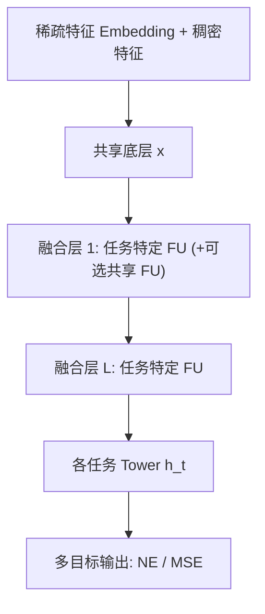
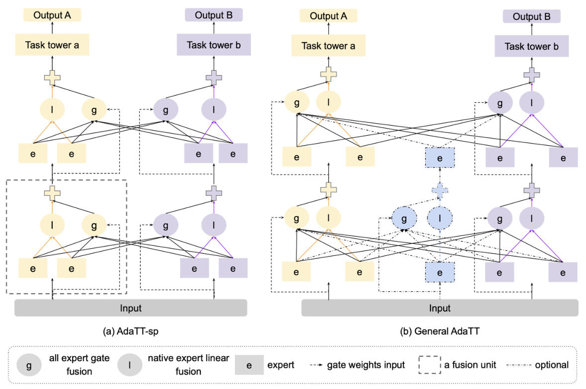

# AdaTT: Adaptive Task-to-Task Fusion Network for Multitask Learning in Recommendations (自适应任务对融合的多任务推荐网络)

- **会议/期刊**: KDD 2023 (Applied Data Science Track)
- **作者与机构**: Danwei Li, Zhengyu Zhang, Siyang Yuan, Mingze Gao, Weilin Zhang, Chaofei Yang, Xi Liu, Jiyan Yang (Meta AI / Meta Platforms)
- **推荐链路定位**: 精排 (多目标预估)
- **研究方向**: 多任务学习与列表级重排 / CTR 预估与特征交叉
- **论文原文**: [https://arxiv.org/abs/2304.04959v2](https://arxiv.org/abs/2304.04959v2)
- **开源代码**: [https://github.com/facebookresearch/AdaTT](https://github.com/facebookresearch/AdaTT)

## TL;DR (1分钟核心速览)

多任务精排的核心矛盾是「任务间相关性不均导致负迁移」与「共享/任务特有能力难以同时最优」。AdaTT 提出**多层任务对级融合单元**：每个任务用 softmax 门控直接吃下所有任务（含自身）的专家输出建模细粒度共享，同时用一条轻量线性通道融合自己的原生专家作为残差，保证任务特有能力不被稀释。在 Meta 短视频 70 亿训练样本 / 100 亿测试样本上，二分类任务 NE 相对 Shared-bottom 降低最高 0.863%，优于 PLE (0.691%)；UCI Census 三任务 AUC 全面领先 PLE/ML-MMoE。

## Background & Motivation (背景与核心矛盾)

- **主流范式**: 精排普遍采用硬共享（Shared-bottom）或软参数共享（Cross-stitch、MMoE、PLE）的 MoE 结构，用一个或一组门控在多任务间调度共享专家。
- **前人局限**: ① 静态结构（Shared-bottom、Cross-stitch）对所有样本使用固定融合权重，无法体现样本级任务相关性差异；② 以 MMoE/PLE 为代表的门控方案中，任务间关系只能通过「共享专家」这一中间媒介**间接**表达，且 PLE 把原生专家与共享专家塞进同一个门控做竞争，任务特有能力在深层容易被共享信号淹没。
- **核心洞察 (Key Insight)**: 任务 $t$ 真正需要的是「直接看其他任务专家」的显式通道，而任务自身专家的融合应当走独立通道——即**共享学习与任务特定学习应当分模块建模，再用残差相加**，而非在同一 softmax 中争夺权重。
- **本文切入点**: 在每一融合层为每个任务构建一个融合单元，内部并行「全专家门控融合 + 原生专家线性融合」，并以残差方式叠加，多层堆叠获得由浅入深的渐进式共享。

## Method (核心方法设计)

### 1. 整体框架 (Overall Architecture)

输入稀疏特征转稠密 Embedding 后拼接，先经共享底层得到统一表征 $x$（即$f_t^0(x)=x$）。随后堆叠$L$层融合网络：每层中任务$t$的融合单元（FU）先基于自身上一层输出生成$m_t$个原生专家，再把**全部任务**的专家矩阵$E^l$用输入相关的门控加权（共享学习），并把自身原生专家的线性组合作为残差加回（任务特定学习）。可选的共享融合单元挂在每层旁侧，仅在进入任务特定单元前提供额外专家，最后共享单元不做融合。第$L$层输出送入各任务专属 tower 得到$\hat{y}_t=h_t(f_t^L(x))$。训练时各任务损失等权求和联合优化 / 反向传播；推理时所有任务共享一次前向，新增开销主要来自门控矩阵乘法。

<figure class="paper-figure" markdown="span">
  <figcaption>图1：具有2个融合层的AdaTT-sp与general AdaTT。任务A和B的特定模块与共享模块通过颜色区分：黄色表示A，紫色表示B，蓝色表示共享。为便于说明，每个任务特定单元使用2个专家。在general AdaTT中，我们添加一个共享融合单元，并以单个专家为例。注意，general AdaTT中的共享模块并非必需，因此用虚线表示。当不存在共享模块时，general AdaTT回退到AdaTT-sp。</figcaption>
</figure>

### 2. 关键设计拆解 (Key Designs)

1. **任务对级门控融合 AllExpertGF（显式建模任务关系）**：针对 PLE「任务关系须经共享专家中转」的痛点，让任务 $t$的门控直接作用在所有任务专家的纵向拼接矩阵$E^l\in\mathbb{R}^{(\sum_t m_t)\times d_l}$上，门控仅以本任务上一步表征为条件：$G_t^l=g_t^l(f_t^{l-1}(x))=\mathrm{softmax}(W_t^l {f_t^{l-1}(x)}^{\top})$，输出$\mathrm{AllExpertGF}_t^l(E^l,G_t^l)={G_t^l}^{\top}E^l$。直觉：任一任务都能按样本自适应地"点名"别的任务专家，任务对交互不再被共享模块压缩成瓶颈。
2. **原生专家线性残差 NativeExpertLF（抗负迁移、抗过拟合）**：痛点是无约束 softmax 会让稀疏任务的原生能力被共享信号挤掉。本文为每任务保留一条独立通道 $\mathrm{NativeExpertLF}_t^l(E_t^l)={v_t^l}^{\top}E_t^l$，与门控项相加：$f_t^l(x)=({G_t^l}^{\top}+\mathrm{pad}({v_t^l}^{\top}))E^l$。门控实际只学习相对原生专家的**残差权重**，任务特定学习有兜底，任务冲突时可自动退化为近硬共享的独立通路。
3. **训练目标、负采样与推理效率**：总损失 $\mathcal{L}=\sum_{t}\lambda_t\mathcal{L}_t$，二分类用交叉熵、回归用 MSE，$\lambda_t$取等权（不做 GradNorm 类梯度手术，纯靠架构解决冲突）。推荐场景默认负样本来自真实曝光未点击的隐式反馈，无额外负采样算子；由于$v_t^l$可零填充进$G_t^l$ 后单次矩阵乘完成，门控参数量比专家小近两个数量级，线上相对于 tower/专家开销可忽略。

## Experimental Setup & Evaluation Protocol (实验设置与评估协议)

- **数据集与预处理**:

| 数据集 | #Users | #Items | #Interactions | 稀疏度/密度 | 特征/场景说明 |
| :--- | :---: | :---: | :---: | :---: | :--- |
| 工业短视频 (Meta) | 未公开 | 未公开 | 训练 ≈70B / 测试 ≈10B 样本 | 未公开 | 3 组任务：消耗+互动(低相关)、双消耗(高相关)、5 任务混合(含 1 回归 + 4 二分类，含 1 稀疏辅助任务) |
| UCI Census Income | 299,285 实例 | — | 199,523 训练 / 99,762 测试 | 40 特征 | 3 任务：收入>50K、未婚、学历≥College |

- **数据划分与防穿越 (Splitting Strategy)**: 工业集按时间顺序的样本流划分（10B/30B/70B 训练检查点 + 独立测试集）；UCI 为随机划分，测试集再等分作验证/测试，属**比例划分**（非严格时间切分）。
- **排名评测协议 (Ranking Protocol)**: 本文属精排层多目标预估，不涉及召回全库排序；采用 **Normalized Entropy (NE)**（越低越好，报告相对 Shared-bottom 的 NE diff）与回归任务 **MSE**，公开集用 **AUC**（100 次不同初始化取均值）。未报告显著性检验。
- **对比基线与超参设置**: Shared-bottom、MMoE、Multi-level MMoE、Cross-stitch、PLE（最强对手）。所有模型 3 层 ReLU 隐层；2 层融合的专家隐维为 256/128，tower 单隐层 64；门控统一单层 MLP+softmax，各模型总专家数受限以对齐算力。

## Key Experimental Results (实验关键数据)

### 1. 主实验对比 (Main Results)

工业短视频数据（Test NE diff / MSE diff，相对 Shared-bottom，负值越大越好）：

| 模型 | 组1 消耗 NE diff | 组1 互动 NE diff | 组3-消耗1 MSE diff | 组3-消耗2 NE diff | 组3-互动1 NE diff |
| :--- | :---: | :---: | :---: | :---: | :---: |
| MMoE | -0.481% | -0.532% | -0.770% | -0.632% | -1.182% |
| ML-MMoE | -0.463% | -0.494% | -0.697% | -0.608% | -1.013% |
| PLE | -0.448% | -0.691% | -0.697% | -0.599% | -1.221% |
| Cross-stitch | -0.140% | -0.225% | -0.520% | -0.454% | -0.818% |
| **AdaTT** | **-0.508%** | **-0.863%** | **-0.873%** | **-0.738%** | **-1.346%** |
| Improv. (vs 次优) | +5.6% | +24.9% | +13.4% | +16.8% | +10.2% |

公开集 UCI Census Income（AUC，2 层融合）：

| 模型 (专家数) | Task1 | Task2 | Task3 |
| :--- | :---: | :---: | :---: |
| ML-MMoE (6) | 0.8729 | 0.9178 | 0.9731 |
| PLE (6) | 0.8683 | 0.9164 | 0.9697 |
| **AdaTT (6)** | **0.8766** | **0.9202** | **0.9783** |
| ML-MMoE (9) | 0.8688 | 0.9139 | 0.9730 |
| PLE (9) | 0.8645 | 0.9134 | 0.9680 |
| **AdaTT (9)** | **0.8744** | **0.9174** | **0.9786** |

### 2. 消融实验 (Ablation Study)

| 配置 | 消耗1 MSE diff | 消耗2 NE diff | 消耗3 NE diff | 互动1 NE diff |
| :--- | :---: | :---: | :---: | :---: |
| AdaTT (完整) | - | - | - | - |
| w/o NativeExpertLF (仅 AllExpertGF) | +0.158% | +0.107% | +0.107% | +0.222% |
| 专家数 1→2 / 3 / 4 | -0.171 / -0.248 / -0.260% | -0.150 / -0.203 / -0.230% | -0.159 / -0.239 / -0.273% | -0.075 / -0.296 / -0.398% |
| 融合层 2→3 / 4 / 5 | -0.225 / -0.503 / -0.664% | -0.242 / -0.448 / -0.587% | -0.284 / -0.522 / -0.655% | -0.409 / -0.619 / -0.766% |

### 3. 关键实验发现 (Key Findings)

1. **任务越不相关，AdaTT 优势越大**：低相关的互动任务上 AdaTT 相对 PLE 再降 0.172 个点 NE（-0.863% vs -0.691%），而两个强相关消耗任务上各模型差距收窄到 0.04 个点（-0.487% vs -0.446%），印证残差原生通道主要是抗负迁移而非单纯堆容量；同时 ML-MMoE 反而劣于 MMoE，说明"多层 + 无任务特定分子"的对称结构会伤害学习。
2. **残差原生专家通道是刚需**：去掉 NativeExpertLF 后所有任务一致退化（NE +0.107% ~ +0.222%，MSE +0.158%），即使门控理论上可学出等价解，实际优化中仍需独立通道兜底任务特有能力。
3. **容量与深度单调有效但收益递减**：专家数 1→4 使互动任务 NE 从 -0.075% 提升到 -0.398%（稀疏任务受益最大），融合层 2→5 使互动任务增益从 -0.409% 增至 -0.766%，说明深层融合捕获更语义化的跨任务共享；权重可视化亦显示浅层按任务组分离、深层跨任务复用专家。

## Highlights & Limitations (亮点、对比与审稿批判)

- **与代表作对比 (vs. Prior Work)**: 相比 MMoE（仅共享专家 + 输入无关结构先验）与 PLE（原生/共享专家同一门控竞争、共享须经共享专家中转），AdaTT 用「全专家门控 + 原生专家残差」双通道把任务对交互显式化；相比 Cross-stitch 的固定线性混合，门控由输入条件化，样本级自适应。
- **可迁移亮点**: ①「pad 权重后单次矩阵乘」把残差通道的额外算力压到可忽略，适合大规模精排线上；② 门控权重矩阵可直接可视化做任务相关性诊断，便于人工裁剪任务组合。
- **审稿级局限批判**: ① 工业实验仅报告相对 NE 差值，未给出绝对 NE、方差或显著性检验，且数据集不公开，工业结论难以独立复现；② 门控规模随任务数 × 专家数线性增长，5 任务以上时门控与专家总量需靠超参上限约束，且论文未报告线上推理延迟与训练吞吐实测；③ 与 GradNorm/PCGrad 等优化层方法的组合效果未探索，架构增益的上界仍不清晰。

## Rating (四维评分)

- **方法创新性 (Novelty)**: ⭐⭐⭐⭐ （双通道残差融合把"任务对共享 vs 任务特定"解耦，思路干净但属 MoE 结构改良而非范式突破）
- **评估协议与实验扎实度 (Protocol & Experiments)**: ⭐⭐⭐⭐ （70B 工业样本 + 3 组任务关系 + 5 任务混合 + 公开集 100 次初始化均值，覆盖面广；缺显著性检验与绝对指标）
- **写作与数学规范度 (Clarity & Rigor)**: ⭐⭐⭐⭐⭐ （公式极简且与图 1 一一对应，把 PLE 差异点说得非常具体，复杂度讨论到位）
- **工业落地与复现价值 (Industrial & Practical Value)**: ⭐⭐⭐⭐⭐ （Meta 开源实现、门控开销可忽略、可插拔替换 PLE，工程迁移成本极低）

