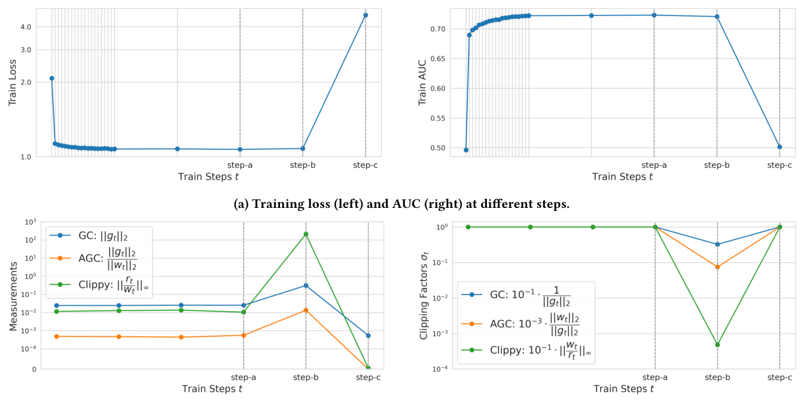
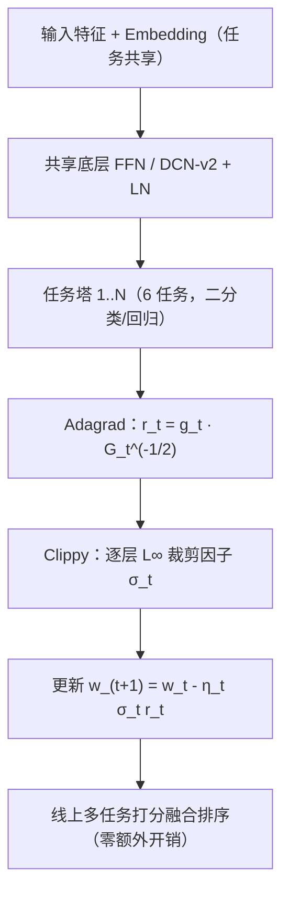

# Improving Training Stability for Multitask Ranking Models in Recommender Systems (面向推荐系统多任务排序模型的训练稳定性改进)

- **会议/期刊**: KDD 2023（ACM SIGKDD）
- **作者与机构**: Jiaxi Tang, Yoel Drori, Daryl Chang, Maheswaran Sathiamoorthy, Justin Gilmer, Li Wei, Xinyang Yi, Lichan Hong, Ed H. Chi（Google DeepMind / Google Research / Google Inc，YouTube 推荐团队）
- **推荐链路定位**: 精排（Ranking，多任务多目标排序模型训练侧）
- **研究方向**: 多任务学习与列表级重排 / 去偏公平、可信隐私与工业架构
- **论文原文**: [https://arxiv.org/abs/2302.09178v2](https://arxiv.org/abs/2302.09178v2)
- **开源代码**: [Clippy Adagrad 实现](https://github.com/tensorflow/recommenders/tree/main/tensorflow_recommenders/experimental/optimizers/clippy_adagrad.py)

## TL;DR (1分钟核心速览)

本文直面推荐系统精排模型“越做越大就越容易 loss 发散”这一被严重低估的工程痛点：在 YouTube 生产级序列训练、大 batch(65k)、Adagrad 的多任务排序模型上，论证发散根因是“损失曲率陡峭时有效步长过大”，并指出 GC/AGC 因使用 $L_2$梯度范数、在宽层中对少数坐标的剧烈变化不敏感而失效。作者提出 Clippy：对 Adagrad 更新量$\boldsymbol{r}_t$施加逐层$L_\infty$裁剪，裁剪因子由相对阈值$\lambda_{\text{rel}}|\boldsymbol{w}_t|$与绝对阈值$\lambda_{\text{abs}}$ 共同决定并显式除以学习率。在 YouTube 生产数据（按天序列训练 + 末日评估，AUC/RMSE）上，Clippy 让 Small/Large/Large+DCN 三种规模全部可稳定使用 2× 学习率，Large+DCN 上 AUC 72.37（GC 72.27、AGC 72.06），且推理零额外开销。

## Background & Motivation (背景与核心矛盾)

- **主流范式**: 工业精排普遍采用“共享底层 + 多任务塔”结构（图 2），依赖序列训练（时间窗内随机采批）与 Adagrad + 大 batch + 大学习率追求快速收敛；稳定性手段主要是 GC、AGC、LAMB、warmup 与 LayerNorm。
- **前人局限**: 其一，现有裁剪方法在层宽极大时用 $L_2$范数衡量梯度，少数坐标的爆炸易被大量正常坐标“平均稀释”，裁剪因子长期贴近 1，实际步长并未被约束；其二，GC 的阈值$\lambda$ 需逐层细调且随模型结构/学习率变化而失效，AGC 虽自适应但在复杂模型上方差极高（72.06±0.08）。
- **核心洞察 (Key Insight)**: 发散的本质可从二次模型理论刻画为 $2/\eta > \alpha^*$（$\alpha^*$ 为损失 Hessian 最大特征值）被破坏；推荐精排比召回更易踩雷，因为 (a) 输入特征与标签分布随序列训练持续漂移、曲率突变频繁，(b) 模型容量更大，(c) 多目标共享层会把单任务的虚假梯度放大成全模型不可逆异常。
- **本文切入点**: 不必精确估 Hessian，而用一阶更新的**逐坐标最坏值**（$L_\infty$）作为曲率代理，把“有效步长”直接约束在参数相对变化量上。

<figure class="paper-figure" markdown="span">
  <figcaption>图4：(a) 我们深入分析模型训练中的三个典型时刻：在 step-a 之前模型训练健康。随后在 step-b，模型损失升高且 AUC 下降。最后在 step-c，损失完全发散且 AUC 降至 0.5。(b) 检查模型顶层隐藏层的一些统计量时，我们发现 GC 和 AGC 未能提供足够小的裁剪因子。而 Clippy 的裁剪因子可比 GC 和 AGC 小两个数量级。补充材料 B 节给出了其他层的统计量。</figcaption>
</figure>

## Method (核心方法设计)

### 1. 整体框架 (Overall Architecture)

模型侧沿用标准多任务精排：数百至上千维稀疏特征经 Embedding 后进入共享底层（Small/Large 为 FFN 2×512 / 4×4096，Large+DCN 追加 DCN-v2 交叉层 + LayerNorm），再分发到 6 个任务塔（含二分类与回归）。训练侧是本文的真正创新：前向反向得到梯度 $\boldsymbol{g}_t$后，先按 Adagrad 累积器算更新量$\boldsymbol{r}_t=\boldsymbol{g}_t\boldsymbol{G}_t^{-1/2}$，再由 Clippy 逐层计算裁剪因子$\sigma_t$ 并对更新量整体缩放入参；推理解码完全不变，仅复用训练好的参数。

### 2. 关键设计拆解 (Key Designs)

1. **基于更新量的 $L_\infty$裁剪（Clippy 之核）**：痛点在于$L_2$范数对“宽层中少数坐标爆炸”不敏感，且 Adagrad 下梯度$\boldsymbol{g}_t$与实际参数位移$\boldsymbol{r}_t$差异巨大。Clippy 直接约束$\|\boldsymbol{r}_t/\boldsymbol{w}_t\|_\infty<\lambda$，其裁剪因子为

$$\sigma_t=\min\left\{1.0,\ \frac{\lambda_{\text{rel}}\|\boldsymbol{w}_t\|_\infty+\lambda_{\text{abs}}}{\eta_t\|\boldsymbol{r}_t\|_\infty}\right\},\qquad \boldsymbol{w}_{t+1}=\boldsymbol{w}_t-\eta_t\sigma_t\boldsymbol{r}_t$$

其中范数均为逐元素取 max 的 $L_\infty$。直觉：$L_\infty$ 抓的是最坏那一个坐标，宽层不会被“平均掉”；对更新量裁剪等价于直接限制“这一步参数相对改变了多少”，即便曲率只在个别方向陡峭也能压住。

2. **相对 + 绝对双阈值与学习率归一（自适应与收敛兼顾）**：单一阈值在训练初期 $\|\boldsymbol{w}\|\approx 0$时会过度裁剪（LAMB 正是因此初期收敛极慢，三档设置全部垫底）。$\lambda_{\text{rel}}\|\boldsymbol{w}_t\|_\infty+\lambda_{\text{abs}}$使 Clippy 在初期退化为 GC 风格、后期自动变成 AGC 风格；分母的$\eta_t$则在 warmup 阶段放宽阈值，避免拖慢起步。作者进一步把 GC/AGC/LAMB/Clippy 统一为$\boldsymbol{w}_{t+1}=\boldsymbol{w}_t-(\eta_t\sigma_t)\boldsymbol{r}_t$的不同$\sigma_t$ 选择，从而可解释三者的本质差异仅在“用什么量、什么范数、什么阈值”。

3. **训练目标、裁剪范围与推理效率**：总损失为 6 任务损失的加权和（原文未披露具体权重与负采样细节，精排为全库候选打分而非负采样对比）。训练使用 65k 大 batch + TPU + Adagrad；裁剪仅作用于**非 Embedding 参数**并逐层（local）执行，稀疏 Embedding 不做裁剪以免破坏长尾特征学习。推理阶段不增加任何算子，部署成本为零。

## Experimental Setup & Evaluation Protocol (实验设置与评估协议)

- **数据集与训练配置**（YouTube 生产数据，出于隐私未公开统计量）：

| 数据/配置项 | 取值 | 说明 |
| :--- | :--- | :--- |
| 数据来源 | YouTube 生产日志（未公开） | 数百–上千维稀疏特征，6 个任务标签 |
| 划分方式 | 序列（按天）训练 + 末日评估 | 前 $N-1$天按时间窗随机采批训练，第$N$ 天持续评估 |
| 指标 | AUC（二分类，越高越好）、RMSE（回归，越低越好） | 仅报告 2 个最具代表性任务 |
| Batch / 硬件 | 65k / TPU | 大 batch 使优化更受曲率主导 |
| 模型规模 | Small 7.5M（512×2）、Large 57M（4096×4）、Large+DCN 68M（DCN+LN→4096×4） | 用模型复杂度而非公开数据规模制造稳定性压力 |
| 重复性 | 每个设置 3 个随机种子，报告 mean±std | 学习率分别尝试 1× 与 2× |

- **数据划分与防穿越 (Splitting Strategy)**: 时间序列切分（sequential training），评估固定落在最后一天，严格避免未来数据泄露。
- **排名评测协议 (Ranking Protocol)**: 非采样排序无关，本文评估的是精排模型在线分布下的**离线打分质量**（AUC/RMSE）；稳定性通过“是否会发散 + 收敛后指标是否更高”间接度量。
- **对比基线与超参**: Naive（无处理）、GC（$\lambda\in\{10^{-1},10^{-2},10^{-3}\}$，逐层）、AGC（$\lambda\in\{10^{-2},10^{-3},10^{-4}\}$，官方实现）、LAMB（梯度裁剪通用式 + 学习率缩放$\mu\in\{10^{-1},10^{-2},10^{-3}\}$）；Clippy 固定$\lambda_{\text{rel}}=0.5,\lambda_{\text{abs}}=10^{-2}$（未精调即生效）。

## Key Experimental Results (实验关键数据)

### 1. 主实验对比 (Main Results)

| 模型设置 | 方法 | AUC (%) ↑ | RMSE ↓ | 可用最大学习率 |
| :--- | :--- | :---: | :---: | :---: |
| Small (7.5M) | Naive | diverged | diverged | — |
| | GC | 71.68±0.13 | 1.058±0.002 | 2× |
| | AGC | 71.73±0.00 | 1.059±0.003 | 1× |
| | LAMB | 71.56±0.01 | 1.063±0.001 | 1× |
| | **Clippy** | **71.79±0.00** | **1.056±0.000** | **2×** |
| Large (57M) | GC | 72.07±0.05 | 1.053±0.003 | 2× |
| | AGC | 72.09±0.02 | 1.054±0.002 | 1× |
| | LAMB | 72.01±0.09 | 1.054±0.002 | 1× |
| | **Clippy** | **72.16±0.02** | **1.051±0.000** | **2×** |
| Large+DCN (68M) | GC | 72.27±0.03 | 1.049±0.001 | 1× |
| | AGC | 72.06±0.08 | 1.051±0.001 | 2×（高方差） |
| | LAMB | 72.05±0.11 | 1.057±0.001 | 1× |
| | **Clippy** | **72.37±0.01** | **1.047±0.001** | **2×** |

（Large+DCN 上 Clippy 相对最强基线 GC：AUC +0.10 绝对点，Improv. 约 +0.14%；相对 AGC：+0.31 绝对点。原文强调在该场景 0.1% AUC 已属显著并可转化为线上指标收益。）

### 2. 消融实验 (Ablation Study)

原文未提供“逐组件移除”的数值消融网格，而是以训练动力学诊断 + 与各基线的等价/差异关系完成机制归因，下表为按组件拆解的对照（数值来自主实验与图 4/5/6/7）：

| 变体 / 对照 | 关键差异 | 观测结果 |
| :--- | :--- | :--- |
| GC（$L_2$ 梯度 + 固定阈值） | 范数类型、裁剪对象不同 | Large+DCN 退化到 1× 学习率；step-b 裁剪因子偏大 |
| AGC（$\|\boldsymbol{g}\|/\|\boldsymbol{w}\|$，$L_2$） | 阈值自适应但范数仍为$L_2$ | 2× 学习率发散；Large+DCN 方差极大（72.06±0.08） |
| LAMB（仅用更新方向） | 丢弃更新幅值 | 三档设置均垫底，初期收敛过慢 |
| Clippy 去掉 $L_\infty$（退化为$L_2$） | 灵敏度下降 | 图 4(b) 显示裁剪因子比 Clippy 大约 2 个数量级 |
| Clippy 去掉 $\lambda_{\text{abs}}$与$\eta_t$项 | 初期$\|\boldsymbol{w}\|\approx0$ 过度裁剪 | 对应 LAMB 式初期收敛停滞的失效模式 |
| Clippy on 翻译任务（图 7） | 跨域迁移（Adagrad + 非推荐任务） | 相对 AdamW/Adagrad 仍有稳定性收益 |

### 3. 关键实验发现 (Key Findings)

1. **唯一在三种规模下都能承受 2× 学习率的方法**：Clippy 在 Small/Large/Large+DCN 全部采用 2×，而 GC 在 Large+DCN 被迫退回 1×、AGC 在 2× 下直接发散，说明其约束力在大容量模型上未被稀释。
2. **增益随模型复杂度单调放大**：Small/Large 上 Clippy 与 GC 基本持平（71.79 vs 71.68、72.16 vs 72.07），但 Large+DCN 上拉开到 72.37 vs 72.27 并同时拿到最低 RMSE 1.047——正好对应生产中更复杂模型更易发散的现象。
3. **失效机制被定位到裁剪因子的量级**：在 step-b（损失刚开始抬升、AUC 初降）时刻，Clippy 的 $\sigma$ 比 GC/AGC 小两个数量级；图 6 还显示裁剪主要发生在底层共享层（参数范数小→阈值小），与“底层微小扰动会被放大到输出”的直觉一致。

## Highlights & Limitations (亮点、对比与审稿批判)

- **与代表作对比 (vs. Prior Work)**: 相对 Pascanu 的 GC，本文把范数从 $L_2$换成$L_\infty$并把裁剪对象从梯度换成 Adagrad 更新量；相对 Brock 的 AGC，引入绝对阈值与学习率归一，使早期呈 GC 行为、后期呈 AGC 行为，并真正消解阈值逐层调参；相对 LAMB，保留更新幅值而非只留方向，避免初期收敛迟缓。三者被纳入同一$\sigma_t$ 框架，理论谱系清晰。
- **可迁移亮点**: ①“先统一到 $\boldsymbol{w}_{t+1}=\boldsymbol{w}_t-(\eta_t\sigma_t)\boldsymbol{r}_t$，再设计$\sigma_t$”这种改写范式可让任意优化器（Adam/Adagrad）快速接入稳定化；②仅裁非 Embedding 参数 + 逐层裁剪 + 逐坐标$L_\infty$ 的组合，是稀疏特征场景下的低成本工程模板。
- **审稿级局限批判**: ①完全没有收敛性/稳定性的理论保证，也无与谱半径的定量联系，仍属强经验性工作；②评测无公开数据集、无统计显著性检验（仅 3 seed 的 std），且“稳定性”本身仍靠“是否发散+最终指标”间接度量，缺少可复现的稳定性度量指标；③$\lambda_{\text{rel}},\lambda_{\text{abs}}$ 虽称免调，但在新结构上仍可能敏感，超参分析缺失。

## Rating (四维评分)

- **方法创新性 (Novelty)**: ⭐⭐⭐⭐ （把裁剪对象/范数/阈值三件事统一重述并针对性改造，洞察扎实，但缺少理论收敛支撑）
- **评估协议与实验扎实度 (Protocol & Experiments)**: ⭐⭐⭐⭐ （时间切分防穿越、3 seed±std、三种规模×两档学习率较完整，可惜无公开数据与显著性检验）
- **写作与数学规范度 (Clarity & Rigor)**: ⭐⭐⭐⭐ （$\sigma_t$ 统一框架与失效机制推导清晰，公式与算法伪码对齐；组件消融数值化不足）
- **工业落地与复现价值 (Industrial & Practical Value)**: ⭐⭐⭐⭐⭐ （已在 YouTube 生产大型模型上线、推理零开销、官方开源 Clippy Adagrad，可即插即用）

