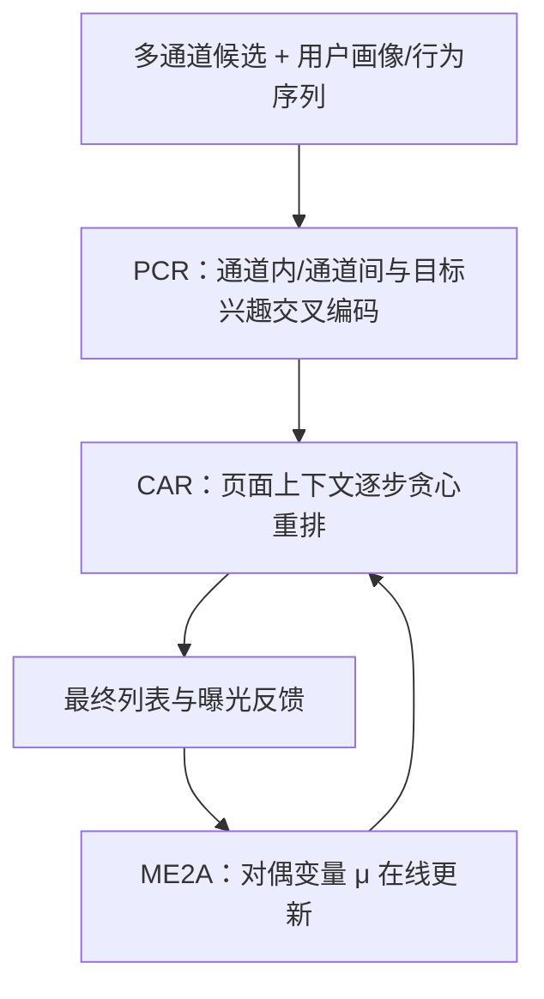
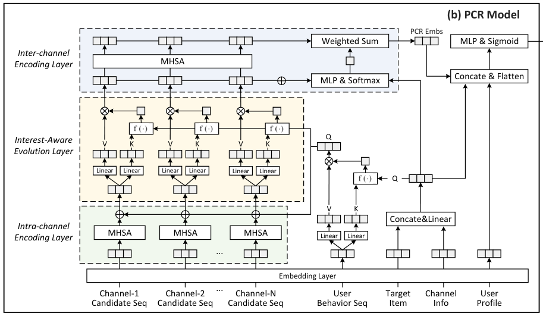

# Multi-channel Integrated Recommendation with Exposure Constraints（曝光约束下的多通道集成推荐）

- **会议/期刊**: KDD 2023
- **作者与机构**: Yue Xu、Qijie Shen、Jianwen Yin 等；阿里巴巴、菜鸟网络、香港理工大学
- **推荐链路定位**: 重排 / 在线多通道资源分配
- **研究方向**: 多任务学习与列表级重排 / 去偏公平、可信隐私与工业架构
- **论文原文**: [arXiv:2305.12319](https://arxiv.org/abs/2305.12319v1)
- **开源代码**: [MIREC](https://github.com/anonymousauthor7/MIREC)

## TL;DR (1分钟核心速览)

本文解决信息流混排多通道异构内容时，既要跨通道比较又要满足通道曝光上下界的难题。提出 MIREC：对偶层用 ME2A 在线分配曝光，排序层用 PCR+CAR 联合建模用户兴趣、跨通道相关与页面上下文。离线 AUC/NDCG 优于 8 个基线，淘宝 A/B 点击 +3.00%、GMV +1.56%。

## Background & Motivation (背景与核心矛盾)

- **主流范式**: 传统重排模型如 DLCM、PRM、PEAR 主要处理单通道同质列表；多通道模型如 STAR、DHANR 关注跨通道特征，但通常只优化单页排序。
- **前人局限**: 其一，实际系统要求某通道累计曝光落在上下界内，单页贪心无法保证全局资源约束；其二，异构内容特征与排序策略不同，直接跨通道比较易失真，且用户对通道的偏好与页面上下文强相关。
- **核心洞察 (Key Insight)**: 多通道曝光约束本质上是跨时间轴的在线线性规划；可用对偶变量表示“通道曝光价格”，把全局约束注入单页排序目标。
- **本文切入点**: 将问题分解为全局对偶分配层与局部上下文排序层，两层随请求到达交替迭代。

## Method (核心方法设计)

### 1. 整体框架 (Overall Architecture)

MIREC 把每个用户请求视为一次带资源的列表决策：各通道上游先给出候选，PCR 对候选做通道内自注意力、目标兴趣交叉注意力和通道间加权编码，输出逐物品质量分；CAR 在给定对偶价格下，结合已展示前缀与剩余候选上下文，逐槽贪心生成最终列表；曝光反馈再回传 ME2A 更新对偶变量。分配层负责长期曝光约束，排序层负责单页效用最大化，二者构成原始-对偶闭环。

<figure class="paper-figure" markdown="span">
  <figcaption>图2：MIREC框架概览。</figcaption>
</figure>
*图2：MIREC 的分配层与排序层协同框架。*

### 2. 关键设计拆解 (Key Designs)

1. **ME2A 在线曝光分配**：痛点是曝光上下界作用于整个时间轴，单请求最优不等于全局可行。将问题写为 $P_0:\max_{\boldsymbol{x}_t\in\mathcal{X}_t}\sum_t f(\boldsymbol{x}_t)$，约束为$\sum_t g_m(\boldsymbol{x}_t)\le G_m^{\max}$与$\sum_t g_m(\boldsymbol{x}_t)\ge G_m^{\min}$。对偶化为$\min_{\mu}\sum_t[f(\boldsymbol{x}_t)-\sum_m\mu_m g_m(\boldsymbol{x}_t)]+\sum_m([\mu_m]_+G_m^{\max}-[-\mu_m]_+G_m^{\min})$，排序层只需解$\tilde{\boldsymbol{x}}_t=\arg\max_{\boldsymbol{x}_t}[f(\boldsymbol{x}_t)-\boldsymbol{\mu}_t^\top g(\boldsymbol{x}_t)]$。对偶变量用镜像下降更新$\mu_{t+1}=[\mu_t-\eta\nabla\mu_t]_+$，上界越界时硬禁止该通道候选，下界为软约束；算法有闭式解、线性复杂度，并给出$O(\sqrt{T})$  regret。直觉是把曝光稀缺性变成通道“价格”，让排序自动为稀缺通道让路。

2. **PCR 个性化跨通道排序**：痛点有二，直接混用原始行为序列会引入噪声，且用户多兴趣易漂移。PCR 先用目标物品对行为做兴趣强化 $V_U=\sum_{i=1}^{B}w_i b_i$，其中$w_i=A(b_i,E_i)$为前馈网络激活权重；再以$V_U$与各通道候选做缩放点积注意力，得到通道内演化表示。随后计算通道重要性$W_{CH}=\mathrm{Softmax}(\mathrm{MLP}[H_{ms},E_i])$，加权融合多通道表示$V_L$，最终$Y_{PCR}=\sigma(\mathrm{MLP}[E_u,E_i,V_L])$。这样既过滤行为噪声，又显式区分“用户喜欢该物品”与“用户喜欢该通道”。

3. **CAR 上下文重排与训练推理**：CAR 在第 $k$槽用已选前缀均值$h_{pre}$与剩余候选均值$h_{can}$构造上下文，做嵌入交叉$H_{pt}=\mathrm{Concat}(h_{pre}\oplus e_i,h_{pre}\otimes e_i,h_{pre}\ominus e_i)$，并与 PCR 高层知识、逐物品分共同输入 MLP：$Y_{CAR}=\sigma(\mathrm{MLP}(H_{all}))$。每槽选最高分并更新上下文，重复$K$次。PCR 与 CAR 均用交叉熵$J=\sum_{e_t}[y\log\hat{y}+(1-y)\log(1-\hat{y})]$ 训练；原文未额外强调负采样，采用日志点击/曝光标签。在线只跑一次 PCR、多次轻量 CAR，系统峰值 120,000 QPS、常规响应约 20 ms。

## Experimental Setup & Evaluation Protocol (实验设置与评估协议)

- **数据集与预处理**: 使用公开 MicroVideo-1.7M 与淘宝工业日志；淘宝未给过滤细节，MicroVideo 为单通道数据，故不比较 STAR/DHANR。

| 数据集 | #Users | #Items | #Interactions | 稀疏度/密度 | 特征/场景说明 |
| :--- | :---: | :---: | :---: | :---: | :--- |
| MicroVideo-1.7M | 10,986 | 1,704,880 | 12,737,619 | 约 0.068% | 微视频，含行为与时间戳 |
| Taobao | 约 1 亿 | 约 6 千万 | 约 100 亿 | 约 1.7e-4% | 首页信息流，多通道异构内容 |

- **数据划分与防穿越 (Splitting Strategy)**: 原文未明确离线切分细节；线上 A/B 连续两周，曝光分配仿真使用一天超十亿真实请求。
- **排名评测协议 (Ranking Protocol)**: 离线用 AUC、Logloss、NDCG@20/30，属于日志样本排序评估；原文未说明采样负例比例，不能视为无偏 Full-Ranking 全库排序。
- **对比基线与超参设置**: 排序基线含 DIN、DIEN、DLCM、PRM、PEAR、STAR、DHANR；分配基线含 Fixed、$\beta$-WPO、HCA2E。学习率$10^{-4}$–$10^{-2}$，L2$10^{-4}$–$1$，Adam 优化；原文未报告显著性检验。

## Key Experimental Results (实验关键数据)

### 1. 主实验对比 (Main Results)

| 数据集 | 方法 | AUC | Logloss | NDCG@20 | NDCG@30 |
| :--- | :--- | ---: | ---: | ---: | ---: |
| MicroVideo | DIN | 0.6831 | 0.5922 | 0.5403 | 0.6535 |
| MicroVideo | DIEN | 0.6842 | 0.5909 | 0.5408 | 0.6537 |
| MicroVideo | DLCM | 0.6872 | 0.5898 | 0.5582 | 0.6698 |
| MicroVideo | PRM | 0.6979 | 0.5872 | 0.5591 | 0.6708 |
| MicroVideo | PEAR | 0.7021 | 0.5821 | 0.5632 | 0.6745 |
| MicroVideo | **MIREC** | **0.7084** | **0.5787** | **0.5667** | **0.6826** |
| Taobao | DIN | 0.7681 | 0.4982 | 0.5203 | 0.6481 |
| Taobao | DIEN | 0.7692 | 0.4971 | 0.5202 | 0.6479 |
| Taobao | DLCM | 0.7699 | 0.4965 | 0.5209 | 0.6482 |
| Taobao | PRM | 0.7722 | 0.4941 | 0.5211 | 0.6489 |
| Taobao | PEAR | 0.7748 | 0.4919 | 0.5232 | 0.6511 |
| Taobao | STAR | 0.7738 | 0.4931 | 0.5219 | 0.6492 |
| Taobao | DHANR | 0.7753 | 0.4923 | 0.5243 | 0.6513 |
| Taobao | **MIREC** | **0.7791** | **0.4899** | **0.5275** | **0.6545** |

相对最佳基线，MicroVideo AUC 提升约 0.90%、NDCG@30 提升约 1.20%；Taobao AUC 与 NDCG@30 均约提升 0.49%。

### 2. 消融实验 (Ablation Study)

| 变体 | AUC | Logloss | NDCG@20 | NDCG@30 |
| :--- | ---: | ---: | ---: | ---: |
| PCR$^{*}$（行为自注意力替换） | 0.7758 | 0.4933 | 0.5222 | 0.6511 |
| PCR$^{†}$（去掉缩放点积交互） | 0.7761 | 0.4932 | 0.5246 | 0.6513 |
| PCR w/o IntraCE | 0.7763 | 0.4928 | 0.5247 | 0.6516 |
| PCR w/o InterCE | 0.7756 | 0.4935 | 0.5239 | 0.6509 |
| PCR | 0.7778 | 0.4913 | 0.5262 | 0.6531 |
| **PCR+CAR（完整）** | **0.7791** | **0.4899** | **0.5275** | **0.6545** |

### 3. 关键实验发现 (Key Findings)

1. **跨通道与上下文模块均有增量**：完整 PCR+CAR 的 AUC 为 0.7791，较单 PCR 的 0.7778 提升 0.0013；去掉 InterCE 后降至 0.7756，去掉目标兴趣交互的 PCR$^{†}$ 为 0.7761，说明通道间重要性与目标感知兴趣过滤是主要增益源。
2. **全局分配优于启发式合流**：在淘宝仿真中，Setting-1 的 CTR 达 6.56%，较 HCA2E 的 6.34% 高约 3.5%，较 Fixed 表内提升 18.41%；Setting-2 为 6.76% 对 6.53%，说明对偶价格注入排序能同时守住曝光并提升点击。
3. **线上收益稳定且曝光更可控**：两周 A/B 相对原基线 CLICK +3.00%、CTR +1.75%、GMV +1.56%、Stay Time +1.42%；图4 还显示曝光比例波动更小、低质物品更倾向后置，带来各位置 CTR 的同步改善。

## Highlights & Limitations (亮点、对比与审稿批判)

- **与代表作对比 (vs. Prior Work)**: DLCM/PRM/PEAR 只做单通道同质列表重排；STAR/DHANR 做多通道建模但缺跨时间轴曝光约束；HCA2E 偏广告二值内容与位置启发式。MIREC 的本质区别是把“曝光分配”和“异构列表重排”放进同一个原始-对偶框架。
- **可迁移亮点**: 把业务约束转成对偶价格并注入排序分 $f-\mu^\top g$，可直接迁移到广告配额、冷启动扶持、内容多样性控制；PCR 的目标感知兴趣强化与通道重要性加权也适合多业务混排。
- **审稿级局限批判**: 其一，曝光分配离线验证仅用淘宝私有数据，缺少公开多通道基准，且请求 i.i.d. 假设与真实分布漂移存在差距；其二，下界为软约束，可能欠曝光，对偶步长与约束阈值敏感，CAR 多槽贪心在超大候选集上的时延与最优性仍需更充分分析。

## Rating (四维评分)

- **方法创新性 (Novelty)**: ⭐⭐⭐⭐ （将多通道重排与长期曝光约束统一为在线原始-对偶问题，并给出 $O(\sqrt{T})$  regret，问题建模新颖。）
- **评估协议与实验扎实度 (Protocol & Experiments)**: ⭐⭐⭐⭐ （有公开数据、工业数据和两周线上 A/B，主实验与消融较完整；但离线切分与负采样细节不足。）
- **写作与数学规范度 (Clarity & Rigor)**: ⭐⭐⭐⭐ （对偶推导、算法流程与约束可行性说明清晰；部分系统细节与超参敏感度分析偏简。）
- **工业落地与复现价值 (Industrial & Practical Value)**: ⭐⭐⭐⭐ （已在淘宝首页主流量落地，120k QPS、20 ms 级响应，开源代码可用，工程参考价值高。）

