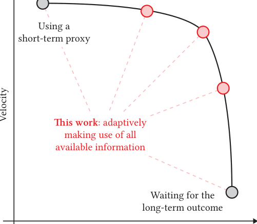
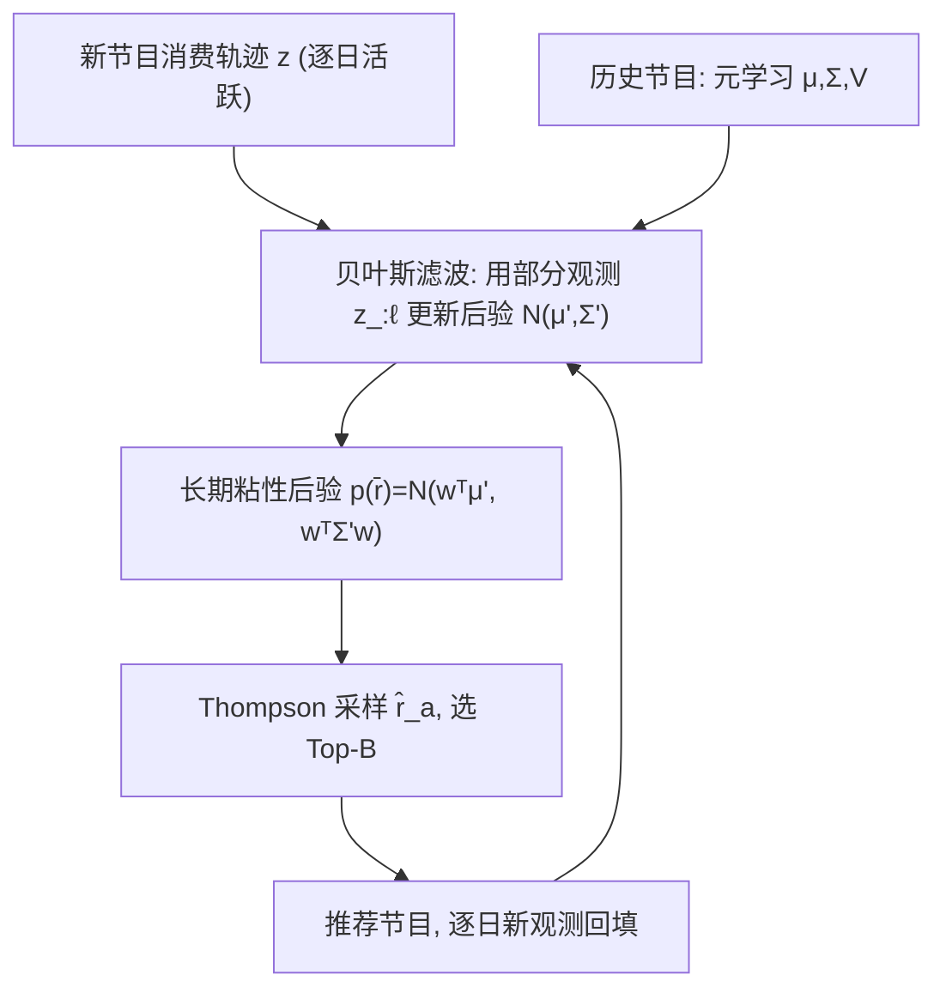

# Impatient Bandits: Optimizing Recommendations for the Long-Term Without Delay（无延迟优化长期：渐进反馈下的"急躁"老虎机）

- **会议/期刊**: KDD '23 (29th ACM SIGKDD)
- **作者与机构**: Thomas M. McDonald (Univ. of Manchester / Spotify)、Lucas Maystre (Spotify)、Mounia Lalmas (Spotify)、Daniel Russo (Columbia & Spotify)、Kamil Ciosek (Spotify)
- **推荐链路定位**: 召回/内容探索（冷启动候选筛选）
- **研究方向**: 强化学习与动态探索推荐 / 冷启动与长尾推荐
- **论文原文**: [https://arxiv.org/abs/2307.09943v2](https://arxiv.org/abs/2307.09943v2)
- **开源代码**: [https://github.com/spotify-research/impatient-bandits](https://github.com/spotify-research/impatient-bandits)（含合成数据集）

## TL;DR (1分钟核心速览)

针对"长期满意度优化中奖励延迟数周"的核心痛点：等完整奖励太慢，用短期代理又失真。本文把内容冷启动形式化为**渐进反馈**下的多臂老虎机，用贝叶斯滤波将逐日揭示、且**非 i.i.d.** 的中间观测融合进长期奖励后验，并以元学习从历史节目学出先验/噪声协方差，再嵌入 Thompson 采样得到 *Impatient Bandit*。在 Spotify 播客 60 天粘性任务（180 轮累积遗憾协议）上，该方法无需等待完整奖励即可逼近 Oracle，显著优于延迟反馈与"次日活跃"代理基线。

## Background & Motivation (背景与核心矛盾)

- **主流范式**: 在线平台日益以 60 天长期粘性（返访天数）等长周期指标定义成功，但生产中多依赖即时可得的短期代理（CTR、次日留存、转化率）。
- **前人局限**: ① 仅用完整延迟奖励（$\Delta=60$ 天）会让前 60 轮几乎"盲选"，学习速率极慢；② 短期代理与长期目标错配，易过早收敛到一小撮次优内容（熵骤降）。
- **核心洞察 (Key Insight)**: 长期结果**随时间越来越可预测**——逐日活跃指标彼此强相关、并非独立，这种相关结构可跨节目用历史数据学出来，从而"提前"推断最终粘性。
- **本文切入点**: 把渐进累积的中间观测视作免费、被动获得的信息，用贝叶斯滤波+元学习先验+Thompson 采样，在不等完整奖励的前提下逼近长期最优。

<figure class="paper-figure" markdown="span">
  <figcaption>图1：短期代理指标可实现快速反馈循环，但可能与需要更长时间才能实现的长期成功指标对齐不佳。我们的方法通过自适应利用给定时刻的所有可用信息来找到最优权衡。</figcaption>
</figure>

## Method (核心方法设计)

### 1. 整体框架 (Overall Architecture)

模型输入为每个新节目被推荐后逐日揭示的 59 维二值活跃轨迹 $\boldsymbol{z}$。核心是一个高斯贝叶斯滤波：对每个已选节目，将当前可得的部分轨迹（前$\ell$天）折叠进后验，得到长期粘性后验$p(\bar{r}_a)$；协方差参数由历史节目集合的元学习得到。随后用 Thompson 采样从各臂后验采样得分、选 Top-$B$ 推荐，新到的逐日观测再回填滤波，形成"推荐—观测—更新"闭环，全程不等待 60 天完整奖励。

### 2. 关键设计拆解 (Key Designs)

1. **渐进贝叶斯奖励模型（部分观测的自共轭更新）**：痛点——延迟反馈下无法用完整观测估计均值奖励。假设 $\bar{\boldsymbol{z}}\sim\mathcal{N}(\boldsymbol{\mu},\boldsymbol{\Sigma})$、$\boldsymbol{z}_m=\bar{\boldsymbol{z}}+\boldsymbol{\varepsilon}_m,\ \boldsymbol{\varepsilon}_m\sim\mathcal{N}(0,\boldsymbol{V})$，对仅观测前$\ell$天的轨迹用高斯自共轭更新：$\boldsymbol{\mu}'=\boldsymbol{\mu}+\boldsymbol{\Sigma}_{:K,:\ell}(\boldsymbol{\Sigma}_{:\ell,:\ell}+\boldsymbol{V}_{:\ell,:\ell})^{-1}(\boldsymbol{z}_{:\ell}-\boldsymbol{\mu}_{:\ell})$，再由$r=\boldsymbol{w}^\top\boldsymbol{z}$得$\bar{r}\,|\,\mathcal{D}\sim\mathcal{N}(\boldsymbol{w}^\top\boldsymbol{\mu}',\ \boldsymbol{w}^\top\boldsymbol{\Sigma}'\boldsymbol{w})$。直觉：$\boldsymbol{\Sigma},\boldsymbol{V}$ 编码了"不同天之间的相关性"，早期观测因此能外推后期活动。

2. **元学习先验与噪声协方差**：痛点——新节目零数据，$\{\boldsymbol{\mu},\boldsymbol{\Sigma},\boldsymbol{V}\}$无从设定。用历史节目集合$\mathcal{A}'$的经验均值轨迹$\hat{\boldsymbol{z}}_a$与噪声协方差$\hat{\boldsymbol{V}}_a$聚合出全局参数。跨节目共享的协方差结构让新节目在开头数天即获得有意义后验：原文显示**仅 8 天解释 50% 的$\bar{r}$ 方差、一个月达 95%**。

3. **Impatient Bandit 与推理效率**：痛点——标准 Thompson 采样只吃完整奖励。每轮对每臂从 $p(\bar{r}_a)=\mathcal{N}(\boldsymbol{w}^\top\boldsymbol{\mu}_a',\boldsymbol{w}^\top\boldsymbol{\Sigma}_a'\boldsymbol{w})$采样$\hat{r}_a$、取 Top-$B$；目标为最小化累积期望遗憾$\mathbb{E}[R_T]=\mathbb{E}[\sum_t(\bar{r}^\star-B^{-1}\sum_i\bar{r}_{t,i})]$。无显式训练损失（贝叶斯推断替代梯度学习），推理仅对"有新观测的臂"做批量+增量更新，开销可控。

## Experimental Setup & Evaluation Protocol (实验设置与评估协议)

- **数据集与预处理**: Spotify 播客消费轨迹（2021.09–2022.05），59 维二值日活向量，轨迹稀疏（中位粘性 3.4/59 ≈ 5.8% 非零）。

| 数据集 | #Shows | #Traces | 活跃日总数 | 稀疏度/场景说明 |
| :--- | :---: | :---: | :---: | :--- |
| Train（2021.09–12） | 200 | ~4.4M | ~13M | 新节目冷启动消费轨迹 |
| Eval（2022.01–03） | 200 | ~4.4M | ~13M | 与训练**互斥**的独立节目集 |

  （总计 8.77M 轨迹、26M 累计活跃日；每节目轨迹数 2.4K–295K，中位 5.8K。）
- **数据划分与防穿越 (Splitting Strategy)**: **全局时间切分 + 互斥节目集**（时间外推冷启动），先验仅用训练期节目计算，后在未见评测节目上运行。
- **排名评测协议 (Ranking Protocol)**: 非排序任务，采用**累积遗憾协议**——180 轮（≈6 个月）、每轮 $B\in\{10,50,200\}$次推荐、$N\in\{200,50\}$（另含$N{=}60$ 动态换库），10 次重复给置信区间；所有基线共用 Thompson 采样以隔离"反馈使用方式"差异。
- **对比基线与超参**: Delayed（仅完整 60 天奖励）、Day-two proxy（仅次日活跃）、Oracle（即时全轨迹，性能上界）；嵌入维度即轨迹长度 59，不做个性化。

## Key Experimental Results (实验关键数据)

### 1. 主实验对比 (Main Results)

> 原文以图（图 3–7）报告，此处按曲线趋势与技术报告数字汇总，遗憾单位为曲线读出方向。

| 方法 | 反馈使用方式 | 平均每步遗憾 | 探索熵 | 与 Oracle 差距 |
| :--- | :--- | :---: | :---: | :---: |
| Oracle（上界） | 即时全 60 天轨迹 | 最低 | 快速收敛 | — |
| **Impatient / Progressive（本文）** | **渐进全部观测** | **接近 Oracle** | **早期探索更广** | **小** |
| Day-two proxy | 仅第 2 天活跃 | 初期≈本文，后期**平台化** | 迅速趋零（次优收敛） | 中 |
| Delayed | 仅完整奖励（延迟 60 天） | 前 60 轮极差 | — | 大 |

奖励模型精度（图 3–4，技术报告数字）：观测 **10 天**即可将粘性预测误差降至可用水平；噪声协方差 $\boldsymbol{V}$在 ~10 天解释 >50% 的偶然不确定性；先验协方差$\boldsymbol{\Sigma}$在 **8 天解释 50%**、一个月 **95%** 的$\bar{r}$ 方差。

### 2. 消融实验 (Ablation Study)

| 变体 | 关键结论 |
| :--- | :--- |
| 完整渐进（本文） | 遗憾持续下降、逼近 Oracle |
| w/o 时间相关性（协方差设对角） | 信息增益显著下降，解释方差曲线与经验曲线拉大 |
| 仅完整奖励 (Delayed) | 前 $\Delta=60$ 轮近乎盲选，遗憾高企 |
| 次日代理 (Day-two) | 初始可，但代理错配致遗憾平台化 |

### 3. 关键实验发现 (Key Findings)

1. **渐进≠慢热**：仅 8–10 天观测即可解释 50% 的长期粘性方差、一个月达 95%，说明"外推"机制使学习几乎无延迟损失，Progressive 全程接近 Oracle。
2. **短期代理会"锁死"**：Day-two proxy 的熵迅速趋零、遗憾平台化，定量印证了短期信号错配会在早期把探索收敛到次优节目子集——这恰是渐进方法的反面。
3. **动态库仍鲁棒**：在 60 个节目不断换入换出的持续冷启动场景（图 7），Progressive 仍显著优于 Delayed 与 Day-two proxy，说明协方差先验可反复复用于新进入内容。

## Highlights & Limitations (亮点、对比与审稿批判)

- **与代表作对比 (vs. Prior Work)**: 相较 Maystre et al.（同时建模 clickiness 与 stickiness，但假设数据充足、不解决冷启动探索），本文专攻内容探索；相较 Grover et al. 的中间反馈 UCB（假设中间反馈 i.i.d. 且做 top-$k$ 识别），本文的渐进反馈**非 i.i.d.** 并显式建模时间相关协方差，做累积遗憾最小化。
- **可迁移亮点**: ①"部分观测折叠进后验"的滤波思路可直接移植到任何有中间信号的长周期目标（留存、LTV、复访）；②跨实体聚合协方差（元学习）是冷启动场景低成本获取先验的通用招式。
- **审稿级局限批判**: ① **非个性化**，个性化仅作为附录中的情境化贝叶斯滤波草稿，未实证；② 高斯模型对二值轨迹仅为 CLT 近似，缺乏渐进反馈相对延迟反馈遗憾界的理论刻画；③ 真实数据因隐私未公开，复现仅靠合成数据，且维数 59 的协方差矩阵随轨迹长度增长为 $O(K^2)$，部署内存需留意。

## Rating (四维评分)

- **方法创新性 (Novelty)**: ⭐⭐⭐⭐ （渐进反馈+贝叶斯滤波+元学习先验的组合新颖，非 i.i.d. 中间反馈是关键区别点）
- **评估协议与实验扎实度 (Protocol & Experiments)**: ⭐⭐⭐⭐ （真实平台数据、互斥节目集、10 次重复置信区间与动态库场景，但缺点估计表与显著性检验）
- **写作与数学规范度 (Clarity & Rigor)**: ⭐⭐⭐⭐ （生成模型与自共轭更新推导清晰，高斯近似合理性有 CLT 论证，理论遗憾界留白）
- **工业落地与复现价值 (Industrial & Practical Value)**: ⭐⭐⭐⭐ （Spotify 生产动机 + 开源参考实现 + 低延迟增量更新，惟个性化与隐私数据限制落地验证）

