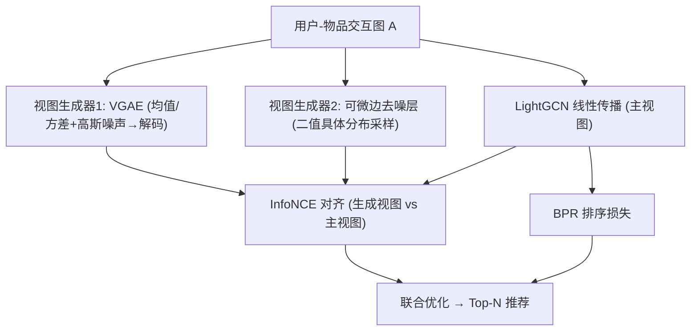
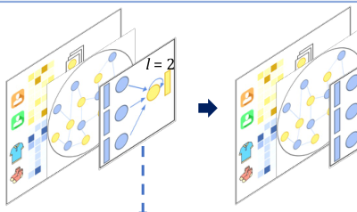
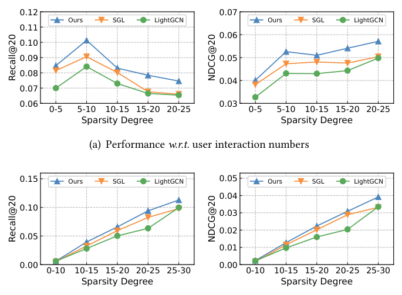

# Adaptive Graph Contrastive Learning for Recommendation (自适应图对比学习推荐)

- **会议/期刊**: KDD 2023
- **作者与机构**: Yangqin Jiang, Chao Huang (通讯), Lianghao Xia — 香港大学 (HKUDS)
- **推荐链路定位**: 召回 (图协同过滤表征学习)
- **研究方向**: 自监督对比学习与交互去噪 / 图神经网络推荐
- **论文原文**: [https://arxiv.org/abs/2305.10837v3](https://arxiv.org/abs/2305.10837v3)
- **开源代码**: [https://github.com/HKUDS/AdaGCL](https://github.com/HKUDS/AdaGCL)

## TL;DR (1分钟核心速览)

SGL/HCCF 一类图对比推荐依赖"随机边丢弃 / 节点丢弃"这类预制增广算子，需要反复试错，且随机扰动既可能保留噪声边、也可能误删关键监督信号，同时两个同分布视图容易导致模型坍缩 (model collapse)。AdaGCL 用**两个可训练视图生成器**——变分图自编码器 (VGAE) 负责"重构式生成视图"、带二值具体分布采样的去噪网络负责"拓扑过滤视图"——替代手工增广，并以任务感知 BPR 信号驱动生成器。在 Last.FM/Yelp/BeerAdvocate 三数据集、7:2:1 划分 + Full-Ranking 协议下，Recall@20 相比最强自监督基线 SGL/NCL/SHT 相对提升约 5.2%–8.3%，NDCG@20 提升约 3.5%–7.8%（$p<10^{-4}$ 级别显著）。

## Background & Motivation (背景与核心矛盾)

- **主流范式**: 以 LightGCN 为代表的线性图卷积在用户-物品二部图上做多层邻域聚合，并叠加 BPR 排序损失；SGL/SLRec/HCCF/NCL 再引入对比学习，通过随机 dropout 或超图构造辅助视图增强表征。
- **前人局限**: 其一，增广方式靠人工试错，且属于"与数据分布无关"的随机置换——既无法针对性删除伪交互边，也可能丢弃稀有但关键的训练信号；其二，两个对比视图常由**同一算子**生成，分布高度重叠，正样本对判别性不足，引发模型坍缩。
- **核心洞察 (Key Insight)**: 若把视图生成器本身参数化并使其**对齐主任务**，视图就能从"数据分布 (生成)"与"拓扑去噪 (判别)"两个正交方向自适应地逼近真实兴趣子图，从而同时缓解噪声与稀疏。
- **本文切入点**: 用 VGAE + 可微边去噪层构成双自适应视图，并以 BPR 反向监督生成器，实现"增广即学习"。

## Method (核心方法设计)

### 1. 整体框架 (Overall Architecture)

输入用户-物品交互矩阵 $\mathbf{A}$，主干为 LightGCN 式线性传播：$\mathbf{e}_{i,l}^{(u)}=\mathbf{z}_{i,l}^{(u)}+\mathbf{e}_{i,l-1}^{(u)}$，最终表征为各层求和$\mathbf{e}_i^{(u)}=\sum_{l=0}^{L}\mathbf{e}_{i,l}^{(u)}$，打分$\hat{y}_{i,j}=\mathbf{e}_i^{(u)\top}\mathbf{e}_j^{(v)}$。在此之上并行两个可训练视图生成器：VGAE 从图分布中采样出"生成视图"，去噪网络逐层输出边掩码得到"去噪视图"；三路表征（主视图 + 两对比视图）做 InfoNCE 对齐，形成上层多任务损失。训练为**双层交替**：下层按生成/去噪目标更新视图生成器，上层按 BPR + 对比损失更新主干，推理阶段仅保留主干，无额外开销。

<figure class="paper-figure" markdown="span">
  <figcaption>图 1：所提出的 AdaGCL 模型的整体框架。</figcaption>
</figure>

### 2. 关键设计拆解 (Key Designs)

1. **VGAE 生成式视图 (生成器一)**：针对随机 dropout 视图分布单一的问题，用 GCN 编码后经两个 MLP 输出均值与标准差，注入高斯噪声后由 MLP 解码重建交互图，损失 $\mathcal{L}_{gen}=\mathcal{L}_{kl}+\mathcal{L}_{dis}+\mathcal{L}_{gen}^{bpr}+\lambda_2\|\Theta\|_F^2$。KL 项带来的不确定性使生成图具备多样性，从而提供"更难"的对比正样本，避免两视图坍缩为同一点。
2. **可微图去噪视图 (生成器二)**：直接在图上做硬删边是 $l_0$组合优化不可导，作者将边保留指示$m^l_{i,j}\sim \mathrm{Bern}(\pi^l_{i,j})$松弛为二值具体分布，边打分由 MLP 给出$\alpha^l_{i,j}=f_{\theta^l}(\mathbf{e}^l_i,\mathbf{e}^l_j)$，并以期望非零边数作为正则：
$$\mathcal{L}_{c}=\sum_{l=1}^{L}\sum_{(u_i,v_j)\in\mathcal{E}}\left(1-P_{\sigma(s^l_{i,j})}(0\mid\theta^l)\right),\quad \mathcal{L}_{den}=\mathcal{L}_{c}+\mathcal{L}_{den}^{bpr}+\lambda_2\|\Theta\|_F^2$$
物理直觉：让"该边是否属于真实兴趣"成为一个可学习的软门控，逐层过滤多跳传播中累积的噪声，等价于学到一个任务驱动的稀疏子图。
3. **训练目标与效率**：上层联合损失 $\mathcal{L}_{upper}=\mathcal{L}_{bpr}+\lambda_1\mathcal{L}_{ssl}+\lambda_2\|\Theta\|_F^2$，其中$\mathcal{L}_{ssl}$为节点自判别 InfoNCE（同节点两视图为正、异节点为负，温度$\tau$），**无需显式负采样**（批内全负）。复杂度为主干$O(L|\mathcal{A}|d)$、VGAE$O(|\mathcal{A}|d^2)$、去噪层$O(L|\mathcal{A}|d^2)$、对比$O(LB(I+J)d)$；推理时丢弃两个生成器，与 LightGCN 同阶。

## Experimental Setup & Evaluation Protocol (实验设置与评估协议)

- **数据集与预处理**:

| 数据集 | #Users | #Items | #Interactions | 密度 | 场景说明 |
| :--- | :---: | :---: | :---: | :---: | :--- |
| Last.FM | 1,892 | 17,632 | 92,834 | 2.8e-3 | 音乐社交/标签 |
| Yelp | 42,712 | 26,822 | 182,357 | 1.6e-4 | 本地商户点评（最稀疏） |
| BeerAdvocate | 10,456 | 13,845 | 1,381,094 | 9.5e-3 | 啤酒评论，`10-core` 过滤 |

- **数据划分与防穿越**: 按 **7:2:1 比例划分** 训练/验证/测试，沿用 LightGCN、SGL 的随机划分设定（非全局时间戳切分）。
- **排名评测协议**: 采用无偏 **Full-Ranking（全库未交互物品与测试正样本一同排序）**，指标 Recall@{20,40} 与 NDCG@{20,40}。
- **对比基线与超参**: 覆盖 MF 类 (BiasMF/NCF/AutoR)、图 CF 类 (NGCF/PinSage/STGCN/GCMC/GCCF/LightGCN)、自监督类 (SGL/SLRec/NCL/HCCF/SHT/DirectAU) 共 15 个基线；嵌入维度 $d$沿用 LightGCN 设置，$\lambda_1$在$\{1,10^{-1},\dots,10^{-4}\}$中搜索（最优为$10^{-1}$或$1$），并对最优基线做 5 次重训的配对 t 检验（$p$ 值均报于表 2）。

## Key Experimental Results (实验关键数据)

### 1. 主实验对比 (Main Results)

| 数据集 | 指标 | NGCF | LightGCN | SGL | NCL | HCCF | SHT | DirectAU | **AdaGCL** | Improv. |
| :--- | :--- | :---: | :---: | :---: | :---: | :---: | :---: | :---: | :---: | :---: |
| Last.FM | R@20 | 0.2081 | 0.2349 | 0.2427 | 0.2353 | 0.2410 | 0.2420 | 0.2422 | **0.2603** | +7.25% |
| Last.FM | N@20 | 0.1474 | 0.1704 | 0.1761 | 0.1715 | 0.1773 | 0.1770 | 0.1727 | **0.1911** | +7.78% |
| Yelp | R@20 | 0.0681 | 0.0761 | 0.0803 | 0.0806 | 0.0789 | 0.0794 | 0.0818 | **0.0873** | +6.72% |
| Yelp | N@20 | 0.0336 | 0.0373 | 0.0398 | 0.0402 | 0.0391 | 0.0395 | 0.0424 | **0.0439** | +3.54% |
| BeerAdv. | R@20 | 0.1033 | 0.1102 | 0.1138 | 0.1131 | 0.1156 | 0.1150 | 0.1182 | **0.1216** | +2.88% |
| BeerAdv. | N@20 | 0.0873 | 0.0943 | 0.0959 | 0.0971 | 0.0990 | 0.0977 | 0.0981 | **0.1015** | +2.53% |

（Improv. 以该数据集上最强基线为参照；$p$值区间$1.5\times10^{-6}$–$1.3\times10^{-2}$，BeerAdvocate 的 NDCG@40 未达显著。）

### 2. 消融实验 (Ablation Study)

| 变体 | Last.FM R@20 | Last.FM N@20 | Yelp R@20 | Yelp N@20 | Beer R@20 | Beer N@20 |
| :--- | :---: | :---: | :---: | :---: | :---: | :---: |
| w/o Task（去任务感知 BPR） | 0.2562 | 0.1868 | 0.0849 | 0.0425 | 0.1212 | 0.1010 |
| Gen+Gen（去噪器换为第二个 VGAE） | 0.2494 | 0.1819 | 0.0853 | 0.0429 | 0.1187 | 0.0992 |
| Random EdgeD（随机边丢弃视图） | 0.2476 | 0.1794 | 0.0852 | 0.0424 | 0.1163 | 0.0964 |
| **AdaGCL** | **0.2603** | **0.1911** | **0.0873** | **0.0439** | **0.1216** | **0.1015** |

### 3. 关键实验发现 (Key Findings)

1. **去噪视图贡献最大且不可替代**：把去噪器替换为第二个 VGAE 后，Last.FM Recall@20 从 0.2603 掉到 0.2494（−4.2%），比随机边丢弃（0.2476）仅略好，说明"自适应生成"本身只能提供多样性，**真正压制噪声的是显式拓扑过滤分支**；Yelp 上 Gen+Gen 的 NDCG 甚至略高于 AdaGCL，暗示极稀疏场景下生成式增广的边际收益更大。
2. **任务感知监督是必要粘合剂**：去掉 BPR 后三数据集全面退化（Last.FM R@20 −1.6%、Yelp −2.7%），表明仅用重构/KL 目标训练视图生成器会与推荐目标错位，视图"看起来合理"但判别性不足。
3. **噪声与稀疏鲁棒性双优**：将 5%–25% 真实边替换为伪边后，AdaGCL 的相对性能衰减始终小于 SGL 与 LightGCN，且在 Yelp（最稀疏）上衰减最剧烈，印证噪声危害与稀疏度正相关；在 Yelp 用户/物品交互数分桶实验中，0–5 交互的最稀疏物品组上 AdaGCL 仍保持领先，且物品侧稀疏度的影响显著大于用户侧。

<figure class="paper-figure" markdown="span">
  <figcaption>图 4：在 Yelp 数据集上，用户和物品的交互数据在不同稀疏程度下的性能。我们根据用户和物品在数据集中的交互次数将其分为若干组。</figcaption>
</figure>

## Highlights & Limitations (亮点、对比与审稿批判)

- **与代表作对比 (vs. Prior Work)**: 与 SGL/SLRec 的"随机 dropout 增广"相比，AdaGCL 把增广算子变成**可学习模块**，无需搜索增广池；与 NCL 的"邻域/原型对比"相比，其正样本来自两条结构上异质的生成路径，从根本上规避同分布坍缩；与 HCCF/SHT 依赖超图或 Transformer 的复杂增广相比，实现更轻、可直接插拔到任意 LightGCN 类主干。
- **可迁移亮点**: (1) 用二值具体分布 + 期望非零边正则实现**可微图结构剪枝**，可迁移到序列去噪、知识图谱边过滤、社交图去噪；(2) 双层"生成器–主任务"交替优化范式，可作为即插即用的自监督插件。
- **审稿级局限批判**: 其一，训练需额外维护 VGAE 与逐层去噪 MLP，$O(L|\mathcal{A}|d^2)$的去噪开销在大规模工业图上不可忽视，且双层优化对学习率与$\lambda_1$敏感（$\lambda_1$ 跨 4 个数量级性能波动明显）；其二，评测仅在三个中小规模公开数据集、随机 7:2:1 划分下进行，未做时间切分或冷启动划分，也缺少线上 A/B 与真实曝光噪声验证，"抗噪"结论主要由人工注入伪边支撑。

## Rating (四维评分)

- **方法创新性 (Novelty)**: ⭐⭐⭐⭐ （将图增广从"手工算子"升级为"可训练生成+可微去噪"双视图，机制新颖，但理论刻画以直觉为主、缺少坍缩的定量分析）
- **评估协议与实验扎实度 (Protocol & Experiments)**: ⭐⭐⭐⭐ （15 个基线 + Full-Ranking + 5 次重训 t 检验 + 噪声/稀疏分桶 + t-SNE，较完整；但划分方式单一、无时间切分与线上验证）
- **写作与数学规范度 (Clarity & Rigor)**: ⭐⭐⭐⭐ （公式链条清晰、复杂度分析到位；部分符号如 $s^l_{i,j}$与$\alpha^l_{i,j}$ 的关系表述略跳跃，具体分布细节需回看原文）
- **工业落地与复现价值 (Industrial & Practical Value)**: ⭐⭐⭐⭐ （代码开源、推理零额外开销、可直接挂载到现有 GCN 召回；训练侧额外生成器成本是主要落地门槛）

