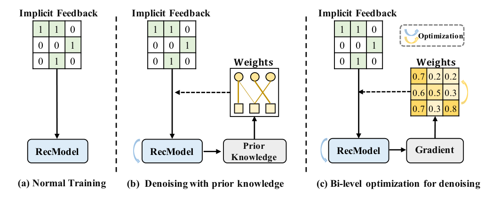
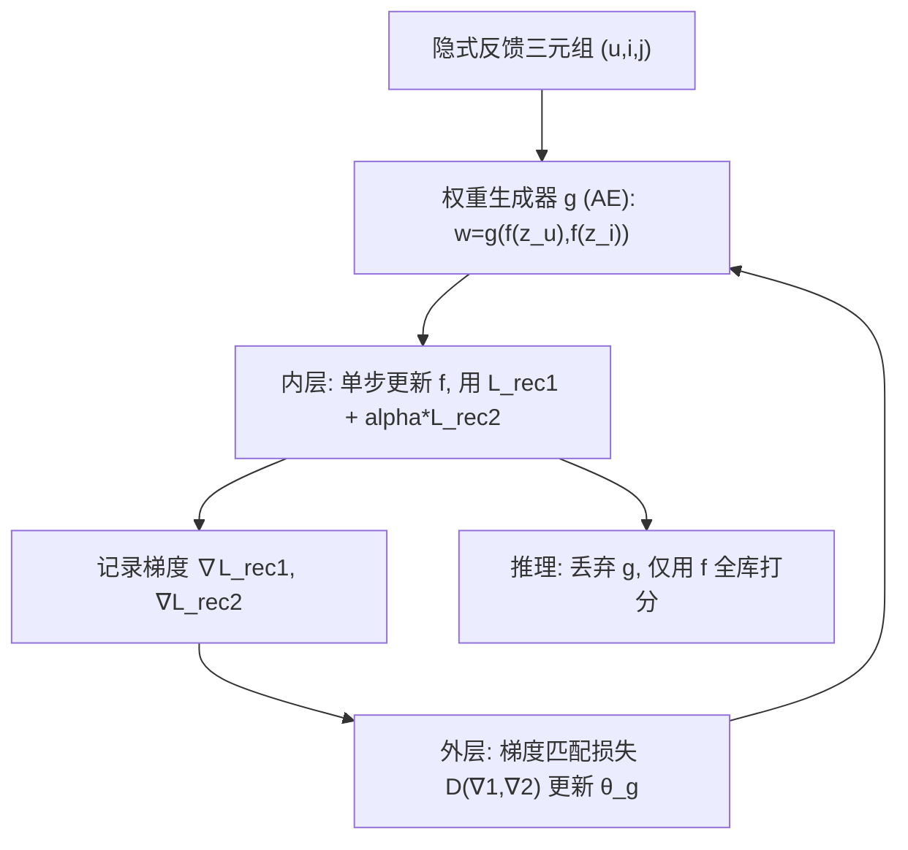
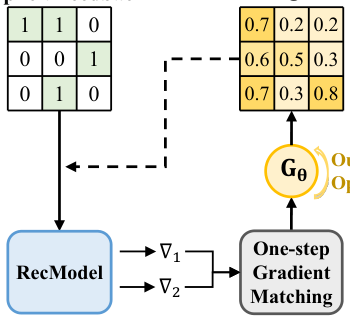

# Efficient Bi-Level Optimization for Recommendation Denoising (面向推荐去噪的高效双层优化框架)

- **会议/期刊**: KDD 2023
- **作者与机构**: Zongwei Wang, Min Gao, Linxin Guo (重庆大学)；Wentao Li (HKUST-GZ)；Junliang Yu, Hongzhi Yin (昆士兰大学)
- **推荐链路定位**: 召回（隐式反馈训练阶段的样本加权去噪，与具体 backbone 解耦）
- **研究方向**: 自监督对比学习与交互去噪 / 协同过滤
- **论文原文**: [arXiv:2210.10321](https://arxiv.org/abs/2210.10321v2)
- **开源代码**: [CoderWZW/BOD](https://github.com/CoderWZW/BOD)

## TL;DR (1分钟核心速览)

隐式反馈含大量假阳性/假阴性，现有加权去噪方法有两大通病：权重逐轮独立重算（丢弃历史权重信息）、权重计算依赖"高 loss 即噪声"等先验知识。本文把去噪写成双层优化：内层训练推荐模型，外层以推荐精度（而非先验）为监督学习样本权重；再用**自编码器权重生成器**替代 $|\mathcal{U}|\times|\mathcal{I}|$ 权重矩阵、用**一步梯度匹配**替代内层完整展开。在 Beauty/iFashion/Yelp2018 上以 7:1:2 划分、Recall/NDCG@10,20 评测，LightGCN 底座上 Recall@20 相对最强基线最高提升 **10.3%**，单 epoch 耗时仅为 SGDL 的 **1/5~1/7**。

## Background & Motivation (背景与核心矛盾)

- **主流范式**: 无辅助信息时，去噪＝给每个 $(u,i)$样本打分权重$w_{u,i}$ 后训练加权 BPR（式 3）。代表作为 T-CE（高 loss 即噪声，动态阈值降权）、DeCA（双模型预测不一致即噪声）、SGDL（早期训练收集"干净样本"再按相似度赋权）。
- **前人局限**: ①权重是**迭代无关**的——每轮重新初始化，上一轮已学到的"噪声置信度"被整体丢弃，等价于每轮盲目猜测；②权重规则**依赖先验知识**（loss 高低、模型分歧、相似度），而先验的适用范围随数据分布变化，无法保证普适。
- **核心洞察 (Key Insight)**: 去噪的终极目标其实就是"提升推荐精度"，那么权重本身应当**由推荐精度反向监督**，而不是由人为规则指定；且权重应作为**跨迭代持久的全局变量**，使历史调整可累积。
- **本文切入点**: 用双层优化把"训练推荐模型"与"学习样本权重"解耦成内/外两个相互依赖的子问题，外层梯度来自内层，天然免除先验。

<figure class="paper-figure" markdown="span">
  <figcaption>图1：(a) 无去噪的常规推荐模型训练、(b) 使用先验知识的去噪训练与 (c) 用于去噪的双层优化的比较。(b)和(c)用于无额外信息的推荐去噪，其中(b)中的权重在每次迭代中被初始化以用于推荐模型训练，而(c)中的权重被存储为一个全局变量集。</figcaption>
</figure>

## Method (核心方法设计)

### 1. 整体框架 (Overall Architecture)

输入为隐式交互三元组 $(u,i,j)$。内层：权重生成器$g$依据当前用户/物品表征产出$w_{u,i},w_{u,j}$，用$\mathcal{L}_{rec1}+\alpha\mathcal{L}_{rec2}$（BPR + AU loss）做**一次**梯度更新推荐模型$f$，并记录该步的两个梯度；外层：固定$\theta_f$，用两个梯度的余弦距离构造匹配损失，反向更新生成器参数$\theta_g$，生成器即成为"跨迭代持久的权重记忆"。先 warm-up 推荐模型至梯度稳定，再启动外层优化，避免早期梯度噪声破坏匹配。推理阶段彻底丢弃生成器，仅保留$f$，零额外延迟。

<figure class="paper-figure" markdown="span">
  <figcaption>图2：BOD框架。</figcaption>
</figure>

### 2. 关键设计拆解 (Key Designs)

1. **去噪的双层优化建模（把权重从"规则"变成"可学习参数"）**：把权重集 $\mathbf{W}$ 设为全局可学习变量，外层目标直接用推荐损失本身：
$$\min_{\mathbf{W}}\ \mathcal{L}_{W}(f_{\theta_f^*}),\quad \text{s.t.}\ \theta_f^*=\arg\min_{\theta_f}\mathcal{L}_{rec}(\mathbf{W},\mathcal{D})$$
外层梯度经内层链式回传，因此"何种权重是好权重"由推荐精度自动定义，无需任何先验；同时 $\mathbf{W}$ 持续被优化，天然实现跨迭代信息共享。

2. **生成器参数化（把 $O(|\mathcal{U}||\mathcal{I}|)$存储降为$O(d\,d_g)$）**：直接存权重矩阵在中等规模数据上即 OOM。改用单层编解码 AE 生成权重：
$$w_{u,i}=g_d\big(g_e(\text{concat}(f(z_u),f(z_i)))\big)$$
隐空间相近的 $(u,i)$获得相近权重、又保留样本级差异，空间代价从$M+|\mathcal{U}||\mathcal{I}|$降到$M+EN+DE$。

3. **一步梯度匹配（把内层完整展开降为单步）**：传统双层求解需 unroll 整个内层轨迹，代价不可接受；但单步梯度信息量太少会训坏 $g$。本文让内层同时优化两个损失、外层最小化两个单步梯度的方向差异：
$$\min_{\theta_g}\mathcal{D}(\nabla_{\theta_f}\mathcal{L}_{rec1},\nabla_{\theta_f}\mathcal{L}_{rec2}),\quad \mathcal{D}=\sum_{c=1}^{d_2}\Big(1-\frac{\mathbf{G}_{1c}\cdot\mathbf{G}_{2c}}{\|\mathbf{G}_{1c}\|\|\mathbf{G}_{2c}\|}\Big)$$
直觉：干净样本上两个损失的梯度方向高度一致，噪声样本上则显著背离；对齐操作相当于把"干净/噪声"的信号差放大成可用的优化方向。总损失为内层 $\mathcal{L}_{rec1}+\alpha\mathcal{L}_{rec2}$（$\alpha$默认 1）+ 外层$\mathcal{D}$；AU 损失自带 alignment/uniformity 平衡系数$\gamma$。整个框架**免负采样设计约束**，只沿用 backbone 的 pairwise 负采样，$g$ 参数量极小、可忽略。

## Experimental Setup & Evaluation Protocol (实验设置与评估协议)

- **数据集与预处理**:

| 数据集 | #Users | #Items | #Interactions | 密度 | 场景 |
| :--- | :---: | :---: | :---: | :---: | :--- |
| Beauty | 22,363 | 12,099 | 198,503 | 0.073% | 亚马逊美妆 |
| iFashion | 300,000 | 81,614 | 1,607,813 | 0.006% | 时尚电商（极稀疏） |
| Yelp2018 | 31,668 | 38,048 | 1,561,406 | 0.130% | 本地生活 POI |

- **数据划分与防穿越**: **比例划分 7:1:2**（train/valid/test），未采用 Leave-One-Out；噪声鲁棒性实验额外向训练集注入 5%/10%/15%/20% 对抗性假正例，测试集保持不变。
- **排名评测协议**: Recall@K 与 NDCG@K，$K\in\{10,20\}$，每个指标重复 10 次取均值；论文未显式声明采样负例比例，按 LightGCN 系基线的惯例采用全库未交互候选排序，属于**无偏 Full-Ranking** 口径。
- **对比基线与超参**: 四个 backbone（GMF / NCF / NGCF / LightGCN）× 五类去噪法（WBPR、WRMF、T-CE、DeCA、SGDL），另加鲁棒表征方法 SGL、SimGCL。统一设置：batch 128、lr 1e-3、$d=64$、LightGCN 2 层、SGL edge dropout 0.1、Adam + Xavier；未报告显著性检验。

## Key Experimental Results (实验关键数据)

### 1. 主实验对比 (Main Results)

以最强 backbone LightGCN 为例（原文表 3，R/N 分别指 Recall/NDCG）：

| 方法 | Beauty R@20 | Beauty N@20 | iFashion R@20 | iFashion N@20 | Yelp R@20 | Yelp N@20 |
| :--- | :---: | :---: | :---: | :---: | :---: | :---: |
| Normal | 0.1221 | 0.0675 | 0.0661 | 0.0310 | 0.0532 | 0.0445 |
| WBPR | 0.1261 | 0.0685 | 0.0662 | 0.0316 | 0.0529 | 0.0448 |
| DeCA | 0.1345 | 0.0754 | 0.0865 | 0.0435 | 0.0511 | 0.0524 |
| SGDL | 0.1365 | 0.0769 | 0.0908 | 0.0415 | 0.0541 | 0.0575 |
| SGL | 0.1422 | 0.0821 | 0.0973 | 0.0475 | 0.0639 | 0.0534 |
| SimGCL | 0.1316 | 0.0781 | 0.1070 | 0.0523 | **0.0711** | **0.0593** |
| **BOD** | **0.1548** | **0.0895** | **0.1180** | **0.0576** | 0.0700 | 0.0588 |
| Improv.% (vs. best baseline) | **+8.87%** | **+9.01%** | **+10.28%** | **+10.13%** | −1.55% | −0.84% |

在其他 backbone 上同样稳定增益：GMF/Beauty R@20 0.1193 vs SGDL 0.1092（**+9.25%**）；NCF/iFashion 0.0909 vs 0.0846（**+7.45%**）；NGCF/Beauty 0.1415 vs 0.1389（+1.87%，该底座对去噪最不敏感）。

### 2. 消融实验 (Ablation Study)

**(a) 内层损失组合**（原文表 5，LightGCN）：

| 变体 | Beauty R@20 | iFashion R@20 | Yelp R@20 | Yelp N@20 |
| :--- | :---: | :---: | :---: | :---: |
| BOD$_{BPR}$（仅单损失） | 0.1386 | 0.0984 | 0.0598 | 0.0523 |
| BOD$_{AU}$（仅单损失） | 0.1400 | 0.1054 | 0.0625 | 0.0546 |
| **BOD$_{BPR+AU}$（默认）** | **0.1548** | **0.1180** | **0.0700** | **0.0588** |

**(b) 权重生成器结构**（原文表 6，Beauty，LightGCN）：

| 生成器 | R@10 | R@20 | N@10 | N@20 |
| :--- | :---: | :---: | :---: | :---: |
| 1-MLP | 0.1011 | 0.1498 | 0.0718 | 0.0855 |
| VAE | 0.1074 | 0.1532 | 0.0731 | 0.0888 |
| 3-MLP | 0.1095 | 0.1548 | 0.0755 | 0.0894 |
| **2-MLP (ours)** | **0.1095** | **0.1548** | **0.0755** | **0.0895** |

**(c) 单 epoch 耗时（秒，原文表 4）**：Beauty 上 BOD 6.82 vs SGDL 32.12 / DeCA 25.10 / T-CE 41.50 / SimGCL 7.26；iFashion 上 97.38 vs SGDL 688.21（≈7 倍加速）。

### 3. 关键实验发现 (Key Findings)

1. **两层梯度匹配是性能命门而非"加速附加项"**：内层退化为单损失后 Beauty R@20 从 0.1548 降至 0.1386（−10.5%），说明一步梯度匹配的价值来自"两个异构损失提供互补梯度视角"，缺一即退化为普通加权训练。
2. **生成器容量存在"够用即止"的天花板**：1-MLP（0.1498）明显欠拟合，2-MLP 与 3-MLP 的 R@20 完全相同（0.1548）、且略优于 VAE（0.1532），证明权重生成只需轻量非线性映射，参数开销可忽略。
3. **收益随数据稀疏度上升、随密度下降**：iFashion（密度 0.006%）相对提升 10.3%，Beauty 8.9%，而 Yelp2018（0.130%）甚至略逊于 SimGCL——稠密数据本身已有足够纯净信号，去噪的边际价值被稀释；同时图 3 显示注入 20% 对抗负例时 BOD 的性能跌幅最小。

## Highlights & Limitations (亮点、对比与审稿批判)

- **与代表作对比 (vs. Prior Work)**: T-CE 用"高 loss≈噪声"的固定先验、DeCA 依赖双模型分歧、SGDL 依赖早期"干净样本"假设，三者都是迭代无关的启发式赋权；BOD 用外层精度梯度替代全部先验，并把权重变为持久全局变量；相对 SGL/SimGCL 这类靠图增广/嵌入均匀性"隐式抗噪"的方法，BOD 显式建模样本可信度，且可作为插件叠加（图 5 中 BOD-SGL、BOD-SimGCL 均进一步提升）。
- **可迁移亮点**: ①"一步梯度匹配"把昂贵双层优化压成单步的工程范式，可直接迁移到 debias 的样本重加权、课程学习与元学习重加权；②推理期丢弃生成器的设计，天然适配工业"训练重、推理轻"的约束。
- **审稿级局限批判**: ①Yelp2018 上被 SimGCL 反超且未做显著性检验，主结论的稳健性存疑；②双层框架超参（$\alpha$、warm-up 轮数、AU 的$\gamma$）虽被报告为"鲁棒"，但$\gamma$ 呈明显先升后降的倒 U 型，在无验证集调优的冷启场景存在风险；③评测未显式声明候选采样口径，也未做流程级时间/显存对比的完整报告；④作者自述测试集噪声无法被双层过程识别，属开放式遗留问题。

## Rating (四维评分)

- **方法创新性 (Novelty)**: ⭐⭐⭐⭐ （首次把隐式反馈去噪严格形式化为 prior-free 双层优化，并用生成器+一步梯度匹配给出可落地解法，机制清晰但理论收敛性未加证明）
- **评估协议与实验扎实度 (Protocol & Experiments)**: ⭐⭐⭐ （4 个 backbone × 5 类去噪基线覆盖充分、含噪声注入鲁棒性与泛化实验，但仅 3 个数据集、7:1:2 单一划分、无显著性检验，采样协议描述含糊）
- **写作与数学规范度 (Clarity & Rigor)**: ⭐⭐⭐⭐ （双层建模与梯度匹配公式推导简洁、算法伪码与复杂度表完整；但 AU 损失细节被推至附录、$\alpha$/$w$ 权重作用位置式 3 的书写易生歧义）
- **工业落地与复现价值 (Industrial & Practical Value)**: ⭐⭐⭐⭐⭐ （代码已开源，插件式挂载任意 backbone，训练耗时仅为同类去噪法的 1/5~1/7，推理零额外开销，工程迁移成本极低）

