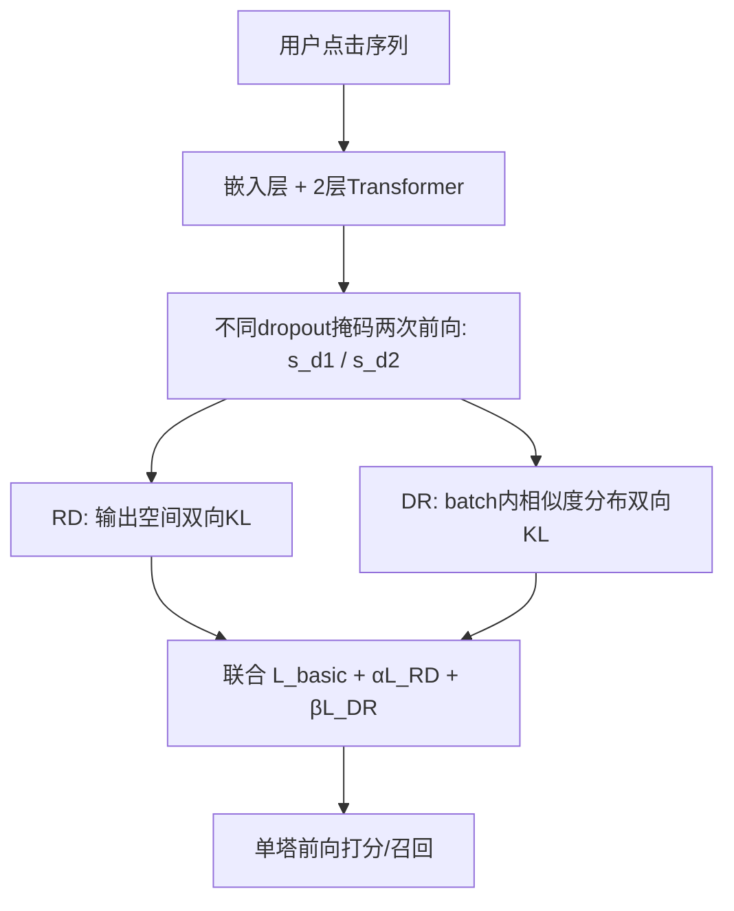
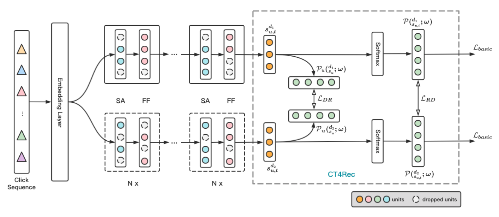

# CT4Rec: Simple yet Effective Consistency Training for Sequential Recommendation (面向序列推荐的简单有效一致性训练)

- **会议/期刊**: KDD 2023
- **作者与机构**: Chong Liu, Xiaoyang Liu 等；腾讯、OPPO、苏州大学、微软亚洲研究院
- **推荐链路定位**: 召回（匹配阶段）
- **研究方向**: 序列与会话推荐 / 自监督一致性正则
- **论文原文**: [论文原文链接](https://arxiv.org/abs/2112.06668v3)
- **开源代码**: [开源代码仓库链接](https://github.com/ct4rec/CT4Rec.git)

## TL;DR (1分钟核心速览)

针对对比学习序列推荐依赖数据增广、pretext任务与负采样调参的痛点，CT4Rec不改结构、不做增广，仅在SASRec上加输出空间RD与表征空间DR两个双向KL一致性损失。Leave-One-Out+500负采样排序下，四数据集HR/NDCG全面超越CL4SRec，相对SASRec*提升5.34%–16.50%，线上CTR+2.717%、人均点击+3.679%。

## Background & Motivation (背景与核心矛盾)

- **主流范式**: SASRec以单项预测损失优化整个Transformer；CL4SRec/CLRec进一步引入序列增广与对比学习，以提升稀疏场景下的用户表征。
- **前人局限**: 对比学习需精细选择增广、pretext任务、负采样与温度系数；且稀疏序列下，“更好区分正负样本”与“更好预测下一物品”存在目标间隙。
- **核心洞察 (Key Insight)**: dropout天然生成同一模型的不同子模型；两次前向的预测分布与用户表征分布不应剧烈漂移，可直接作为无标签一致性约束。
- **本文切入点**: 不改造骨干、不构造增广视图，只用两个双向KL损失分别约束输出空间与表征空间。

## Method (核心方法设计)

### 1. 整体框架 (Overall Architecture)

输入用户点击序列，经嵌入层与2层Transformer编码；同一序列用两组不同dropout掩码前向两次，得到$\boldsymbol{s}_{u,t}^{d_1}$与$\boldsymbol{s}_{u,t}^{d_2}$。基础物品预测损失对两次输出取平均；RD约束两次输出概率分布，DR约束mini-batch内用户相似度分布；最终联合训练。推理仅需单次前向，在线服务计算量与SASRec一致。

<figure class="paper-figure" markdown="span">
  <figcaption>图 1：CT4Rec 的模型结构。该模型以用户点击序列为输入，并在推荐匹配阶段输出用于物品检索的用户表示。输入序列经嵌入层转换为向量表示，再由 N 个具有不同隐藏随机失活掩码的 Transformer 编码。此外，引入分布式正则化损失和正则化随机失活损失，以约束由不同随机失活掩码生成的这些表示。</figcaption>
</figure>

### 2. 关键设计拆解 (Key Designs)

1. **RD：输出空间正则化**：稀疏序列下，两次dropout子模型的下一物品分布可能不一致。对同一序列的$P^{d_1}$与$P^{d_2}$施加双向KL：$\mathcal{L}_{RD}=\frac{1}{2}[D_{KL}(P^{d_1}\|P^{d_2})+D_{KL}(P^{d_2}\|P^{d_1})]$。它直接作用于预测分布，故对排序目标最敏感。
2. **DR：表征空间分布式正则化**：直接对用户向量做cosine/L2约束在稀疏场景收益有限。本文将每个用户表示为batch内与其他用户的相似度分布：$P_u^{d_i}=\mathrm{softmax}([\mathrm{sim}(\boldsymbol{s}_{u}^{d_i},\boldsymbol{s}_{u'}^{d_i})]_{u'\in B})$，再对$P_u^{d_1}$与$P_u^{d_2}$做双向KL。该分布式约束保留相对结构，比逐点距离更稳健。
3. **训练目标、负采样与推理效率**：$\mathcal{L}_{basic}=-\frac{1}{2}(\log P^{d_1}+\log P^{d_2})$，$\mathcal{L}_{final}=\mathcal{L}_{basic}+\alpha\mathcal{L}_{RD}+\beta\mathcal{L}_{DR}$。训练采用随机负样本；推理无额外分支，仅训练多一次前向，且收敛轮数少于CL4SRec。

## Experimental Setup & Evaluation Protocol (实验设置与评估协议)

- **数据集与预处理**: 三个公开基准与一个工业语料，Amazon Beauty/Sports沿用常用预处理：

| 数据集 | #Users | #Items | #Interactions | 平均长度 | 密度/场景 |
| :--- | :---: | :---: | :---: | :---: | :--- |
| Beauty | 52,024 | 57,289 | 0.4M | 7.6 | 0.01% / Amazon |
| Sports | 25,598 | 18,357 | 0.3M | 8.3 | 0.05% / Amazon |
| Yelp | 30,431 | 20,033 | 0.3M | 10.4 | 0.05% / 商户 |
| WeChat | 749,452 | 211,004 | 9.5M | 12.7 | 0.006% / 工业 |

- **数据划分与防穿越**: 公开基准采用`Leave-One-Out`；WeChat按时间切分，前几日训练、其后测试。
- **排名评测协议**: `Sampled Ranking`，每个正样本随机采样500个负样本排序；指标HR@{5,10,20}、NDCG@{5,10,20}。
- **对比基线与超参**: GRU4Rec、SASRec、SASRec*、TiSASRec、BERT4Rec、StackRec、CLRec、CL4SRec；$d=50$、2层注意力、2头、序列长50、lr=0.001、batch=128、dropout=0.5；$\alpha,\beta\in\{0.1,0.3,0.5,1,2,3\}$，显著性$p<0.01$。

## Key Experimental Results (实验关键数据)

### 1. 主实验对比 (Main Results)

| 数据集 | 指标 | SASRec | SASRec* | TiSASRec | StackRec | CLRec | CL4SRec | CT4Rec | Improv.* |
| :--- | :--- | ---: | ---: | ---: | ---: | ---: | ---: | ---: | ---: |
| Beauty | HR@10 | 0.2759 | 0.2748 | 0.2746 | 0.2225 | 0.1816 | 0.2896 | **0.3200** | 16.45% |
| Beauty | NDCG@10 | 0.1733 | 0.1840 | 0.1646 | 0.1447 | 0.1279 | 0.1901 | **0.2132** | 15.87% |
| Sports | HR@10 | 0.2747 | 0.2683 | 0.2456 | 0.1962 | 0.2178 | 0.2834 | **0.3010** | 12.19% |
| Sports | NDCG@10 | 0.1558 | 0.1629 | 0.1402 | 0.1110 | 0.1263 | 0.1729 | **0.1817** | 11.54% |
| Yelp | HR@10 | 0.4221 | 0.4469 | 0.4257 | 0.3397 | 0.3881 | 0.4451 | **0.4784** | 7.05% |
| Yelp | NDCG@10 | 0.2335 | 0.2687 | 0.2435 | 0.1859 | 0.2132 | 0.2647 | **0.2869** | 6.77% |
| WeChat | HR@10 | 0.4103 | 0.4366 | 0.4406 | 0.4173 | 0.3985 | 0.4511 | **0.4861** | 11.34% |
| WeChat | NDCG@10 | 0.2357 | 0.2743 | 0.2615 | 0.2576 | 0.2371 | 0.2827 | **0.3057** | 11.40% |

### 2. 消融实验 (Ablation Study)

原文以图3展示Beauty上的趋势，未列表数值；下表为相对SASRec*的定性归因。

| 配置 | 相对SASRec*趋势 | 结论 |
| :--- | :---: | :--- |
| 仅$\mathcal{L}_{basic}$ | 基线 | 单项预测损失 |
| +RD | 显著提升 | 输出空间约束贡献最大 |
| +DR | 明显提升 | 表征空间分布式约束有效 |
| 用cosine替代DR | 无显著增益 | 逐点距离不适合稀疏序列 |
| 用L2替代DR | 无显著/部分下降 | 点对正则不足 |
| RD+DR（CT4Rec） | 最优 | 两空间互补 |

### 3. 关键实验发现 (Key Findings)

- 主实验中CT4Rec在Beauty的HR@10达0.3200，较CL4SRec的0.2896与SASRec*的0.2748分别提升明显，相对SASRec*提升16.45%；四数据集相对SASRec*提升5.34%–16.50%，说明两个KL正则比复杂对比学习更稳。
- 消融显示RD单独已贡献主要增益，DR单独也有效；而cosine/L2替代DR几乎无显著收益，证明batch-wise相似度分布比逐点距离更能约束稀疏序列表征。
- 效率与线上：CT4Rec虽训练多一次前向，但收敛快于CL4SRec且无需增广/负采样调参；线上作为额外召回通道取得CTR+2.717%、ACN+3.679%，服务计算与骨干一致。

## Highlights & Limitations (亮点、对比与审稿批判)

- **与代表作对比 (vs. Prior Work)**: CL4SRec依赖序列增广+对比损失+负采样，StackRec依赖深层堆叠，SASRec仅用单项损失；CT4Rec不改结构、不增广，仅加两个KL正则，却同时约束输出与表征空间。
- **可迁移亮点**: dropout-as-submodel的一致性约束可迁移到CTR/重排；batch内相似度分布的KL正则可作为通用表征正则，且不增加推理开销。
- **审稿级局限批判**: 训练需两次前向，存在额外训练开销；dropout率>0.8时性能转负，对稀疏数据与超参敏感；评测为500负采样排序而非Full-Ranking，线上收益仍需更多场景验证。

## Rating (四维评分)

- **方法创新性 (Novelty)**: ⭐⭐⭐⭐ （机制极简但有效，输出空间RD与分布式DR的组合有清晰直觉）
- **评估协议与实验扎实度 (Protocol & Experiments)**: ⭐⭐⭐⭐ （四数据集+线上A/B+CTR扩展，但采样排序非全库排序）
- **写作与数学规范度 (Clarity & Rigor)**: ⭐⭐⭐⭐ （两个KL损失定义清楚，消融以图呈现，部分超参分析略简）
- **工业落地与复现价值 (Industrial & Practical Value)**: ⭐⭐⭐⭐ （代码开源、推理零增量、线上验证充分，训练多一次前向可接受）

