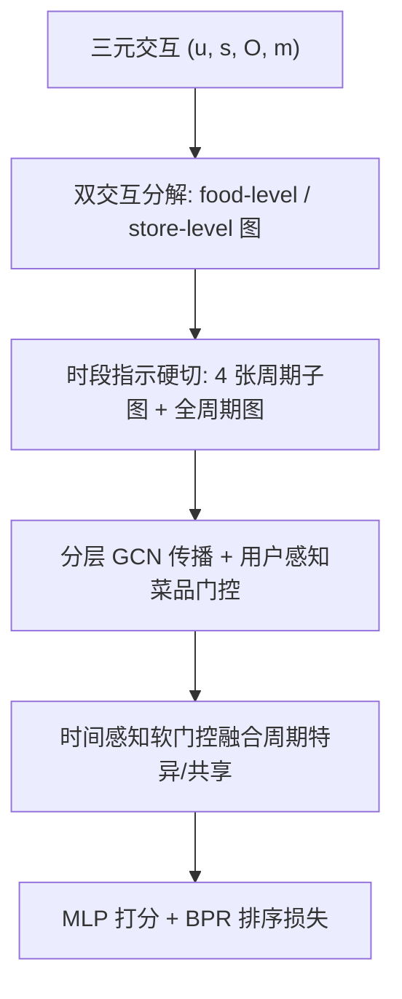

# Modeling Dual Period-Varying Preferences for Takeaway Recommendation (面向外卖推荐的双周期变化偏好建模)

- **会议/期刊**: KDD 2023 (Applied Data Science Track)
- **作者与机构**: Yuting Zhang, Yiqing Wu, Fuzhen Zhuang, Zhulin An 等（中科院计算所 / 北航 / 美团）
- **推荐链路定位**: 召回级表征学习（产出图嵌入作为下游精排附加特征）
- **研究方向**: 序列与会话推荐 / 图神经网络推荐
- **论文原文**: [arXiv:2306.04370v2](https://arxiv.org/abs/2306.04370v2)
- **开源代码**: [github.com/17231087/DPVP](https://github.com/17231087/DPVP.git)

## TL;DR (1分钟核心速览)

外卖场景与传统推荐的差异在于：用户偏好同时作用于**商家（店铺品牌/评分）**与**菜品（口味/品类）**两个层级，且一天内呈现强时段周期性（早餐包子、夜宵烧烤）。DPVP 把"用户-商家-菜品"三元全周期图拆成 food-level 与 store-level 两张双交互图，再按 Morning/Noon/Night/Late Night 四个时段硬切出周期子图，用 LightGCN 式传播 + 用户感知门控聚合店内候选菜品 + 时间感知软门控融合"周期特异/全周期"表征。在美团两城数据集的 1:99 采样排序协议下，Hit@10 比最强基线 SVD-GCN 相对提升 7.35%（MT-small）/3.60%（MT-large），线上 A/B 两周 GMV +0.70%、CTCVR +0.68%。

## Background & Motivation (背景与核心矛盾)

- **主流范式**: 外卖推荐沿用 CF/双塔（DAT）或图网络（LightGCN、SVD-GCN、AutoIntent 超图），把时间、空间、属性作为辅助特征喂入。
- **前人局限**: ①只用 user–store 或 user–food 的**二元**交互建模，无法刻画"爱某店但只点其某道菜"这种层级化权衡；②时间处理停留在 session/day 级连续演化或把 time 当旁路 embedding，无法表达"日内四时段"这种**阶跃式**偏好切换。
- **核心洞察 (Key Insight)**: 作者统计 10 万条点击发现菜品品类点击占比随时段剧烈翻转（包子集中在 Morning、烧烤集中在 Late Night），同时跨时段仍存在稳定偏好（嗜辣者全天点辣），说明偏好 = 周期特异 $\oplus$ 周期共享，必须**分解**而非**平滑**。
- **本文切入点**: 用显式时段指示函数把三元图切为多张周期子图，分别传播后再软融合，避免周期特异数据稀疏导致的信息损失。

## Method (核心方法设计)

### 1. 整体框架 (Overall Architecture)

输入是带时段标签的三元交互记录 $x=(u,s,O,m)$（$m\in\{1..4\}$）。先由双交互模块把全周期全局图$\mathcal{G}$分解为以菜品为中心的$\mathcal{G}^{[o]}=\{\mathcal{E}_{UO}\cup\mathcal{E}_{SO}\}$与以商家为中心的$\mathcal{G}^{[s]}=\{\mathcal{E}_{US}\cup\mathcal{E}_{SO}\}$——注意两类图共享 store–food 边，但一者视其为"同店菜品关联"、一者视其为"菜品相似店铺关联"。再由时间分解模块按$m$硬切出$M$组周期子图。双层级各用独立 embedding 组（跨时段共享初始化）做 LightGCN 式层间传播与加权池化，得到 food-level 与 store-level 的用户/实体表征；店侧用用户感知门控把店内 top-$N'$ 高频菜品池化成个性化"菜品集"向量，再由时间感知软门控把 4 个时段表征与全周期表征融为最终向量，拼接后过 MLP 打分，BPR 优化。

### 2. 关键设计拆解 (Key Designs)

1. **双交互感知分解（把"层级混淆"变成"层级解耦"）**：若直接在全局三元图上传播，store–food 边会同时向用户注入两种语义，用户表征被"店铺偏好 + 菜品偏好"污染（消融中 DPVP(global level) 全面劣于双图）。DPVP 的做法是保留两条独立传播路径并各自维护 embedding，使 $\mathcal{E}_{SO}$ 在两个视角下承担不同角色，从而分离"认牌子"与"认口味"两类偏好。

2. **时段硬切 + 时间感知软门控（稀疏时段与共享偏好的折中）**：切分用示性函数构造硬权重 $w_c^m=\mathbb{I}(c_t=m)$，得到$\mathcal{E}^m=\{w_c^m\cdot c\}$；但纯 one-hot 只取时段$m$ 的子图会因该时段交互稀疏而退化，因此引入软门控把周期特异与全周期表征一起加权：

$$g_m(u,m)=\frac{\exp\!\big(\mathbf{h}_{u,m}^{[o]\top}[\mathbf{h}_u^{[o]},\mathbf{e}_m]\big)}{\sum_{k=1}^{M}\exp\!\big(\mathbf{h}_{u,k}^{[o]\top}[\mathbf{h}_u^{[o]},\mathbf{e}_k]\big)},\qquad \mathbf{e}_{u,m}^{[o]}=\sum_{m=1}^{M}g_m(u,m)\,\mathbf{h}_{u,m}^{[o]},$$

其中 $\mathbf{h}_u^{[o]}$是全周期共享表征、$\mathbf{e}_m$ 为时段 embedding。门控以"当前用户 × 目标时段"为条件动态调权，等价于在共享表征监督下对周期子图做自适应平滑，既缓解稀疏又保留阶跃信号。

3. **用户感知菜品门控与训练目标**：同一店铺的 $N'$个候选菜品对不同用户权重不同，用$g_u(o_i)=\mathrm{softmax}_i(\mathbf{h}_{o_i}^{[o]\top}\mathbf{h}_u^{[o]})$得到$\mathbf{h}_O^{[o]}=\sum_i g_u(o_i)\mathbf{h}_{o_i}^{[o]}$，作为细粒度菜品信号桥接到粗粒度店铺打分。最终$\hat{y}_{u,s,O,m}=\mathrm{MLP}([\mathbf{e}_{u,m}^{[o]},\mathbf{e}_{O,m}^{[o]},\mathbf{e}_{u,m}^{[s]},\mathbf{e}_{s,m}^{[s]}])$，损失为 BPR：$\mathcal{L}=\sum_{(u,s,s')}-\ln\sigma(\hat{y}_{u,s,O,m}-\hat{y}_{u,s',O',m})$，负样本为**均匀随机采样**。聚合权重沿用 LightGCN 的$\alpha_l=1/(l+1)$，层数$L=2$、维度$d=100$，推理只需一次图传播与门控，线上以 embedding 特征形式注入下游模型，无额外重排开销。

## Experimental Setup & Evaluation Protocol (实验设置与评估协议)

- **数据集与预处理**: 两座城市、两个时间窗的美团外卖真实日志（各 8 天），含 user–store、user–food、store–food 三元边并附时段标签；正文未给出规模统计，详见原文附录 A.1。

| 数据集 | #Users | #Items | #Interactions | 稀疏度/密度 | 特征/场景说明 |
| :--- | :---: | :---: | :---: | :---: | :--- |
| MT-small | 原文附录 A.1 | 商家+菜品 | 小规模城市日志 | — | 单城市 8 天，4 时段 |
| MT-large | 原文附录 A.1 | 商家+菜品 | 大规模城市日志 | — | 单城市 8 天，4 时段 |

- **数据划分与防穿越 (Splitting Strategy)**: 按**全局时间戳切分**——前 6 天训练、第 7 天验证、第 8 天测试，严格防穿越。
- **排名评测协议 (Ranking Protocol)**: **Sampled Ranking**，每条正样本随机采 99 个未交互店铺（1:99），指标为 Hit@10、NDCG@10、MRR 与 AUC。
- **对比基线与超参设置**: 4 个无图基线（NeuMF、DNN、ENMF、SimpleX）+ 7 个图基线（GCN、GAT、NGCF、HGT、LightGCN、UltraGCN、SVD-GCN），并自建 DPVP(full-period global graph) 对照以剥离"图聚合本身"的贡献。$d=100$、$L=2$、$N'$为店内高频菜品池大小；显著性用 paired t-test，$p<0.005$（标 `*`）。

> 说明：MT-small 上 ENMF 的 AUC（0.7356）低于 NeuMF（0.7814）却 Hit@10 更高，反映 1:99 采样协议下 AUC 与排序指标并不同向，读表时不宜只看 AUC。

## Key Experimental Results (实验关键数据)

### 1. 主实验对比 (Main Results)

| 模型 | MT-small Hit@10 | NDCG@10 | AUC | MRR | MT-large Hit@10 | NDCG@10 | AUC | MRR |
| :--- | :---: | :---: | :---: | :---: | :---: | :---: | :---: | :---: |
| NeuMF | 0.3957 | 0.2104 | 0.7814 | 0.1788 | 0.4554 | 0.2488 | 0.8198 | 0.2101 |
| ENMF | 0.5513 | 0.3845 | 0.7356 | 0.3450 | 0.5911 | 0.4285 | 0.7496 | 0.3887 |
| SimpleX | 0.4851 | 0.2710 | 0.8171 | 0.2276 | 0.5634 | 0.3289 | 0.8457 | 0.2763 |
| NGCF | 0.5009 | 0.2839 | 0.8163 | 0.2411 | 0.6358 | 0.4222 | 0.8593 | 0.3725 |
| LightGCN | 0.4942 | 0.2784 | 0.7979 | 0.2330 | 0.6309 | 0.4250 | 0.8562 | 0.3756 |
| SVD-GCN | <u>0.5745</u> | <u>0.3973</u> | <u>0.8205</u> | <u>0.3402</u> | <u>0.6370</u> | <u>0.4248</u> | <u>0.8609</u> | <u>0.3736</u> |
| DPVP (global graph) | 0.5094 | 0.3022 | 0.7875 | 0.2562 | 0.6324 | 0.4117 | 0.8621 | 0.3592 |
| **DPVP** | **0.6167*** | **0.4180*** | **0.8392*** | **0.3715*** | **0.6599*** | **0.4563*** | **0.8741*** | **0.4075*** |
| Improv.% | +7.35 | +5.21 | +2.28 | +7.68 | +3.60 | +6.49 | +1.39 | +4.84 |

### 2. 消融实验 (Ablation Study)

| 变体 | MT-small Hit@10 | NDCG@10 | MRR | MT-large Hit@10 | NDCG@10 | MRR |
| :--- | :---: | :---: | :---: | :---: | :---: | :---: |
| DPVP(user-food) 仅二元 | 0.3990 | 0.2531 | 0.2298 | 0.4054 | 0.2299 | 0.1986 |
| DPVP(user-store) 仅二元 | 0.5355 | 0.3432 | 0.3017 | 0.6110 | 0.3879 | 0.3359 |
| DPVP(food-level) 单层级 | 0.4438 | 0.2750 | 0.2444 | 0.4547 | 0.2842 | 0.2602 |
| DPVP(store-level) 单层级 | 0.5461 | 0.3588 | 0.3161 | 0.6271 | 0.4158 | 0.3664 |
| DPVP(global level) 不分解 | 0.5865 | 0.3909 | 0.3467 | 0.6494 | 0.4476 | 0.3998 |
| **DPVP** | **0.6167*** | **0.4180*** | **0.3715*** | **0.6599*** | **0.4563*** | **0.4075*** |

### 3. 关键实验发现 (Key Findings)

1. **收益来自"分解"而非"图"**: 同为 mean-pooling 聚合，DPVP(global graph) 在 MT-small 仅 0.5094 Hit@10，比完整 DPVP 低 10.7 个点、甚至低于退化为 store 单层级的 0.5461——证明三元异构边混传会污染用户表征，双层级解耦是关键增量。
2. **层级互补而非冗余**: 仅 food 级（0.4438）远弱于仅 store 级（0.5461），但二者融合到 0.6167，说明菜品信号本身判别力弱、必须作为**条件信息**桥接进店铺打分；用户感知门控（式 7）避免了"店内高频菜 = 该用户想吃"的平均化偏差。
3. **周期分解优于时间旁路**: 相比 DPVP(w/o time)，DPVP 在 MT-small 各时段三指标最小提升 3.91%（Late Night 的 Hit@10），MT-large 最小提升 1.17%（Noon 的 MRR）；且预测得分可视化显示包子/粥在 Morning、烧烤在 Late Night 显著抬升，而面条类全天平稳——与图 2 的真实点击分布一致，说明模型学到的是品类级周期先验而非单纯时段偏置。

## Highlights & Limitations (亮点、对比与审稿批判)

- **与代表作对比 (vs. Prior Work)**: 相比 SVD-GCN/LightGCN 等只吃 user–item 二部图的图模型，DPVP 显式引入 store–food 辅助边并做层级解耦；相比 DAT、TRISAN 等把时间/空间当辅助特征的外卖模型，DPVP 用时段切图把时间从"输入特征"提升为"图结构算子"；相比 AutoIntent 的超图方案，DPVP 无需构造多组超边，工程上更轻。
- **可迁移亮点**: ①"示性函数硬切 + 软门控回融"这套组合可平移到任何具有阶跃周期语义的场景（电商大促时段、打车早晚高峰、短视频深夜时段）；②用户感知池化（用用户向量对候选集合做 attention）可复用到"店铺→商品/歌单→歌曲"等一对多打分结构。
- **审稿级局限批判**: ①评估仅用 **1:99 采样排序**而非全库 Full-Ranking，SVD-GCN 等强基线在采样协议下可能被高估或低估，且未报告多次随机负采样的方差；②时段划分固定为 4 段、边界（如 10:00、20:00）与 $N'$ 均未做敏感性分析，跨城市/跨季节的稳定性存疑；③仅做店铺推荐，"菜品推荐"被留作 future work，双偏好建模的另一半价值尚未闭环；④线上提升 0.70% GMV 缺少置信区间与实验时长的方差说明。

## Rating (四维评分)

- **方法创新性 (Novelty)**: ⭐⭐⭐⭐ （"双层级图解耦 + 时段硬切软融"组合朴素但对场景痛点精准，缺乏理论层面的谱分析或可辨识性证明）
- **评估协议与实验扎实度 (Protocol & Experiments)**: ⭐⭐⭐ （两城数据集 + 11 个基线 + paired t-test 较规范，但仅 1:99 采样排序、单次时间切分、无全库排序与方差报告）
- **写作与数学规范度 (Clarity & Rigor)**: ⭐⭐⭐⭐ （符号与两张图（图 1/图 3）表述清晰，式 2–9 推导连贯；门控式中 $\mathbf{h}_{u,m}$与全周期$\mathbf{h}_u$ 的记号略易混淆）
- **工业落地与复现价值 (Industrial & Practical Value)**: ⭐⭐⭐⭐⭐ （已在美团外卖上线两周、GMV +0.70%，代码开源，$L=2$ 双层传播推理成本低，embedding 可直接作为下游特征注入）

