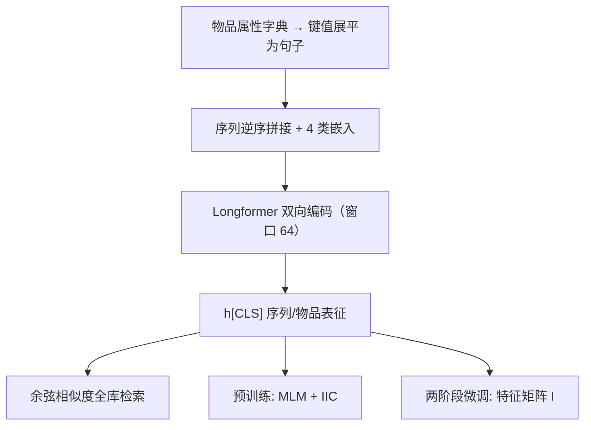
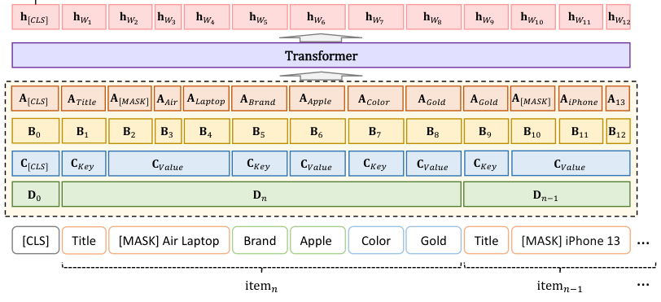
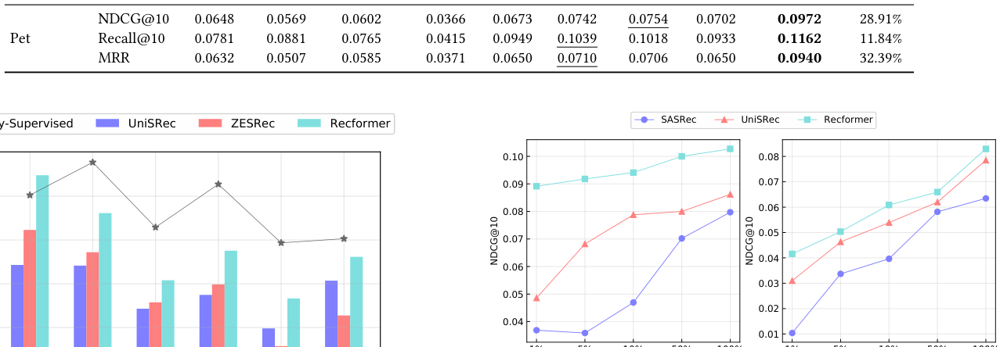

# Text Is All You Need: Learning Language Representations for Sequential Recommendation (只需文本：为序列推荐学习语言表征)

- **会议/期刊**: KDD 2023
- **作者与机构**: Jiacheng Li, Jingbo Shang, Julian McAuley (UCSD)；Ming Wang, Jin Li, Jinmiao Fu, Xin Shen (Amazon)
- **推荐链路定位**: 召回（ID-free 序列召回 / 端到端文本编码检索）
- **研究方向**: 序列与会话推荐 / 冷启动与长尾推荐
- **论文原文**: [https://arxiv.org/abs/2305.13731v2](https://arxiv.org/abs/2305.13731v2)
- **开源代码**: [https://github.com/JiachengLi1995/Recformer](https://github.com/JiachengLi1995/Recformer)

## TL;DR (1分钟核心速览)

针对 ID-based 序列推荐无法处理冷启物品、无法跨域迁移的痛点，Recformer 彻底抛弃 item ID 与 item embedding table：把商品展平为键值属性“句子”、用户历史变成“句子序列”，用改造版 Longformer（四种嵌入 + 局部窗口注意力）在同一 Transformer 内联合学习语言理解与下一物品检索，并以 MLM + item-item 对比预训练、非可学习物品特征矩阵的两阶段微调适配新域。Amazon 六域 leave-one-out **全库排序**下 NDCG@10 平均相对提升 **15.83%**，零样本场景提升 **39.78%**。

## Background & Motivation (背景与核心矛盾)

- **主流范式**: ID 类方法（GRU4Rec/SASRec/BERT4Rec）依赖可训练 item embedding table 捕捉转移模式；ID-Text 类（FDSA/S³-Rec）把文本当辅助特征注入 ID 嵌入；Text-Only 类（ZESRec/UniSRec）先用 BERT 抽固定句向量，再喂给独立序列模型。
- **前人局限**: ① ID 表对新物品/新域天然失效，冷启物品只能随机初始化，新增物品必须重训；② BERT 给的是**句级粗粒度**表征，既学不出“最近几次交互里同一颜色/同一品牌更重要”的词级偏好，也无法建模属性 key 的差异化重要性；③ 语言模型（MLM 训练）与推荐模型（下一物品预测）分离训练，推荐信号无法反哺语言理解。
- **核心洞察 (Key Insight)**: 商品文本本身即跨域通用的“语言”，若把“预测下一个物品”直接表述为“检索下一个句子”，语言理解与序列转移可在同一编码器内端到端联合优化，模型规模与物品数量彻底解耦。
- **本文切入点**: 建立无 ID 范式——item = key-value 属性句子，序列 = 句子序列，用可迁移的语言表征替代物品嵌入。

## Method (核心方法设计)

### 1. 整体框架 (Overall Architecture)

物品 $i$的属性字典展平为$T_i=\{k_1,v_1,\dots,k_m,v_m\}$；用户序列**逆序**拼接以保证近期物品被保留：$X=\{[\text{CLS}],T_n,T_{n-1},\dots,T_1\}$。四类嵌入（词元、词元位置、词元类型、物品位置）相加后 LayerNorm 送入 Longformer（局部窗口 64、仅 `[CLS]` 全局注意力，最长 1024 token），取$h_{[\text{CLS}]}$ 作序列表征；物品表征则用只含单个物品句子的同构输入编码得到。预训练阶段联合优化 MLM 与 item-item 对比；微调阶段用“物品特征矩阵两阶段”策略适配目标域；推理时离线编码全库物品向量，在线仅编码用户序列做余弦内积 top-k 检索，无需 item embedding table。

<figure class="paper-figure" markdown="span">
  <figcaption>图 3：Recformer 的整体框架。</figcaption>
</figure>

### 2. 关键设计拆解 (Key Designs)

1. **物品位置嵌入 + 词元类型嵌入（让长文本序列仍保留物品边界与序列转移）**：直接沿用 BERT 的位置/段落嵌入会让“物品从哪来、处于序列第几位”丢失，长 item 句子会把序列模式淹没。本文新增三种词元类型向量 $\mathbf{C}_{[\text{CLS}]},\mathbf{C}_{\text{Key}},\mathbf{C}_{\text{Value}}$与物品级位置向量$\mathbf{D}_k$，统一相加：
$E_w=\text{LayerNorm}(\mathbf{A}_w+\mathbf{B}_w+\mathbf{C}_w+\mathbf{D}_w)$
直觉：数据集中属性 key 高度重复（如 Brand/Color），类型嵌入使模型能识别“这是 key 而非 value”；物品位置嵌入则把词元对齐回物品粒度，是序列模式得以学习的核心。
2. **两阶段微调（非可学习物品特征矩阵 $\mathbf{I}\in\mathbb{R}^{|\mathcal{I}|\times d}$）**：小数据集下 in-batch 负样本假阴性严重，而全库 softmax 又因每 batch 需重编码全部物品而不可行。折中方案：Stage 1 每 **epoch** 重编码一次$\mathbf{I}$并用全库 softmax 训练，Stage 2 冻结$\mathbf{I}$ 仅更新模型参数，损失为
$\mathcal{L}_{\text{FT}}=-\log\frac{e^{\text{sim}(h_s,\mathbf{I}_i^+)/\tau}}{\sum_{i\in\mathcal{I}}e^{\text{sim}(h_s,\mathbf{I}_i)/\tau}}$
直觉：先用“当前模型”刷新监督信号、再固定监督把模型收敛到该表征上，规避了动态监督导致的优化震荡。
3. **训练目标、负采样与推理效率**：预训练 $\mathcal{L}_{\text{PT}}=\mathcal{L}_{\text{IIC}}+\lambda\mathcal{L}_{\text{MLM}}$，$\lambda=0.1$、$\tau=0.05$；$\mathcal{L}_{\text{IIC}}$ 采用 **in-batch 负样本**（预训练集近 3.2k 万交互，假阴性概率低），MLM 掩码 15% 用于弥合通用语料与商品文本的语言域差。推理开销集中在离线物品编码，在线仅一次前向 + 内积，参数量与物品数无关。

## Experimental Setup & Evaluation Protocol (实验设置与评估协议)

- **数据集与预处理**（Amazon 评论，`5-core` 过滤 + 剔除缺失 title，保留 title/categories/brand 三类键值属性）：

| 数据集 | #Users | #Items | #Interactions | 密度 | 场景说明 |
| :--- | :---: | :---: | :---: | :---: | :--- |
| Pre-training | 3,613,906 | 1,022,274 | 33,588,165 | 9.1e-6 | 7 类目合并，CDs 作验证 |
| Scientific | 11,041 | 5,327 | 76,896 | 1.3e-3 | 目标域（工业科研） |
| Instruments | 27,530 | 10,611 | 231,312 | 7.9e-4 | 目标域（乐器） |
| Arts | 56,210 | 22,855 | 492,492 | 3.8e-4 | 目标域（手工艺） |
| Office | 101,501 | 27,932 | 798,914 | 2.8e-4 | 目标域（办公） |
| Games | 11,036 | 15,402 | 100,255 | 5.9e-4 | 目标域（游戏） |
| Pet | 47,569 | 37,970 | 420,662 | 2.3e-4 | 目标域（宠物） |

- **数据划分与防穿越**: `Leave-One-Out`（最后 1 次交互测试、倒数第 2 次验证、其余训练），交互按 timestamp 升序排列，无全局时间戳切分。
- **排名评测协议**: 无偏 `Full-Ranking`（将 ground-truth 物品与**全部**物品比较），报告 NDCG@10 / Recall@10 / MRR。
- **对比基线与超参**: 三组基线——ID-Only（GRU4Rec、SASRec、BERT4Rec、RecGURU）、ID-Text（FDSA、S³-Rec）、Text-Only（ZESRec、UniSRec）。Longformer-base 初始化，单属性 32 token、序列 1024 token、最大 50 物品，batch 64/16，Adam lr=5e-5，early stop patience=5。

## Key Experimental Results (实验关键数据)

### 1. 主实验对比 (Main Results)

NDCG@10 六个目标域（最佳加粗，Improv. 为相对次优基线）：

| 数据集 | SASRec | BERT4Rec | FDSA | S³-Rec | ZESRec | UniSRec | **Recformer** | Improv. |
| :--- | :---: | :---: | :---: | :---: | :---: | :---: | :---: | :---: |
| Scientific | 0.0797 | 0.0790 | 0.0716 | 0.0451 | 0.0843 | 0.0862 | **0.1027** | +19.14% |
| Instruments | 0.0634 | 0.0707 | 0.0731 | 0.0797 | 0.0694 | 0.0785 | **0.0830** | +4.14% |
| Arts | 0.0848 | 0.0942 | 0.0994 | 0.1026 | 0.0970 | 0.0894 | **0.1252** | +16.47% |
| Office | 0.0832 | 0.0972 | 0.0922 | 0.0911 | 0.0865 | 0.0919 | **0.1141** | +17.39% |
| Games | 0.0547 | 0.0628 | 0.0600 | 0.0532 | 0.0530 | 0.0580 | **0.0684** | +8.92% |
| Pet | 0.0569 | 0.0602 | 0.0673 | 0.0742 | 0.0754 | 0.0702 | **0.0972** | +28.91% |
| **平均 MRR 提升** | — | — | — | — | — | — | — | **+15.99%** |

### 2. 消融实验 (Ablation Study)

| 变体 | Scientific N@10 | Instruments N@10 |
| :--- | :---: | :---: |
| (0) Recformer | **0.1027** | **0.0830** |
| (1) w/o two-stage finetuning | 0.1023 | 0.0728 |
| (1)+(2) 冻结词嵌入与物品特征矩阵 | 0.1026 | 0.0728 |
| (1)+(3) 可训练词嵌入与物品特征矩阵 | 0.0970 | 0.0802 |
| (1)+(4) 可训练物品矩阵 + 冻结词嵌入 | 0.0965 | 0.0801 |
| (5) w/o pre-training | 0.0722 | 0.0598 |
| (6) w/o item-position & token-type emb | 0.1018 | 0.0518 |

### 3. 关键实验发现 (Key Findings)

1. **两阶段微调是跨域迁移的“对症药”，且收益与域差强相关**：Instruments 上去掉两阶段微调 NDCG@10 从 0.0830 掉至 0.0728（-12.3%），而 Scientific 几乎无损（0.1027→0.1023）。这印证了预训练物品表征在源域相近的目标域已足够好，只有域差大时 Stage 1 的重编码才提供决定性增益。
2. **预训练与结构嵌入缺一不可，且结构先验对域差同样敏感**：去掉预训练（变体 5）造成最大跌幅（Scientific -29.7%、Instruments -28.0%），说明非可学习矩阵 $\mathbf{I}$ 必须由预训练表征“点火”；去掉物品位置/词元类型嵌入（变体 6）在 Instruments 崩至 0.0518（-37.6%）却几乎不影响 Scientific，再次指向“域差越大越依赖结构先验”。
3. **冷启动与低资源收益最显著**：Pet 冷启物品 NDCG@10 上 Recformer 0.0225 vs. UniSRec 0.0101 vs. SASRec 0.0013（ID 方法衰减到近随机）；零样本下 Recformer 在 Scientific 上（0.10 量级）已超过三个 ID 方法的**全监督**平均，且预训练约 4,000 步后继续训练反而损害迁移性。

<figure class="paper-figure" markdown="span">
  <figcaption>图 5：SASRec、UniSRec、Recformer 在不同训练数据规模（即 1%、5%、10%、50%、100%）下的性能（NDCG@10）。</figcaption>
</figure>

## Highlights & Limitations (亮点、对比与审稿批判)

- **与代表作对比 (vs. Prior Work)**: 相较 SASRec/BERT4Rec，本文不再维护 item embedding table，物品表征由文本实时生成，天然支持新物品；相较 UniSRec/ZESRec 的“BERT 抽固定特征 + 独立序列模型”两段式，Recformer 把语言理解与序列转移放进同一编码器端到端联合训练，并用 IIC 反哺语言侧，避免了特征提取器与推荐目标错位。
- **可迁移亮点**: ① “非可学习物品特征矩阵 + 两阶段（刷新→冻结）”训练范式，可直接迁移到任何需在线/离线实时编码物品的生成式召回或双塔检索系统；② key-value 展平 + token type 嵌入，是给 LLM/文本编码器序列化结构化商品特征的通用模板。
- **审稿级局限批判**: ① 推理需对**全库物品**离线重编码，商品频繁上下架场景的维护成本高，且 1024 token 上限截断长属性（如长描述）会损失信息；② 预训练/目标域全部来自 Amazon 同一平台，跨平台、跨语言迁移未验证，且预训练超过约 4,000 步即退化，显示对预训练规模与步数较敏感，缺乏 scaling 维度分析；③ 冷启动评测采用“训练集内物品 / 全冷物品”人工二分，与真实冷启流量分布仍有差距。

## Rating (四维评分)

- **方法创新性 (Novelty)**: ⭐⭐⭐⭐ （首次将“下一物品预测”重构为“下一句子检索”的无 ID 范式，四类嵌入与两阶段微调均有明确动机支撑，唯编码器主体沿用 Longformer）
- **评估协议与实验扎实度 (Protocol & Experiments)**: ⭐⭐⭐⭐⭐ （六域 leave-one-out + 无偏全库排序，覆盖全监督、零样本、1%–100% 低资源与冷启四类设定，消融完整）
- **写作与数学规范度 (Clarity & Rigor)**: ⭐⭐⭐⭐ （输入构造、损失与算法伪码清晰，但 item 与 sequence 表征共享同一编码器的细节需读者自行推演，缺少复杂度量化）
- **工业落地与复现价值 (Industrial & Practical Value)**: ⭐⭐⭐⭐ （无需 ID 表即可上线新物品，代码开源；缺点是全库文本编码的离线算力与存储开销偏高）

