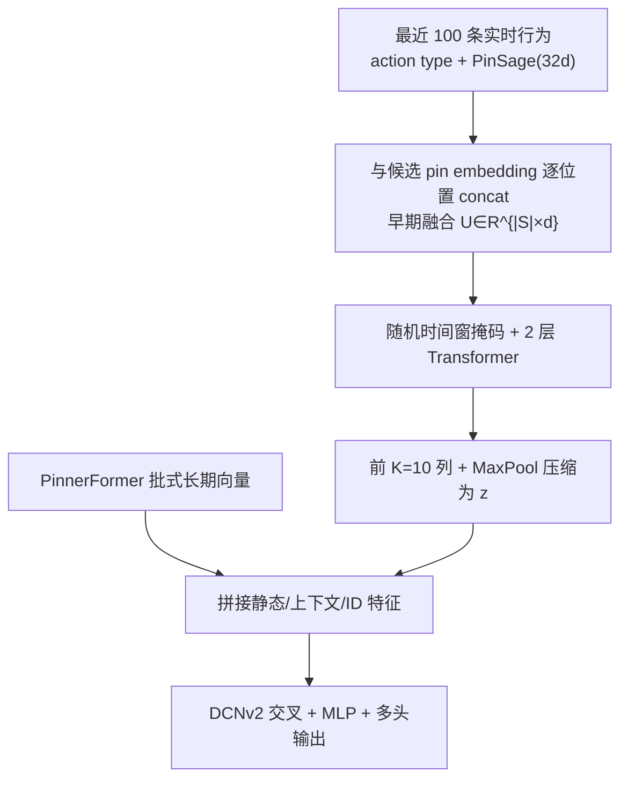
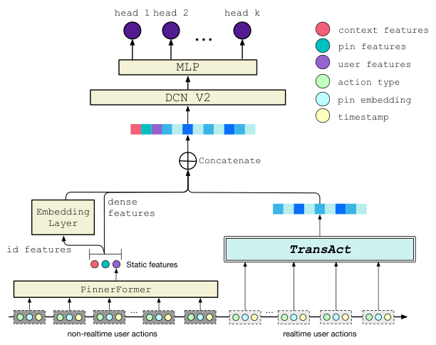

# TransAct: Transformer-based Realtime User Action Model for Recommendation at Pinterest (Pinterest 基于 Transformer 的实时用户行为排序模型)

- **会议/期刊**: KDD 2023 (Applied Data Science Track)
- **作者与机构**: Xue Xia, Pong Eksombatchai, Nikil Pancha, Dhruvil D. Badani, Po-Wei Wang 等，Pinterest
- **推荐链路定位**: 精排（Homefeed 主模型 Pinnability 的子模块，并复用至 Related Pins / Search / Notification）
- **研究方向**: 序列与会话推荐 / CTR 预估与特征交叉
- **论文原文**: [论文原文链接](https://arxiv.org/abs/2306.00248v1)
- **开源代码**: [开源代码仓库链接](https://github.com/pinterest/transformer_user_action)

## TL;DR (1分钟核心速览)

工业界序列推荐长期二选一：要么端到端实时建模（响应快但缺长期兴趣、成本高），要么天级批式用户向量（便宜但滞后）。本文提出 TransAct——用行为类型 embedding + PinSage 内容 embedding 逐位置 concat 候选物品做早期融合，经 2 层 Transformer 编码最近 100 条实时行为，再与 PinnerFormer 批式向量在 DCNv2 排序塔中混合。Pinterest 站内全库随机打乱会话的 HIT@3 协议下，repin 命中相对提升 9.40%、hide 降低 14.86%，线上 repin 量 +11.0%。

## Background & Motivation (背景与核心矛盾)

- **主流范式**: 序列推荐分两派——BST/DIN 类把行为序列直接喂进 CTR 模型端到端训练；PinnerFormer 类把长周期行为离线压成天级更新的用户向量。
- **前人局限**: ① 批式向量无法反映"当前会话"的兴趣漂移，实时行为日志白白浪费；② 端到端序列模型只覆盖短窗口，丢掉长周期兴趣，且长序列带来延迟爆炸；③ BST 式做法把候选 pin 追加为序列末位，对 hide 这类强负反馈几乎无区分力（positive-only BST 的 hide 甚至不显著）。
- **核心洞察 (Key Insight)**: 实时序列与批式向量是互补而非替代关系；推荐排序中真正重要的是"行为类型 + 物品内容"，而时间顺序信息价值极低——位置编码反而伤害效果。
- **本文切入点**: 把候选物品信息提前下沉到序列的每个位置，用极浅 Transformer 提取短期兴趣，与离线长期向量混合后交给 DCNv2。

## Method (核心方法设计)

### 1. 整体框架 (Overall Architecture)

输入侧两路用户表征并行：一路是最近 100 条 pin 级实时行为（时间戳、动作类型、32 维 PinSage 内容 embedding），上采样/补零到定长后送 TransAct 子模块；另一路是天级生成的 PinnerFormer 长期兴趣向量。TransAct 输出压缩为定长向量后，与静态特征、上下文特征、ID 特征一起进入 DCNv2 显式交叉层，再由 MLP 与 click/repin/hide 等多任务输出头打分。训练为加权多任务 BCE，线上以 $S=\sum_{h}u_h f(\boldsymbol{x})_h$ 线性融合各头输出排序。

<figure class="paper-figure" markdown="span">
  <figcaption>图2：Pinterest 首页信息流排序模型（Pinnability）</figcaption>
</figure>

### 2. 关键设计拆解 (Key Designs)

1. **逐位置 Concat 早期融合**：BST 把候选追加为序列最后一项，模型需靠 attention 隐式对齐候选与历史；TransAct 改为在每个位置都拼上候选 embedding，融合矩阵 $\mathbf{U}\in\mathbb{R}^{|S|\times d}$，$d=d_{act}+2d_{\text{PinSage}}$（取 32+32）。直觉是把"用户-候选"交互从注意力层下沉到输入层，交叉信号不再被浅层编码稀释，图 4 显示其稳定优于 append 方式；同时显式编码 action type，使 hide 与 repin 在嵌入空间可分。

2. **随机时间窗掩码 (Random Time Window Mask)**：引入实时序列后，模型只盯最近几次互动，Pinterest 28k 节点兴趣分类树下曝光多样性掉 2%–3%（兔子洞效应）。训练时每次前向从 $\mathcal{U}(0,24\text{h})$采样窗口宽度$T$，将$(t_{req}-T,\,t_{req})$ 内的动作位置在 self-attention 前 mask 掉，推理期不启用。这等价于对"时间近因"做在线数据增广，迫使模型用更早行为推断兴趣，多样性回落收窄至 -1% 且不损 repin；对比试验中 dropout 加大、定比例随机 mask 都会以掉 engagement 为代价。

3. **输出压缩与训练目标**：$\boldsymbol{O}\in\mathbb{R}^{|S|\times d}$直接进 DCNv2 会让交叉层复杂度随$|S|$膨胀。取前$K=10$列（最近兴趣）与全序列 MaxPool（长期偏好）拼接：$\boldsymbol{z}=\text{flatten}\big([\boldsymbol{o}_0;\dots;\boldsymbol{o}_{K-1};\text{MaxPool}(\boldsymbol{O})]\big)\in\mathbb{R}^{(K+1)d}$。总损失为带标签权重矩阵的多任务 BCE：

$$\mathcal{L}=w_u\sum_{h\in H}-w_h\big[y_h\log f(\boldsymbol{x})_h+(1-y_h)\log(1-f(\boldsymbol{x})_h)\big],\quad w_h=\sum_{a\in H}M_{h,a}\,y_a$$

$M$非对角项控制"只有 hide 时误判为 repin"这类跨任务惩罚（如$M_{\text{repin,hide}}=100$），$w_u$ 按用户状态/性别/地域乘积加权。训练对负样本按固定正负比下采样；推理无负采样开销，引入 TransAct 后 FLOPs 涨 65 倍，靠 GPU 推理 + 算子融合/合并内存拷贝/放大 batch/CUDA Graph 把 batch=256 延迟从 CPU 的 712ms 压到 8ms，服务成本回到 1x。

## Experimental Setup & Evaluation Protocol (实验设置与评估协议)

- **数据集与预处理**: 仅用 Pinterest 站内 Homefeed 曝光日志（FVL），作者明确说明公开数据集缺少实时序列所需的 action type 与物品 embedding 元数据，无法复现混合架构。

| 数据集 | #Users | #Items | #Interactions | 稀疏度/密度 | 特征/场景说明 |
| :--- | :---: | :---: | :---: | :---: | :--- |
| Pinterest Homefeed FVL | 177M | 720M | 3B | 前 2 周训练 / 第 3 周测试 | 最近 100 条行为序列 + 32d PinSage + action type |

- **数据划分与防穿越 (Splitting Strategy)**: 全局时间戳切分（前两周训练、第三周评估），并按用户状态与标签分布分层采样。
- **排名评测协议 (Ranking Protocol)**: 不用采样负例排序，而是按 `(uid, cid)` 分组对同一请求内全部候选打分排序后取 top-3 统计 HIT@3；为消除 position bias，仅使用 1% 位置随机打乱会话的日志做离线评估，保证无偏。hide 等负向行为指标越低越好。
- **对比基线与超参设置**: WDL+seq（序列做平均池化）、BST（全行为 / 仅正行为）两变体；未比 DIN（BST 已优于 DIN）、BERT4Rec（任务形式不同）。$|S|=100$、$d_{act}=32$、2 层 Transformer、$d_{hidden}=32$、dropout 0.1、batch 12000、Adam + warmup 5000 + cosine 至 0.0048，显著性$p<0.05$。

## Key Experimental Results (实验关键数据)

### 1. 主实验对比 (Main Results)

| 方法 | HIT@3/repin (all) | HIT@3/repin (non-core) | HIT@3/hide (all) ↓ | HIT@3/hide (non-core) ↓ |
| :--- | :---: | :---: | :---: | :---: |
| WDL + seq (avg pool) | +0.21% | +0.35% | -1.61% | -1.55% |
| BST (all actions) | +4.41% | +5.09% | +2.33% | +3.59% |
| BST (positive only) | +7.34% | +8.16% | -1.12%* | -3.14%* |
| **TransAct** | **+9.40%** | **+10.42%** | **-14.86%** | **-13.54%** |

（相对无实时序列的 Pinnability 基线；* 表示统计不显著）

### 2. 消融实验 (Ablation Study)

| 消融维度 | 变体 | HIT@3/repin | HIT@3/hide ↓ |
| :--- | :--- | :---: | :---: |
| 混合结构 | w/o TransAct（仅 PF + 其他用户特征） | -8.59% | +17.45% |
| 混合结构 | w/o PinnerFormer | -2.46% | +3.61% |
| 混合结构 | w/o 其他用户特征 | -0.67% | +1.40% |
| 序列编码器 | Average Pooling | +0.21% | -1.61% |
| 序列编码器 | CNN / RNN / LSTM | +0.08% / -1.05% / -0.75% | -1.29% / -2.46% / -2.98% |
| 序列编码器 | Vanilla Transformer（无类型/融合） | +1.56% | -8.45% |
| 输出压缩 | 仅 first K cols / 仅 max pool | +9.38% / +6.38% | -14.33% / -14.15% |
| 输出压缩 | **first K + max pool（本文）** | **+9.41%** | **-14.86%** |
| 位置编码 | 加正弦位置编码 | -0.13% | +0.78% |

**线上 A/B（各 1.5% 流量，两周）**：Homefeed repin 量 **+11.0%**（非核心用户 **+17.0%**），hide 量 **-10.0%**（非核心 -10.5%），总停留时长 +2.0%；跨场景迁移 Related Pins repin +2.8%、Search repin +2.3%、Notification 邮件 CTR +1.4%。

### 3. 关键实验发现 (Key Findings)

1. **实时与批式互补，但短期兴趣是主贡献**：移除 TransAct 使 repin 掉 8.59%、hide 涨 17.45%，移除 PinnerFormer 仅 -2.46%/+3.61%；而移除其余全部用户特征只损失 0.67%，说明"实时序列 + 批式向量"已基本覆盖用户画像信息，混合设计不是冗余堆叠。
2. **序列编码器不是越复杂越好，位置信息是负收益**：RNN/LSTM 甚至不如平均池化（-1.05%/-0.75%），CNN 仅 +0.08%，而 2 层 Transformer 把 hide 压到 -8.45%；加正弦/可学习位置编码后 hide 反而恶化 0.78%–2.29%，印证排序任务依赖"行为类型 + 内容匹配"而非时序先后。
3. **收益高度依赖重训与反馈回路**：不重训时 TransAct 组的 repin 增益在两周内衰减到低点，改为每周重训 2 次后恢复稳定；全量上线后的增益高于 1.5% 实验组，说明模型改变用户行为、行为又回流为训练数据的正反馈放大了效果。

## Highlights & Limitations (亮点、对比与审稿批判)

- **与代表作对比 (vs. Prior Work)**: 与 BST 的本质差异不在 Transformer 本身，而在 concat 早期融合 + action type 嵌入，使其能显著压制 hide；与 PinnerFormer 的关系不是替代而是"实时/批式"分工；与学术序列推荐（BERT4Rec 等 next-item 全库排序）任务形式不同，本文是 chunk 内 pointwise 多任务 CTR 排序，指标不可直接横比。
- **可迁移亮点**: ① 随机时间窗掩码是一种零推理开销的多样性正则，可直接移植到任何实时序列精排；② "前 K 列 + MaxPool"压缩让长序列能以常数复杂度接入 DCN 类特征交叉层。
- **审稿级局限批判**: ① 全部实验在站内私有数据，无公开数据集与统一基线复现，HIT@3 的可比性与结论外推性受限；② 65× FLOPs 依赖 GPU 推理、CUDA Graph 与自研 embedding lookup 等重度工程，中小团队落地门槛高；③ 线上增益部分来自正反馈回路与高频重训，存在评估自增强风险，且 $K$、$T$ 等超参缺少敏感性分析。

## Rating (四维评分)

- **方法创新性 (Novelty)**: ⭐⭐⭐⭐ （模块本身是 BST 的工程改良，但 concat 早期融合、随机时间窗掩码与输出压缩三处改动均有明确动机与实证支撑）
- **评估协议与实验扎实度 (Protocol & Experiments)**: ⭐⭐⭐⭐ （随机打乱会话消除位置偏差、区分 non-core 用户、离线-线上指标对齐，且附完整消融；扣分在无公开数据与不显著项标注）
- **写作与数学规范度 (Clarity & Rigor)**: ⭐⭐⭐⭐ （系统链路与工程细节交代清晰，但损失函数书写有笔误，且未给出复杂度量化的理论分析）
- **工业落地与复现价值 (Industrial & Practical Value)**: ⭐⭐⭐⭐⭐ （已部署 Homefeed/Related Pins/Search/Notification 四大场景，开源模块代码并给出 GPU 服务优化的完整工程路径）

