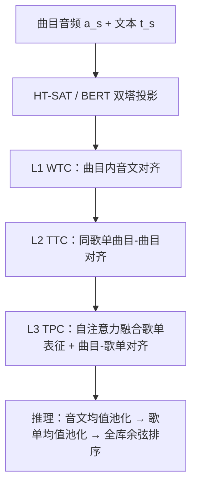
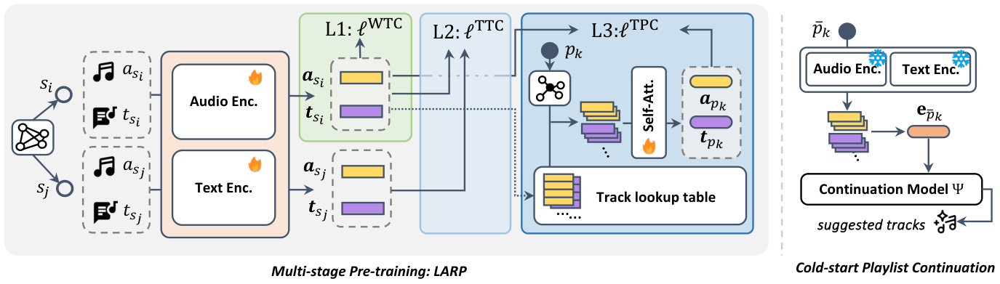

# LARP: Language Audio Relational Pre-training for Cold-Start Playlist Continuation (语言-音频关系预训练用于冷启动歌单续写)

- **会议/期刊**: KDD 2024
- **作者与机构**: Rebecca Salganik, Xiaohao Liu, Yunshan Ma, Jian Kang, Tat-Seng Chua；University of Rochester / National University of Singapore
- **推荐链路定位**: 召回（歌单续写候选曲目检索）
- **研究方向**: 冷启动与长尾推荐 / 多模态推荐
- **论文原文**: [https://arxiv.org/abs/2406.14333v1](https://arxiv.org/abs/2406.14333v1)
- **开源代码**: [https://github.com/Rsalganik1123/LARP](https://github.com/Rsalganik1123/LARP)

## TL;DR (1分钟核心速览)

针对冷启动歌单续写中曲目与歌单完全无交互、现有方法依赖冻结内容编码器且关系信号与跨模态信号割裂的问题，LARP 用曲目内语言-音频、曲目-曲目、曲目-歌单三阶段对比预训练把关系意识写进内容表征；在 MPD/LFM 无重叠冷启动划分、全库排序下，ItemKNN 下游 R@10 达 0.0406/0.0137，较最强基线提升 87.1%/280.6%。

## Background & Motivation (背景与核心矛盾)

- **主流范式**: 歌单续写多依赖协同过滤或冷启动框架，后者通常把内容表征交给冻结的预训练模型，再设计复杂机制抽取关系信号。
- **前人局限**: 冻结内容模型与具体音乐场景的分布/格式不匹配；音乐 SOTA 内容编码器要么依赖推理时不可得的协同数据，要么无法同时整合跨模态与关系信号。
- **核心洞察 (Key Insight)**: 冷启动的真正瓶颈是内容模块的表征质量；歌单内共现本身是可靠关系信号，可在不依赖用户-曲目 CF 的情况下注入内容编码器。
- **本文切入点**: 将“关系学习”前移到多模态内容预训练中，用逐步抽象的三阶段对比损失同时学习跨模态对齐与歌单邻域结构。

## Method (核心方法设计)

### 1. 整体框架 (Overall Architecture)

输入为曲目 10 秒音频与“曲名/艺术家/专辑”文本拼成的 caption，分别经 HT-SAT 与 BERT 编码并投影到 256 维统一空间；训练时用动量队列缓存负样本，依次执行 WTC、TTC、TPC 三阶段对比学习，每阶段只增加损失、模型权重延续。推理时丢弃训练期融合层，对曲目音文嵌入取均值，再对种子曲目嵌入取均值得到歌单向量，与全库曲目做余弦相似度排序。

<figure class="paper-figure" markdown="span">
  <figcaption>图 2：LARP 概览。训练时（左），LARP 使用三阶段对比损失。第一阶段，LARP 对来自单个曲目的文本、音频输入执行曲目内对比损失（WTC）。第二阶段，LARP 对共现歌曲的文本、音频对执行曲目-曲目对比损失（TTC）。最后阶段，LARP 对歌单及其子曲目的文本、音频对执行曲目-歌单对比损失（TPC）。测试时（右），LARP 用于生成曲目嵌入，并将其池化以创建歌单表示。</figcaption>
</figure>

### 2. 关键设计拆解 (Key Designs)

1. **WTC：曲目内语言-音频对比**：针对冻结内容模型跨模态不对齐的问题，先用音文双向 InfoNCE 把同一曲目的两种模态拉到一起；负样本来自动量队列。
$\ell_{\mathrm{WTC}}^{s_i}=\frac{1}{2}\left[\mathrm{CE}\left(y_i^{a2t},\hat{y}_i^{a2t}\right)+\mathrm{CE}\left(y_i^{t2a},\hat{y}_i^{t2a}\right)\right]$其中$\hat{y}_i^{a2t}=\frac{\exp(\mathrm{sim}(\mathbf{a}_{s_i},\mathbf{t}_{s_i})/\tau)}{\sum_j\exp(\mathrm{sim}(\mathbf{a}_{s_i},\mathbf{t}_{s_j})/\tau)}$，$\tau=0.07$。直觉是先保证“同一首歌的音与文”可比，为后续关系对齐提供干净底座。

2. **TTC：曲目-曲目关系对比**：针对 CF 不可用、但歌单共现可用的场景，将同一歌单内共现曲目 $s_i,s_j$作为正对，并交换模态计算$a_i$-$t_j$、$t_i$-$a_j$ 对比。
$\ell_{\mathrm{TTC}}^{s_i,s_j}=\frac{1}{2}\left[\mathrm{Contrast}(\mathbf{a}_{s_i},\mathbf{t}_{s_j})+\mathrm{Contrast}(\mathbf{t}_{s_i},\mathbf{a}_{s_j})\right],\quad o_{s_i s_j}=1$
该损失迫使 Jazz 与 Country 等异构曲目在“同列表”关系下靠近，使关系信号无需用户交互即可进入内容空间。

3. **TPC + 自注意力融合：曲目-歌单关系对比**：简单平均会被歌单内离群曲目污染，因此用单层 self-attention 对种子曲目加权，得到歌单音文表征 $\mathbf{a}_{p_k},\mathbf{t}_{p_k}$，再做曲目-歌单对比。
$\mathbf{a}_{p_k}=\mathrm{SelfAtt}(\{\mathbf{a}_{s_j}:s_j\in p_k\setminus s_i\}),\quad \ell_{\mathrm{TPC}}^{p_k,s_i}=\frac{1}{2}\left[\mathrm{Contrast}(\mathbf{a}_{p_k},\mathbf{t}_{s_i})+\mathrm{Contrast}(\mathbf{t}_{p_k},\mathbf{a}_{s_i})\right]$融合层只在训练期使用，推理仍用均值池化，避免额外延迟。总损失按阶段累加：$\mathcal{L}=\ell_{\mathrm{WTC}}+\ell_{\mathrm{TTC}}+\ell_{\mathrm{TPC}}$；训练负样本来自动量队列与全局 track lookup table，推理为全库余弦检索、免负采样。

## Experimental Setup & Evaluation Protocol (实验设置与评估协议)

- **数据集与预处理**: 未采用 5-core；MPD/LFM 均补充 10 秒音频与文本 caption，LFM 将用户聚合为 Weekly Discovery 歌单并剔除跨划分重叠曲目。

| 数据集 | #Playlists (训练) | #Tracks (训练/评测) | #Interactions (训练) | 稀疏度/场景说明 |
| :--- | :---: | :---: | :---: | :--- |
| MPD | 100 | 98,552 / 6,978 | ≈9.8k | 冷启动无重叠；音频+track/artist/album 文本 |
| LFM | 1,000 | 87,558 / 17,439 | ≈91k | 用户周发现歌单；测试歌单 30–100 首 |

- **数据划分与防穿越 (Splitting Strategy)**: 采用严格冷启动划分，训练与测试的曲目、歌单均无交集，$S\cap\bar{S}=\varnothing$、$P\cap\bar{P}=\varnothing$；LFM 额外迭代移除训练/验证/测试间重叠曲目。
- **排名评测协议 (Ranking Protocol)**: 无偏 Full-Ranking，在全部未见测试曲目 $\bar{S}$上排序；给定$q$个种子曲目预测歌单剩余曲目，报告 Recall@K 与 NDCG@K，$K\in\{10,20,40\}$。
- **对比基线与超参设置**: 编码器基线含 Jukebox、MULE、CO-Playlist、CLAP-PT/FT；下游适配 ItemKNN、DropoutNet、CLCRec。嵌入维度 256，batch size 50，学习率 $1e-4$，45 epochs 早停；论文未报告显著性检验。

## Key Experimental Results (实验关键数据)

### 1. 主实验对比 (Main Results)

下表为 ItemKNN 下游结果（DropoutNet/CLCRec 结论一致），加粗为最优：

| 编码器 | MPD R@10 | MPD N@10 | MPD R@40 | LFM R@10 | LFM N@10 | LFM R@40 |
| :--- | :---: | :---: | :---: | :---: | :---: | :---: |
| Jukebox | 0.0012 | 0.0045 | 0.0055 | 0.0005 | 0.0017 | 0.0021 |
| MULE | 0.0156 | 0.0798 | 0.0457 | 0.0036 | 0.0140 | 0.0121 |
| CO-Playlist | 0.0012 | 0.0058 | 0.0067 | 0.0008 | 0.0036 | 0.0024 |
| CLAP-PT | 0.0020 | 0.0099 | 0.0065 | 0.0013 | 0.0061 | 0.0038 |
| CLAP-FT | 0.0217 | 0.1047 | 0.0682 | 0.0033 | 0.0125 | 0.0132 |
| **LARP** | **0.0406** | **0.1964** | **0.1306** | **0.0137** | **0.0536** | **0.0389** |
| Improv. vs 最强基线 | +87.1% | +87.6% | +91.5% | +280.6% | +282.9% | +194.7% |

在 DropoutNet 下游，LARP 的 MPD/LFM R@10 为 0.0418/0.0146；CLCRec 下游为 0.0416/0.0151，均优于对应最强基线。

### 2. 消融实验 (Ablation Study)

| 变体（ItemKNN） | MPD R@10 | MPD N@10 | MPD R@40 | LFM R@10 | LFM N@10 | LFM R@40 |
| :--- | :---: | :---: | :---: | :---: | :---: | :---: |
| 仅文本 BERT | 0.0075 | 0.0415 | 0.0191 | 0.0032 | 0.0128 | 0.0089 |
| 仅音频 HTS-AT | 0.0012 | 0.0072 | 0.0071 | 0.0006 | 0.0025 | 0.0023 |
| LARP-WTC (w/o TTC) | 0.0256 | 0.1278 | 0.0779 | 0.0057 | 0.0232 | 0.0201 |
| LARP-TTC (w/o TPC) | 0.0373 | **0.1968** | 0.1243 | **0.0141** | **0.0587** | **0.0425** |
| LARP-TPC (w/o fusion) | 0.0357 | 0.1865 | 0.1132 | 0.0094 | 0.0354 | 0.0286 |
| **LARP-TPC-fusion** | **0.0406** | 0.1964 | **0.1306** | 0.0137 | 0.0536 | 0.0389 |

### 3. 关键实验发现 (Key Findings)

1. **关系信号是主增益来源**：MPD 上仅 WTC 的 R@10 为 0.0256，加入 TTC 升至 0.0373（+45.7%），再加 TPC/fusion 达 0.0406（+8.8%）；单文本/单音频仅 0.0075/0.0012，说明先跨模态对齐、再叠加关系抽象是有效路径。
2. **下游框架不是瓶颈**：MPD 上 ItemKNN/DropoutNet/CLCRec 配 LARP 的 R@10 为 0.0406/0.0418/0.0416，差距不足 3%；而换 CLAP-FT 后 DropoutNet 仅 0.0283，表明收益主要来自内容表征而非复杂推荐头。
3. **跨数据集泛化强但融合层依赖数据同质性**：MPD 预训练直接测 LFM 得 R@10=0.0102、N@10=0.1311，超过 LFM 域内 CLAP-FT 的 0.0033/0.0125；但 LFM 上 TTC 已最佳（R@10=0.0141），TPC/fusion 因歌单异质性过强反降至 0.0137，提示融合层应按数据多样性启用。

## Highlights & Limitations (亮点、对比与审稿批判)

- **与代表作对比 (vs. Prior Work)**: CO-Playlist 用 playlist-track 交互选正样本但仍依赖协同关系且不用文本；CLAP 只做音文对齐、缺少关系抽象；MULE 为纯音频且依赖 1.8M 私有数据。LARP 首次把跨模态与关系信号在内容预训练中统一，且推理不依赖 CF。
- **可迁移亮点**: 动量队列 + 全局 lookup table 可在显存受限时构造大负样本池；self-attention 融合可迁移到 basket、session、短剧集合等“噪声集合聚合”场景。
- **审稿级局限批判**: 未建模歌单内顺序，MPD 训练仅 100 个歌单、LFM 为人工构造的 Weekly Discovery 代理，且缺少线上 A/B 与显著性检验；TPC 对种子曲目数 $J$ 敏感，LFM 上甚至不如 TTC，跨域鲁棒性仍受歌单同质性影响。

## Rating (四维评分)

- **方法创新性 (Novelty)**: ⭐⭐⭐⭐ （三阶段“曲目内→曲目间→曲目-歌单”对比是清晰增量，首次将关系预训练写入多模态内容模块）
- **评估协议与实验扎实度 (Protocol & Experiments)**: ⭐⭐⭐ （严格无重叠冷启动+全库排序是亮点，但仅两数据集、LFM 为代理构造、无显著性检验）
- **写作与数学规范度 (Clarity & Rigor)**: ⭐⭐⭐⭐ （损失定义与阶段训练交代清楚，融合层“训练用、推理弃”边界明确；复杂度与理论分析偏少）
- **工业落地与复现价值 (Industrial & Practical Value)**: ⭐⭐⭐⭐ （代码开源、可插拔到 ItemKNN/DropoutNet/CLCRec；但音频编码与全库检索仍有部署开销）

