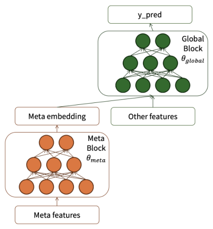
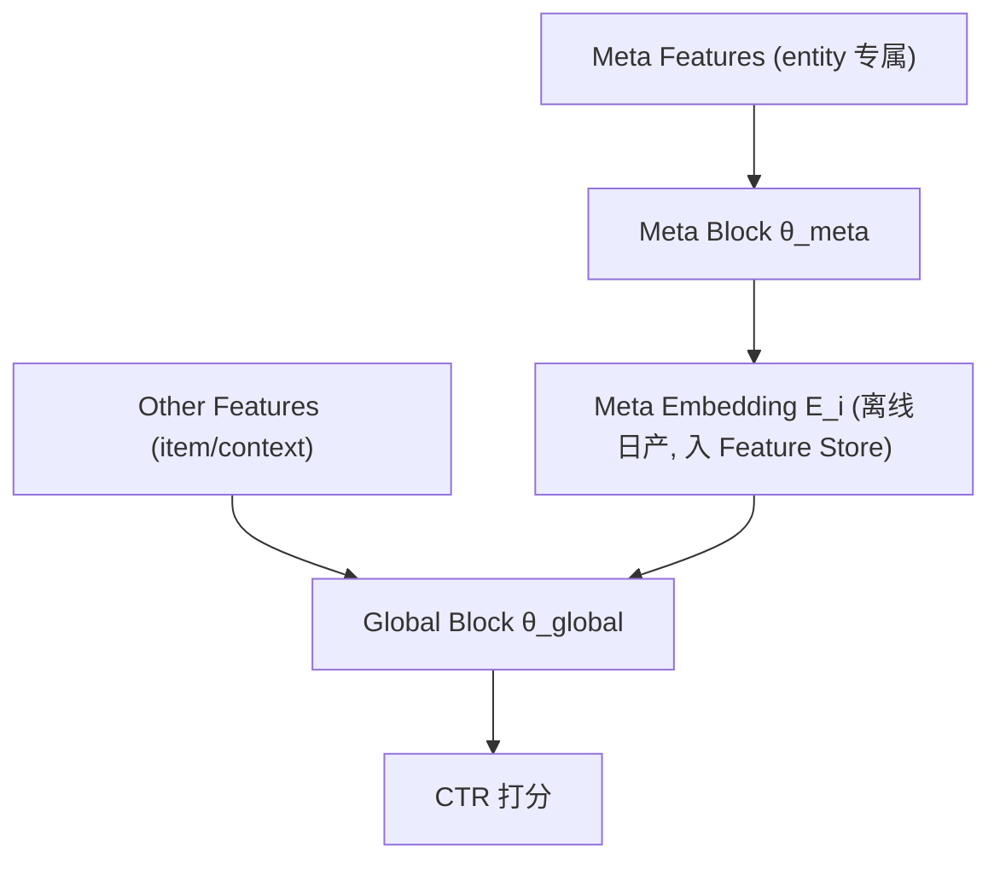

# LiMAML: Personalization of Deep Recommender Models via Meta Learning (基于元学习的深度推荐模型个性化)

- **会议/期刊**: KDD 2024 (August 25–29, Barcelona)
- **作者与机构**: Ruofan Wang, Prakruthi Prabhakar, Gaurav Srivastava, Tianqi Wang, Zeinab S. Jalali 等 (LinkedIn Inc.)
- **推荐链路定位**: 精排 (CTR 预估) + 离线特征生成
- **研究方向**: 冷启动与长尾推荐 / 工业级个性化架构
- **论文原文**: [https://arxiv.org/abs/2403.00803v1](https://arxiv.org/abs/2403.00803v1)
- **开源代码**: 暂未开源

## TL;DR (1分钟核心速览)

针对推荐深模在低频用户/实体上 ID embedding 训练数据不足、个性化失效，而原始 MAML 又因需存储十亿级任务权重与在线实时微调而无法工业落地的双重死结，提出 LiMAML：将网络解耦为 Meta Block 与 Global Block，仅对 Meta Block 做 MAML 元学习，并把每个 task 微调后的子网络输出压缩为定长 meta embedding，离线日产、在线直接 lookup 打分。在 LinkedIn pTap/pClick/pInvite 生产数据（全局时间戳切分 + AUC）上相对基线提升 +1.47%/+0.47%/+10.56%，线上 A/B 通知 CTR 提升 +2.0%/+0.6%（p<0.05），低频与新注册用户 cohort CTR 涨幅最高 +11.2%。

## Background & Motivation (背景与核心矛盾)

- **主流范式**: 工业推荐深模依赖高阶特征交叉 (Wide&Deep / DeepFM / DCN v2) 与大规模 ID embedding 表实现用户/实体级个性化；少量工作 (MeLU 等) 已把 MAML 用于 CTR 冷启动。
- **前人局限**: ①全局模型对所有成员共享一套参数，个性化受限；②ID embedding 只有在单实体数据充足时才可靠，低频成员天然数据低效；③MeLU 型方案把任务适配放在最后几层 MLP，必须为每个 task 存储整套个性化尾层权重（十亿用户 × 全参数），存储不可行；④在线实时微调会引入秒级推理延迟，计算不可行。
- **核心洞察 (Key Insight)**: MAML 学到的 $\theta$ 本身不是任何任务的最优点，但它是极佳的 bootstrap 起点——真正携带个性化信息的是"适配后子网络在当前 entity 特征上的输出"，而非整套权重。
- **本文切入点**: 把网络拆成「元学习小块 + 全局共享大块」，只把小块的结果物化为向量，从而同时保住少样本个性化能力与工业可服务性。

## Method (核心方法设计)

### 1. 整体框架 (Overall Architecture)

模型将输入特征分为 Meta Features（entity 专属，如用户特征）与 Other Features（item/context 等）。Meta Block（参数 $\theta_{\mathrm{meta}}$，可用 ID embedding 或轻量 MLP）吃 Meta Features，输出 meta embedding$\mathbf{E}$，与 Other Features 拼接后送入 Global Block（参数$\theta_{\mathrm{global}}$，与线上现有深模架构等价）产出预测。训练分两阶段：Algo 2a 在 support set 上做内层适配、用 query set 同时更新两块；Algo 2b 每日离线用最近$X$天（2 周~2 月）数据对每个 task 做$k$步微调得$\theta_{\mathrm{meta}}^{(i)}$，再用该 task 最新一条样本打分得到$\mathbf{E}_i$写入 feature store。线上服务时 Global Block 仅需检索$\mathbf{E}_i$ 参与前向，无任何元学习计算开销。

<figure class="paper-figure" markdown="span">
  <figcaption>图1：LiMAML模型结构</figcaption>
</figure>

### 2. 关键设计拆解 (Key Designs)

1. **Meta/Global 解耦 + Meta Embedding 物化（让百亿参数模型可服务）**：原始 MAML/MeLU 需持久化每个任务的个性化权重或在线微调；LiMAML 只存 Meta Block 的**输出向量**，存储从"每任务一套参数（quadrillions 级）"降到"每任务一个定长向量（tens of billions 级）"，且元学习全部搬到离线，线上零延迟。公式上即把适配后的子网络对当前 entity 特征的一次前向当作特征：
$$\mathbf{E}_i = \mathrm{Enc}_{\theta_{\mathrm{meta}}^{(i)}}\left(\mathbf{x}_i^{\mathrm{latest}}\right)$$
直觉上，这就是用 MAML 学到一个"把少量近期交互压缩成个性化先验"的编码器，替代需要大量样本才收敛的 ID embedding。

2. **双层优化与分任务分组训练（让个性化真正发生）**：任务级损失为标准交叉熵 $\mathcal{L}_{T_i}(f) = -\sum_{j}\left[y_j \log f(\mathbf{x}_j) + (1-y_j)\log(1-f(\mathbf{x}_j))\right]$。内层从$\theta_{\mathrm{meta}}$出发迭代$n$ 步得到个性化参数：
$$\theta_{\mathrm{meta}}^{(i)} \leftarrow \theta_{\mathrm{meta}}^{(i)} - \alpha \nabla_{\theta_{\mathrm{meta}}^{(i)}} \mathcal{L}_{T_i}\left(f_{\theta_{\mathrm{meta}}^{(i)}}\right)$$
外层用 query set 联合更新两块：$\theta_{\mathrm{meta}} \leftarrow \theta_{\mathrm{meta}} - \beta \nabla_{\theta_{\mathrm{meta}}} \sum_{i}\mathcal{L}_{T_i}(f_{\theta_{\mathrm{meta}}^{(i)}})$，$\theta_{\mathrm{global}} \leftarrow \theta_{\mathrm{global}} - \beta \nabla_{\theta_{\mathrm{global}}}\sum_{i}\mathcal{L}_{T_i}(f_{\theta_{\mathrm{global}}})$。关键工程细节是 Vanilla 基线也按 task 分组构造 mini-batch，保证对比公平；正确选择 task 粒度是收益前提（见 Findings 2）。

3. **训练目标、加速与推理开销**：总损失即外层 query-set 交叉熵之和（MAML 无额外正则）；负采样策略论文未涉及（pointwise 二分类）。训练加速三招：tasks/GPU 32→128 + 全局 LR 线性缩放 + 梯度范数裁剪至 1.0 + warm-up/decay；多 GPU 数据并行**仅在外层同步梯度**；内层步数 $n$ 降到 1（AUC 无显著变化），合计训练时间减少 **77.19%**。推理端额外开销仅一次向量检索与拼接，可忽略。

## Experimental Setup & Evaluation Protocol (实验设置与评估协议)

- **数据集与预处理**（LinkedIn 生产数据，无公开集）：

| 数据集 | 任务定义 | #Tasks | 预测目标 | 场景说明 |
| :--- | :---: | :---: | :---: | :--- |
| pTap | per user | 数千万 | 推送点击率 | 移动端 push 通知，meta features 为全部用户特征 |
| pClick | per user / per (user, notif. type) | 数百万 | 站内通知点击率 | 对比任务粒度影响 |
| pInvite | per inviter / per invitee | 数千万 | 连接邀请接受率 | 双实体输入 (inviter, invitee) |

- **数据划分与防穿越**: **全局时间戳切分**（train < validation < test 严格时序）；每个 task 内按时间排序，前 **75% 作 support set、后 25% 作 query set**；每任务样本数设上限并只保留最近样本，显式避免跨期信息泄漏。Validation 用于 task-level 微调，Test 用于最终报告。
- **排名评测协议**: 报告 **AUC 相对增益**（非 Full-Ranking 排序指标，论文未披露候选集规模与负采样比例），多次运行 AUC 增益相对标准差 < 0.02%；线上 A/B 采用 $p<0.05$ 显著性检验，持续一周。
- **对比基线与超参**: ①Vanilla Training（同架构 MLP，分任务 batch，含 fine-tune/非 fine-tune 两版）；②Entire Network MAML（全网络元学习）；③Wide&Deep + 用户 ID embedding（工业强基线）。Meta Block 为较小 MLP，Global Block 与各应用线上架构一致。

## Key Experimental Results (实验关键数据)

### 1. 主实验对比 (Main Results)

pTap 上三种训练范式的 AUC 相对增益（Table 3）：

| 方法 | 无微调 | 微调后 | <25 样本任务(微调) | >25 样本任务(微调) |
| :--- | :---: | :---: | :---: | :---: |
| Vanilla Training (MLP) | baseline | +0.75% | +1.09% | +1.63% |
| Entire Network MAML | -0.18% | **+1.68%** | +1.84% | **+2.83%** |
| **LiMAML** | -0.43% | **+1.47%** | +1.38% | +1.64% |

多应用与 ID embedding 基线对比（Table 4/5）：

| 应用 / 配置 | 任务定义 | Test AUC Gain |
| :--- | :---: | :---: |
| pInvite (LiMAML) | per inviter | **+10.56%** |
| pInvite (LiMAML) | per invitee | +0.58% |
| pClick (LiMAML) | per user | +0.01% |
| pClick (LiMAML) | per (user, notif. type) | **+0.47%** |
| pTap (Wide&Deep + User ID Emb.) | per user | baseline |
| pTap (LiMAML, Meta=ID Emb.) | per user | +1.30% |
| pTap (LiMAML, Meta=MLP) | per user | **+1.36%** |

线上 A/B（Table 7/8，全部 $p<0.05$）：pClick CTR **+2.0%**、WAU +0.1%；pTap CTR +0.6%、WAU +0.2%。低频 cohort：pClick CTR 依次 **+7.7% / +4.9% / 中性**；pTap CTR **+3.7% / +11.2% / +5.3%**（Cohort 3 为新注册、训练集未出现）。

### 2. 消融实验 (Ablation Study)

| 消融项 | 设置 | 性能变化 |
| :--- | :---: | :---: |
| 去掉任务微调 | LiMAML 无 fine-tune | AUC **-0.43%**（低于 baseline） |
| Meta Block 架构 | ID Embedding → MLP | +1.30% → **+1.36%**（略优） |
| Embedding 刷新频率 | 每日 → 每周 (pTap) | 离线 AUC **-0.5%** |
| 内层迭代步数 $n$ | 5 → 1 | AUC 无显著差异，训练时间 **-77.19%** |
| 加 Dropout 0.1 | 每层 MLP 后 | 测试 AUC 下降（数据量过大不需正则） |
| Embedding 聚合 | 最新样本 → mean/max pooling | 均劣于取最新样本 |

### 3. 关键实验发现 (Key Findings)

1. **微调是收益的唯一来源，而非元学习本身**：LiMAML 无微调时 AUC 相对基线 **-0.43%**（MAML 输出的 $\theta$ 非最优点），一旦在验证集上做少量梯度适配即翻正至 **+1.47%**；说明工业部署必须保留每日离线 meta fine-tuning 环节，否则模型反而不如普通训练。
2. **任务粒度定义比算法选择更决定成败**：同一 pClick 上 per-user 仅 +0.01%（近乎无效），改为 per-(user, notification type) 即 +0.47%；pInvite 上选 inviter 为任务得 **+10.56%**、选 invitee 仅 +0.58%——meta learning 的收益高度依赖"哪个实体真正承载了可迁移的个性化信号"。
3. **对数据稀缺群体实现了真正的 strict cold-start 泛化**：线上 Cohort 3（新注册、完全未参与训练）在 pTap 上 CTR 仍提升 **+5.3%**，Cohort 2（28 天未活跃）提升 **+11.2%**，与 ID embedding "必须先有足够数据才能学好"的机制形成鲜明对照，证明元学习先验可跨任务迁移。

## Highlights & Limitations (亮点、对比与审稿批判)

- **与代表作对比 (vs. Prior Work)**: 相比原始 MAML，LiMAML 把"全网络元学习 + 在线微调"改为"子网络元学习 + 离线物化向量"，存储与延迟从不可行变为可服务；相比 MeLU（元学习最后几层 MLP，需为每个成员持久化尾层权重），本文把适配前移到前几层，只存一个定长向量；相比 Wide&Deep ID embedding（pTap 上 +1.30% vs +1.36%），在低频任务上优势更显著。
- **可迁移亮点**: ①"离线日产 embedding + 线上 feature store lookup"是把任何重计算个性化模块 (LLM/图模型/序列模型) 工业化的通用范式；②分任务构造 mini-batch 的训练方式为元学习类方法提供了可比的强基线设定。
- **审稿级局限批判**: ①仅报告 AUC，未披露 Full-Ranking 或采样排序协议，也未说明候选集规模，离线结论与线上排序效果之间的映射不够透明；②数千万任务每日各做 $k$ 步离线微调，其算力成本仅给出训练侧加速，未量化推理侧 embedding 生成的总开销；③任务定义（哪个 entity、何种粒度）依赖人工试错，论文未给出可自动选择 task 的准则；④Meta Block 仅验证 MLP/ID embedding，文中自认 Transformer/序列架构仍是 future work；⑤全部基于 LinkedIn 内部数据与业务指标，缺乏可复现的公开基准。

## Rating (四维评分)

- **方法创新性 (Novelty)**: ⭐⭐⭐ （MAML 用于推荐已有 MeLU 等前作，核心贡献在"网络解耦 + meta embedding 物化"的架构级改造，理论增量有限但问题切分精准）
- **评估协议与实验扎实度 (Protocol & Experiments)**: ⭐⭐⭐⭐ （三个生产应用、多任务定义、离线 AUC + 线上 A/B + 三类低频 cohort 分析完整，显著性检验到位；但无公开数据集、无 Full-Ranking 排序协议、负采样与候选集细节缺失）
- **写作与数学规范度 (Clarity & Rigor)**: ⭐⭐⭐⭐ （算法伪代码与 MAML/MeLU 对照表清晰，工程洞察具体；公式较简洁，未给出复杂度与收敛性分析）
- **工业落地与复现价值 (Industrial & Practical Value)**: ⭐⭐⭐⭐⭐ （真实服务百亿参数模型，训练加速 77.19%，线上 CTR/WAU 双指标显著提升，离线 embedding 化思路可直接迁移到任何大规模推荐系统）

