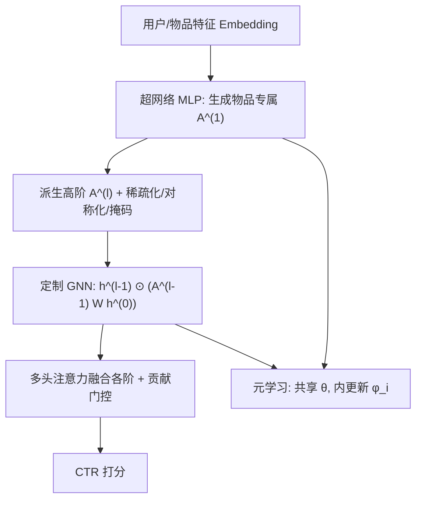
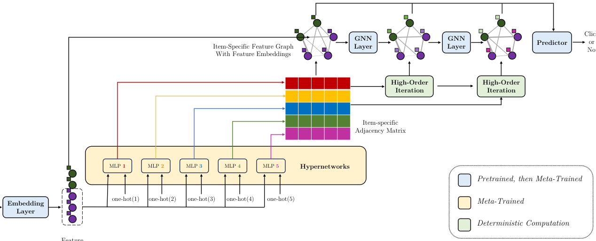

# Warming Up Cold-Start CTR Prediction by Learning Item-Specific Feature Interactions (通过物品专属特征交互学习为新物品 CTR 预估预热)

- **会议/期刊**: KDD 2024 (arXiv:2407.10112v1)
- **作者与机构**: Yaqing Wang, Daxiang Dong, Jingbo Zhou (百度研究院/百度智能云)；Hongming Piao (香港城市大学)；Quanming Yao (清华大学电子工程系)
- **推荐链路定位**: 精排 (CTR 预估) — 面向新物品的冷启动/暖启动阶段
- **研究方向**: 冷启动与长尾推荐 / CTR 预估与特征交叉
- **论文原文**: [https://arxiv.org/abs/2407.10112v1](https://arxiv.org/abs/2407.10112v1)
- **开源代码**: [https://github.com/LARS-group/EmerG](https://github.com/LARS-group/EmerG)

## TL;DR (1分钟核心速览)

现有冷启动工作（MetaE/MWUF/CVAR/GME）只在新物品的 **ID embedding 初始化**上做文章，后端仍沿用一套**全局特征交互模式**，导致交互丰富的旧物品在训练中淹没新物品。EmerG 改为学习**物品专属的特征交互图**：超网络由物品侧特征直接生成邻接矩阵，定制 GNN 以"聚合原始 0 阶特征嵌入"的方式可证地捕获任意阶交互，再用元学习在大量旧物品任务上共享超网络/GNN 参数、每任务仅微调极小物品专属参数。在 MovieLens/Taobao 的冷启动 + 三阶段暖启动评测中，AUC 分别达 75.44%/61.58%（冷启动，较最优基线 +2.53%/+1.55%），三阶段暖启动亦全部最优。

## Background & Motivation (背景与核心矛盾)

- **主流范式**: 工业界把新物品生命周期拆为冷启动（零交互）→ 暖启动（少量交互）→ 常规期；学界主流做法是让通用 CTR 骨干（DeepFM/AutoInt/Fi-GNN 等）+ 一个"新物品 ID embedding 生成器"（元学习 Embedding、邻域聚合、VAE 解码）平滑过渡。
- **前人局限**: ①所有方法共享**同一张全局特征图/同一套高阶交叉算子**，新物品的个性化交互语义被旧物品的海量样本压制；②通用骨干参数量大，用少量新样本微调极易过拟合，而 Fi-GNN 式"逐物品自由学习特征图"在冷启动下自由度过高反而更差（表 1 中 Fi-GNN 在 Taobao 冷启动仅 56.92%）。
- **核心洞察 (Key Insight)**: 同为"物品"，交互模式本质不同——高客单价奢侈品的关键是 $\langle$price, income$\rangle$二阶交叉，日用品则由$\langle$age, category$\rangle$ 主导；因此**特征图应当随物品而变，而非全局共享**。
- **本文切入点**: 用超网络从"物品是什么"（物品特征嵌入）直接"渲染"出该物品的特征图，把冷启动预测转成"图生成 + 任意阶交互传播 + 元学习泛化"三件事。

## Method (核心方法设计)

### 1. 整体框架 (Overall Architecture)

输入为一条 $(u,v)$样本的全部用户/物品特征，经 Embedding 层得到$N_v+N_u$个特征向量；超网络$MLP_{W_a}$以"物品侧特征嵌入 + 目标节点 one-hot"为输入，逐行输出该物品专属的初始邻接矩阵$\bar{A}^{(1)}_i$；后续各层邻接矩阵直接由$\bar{A}^{(1)}_i$自乘派生（省存储），经稀疏化/对称化/掩码后送入定制消息传递 GNN，第$l-1$层即对应$l$阶交互；多头注意力显式融合 0 至$N_l$阶表示，再由 sigmoid 门控给出各特征贡献系数并加权求和得最终 CTR。训练采用任务级元学习（内外双循环），推理时新物品只需生成$\phi_k$ 并做极少步内更新。

<figure class="paper-figure" markdown="span">
  <figcaption>图 1：所提出的 EmerG 的示意图，旨在通过学习物品特定的特征交互模式来增强新出现物品的 CTR 预测。EmerG 使用超网络基于物品特征嵌入，为特征图生成初始的物品特定邻接矩阵，其中节点表示用户和物品特征，边表示它们之间的交互。后续 GNN 层的高阶邻接矩阵由该初始矩阵生成，从而降低模型复杂度和存储需求。GNN 的消息传递过程被定制为限制</figcaption>
</figure>

### 2. 关键设计拆解 (Key Designs)

1. **超网络生成物品专属特征图**：全局共享图无法表达物品差异 $\to$对第$m$行有$[\bar{A}^{(1)}_i]_{m:}=\mathrm{MLP}_{W_a}([\boldsymbol{e}_{1,i},\dots,\boldsymbol{e}_{N_v,i},\text{one-hot}(m)])$，且高阶图由$\bar{A}^{(l)}_i=\bar{A}^{(l-1)}_i\cdot\bar{A}^{(1)}_i$直接连乘得到，再做 top-$K$稀疏化、$(\hat{A}^\top+\hat{A})/2$对称化与低阶断连掩码。直觉：连乘只保留$l$ 跳可达路径，**每个物品只需存一张矩阵**即可支撑任意层数，参数与存储不随 GNN 深度增长。

2. **可证任意阶交互的定制消息传递**：常规 GNN 用 $h^{(l-1)}_n$聚合，阶数不可控且需残差堆叠$\to$改为与**原始嵌入**聚合：$\boldsymbol{h}^{(l)}_m=\boldsymbol{h}^{(l-1)}_m\odot\big[\sum_{n=1}^{N_v+N_u}[A^{(l-1)}_i]_{mn}W^{(l-1)}_g\boldsymbol{h}^{(0)}_n\big]$。Proposition 4.1 证明第$l-1$层输出恰为$l$ 阶交互，使模型能把 2 阶、3 阶交叉显式分层后再由注意力按需加权，而非隐式混叠。

3. **训练目标、负采样与推理效率**：跨任务元目标为 $\sum_{i}\gamma\mathcal{L}_{S_i}(\theta_{\mathrm{GNN}},\phi_i)+(1-\gamma)\mathcal{L}_{Q_i}(\theta_{\mathrm{GNN}},\phi'_i)$，其中$\phi_i=\{A^{(1)}_i,\boldsymbol{e}_{ID,i}\}$为物品专属参数、$\phi'_i=\phi_i-\alpha_1\nabla_{\phi_i}\mathcal{L}_{S_i}$为内更新一步后的参数；$\gamma$ 平衡"冷启动（未见 S_i）"与"暖启动后"两种性能。CTR 场景沿用日志正负样本（无额外负采样）。推理端新物品仅需一次 MLP 前向 + 少量内更新，开销显著低于重训骨干。

## Experimental Setup & Evaluation Protocol (实验设置与评估协议)

- **数据集与预处理**: MovieLens 将评分 <4 置 0、≥4 置 1；Taobao 为 2600 万广告点击日志。

| 数据集 | #Users | #Items | #Interactions | 特征/场景说明 |
| :--- | :---: | :---: | :---: | :--- |
| MovieLens | 原文未列 | 原文未列 | ~1M | 物品: ID/title/year/genres；用户: ID/age/gender/occupation/zip |
| Taobao | 原文未列 | 原文未列 | ~26M | 物品: ad/position/category/campaign/advertiser/brand/price；用户: ID/group/gender/age/消费等级/购物深度/职业/城市等级 |

- **数据划分与防穿越 (Splitting Strategy)**: 按交互频次切分 —— 旧物品（交互数 > $N$，MovieLens$N{=}200$、Taobao$N{=}2000$）用于预训练；新物品（交互数$<N$且$>3K$，$K{=}20/500$）的交互**按时间戳排序**，依次切出 A/B/C 三个暖启动支撑集（各含$K$ 条/物品），剩余交互构成测试集 —— 属于严格的时间序**增量暖启动划分**，测试样本对模型不可见。
- **排名评测协议 (Ranking Protocol)**: 非排名类，使用逐条打分指标 **AUC** 与 **F1**（阈值 0.5），在物品级任务上分别报告冷启动、暖启动 A/B/C 四阶段结果；每项实验多次随机种子取均值，括号内为标准差。
- **对比基线与超参设置**: 四组共 15 个基线 —— 通用骨干（DeepFM、Wide&Deep、AutoInt、AFN、Fi-GNN、FinalMLP、FINAL）、零交互新物品（DropoutNet、ALDI）、少样本（MeLU、MAMO、TaNP、ColdNAS）、增量暖启动（MetaE、MWUF、GME、CVAR，均以 DeepFM 为骨干）。GNN 层数 MovieLens 取 2、Taobao 取 3；作者报告 EmerG 在时间与算力上更省（附录 C.2）。

## Key Experimental Results (实验关键数据)

### 1. 主实验对比 (Main Results)

**MovieLens（AUC%，括号内标准差）**

| 方法 | Cold-Start | Warm-A | Warm-B | Warm-C |
| :--- | :---: | :---: | :---: | :---: |
| DeepFM | 71.48 | 75.21 | 77.70 | 79.45 |
| FinalMLP | 69.51 | 78.48 | 78.47 | 79.07 |
| DropoutNet | 72.94 | – | – | – |
| TaNP | – | 79.15 | 80.49 | 80.71 |
| MetaE | 71.82 | 79.53 | 80.27 | 80.47 |
| CVAR | 73.58 | 78.23 | 80.28 | 81.06 |
| GME | 71.54 | 75.81 | 78.10 | 79.15 |
| MWUF | 73.19 | 78.88 | 80.26 | 80.57 |
| **EmerG** | **75.44** | **79.92** | **81.28** | **81.82** |
| Improv.% | +2.53 | +0.49 | +0.98 | +0.94 |

**Taobao（AUC%）**

| 方法 | Cold-Start | Warm-A | Warm-B | Warm-C |
| :--- | :---: | :---: | :---: | :---: |
| DeepFM | 59.01 | 60.68 | 61.51 | 62.34 |
| Fi-GNN | 56.92 | 60.00 | 62.09 | 62.46 |
| FinalMLP | 60.64 | 63.44 | 63.49 | 64.05 |
| TaNP | – | 55.67 | 55.85 | 56.19 |
| MetaE | 59.75 | 61.19 | 62.06 | 62.87 |
| CVAR | 60.56 | 62.54 | 63.17 | 63.95 |
| GME | 60.57 | 62.55 | 63.29 | 63.85 |
| MWUF | 59.65 | 62.08 | 63.03 | 63.79 |
| **EmerG** | **61.58** | **63.56** | **63.76** | **64.22** |
| Improv.% | +1.55 | +0.19 | +0.43 | +0.27 |

F1 同步最优：MovieLens 冷启动 64.76%（次优 GME 64.31%），暖启动 C 70.26%（次优 GME 69.95%）；Taobao 暖启动 A/C 为 15.02%/15.21%（次优 FinalMLP 14.83%、CVAR 15.09%）。

### 2. 消融实验 (Ablation Study)

原文以图 3（四阶段 AUC 折线）呈现，下表为相对 EmerG 的方向性结论：

| 变体 | 移除内容 | MovieLens | Taobao | 结论指向 |
| :--- | :--- | :---: | :---: | :--- |
| w/ random graph | 超网络生成 → 随机邻接矩阵 | 显著↓ | 显著↓ | 物品专属图确实携带有效交互语义 |
| w/ shared graph | 物品专属图 → 全局共享图 | 明显↓ | 明显↓ | 全局共享无法刻画物品差异（核心论点验证） |
| w/o sparsification | 去掉 top-$K$ 稀疏化 | 中等↓ | 中等↓ | 稠密图稀释有用消息 |
| w/o mask | 去掉低阶断连掩码 | 中等↓ | 中等↓ | 无连通性的高阶路径是噪声 |
| w/o meta | 去掉任务级元学习 | 显著↓ | 显著↓ | 跨任务共享先验是抗过拟合关键 |
| w/o inner | 去掉内循环 $\phi\to\phi'$ | 明显↓ | 明显↓ | 少量新样本必须内更新才被吸收 |

交互函数消融（表 2，AUC%）：元素积 $\odot$ 冷启动 75.44 / 61.58，max 74.14 / 59.98，加法 73.64 / 59.80 —— 逐元素门控式乘性融合最优。

### 3. 关键实验发现 (Key Findings)

1. **冷启动收益最大、暖启动趋于收敛但从不被反超**：MovieLens 冷启动 +2.53%、Taobao +1.55% 的增幅远超暖启动 C 的 +0.94%/+0.27%；且图 2 显示随新物品样本从 0 增至 1200（MovieLens）/1750（Taobao），CVAR 逐渐被 DeepFM 追平，而 EmerG 始终居于最上沿 —— 说明"生成初始 embedding"的增益会被数据量稀释，"物品专属特征交互"则是可持续的结构性增益。
2. **图结构设计的每一环都不可省，且"共享图"是最致命退化**：w/ shared graph 与 w/ random graph 的跌幅位列前二，直接证明本文动机（全局交互模式淹没新物品）成立；w/o mask 与 w/o sparsification 的中等跌幅说明稀疏 + 连通性约束共同承担"剪枝噪声、增强可解释性"的职责。
3. **阶数需求与数据规模正相关**：MovieLens（1M）在 2 层 GNN 最优，Taobao（26M）在 3 层最优（图 4），而按 $\bar{A}^{(l)}=\bar{A}^{(l-1)}\bar{A}^{(1)}$ 生成的方式使层数可任意扩展而不增加邻接矩阵存储，天然适配不同量级平台。
4. **案例可视化佐证语义合理**：科幻片 *Lawnmower Man 2* 的关键二阶为 $\langle$genres, title$\rangle$（片名反映世界观），喜剧片 *Waiting to Exhale* 则与 title 弱相关；且$\langle$year, age$\rangle$、$\langle$year, zip-code$\rangle$共同诱导出有意义的$\langle$year, age, zip-code$\rangle$ 三阶交互，暖启动阶段图的变动平缓，说明超网络在零样本时已"预判"出大致结构。

## Highlights & Limitations (亮点、对比与审稿批判)

- **与代表作对比 (vs. Prior Work)**: 对比 CVAR（从物品侧信息分布解码 ID embedding）、MWUF（元网络稳定化 ID embedding）与 MetaE（元学习 embedding 生成器），三者本质都是"**在固定全局交叉算子上修 embedding**"，EmerG 换掉了被优化的对象 —— 从"物品向量"扩展到"物品专属的交互结构 + 任意阶交叉路径"，因而在 ID 信号几近于零的冷启动期仍能靠内容侧特征图工作。相较 Fi-GNN / FIVES 的"全局或自由学习的特征图"，EmerG 以超网络做**受控的条件生成**，避免了冷启动下的过参数化。
- **可迁移亮点**: ①"仅存初始邻接矩阵 + 矩阵连乘派生高阶图"可低成本移植到任何多层 GNN 场景，省 $O(N_l)$倍图存储；②"内循环只更新极小的$\phi_i$、外循环更新共享$\theta$"的任务式元训练范式，可直接套用到新用户冷启动、新广告冷启动等同类小样本适配问题。
- **审稿级局限批判**: ①超网络需对 $N_v+N_u$个节点逐一输出一行，稠密$\bar{A}^{(1)}$ 规模随特征数平方增长，特征维度高的工业场景（数百特征）存储与生成开销可能失控，论文未给出规模敏感性分析；②仅报告 AUC/F1 离线指标，缺少线上 A/B、缺少与"直接对 DeepFM 做增量微调"的同等算力对齐对比，且 Taobao 暖启动 A/C 上相对 FinalMLP 的增益仅 +0.19%/+0.27%，是否统计显著（论文未做显著性检验）值得商榷。

## Rating (四维评分)

- **方法创新性 (Novelty)**: ⭐⭐⭐⭐ （把冷启动从"ID embedding 初始化"重构为"物品专属特征图条件生成"，并有 Proposition 4.1 对任意阶交互的可证性支撑，思路清晰且非增量拼接）
- **评估协议与实验扎实度 (Protocol & Experiments)**: ⭐⭐⭐⭐ （时间序增量暖启动划分贴合工业生命周期，四阶段 × 两数据集 × 15 基线 + 6 组消融较完整，扣分在无显著性检验、缺线上验证）
- **写作与数学规范度 (Clarity & Rigor)**: ⭐⭐⭐⭐ （公式链条从 $A^{(1)}$生成到稀疏化/掩码/消息传递/元目标自洽，证明下放附录但结论前置明确；部分符号如$N_d,N_h$ 说明略简）
- **工业落地与复现价值 (Industrial & Practical Value)**: ⭐⭐⭐⭐ （代码已开源，单物品只存一张邻接矩阵、推理仅需前向 + 少量内更新，侵入性低；但超网络对高维特征的可扩展性需工程裁剪）

