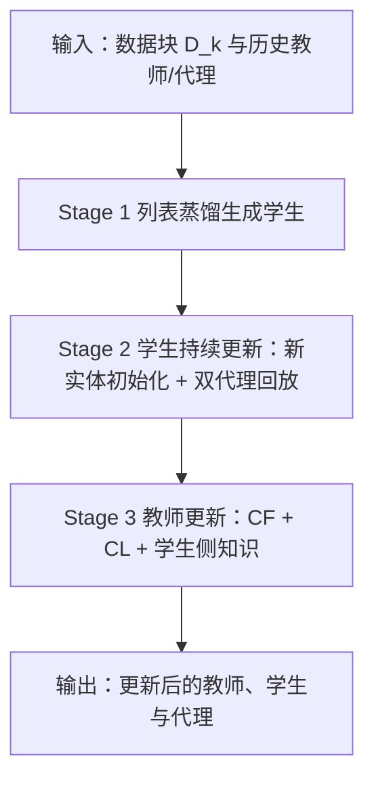
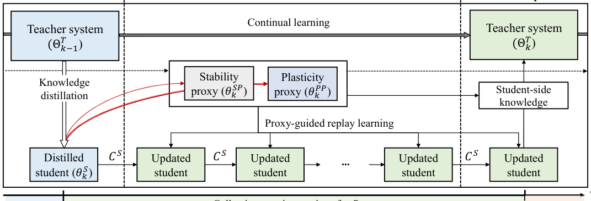

# Continual Collaborative Distillation for Recommender System（推荐系统持续协同蒸馏）

- **会议/期刊**: KDD 2024
- **作者与机构**: Gyuseok Lee, SeongKu Kang, Wonbin Kweon, Hwanjo Yu；POSTECH / UIUC
- **推荐链路定位**: 精排/召回通用（模型压缩与在线更新）
- **研究方向**: 协同过滤与双塔召回 / 工业级持续学习与模型压缩
- **论文原文**: [论文原文链接](https://arxiv.org/abs/2405.19046v4)
- **开源代码**: [开源代码仓库链接](https://github.com/Gyu-Seok0/CCD_KDD24)

## TL;DR (1分钟核心速览)

针对真实推荐流中教师模型更新慢、学生一次蒸馏后无法持续适应新用户/新物品的痛点，本文提出 CCD：学生高频持续更新，并以稳定性/可塑性双代理回放遗忘知识，教师再吸收学生侧知识。Yelp Recall@20 的 H-mean 上，学生 GNN 较最佳基线提升 10.6%，教师较最佳 CL 基线提升 52.6%。

## Background & Motivation (背景与核心矛盾)

- **主流范式**: 用知识蒸馏把大规模教师系统压缩为轻量学生，学生继承教师的列表排序知识，以低推理延迟部署。
- **前人局限**: 现有 KD 多是一次性静态蒸馏；数据流中反复“重训教师+独立蒸馏”既无法频繁更新教师，也无法复用历史知识。
- **核心矛盾**: 学生容量小、更新应快；教师容量大、更新应慢。独立更新学生易灾难性遗忘，独立蒸馏又浪费沿时间累积的教师/学生知识。
- **核心洞察**: 教师与学生具有不同更新周期，可通过“高频学生适应 + 低频教师吸收学生侧知识”实现协同进化。
- **本文切入点**: 将 KD 从静态压缩问题转为非平稳数据流中的教师-学生协同持续学习问题。

## Method (核心方法设计)

### 1. 整体框架 (Overall Architecture)

CCD 按教师周期 $C_T$划分数据块$D_k$，学生以更短周期$C_S\ll C_T$ 更新。每个块依次执行：Stage 1 用教师列表蒸馏生成学生；Stage 2 学生在块内持续学习，并用双代理回放遗忘知识、初始化新实体；Stage 3 教师更新时同时学习新交互、延续旧知识，并选择性吸收学生与代理的高置信预测。该闭环使学生快速适应新数据，教师再借学生侧知识增强，反过来生成更强学生。

<figure class="paper-figure" markdown="span">
  <figcaption>图2：用于第 𝑘 个数据块的 CCD 框架概览。</figcaption>
</figure>

### 2. 关键设计拆解 (Key Designs)

1. **稳定性/可塑性双代理回放**：学生容量小，朴素更新会快速遗忘旧偏好。CCD 用时间均值维护慢更新稳定性代理 $S^{SP}$与快更新可塑性代理$S^{PP}$，按排名差异识别“曾被高排、当前被低估”的物品：$d_{ui}(A,B)=\exp(\epsilon(\mathrm{rank}^A_{ui}-\mathrm{rank}^B_{ui}))$。回放损失为$\mathcal{L}_{RE}=-\sum_u(\sum_{i\in I^{SP}}\ell(\hat{r}^S_{ui},\hat{r}^{SP}_{ui})+\sum_{i\in I^{PP}}\ell(\hat{r}^S_{ui},\hat{r}^{PP}_{ui}))$。直觉是分别从长期保留与近期趋势两个互补视角纠偏。

2. **新实体 2-hop 显著实体初始化**：新用户/新物品的 1-hop 交互极少，直接随机初始化或仅 1-hop 聚合学不动。CCD 从当前块高频实体集合 $P_U,P_I$中取 2-hop 邻居补充，$e_u=AGG(\{e_x:x\in N_u^1\cup(N_u^2\cap P_U)\})$，物品同理。这样把“当下热门趋势”注入新实体，缓解学生小容量下的冷启动学习难题。

3. **教师选择性吸收学生侧知识**：教师长期未更新，学生却掌握最新交互；代理还积累历史知识。CCD 从学生/双代理 top-N 列表中按 $p(i)\propto d_{ui}(RS^T,S^*)$采样教师低估的物品，构造$\mathcal{L}_{S\to T}$做蒸馏，并用$\lambda_{S\to T}=\lambda^0_{S\to T}e^{-t/\tau}$ 退火。早期强吸收学生新知识，后期让教师回归自身 CF/CL 目标。

4. **训练目标、负采样与推理效率**：学生用 BPR 成对损失 $\mathcal{L}_{BPR}$，负例为$j\notin N_u^1$，总损失$\mathcal{L}^S=\mathcal{L}_{BPR}+\lambda_{RE}\mathcal{L}_{RE}$；教师总损失$\mathcal{L}^T=\mathcal{L}_{CF}+\lambda_{CL}\mathcal{L}_{CL}+\lambda_{S\to T}\mathcal{L}_{S\to T}$。Stage 1 采用列表蒸馏$\mathcal{L}_{KD}=-\sum_u\log p(\pi_u^T\mid\theta^S)$。在线仅部署紧凑学生，推理成本显著低于教师系统。

## Experimental Setup & Evaluation Protocol (实验设置与评估协议)

- **数据集与预处理**: 使用 Gowalla、Yelp；论文未说明 5-core 过滤。统计为累计用户/物品与各块交互数：

| 数据集 | #Users | #Items | #Interactions | 密度 | 特征/场景说明 |
| :--- | :---: | :---: | :---: | :---: | :--- |
| Gowalla | 29,858 | 40,988 | 1,027,464 | 0.084% | 签到数据，D0=50%，D1–D5 均分 |
| Yelp | 14,950 | 12,261 | 342,617 | 0.187% | 商户评论，持续新用户/新物品 |

- **数据划分与防穿越**: 按时间戳切分：前 50% 为 $D_0$，后 50% 均分为 5 个增量块；每块内按用户 80%/10%/10% 随机划分 train/val/test。更新$D_k$时禁止访问$D_0,\dots,D_{k-1}$。
- **排名评测协议**: 原文仅称沿用 CL 基线协议，未明确披露是 Full-Ranking 还是 Sampled Ranking 及负采样比；指标为 Recall@20、NDCG@20，并用 LA（可塑性）、RA（稳定性）、H-mean 汇总。
- **对比基线与超参**: 对比 Full-Batch、Fine-Tune、LWC-KD-PIW、ReLoop2，以及 KD+Fine-Tune、KD+LWC-KD-PIW；学生用 MF 与 GNN，嵌入维度 Gowalla 16、Yelp 8；$C_S=C_T/10$；报告 5 次独立运行，$p<0.05$ 配对 t 检验。

## Key Experimental Results (实验关键数据)

### 1. 主实验对比 (Main Results)

Yelp、Recall@20、After $D_5$ 的 H-mean：

| 方法 | Teacher | Student-MF | Student-GNN |
| :--- | ---: | ---: | ---: |
| Full-Batch† | 0.1095 | 0.0735 | 0.0842 |
| Fine-Tune | 0.0722 | - | - |
| LWC-KD-PIW | 0.0682 | 0.0601 | 0.0529 |
| ReLoop2 | 0.0615 | 0.0657 | 0.0611 |
| KD + Fine-Tune | - | 0.0781 | 0.0883 |
| KD + LWC-KD-PIW | - | 0.0781 | 0.0877 |
| **CCD** | **0.1041** | **0.0877** | **0.0977** |

† Full-Batch 使用全部历史数据，仅作参考。相对最佳可部署基线：Teacher +52.6%（vs LWC-KD-PIW），Student-MF +12.3%，Student-GNN +10.6%。NDCG@20 趋势一致且多数提升显著。

### 2. 消融实验 (Ablation Study)

Yelp、After $D_5$：

| 设置 | H-mean |
| :--- | ---: |
| Teacher CCD | 0.1037 |
| Teacher w/o student-side knowledge | 0.0682 |
| Teacher w/o proxies (student only) | 0.0785 |
| Teacher w/o annealing | 0.0797 |
| Student CCD | 0.0977 |
| Student w/o proxy learning | 0.0737 |
| Student w/o S-proxy | 0.0829 |
| Student w/o P-proxy | 0.0826 |
| Student extreme stability | 0.0952 |
| Student extreme plasticity | 0.0962 |

### 3. 关键实验发现 (Key Findings)

1. **教师侧增益主要来自学生知识**：去掉 $\mathcal{L}_{S\to T}$ 后教师 H-mean 从 0.1037 跌至 0.0682（-34.2%）；仅用更新学生为 0.0785，加入双代理后恢复至 0.1037，说明最新知识与历史知识互补。
2. **双代理回放是学生抗遗忘核心**：去掉回放后学生 H-mean 0.0977→0.0737（-24.6%）；仅保留 S/P 代理分别为 0.0829/0.0826，二者单独均不足，组合才最优。新实体初始化也使新用户 Recall@20 达 0.1313，优于 1-hop 的 0.1116 与随机的 0.1270。
3. **压缩部署收益明确但非无损**：Yelp 上学生仅 0.99M 参数、推理 6.56s、H-mean 0.0861，教师为 18.24M、105.20s、0.0813；学生约 5.4% 参数、6.2% 推理时间。但 Gowalla 教师 H-mean 0.1332 仍高于学生 0.1303，说明容量差距尚存。

## Highlights & Limitations (亮点、对比与审稿批判)

- **与代表作对比**: 传统 KD 是静态一次性蒸馏；传统 CL 只更新单一模型；CCD 首次把教师-学生 KD 放进数据流，并让二者互相供知识，而非独立蒸馏。
- **可迁移亮点**: 基于排名差异的动态回放采样可迁移到任何持续推荐模型；2-hop 显著实体初始化适合新用户/新物品频繁出现的场景。
- **审稿级局限批判**: 教师更新仍重（Yelp 约 107 分钟），CCD 主要降低学生推理成本而非教师训练成本；仅两个数据集，且未明确排名候选集与负采样协议，复现公平性受影响；教师未超过 Full-Batch 参考性能，容量差距仍存在。

## Rating (四维评分)

- **方法创新性 (Novelty)**: ⭐⭐⭐⭐ （把 KD 与 CL 从“单模型/静态”推进到教师-学生协同持续进化，双代理机制有清晰直觉）
- **评估协议与实验扎实度 (Protocol & Experiments)**: ⭐⭐⭐⭐ （两个真实数据集、LA/RA/H-mean、5 次运行与显著性检验齐全，但排名协议披露不足）
- **写作与数学规范度 (Clarity & Rigor)**: ⭐⭐⭐⭐ （三阶段流程与公式定义清楚，复杂度分析偏少）
- **工业落地与复现价值 (Industrial & Practical Value)**: ⭐⭐⭐⭐⭐ （代码开源，学生参数与推理开销显著下降，直接对应工业部署的更新周期问题）

