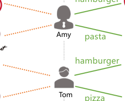
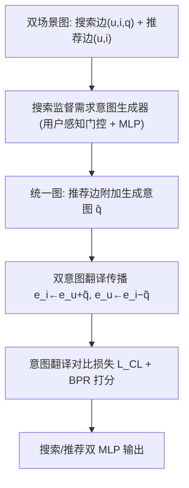
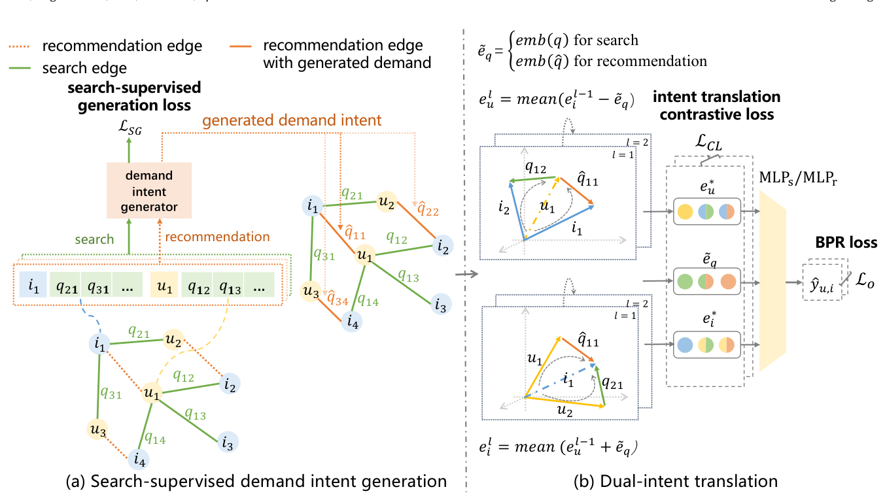

# Unified Dual-Intent Translation for Joint Modeling of Search and Recommendation (统一双意图翻译的搜索与推荐联合建模)

- **会议/期刊**: KDD 2024 (ACM SIGKDD)
- **作者与机构**: Yuting Zhang、Yiqing Wu、Yongchun Zhu、Zhulin An、Yongjun Xu (中科院计算所)；Ruidong Han、Xiang Li、Wei Lin (美团)；Ying Sun (HKUST-GZ)；Fuzhen Zhuang (北航)
- **推荐链路定位**: 召回表征层（离线学习图嵌入，线上作为下游推荐模型的附加特征）
- **研究方向**: 跨域与多场景推荐 / 图神经网络推荐
- **论文原文**: [arXiv:2407.00912v1](https://arxiv.org/abs/2407.00912v1)
- **开源代码**: [17231087/UDITSR](https://github.com/17231087/UDITSR)

## TL;DR (1分钟核心速览)

推荐场景中用户的「固有意图」与「需求意图」均隐式不可观测，现有意图感知模型只能从点击行为反推意图，常把同一物品的交互误判为同一需求。本文提出 UDITSR：用同一平台上搜索侧的真实 query 作为监督信号，为每条推荐交互 (u, i) 生成需求意图 $\hat{\mathbf{e}}_q$，再以「固有意图 + 需求意图 ≈ 交互物品」的嵌入翻译式图传播统一建模，并加意图翻译对比损失约束。在美团外卖两个自建数据集上采用时间切分 + 1:99 采样排序，搜索 Hit@5 相对最优基线 +4.78%，推荐 Hit@5 +5.77%；线上 A/B 一月 GMV +1.46%、CTR +0.77%。

## Background & Motivation (背景与核心矛盾)

- **主流范式**: 搜索与推荐常共存于同一平台，JSR/SRJGraph 等采用共享参数或统一图（把 query 作为边属性）做联合优化；推荐侧的意图建模则依赖行为序列反推（DIN、KA-MemNN）。
- **前人局限**: ① SRJGraph 对**所有推荐交互使用同一个 padding query**，隐含「需求意图不随时间/物品变化」的强假设，与用户真实跨品类需求漂移矛盾；② 直接把历史 query 拼进推荐模型缺少显式监督，学到的意图与真实需求偏差大；③ 双意图仅作为输入特征拼接，无法刻画「意图—意图—物品」三元组关系。
- **核心洞察 (Key Insight)**: 同一用户的固有意图（如偏向重口味）在两场景一致，而需求意图（如夏天要 T 恤、冬天要羽绒服）在搜索侧由 query **显式给出**——搜索 query 可充当推荐需求意图的"标注"。
- **本文切入点**: 把推荐缺失的 query 当作**可生成变量**，用搜索 query 监督生成，再把「固有 + 需求 = 交互物品」写成知识图谱式翻译约束。

<figure class="paper-figure" markdown="span">
  <figcaption>图1：推荐与搜索场景中的交互行为示例。</figcaption>
</figure>

## Method (核心方法设计)

### 1. 整体框架 (Overall Architecture)

输入为双场景交互图 $G=(\mathcal{U}\cup\mathcal{I},\mathcal{E}^s\cup\mathcal{E}^r)$：搜索边$(u,i,q)$带真实 query，推荐边$(u,i)$无 query。先由**搜索监督需求意图生成器**为每条推荐边合成意图表征$\hat{\mathbf{e}}_q$，把双场景图补全为统一图；再在该图上做**双意图翻译传播**，用户侧聚合$\mathbf{e}_i-\tilde{\mathbf{e}}_q$、物品侧聚合$\mathbf{e}_u+\tilde{\mathbf{e}}_q$，配合意图翻译对比损失约束三元组同空间一致性；最后拼接$(\mathbf{e}_u^*\Vert\mathbf{e}_i^*\Vert\tilde{\mathbf{e}}_q)$ 经搜索/推荐两个独立 MLP 打分，BPR 成对训练、双任务联合反向传播。

<figure class="paper-figure" markdown="span">
  <figcaption>图2：我们提出的 UDITSR 的整体框架。双意图翻译中的均值表示式5中的平均池化操作。为清晰起见，双意图翻译中的每个图聚合仅展示两个交互示例。</figcaption>
</figure>

### 2. 关键设计拆解 (Key Designs)

1. **搜索监督的需求意图生成器（把 query 从"输入特征"变成"监督目标"）**：痛点是无标注就无法校验推荐意图是否真实。作者用用户历史 query 表征 $\mathbf{e}_{q_u}$与物品侧 query 词做用户感知门控（物品 query 来自多用户，需个性化加权），再与$\mathbf{e}_u,\mathbf{e}_i$ 一起过 MLP 回归真实 query 表征：
$\mathbf{K}_g=\mathbf{W}_g(\mathbf{e}_u\Vert\mathbf{e}_{q_u})$，$\ \mathbf{e}_{q_i}=\sum_k g(w_{ik})\mathbf{e}_{w_{ik}}$，$\ \hat{\mathbf{e}}_q=\mathrm{MLP}(\mathbf{e}_u\Vert\mathbf{e}_i\Vert\mathbf{e}_{q_u}\Vert\mathbf{e}_{q_i})$，$\ \mathcal{L}_{SG}=\sum_{(u,i,q)\in X^s}(\mathbf{e}_q-\hat{\mathbf{e}}_q)^2$。
关键取舍是**直接生成意图向量而非生成 query 词**，避免离散解码不可导与词表误差，使意图可端到端进入图传播。

2. **双意图翻译传播（把 TransE 式平移搬到用户—物品图）**：痛点是双意图拼接无法表达"需求意图是相对固有意图的偏移"。作者令物品 = 固有意图 + 需求意图、用户 = 物品 − 需求意图，在消息聚合算子内直接改写为加/减：
$\mathbf{e}_i^{l}=\mathrm{mean}(\{\mathbf{e}_u^{l-1}+\tilde{\mathbf{e}}_q,\forall u\in\mathcal{N}_i\})$，$\ \mathbf{e}_u^{l}=\mathrm{mean}(\{\mathbf{e}_i^{l-1}-\tilde{\mathbf{e}}_q,\forall i\in\mathcal{N}_u\})$，
再做层加权 $\mathbf{e}^*=\sum_l \alpha_l\mathbf{e}^l,\ \alpha_l=1/(l+1)$。物理直觉：加法把"人 + 当下需求"推到目标物品邻域，减法反向剥离需求、只留固有偏好，使两类意图在同一语义空间解耦。

3. **意图翻译对比损失、训练目标与推理开销**：仅靠传播不足以约束平移关系，故加 margin 式成对约束，令 $\mathbf{e}_u^*+\tilde{\mathbf{e}}_q$ 靠近真物品、远离负物品：
$\mathcal{L}_{CL}=\sum_{(u,i,i')\in Y}-\ln\sigma[(\mathbf{e}_u^*+\tilde{\mathbf{e}}_q-\mathbf{e}_{i'}^*)^2-(\mathbf{e}_u^*+\tilde{\mathbf{e}}_q-\mathbf{e}_i^*)^2]$。
总损失 $\mathcal{L}=\mathcal{L}_o+\lambda_1\mathcal{L}_{SG}+\lambda_2\mathcal{L}_{CL}$，$\mathcal{L}_o$ 为 BPR 成对损失（每正样本随机采 1 负样本，同批负样本兼作对比负例，无需额外难负采样）；推理只需一次 2 层图传播 + 向量内积，线上以预计算嵌入作为特征注入下游模型。

## Experimental Setup & Evaluation Protocol (实验设置与评估协议)

- **数据集与预处理**: 作者指出无公开的搜索+推荐双场景数据，自建美团外卖两城 8 天数据（无 5-core 过滤描述）：

| 数据集 | #Users | #Items | #Interactions (Search / Rec) | 稀疏度/密度 | 特征/场景说明 |
| :--- | :---: | :---: | :---: | :---: | :--- |
| MT-Small | 56,887 | 4,059 | 111,891 / 65,035 | 稀疏（人均约 3 次交互） | 外卖，query 平均切词 1.68 |
| MT-Large | 433,573 | 22,967 | 1,527,869 / 1,168,491 | 中等 | 外卖，query 平均切词 1.56 |

- **数据划分与防穿越 (Splitting Strategy)**: **全局时间戳切分**——前 6 天训练、第 7 天验证（早停）、第 8 天测试。
- **排名评测协议 (Ranking Protocol)**: `Sampled Ranking`，每条测试正样本随机采 **99 个未交互负样本（1:99）**；指标 Hit@5、NDCG@5、MRR、Avg.C（越小越好）与推荐侧 AUC。
- **对比基线与超参设置**: 无图基线 NeuMF / xDeepFM / DIN / AEM / TEM / JSR / SimpleX / MGDSPR，图基线 GAT / NGCF / LightGCN / GraphSRRL / SRJgraph / DCCF（共 15 个）；所有基线共享相同嵌入层与预测层并联合双任务训练。嵌入维度 $d=100$，传播层数 2，AdamW、lr$1\times10^{-4}$、batch 256、早停；$\lambda_1=1.5/1$、$\lambda_2=0.2/0.4$（Small/Large）；报告$p<0.05$ 配对 t 检验。

## Key Experimental Results (实验关键数据)

### 1. 主实验对比 (Main Results)

| Dataset | Model | S-Hit@5 | S-NDCG@5 | R-Hit@5 | R-NDCG@5 | R-AUC |
| :--- | :--- | :---: | :---: | :---: | :---: | :---: |
| MT-Small | NGCF | 0.6418 | 0.5173 | 0.4564 | 0.3346 | 0.8232 |
| MT-Small | LightGCN | 0.6665 | 0.5402 | 0.4577 | 0.3296 | 0.8174 |
| MT-Small | GraphSRRL | 0.6688 | 0.5267 | 0.4540 | 0.3249 | 0.7883 |
| MT-Small | SRJgraph | 0.6186 | 0.4850 | 0.4140 | 0.3074 | 0.7474 |
| MT-Small | DCCF | 0.5013 | 0.3760 | 0.4323 | 0.3380 | 0.7239 |
| MT-Small | DIN / SimpleX | 0.5892 / 0.6237 | 0.4726 / 0.4864 | 0.3632 / 0.3314 | 0.2510 / 0.2288 | 0.8213 / 0.8081 |
| MT-Small | **UDITSR** | **0.7008** | **0.5691** | **0.4841** | **0.3528** | **0.8285** |
| MT-Small | Improv.% | +4.78 | +5.35 | +5.77 | +4.38 | +0.64 |
| MT-Large | NGCF | 0.8821 | 0.7892 | 0.6325 | 0.4966 | 0.9096 |
| MT-Large | LightGCN | 0.8937 | 0.8016 | 0.6158 | 0.4785 | 0.8920 |
| MT-Large | GraphSRRL | 0.8966 | 0.7992 | 0.6106 | 0.4726 | 0.8891 |
| MT-Large | SRJgraph | 0.8836 | 0.7883 | 0.5873 | 0.4494 | 0.8942 |
| MT-Large | DCCF | 0.8568 | 0.7459 | 0.6201 | 0.5007 | 0.8292 |
| MT-Large | DIN / SimpleX | 0.8914 / 0.8896 | 0.7934 / 0.7895 | 0.6005 / 0.5004 | 0.4489 / 0.3790 | 0.9082 / 0.8640 |
| MT-Large | **UDITSR** | **0.9178** | **0.8382** | **0.6566** | **0.5157** | **0.9146** |
| MT-Large | Improv.% | +2.36 | +4.57 | +3.81 | +3.00 | +0.55 |

### 2. 消融实验 (Ablation Study)

| 变体 | Small S-Hit@5 | Small R-Hit@5 | Small R-NDCG@5 | Large S-Hit@5 | Large R-Hit@5 | Large R-AUC |
| :--- | :---: | :---: | :---: | :---: | :---: | :---: |
| w/o DeIntGen & IntTrans | 0.6479 | 0.4185 | 0.3052 | 0.8660 | 0.6183 | 0.9031 |
| w/o IntTrans (退化为均值传播) | 0.6454 | 0.4352 | 0.3206 | 0.8870 | 0.6228 | 0.9061 |
| w/o DeIntGen (padding query) | 0.6959 | 0.4510 | 0.3237 | 0.9089 | 0.6303 | 0.9058 |
| **UDITSR 完整** | **0.7008** | **0.4841** | **0.3528** | **0.9178** | **0.6566** | **0.9146** |

### 3. 关键实验发现 (Key Findings)

1. **需求意图生成器是推荐侧收益的主要来源，但几乎不改善搜索侧**：去掉 DeIntGen 后 MT-Small 推荐 Hit@5 从 0.4841 掉到 0.4510（相对 −6.8%），而搜索仅从 0.7008 掉到 0.6959（−0.7%），证实 query 监督主要作用是把搜索侧显式意图"迁移"进隐式推荐，而非提升搜索本身。
2. **翻译传播比意图生成更"硬"**：去掉 IntTrans 后 MT-Small 搜索 Hit@5 跌至 0.6454，甚至低于仅保留 padding query 的 w/o DeIntGen（0.6959），说明"加/减平移 + 对比约束"是统一双意图空间的关键，而非生成器单独贡献；两者同时移除时 MT-Large 推荐 AUC 降至 0.9031，低于 LightGCN 类纯协同基线。
3. **位置质量与线上一致性**：MT-Large 上 Avg.C 由最优基线 GraphSRRL 的 2.3504 降到 1.9819（相对 −15.7%），说明意图翻译把目标物品推到更靠前的位置；线上美团外卖首页一月 A/B（2023-12-18 至 2024-01-17，仅部署推荐侧）GMV +1.46%、CTR +0.77%，与离线方向一致。

## Highlights & Limitations (亮点、对比与审稿批判)

- **与代表作对比 (vs. Prior Work)**: SRJgraph 用统一图 + padding query，假设推荐意图恒定；USER 也把推荐当作带固定 padding query 的搜索；JSR 仅共享嵌入参数。本文的差异是把推荐缺失的 query 视为**逐交互生成的潜变量**并用真实 query 监督，正是这一"生成 + 翻译"组合使推荐侧 Hit@5 反超最强图基线 LightGCN/GraphSRRL 约 5.8%。
- **可迁移亮点**: ① "有显式监督的富场景 → 无监督的贫场景"的**表征级蒸馏**思路可迁移到搜索→广告、评论→评分、跨域冷启动等场景；② 把 $e_{item}=e_{user}+e_{intent}$ 的平移假设直接写进消息聚合算子（加/减同一条边属性），比事后拼接更易实现意图解耦，且几乎零额外推理成本。
- **审稿级局限批判**: ① 评估仅用 **1:99 采样排序**而非全库 Full-Ranking，且为单一平台自建数据、无公开数据集复现，外部效度受限；② 线上仅部署推荐侧、未验证搜索侧收益，A/B 也仅一个月单城市量级；③ $\lambda_1,\lambda_2$ 在两个数据集上最优值不同（1.5 vs 1、0.2 vs 0.4），超参敏感且缺少多随机种子方差报告；④ 需求意图用 MSE 回归 query 向量，隐含"query 表征可加和"的强假设，对长 query / 多词义 query 可能失真。

## Rating (四维评分)

- **方法创新性 (Novelty)**: ⭐⭐⭐⭐ （把 query 从边属性升级为搜索监督生成的潜意图，并用 TransE 式加/减算子改写图聚合，机制新颖且有清晰物理直觉）
- **评估协议与实验扎实度 (Protocol & Experiments)**: ⭐⭐⭐ （15 个基线 + 双任务 + 消融 + t-SNE + 线上 A/B 较完整，但仅采样排序、自建单平台数据、缺方差与全库排序）
- **写作与数学规范度 (Clarity & Rigor)**: ⭐⭐⭐⭐ （三元组翻译与两个损失的符号定义清楚、复杂度可分析，但生成器与传播的耦合推导较简，公式 7 的符号方向略需读者自行验证）
- **工业落地与复现价值 (Industrial & Practical Value)**: ⭐⭐⭐⭐⭐ （代码与数据处理已开源，推理仅需 2 层传播与内积，已在线上海外外卖场景取得 GMV +1.46%、CTR +0.77% 的实证收益）

