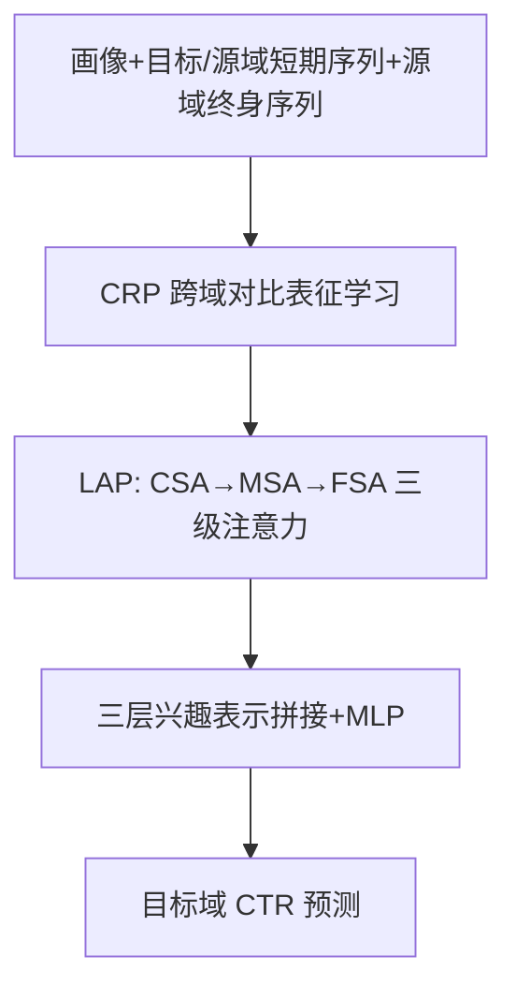
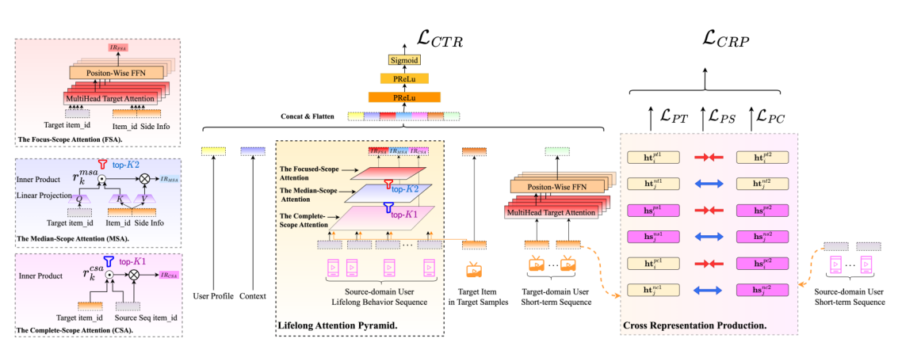
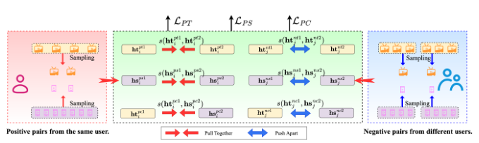

# Cross-Domain LifeLong Sequential Modeling for Online Click-Through Rate Prediction (面向在线CTR预测的跨域终身序列建模)

- **会议/期刊**: KDD 2024
- **作者与机构**: Ruijie Hou, Zhaoyang Yang 等，腾讯微信视频号团队
- **推荐链路定位**: 精排 / CTR 预估（含终身序列 GSU-ESU 式检索与兴趣抽取）
- **研究方向**: CTR/CVR 预估与特征交叉 / 跨域与多场景推荐 / 序列推荐
- **论文原文**: [论文原文链接](https://arxiv.org/abs/2312.06424v2)
- **开源代码**: 暂未开源

## TL;DR (1分钟核心速览)

针对跨域终身序列建模中“目标域直接监督不足以对齐源/目标域物品嵌入、跨域序列噪声更大”的核心痛点，本文提出 LCN：用 CRP 对比学习显式对齐跨域物品表征，用 LAP 三级级联注意力金字塔渐进抽取用户兴趣。在微信视频号工业数据与淘宝公开数据上，LCN-200-50 相对最强基线工业 AUC +0.21%、GAUC +0.39%，公开 AUC +0.33%、GAUC +0.36%；线上 A/B 测试 CTR +2.93%、停留时长 +3.27%。

## Background & Motivation (背景与核心矛盾)

- **主流范式**: 终身序列建模通常沿用 SIM 的 GSU+ESU 两段式：GSU 从长序列中粗筛候选相关物品，ESU 对筛后子序列做精细注意力抽取。
- **前人局限**: 其一，GSU 依赖物品嵌入度量跨域相似度，但现有模型仅用目标域 CTR 损失训练嵌入，源域与目标域物品空间难以对齐；其二，跨域序列比单域序列噪声更大，而 ESU 常受算力约束使用较弱注意力，难以有效过滤噪声。
- **核心洞察 (Key Insight)**: 同一用户短期内在不同域的行为往往反映相近兴趣，因此可用短期跨域行为对构造正/负样本，对物品嵌入施加额外跨域对齐监督；同时，注意力分数高度集中，少量物品即可覆盖主要兴趣。
- **本文切入点**: 以 CRP 对比学习增强 GSU 跨域检索质量，以 LAP 中间层 MSA 衔接 CSA 与 FSA，在保持效率的同时提升级联注意力一致性与去噪能力。

## Method (核心方法设计)

### 1. 整体框架 (Overall Architecture)

LCN 输入包括用户画像、目标域/源域短期行为序列和源域终身序列。CRP 作为联合训练子网络，用域内与跨域对比损失优化物品嵌入；LAP 在源域终身序列上依次执行 CSA 全序列粗筛、MSA 带上下文二次筛选、FSA 多头注意力精抽，并将三层兴趣表示拼接后送入 MLP 预测目标域 CTR。训练端到端联合 CTR 损失与 CRP 损失；推理端不增加 CRP 前向开销，FSA 仅处理小候选池。

<figure class="paper-figure" markdown="span">
  <figcaption>图2：所提出的 Lifelong Cross Network (LCN) 概览。模型包含两个主要组件：(i) Cross Representation Production (CRP) 模块是一个联合训练的子网络，用于学习能够识别跨域相似物品的物品嵌入。(ii) Lifelong Attention Pyramid (LAP) 模块由三级级联注意力组成。这些注意力旨在从跨域终身序列中逐步提取针对候选物品的兴趣表示。</figcaption>
</figure>

### 2. 关键设计拆解 (Key Designs)

1. **CRP 跨域表征生产（Cross Representation Production）**：痛点是目标域 CTR 损失无法让 GSU 在源域长序列中稳定检索跨域相关物品。CRP 从同一用户短期目标域序列、源域序列及跨域各采正对，从同 batch 其他用户采负对，使用三类 InfoNCE 损失；跨域对的核心式为 $\mathcal{L}_{PC}=-\frac{1}{|B|}\sum_i \log \frac{\exp(s(h^{t,c1}_i,h^{s,c2}_i)/\tau)}{\sum_{j=1}^{M}\exp(s(h^{t,nc1}_j,h^{s,nc2}_j)/\tau)}$。直觉是缩短跨域相似物品余弦距离、拉大无关对距离，使 GSU 检索空间可跨域复用。
2. **LAP 终身注意力金字塔（Lifelong Attention Pyramid）**：痛点在于两段式 GSU/ESU 的筛选标准不一致，且跨域噪声使 ESU 易受干扰。CSA 用内积在全序列上粗筛并输出兴趣表示；MSA 将物品上下文 $e_{c_k}$与物品嵌入拼接，计算$r^{msa}_k=\frac{(W_Qe_{v_i})(W_K(e_{h_k}\Vert e_{c_k}))^\top}{\sqrt{d}}$，再取 top-$K_1$；FSA 在更小候选池上用多头注意力+FFN 输出$IR_{FSA}$。中间层 MSA 承担“过渡筛选”，使 FSA 可用更强非线性且保持低延迟。
3. **训练目标、负采样与推理效率**：总损失为 $\mathcal{L}=\mathcal{L}_{CTR}+\lambda_{CRP}(\lambda_{PT}\mathcal{L}_{PT}+\lambda_{PS}\mathcal{L}_{PS}+\lambda_{PC}\mathcal{L}_{PC})$；CRP 负样本为同 batch 不同用户物品对，每类采$M$对，无需额外全库负采样；CRP 只在训练期生效，推理不增开销，FSA 仅处理$K_2$ 个物品。

<figure class="paper-figure" markdown="span">
  <figcaption>图3：Cross Representation Production (CRP) 模块示意图。它采样三类不同的正对和负对。我们引入对比损失，以减小正对中物品之间的余弦距离，同时增大负对中物品之间的余弦距离。</figcaption>
</figure>

## Experimental Setup & Evaluation Protocol (实验设置与评估协议)

- **数据集与预处理**: 未报告 `5-core` 过滤；公开集按 Category ID 划分目标/源域，工业集以直播为目标域、视频为源域。

| 数据集 | #Users | #Items | #Interactions | 稀疏度/密度 | 特征/场景说明 |
| :--- | :---: | :---: | :---: | :---: | :--- |
| Taobao 公开 | >1M | 未披露（Category ID<2000/≥2000 分域） | >2M，7 天 | 未披露 | 短期序列 24，源域终身序列 500 |
| WeChat 工业 | 0.4B | 未披露（视频/直播） | 2B，7 天 | 未披露 | 源域视频终身序列≤2000，目标域直播 CTR |

- **数据划分与防穿越 (Splitting Strategy)**: 两者均按全局时间戳切分，前 6 天训练、第 7 天测试；未采用 Leave-One-Out，也未做冷启动划分。
- **排名评测协议 (Ranking Protocol)**: 点式 CTR 评估，使用 AUC、GAUC、Logloss；不是 Full-Ranking Top-K 排序，论文未报告负采样比例或采样排序协议。
- **对比基线与超参设置**: 对比 SIM Soft、ETA、SDIM、TWIN 及 DSS/BERT4Rec/CLRec/CL4CTR 等；嵌入维度 $d=64$，MLP 公开集 256-128、工业集 512-256，Adam 学习率 0.001，batch 2048；未报告显著性检验。

## Key Experimental Results (实验关键数据)

### 1. 主实验对比 (Main Results)

| 方法 | 工业 AUC | 工业 GAUC | 工业 Logloss | 公开 AUC | 公开 GAUC | 公开 Logloss |
| :--- | :---: | :---: | :---: | :---: | :---: | :---: |
| SIM Soft | 0.7196 | 0.6342 | 0.2356 | 0.6071 | 0.5762 | 0.1629 |
| ETA | 0.7166 | 0.6328 | 0.2373 | 0.6055 | 0.5748 | 0.1630 |
| SDIM | 0.7153 | 0.6330 | 0.2384 | 0.6038 | 0.5734 | 0.1631 |
| TWIN | 0.7212 | 0.6355 | 0.2348 | 0.6087 | 0.5776 | 0.1623 |
| DSS | 0.7242 | 0.6386 | 0.2227 | 0.6107 | 0.5790 | 0.1617 |
| BERT4Rec | 0.7253 | 0.6392 | 0.2224 | 0.6122 | 0.5797 | 0.1615 |
| CLRec | 0.7279 | 0.6398 | 0.2225 | 0.6123 | 0.5799 | 0.1614 |
| CL4CTR | 0.7265 | 0.6386 | 0.2225 | 0.6115 | 0.5791 | 0.1616 |
| **LCN-200-50** | **0.7294** | **0.6423** | **0.2223** | **0.6143** | **0.5820** | **0.1610** |
| **LCN-500-100** | **0.7297** | **0.6425** | **0.2220** | **0.6145** | **0.5820** | **0.1610** |

相对最强基线 CLRec：工业 AUC +0.21%、GAUC +0.39%，公开 AUC +0.33%、GAUC +0.36%；LCN-500-100 与 200-50 几乎持平，说明扩大候选池收益有限。

### 2. 消融实验 (Ablation Study)

| 变体 | $K_1$|$K_2$ | AUC | GAUC | Logloss |
| :--- | :---: | :---: | :---: | :---: | :---: |
| w/o CRP | - | - | 0.7237 | 0.6379 | 0.2330 |
| w/o $\mathcal{L}_{PC}$（仅域内对比） | 200 | 50 | 0.7250 | 0.6391 | 0.2290 |
| w/o LAP（仅 CRP） | - | - | 0.7266 | 0.6401 | 0.2296 |
| w/o MSA（$K_1$=-） | - | 50 | 0.7297 | 0.6424 | 0.2222 |
| w/o FSA（$K_2$=-） | 50 | - | 0.7266 | 0.6388 | 0.2246 |
| Full LCN-200-50 | 200 | 50 | 0.7294 | 0.6423 | 0.2223 |

### 3. 关键实验发现 (Key Findings)

- **CRP 的跨域对是主要增益源**：去掉 $\mathcal{L}_{PC}$ 后 AUC 从 0.7294 降至 0.7250、Logloss 从 0.2223 升至 0.2290；将 CRP 插入 TWIN 也从 0.7212 提至 0.7265，说明其收益不依赖单一 LSM 主干。
- **LAP 的主要价值在一致性与效率**：w/o MSA 的 AUC 0.7297 仅比完整版高 0.0003，属噪声级，但 MSA 将 $K_1$之后候选池大幅收窄，使 FSA 可用多头注意力；$K_1,K_2$ 超过前层约 1/4 后性能趋稳，200-50 与 500-100 接近。
- **工业收益显著、线上成立**：线上 7 天 A/B 取得 CTR +2.93%、停留时长 +3.27%，推理延迟仅 +3ms；公开集提升较小，作者归因于其序列更短、数据量更小。

## Highlights & Limitations (亮点、对比与审稿批判)

- **与代表作对比 (vs. Prior Work)**: SIM 只做 GSU/ESU 两段式，未显式处理跨域嵌入错位；ETA/SDIM/TWIN 侧重哈希、维度压缩或端到端一致性，仍主要依赖目标域监督；CL4CTR 类对比学习需较大嵌入表/三元组管理，LCN 改用同 batch 跨域对，训练后推理零额外开销。
- **可迁移亮点**: “跨域短期行为对做 in-batch 对比对齐”可前置于任意 GSU；三级注意力“逐层筛选+全层拼接”兼顾梯度传播与低延迟。
- **审稿级局限批判**: 工业数据闭源且无开源代码，复现与公平比较受限；仅报告点式 CTR 指标，未说明负采样/全库排序协议、未做显著性检验，且对 CRP 正对构造所依赖的“短期兴趣稳定”假设缺少敏感性分析。

## Rating (四维评分)

- **方法创新性 (Novelty)**: ⭐⭐⭐⭐（跨域对比表征与三级注意力金字塔的组合有明确增量，机制直观但理论分析较浅）
- **评估协议与实验扎实度 (Protocol & Experiments)**: ⭐⭐⭐（公开+工业+线上 A/B 较完整，但缺少排序协议、显著性检验与代码复现）
- **写作与数学规范度 (Clarity & Rigor)**: ⭐⭐⭐⭐（公式与模块职责清楚，部分消融数字与文字结论存在细微张力）
- **工业落地与复现价值 (Industrial & Practical Value)**: ⭐⭐⭐⭐（推理仅 +3ms、CRP 不增推理成本，工业价值强；复现受闭源数据限制）

